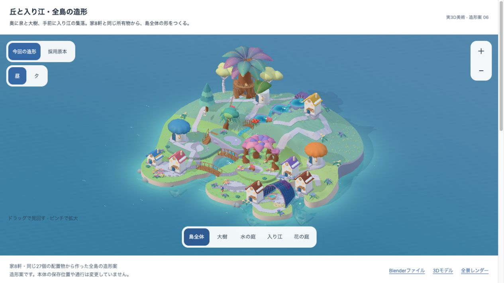

# 同じ所有物から作る全島の造形

2026-10-11。利用者「美術やって」「続けて」を受けた、全島の実3D造形。画像生成は使わない。採用native-05を美術の原本とし、現行の成熟診断と同じ家8軒・配置物27個・収納2個を固定して、丘・入り江・場所の大きな形を先に詰める。

[回転できる実3D](index.html)、[編集可能なBlender](whole-landscape.blend)、[GLB](whole-landscape.glb)、[全景レンダー](whole-landscape-render.png)。本体A6の実画面と並べて、家を増やす前に地形・密度・空間の差を確認する。



最終造形は`native05-landscape-owned-art-v6`。GLB SHA256は`b768b085afd83bbe5f31415d91adb9be3bde2611786ca65917c0ed7f0f2454f3`。2,560 meshes / 1,275,347 triangles / 46,361,832 bytes。これは編集用の全美術モデルであり、本体のモバイル配信予算を満たしたassetではない。

## 制作順序

1. 入り江の切り込み、背後の丘、泉の三段を全島の輪郭として置く。
2. 同じ家を小さなまとまりに寄せ、大樹の回廊・花の部屋・貝の集会所へ入口をつなぐ。
3. 四本の木、四株の花、三つの水ばちの共同形を、元の所有IDへ対応させる。
4. 原本の葉・木・瓦・鉱石・透ける殻を同じ日の光で確認する。白さや光の量で幻想性を補わない。
5. 全景・390幅・768幅で本体A6と原本を比較する。造形を固めてから、床・足・配置hit・道を共有する実装へ進む。

## 転写するものと境界

| 転写 | 今回の境界 |
| --- | --- |
| 深い湾、細い岸、背後の丘、流れの高低差 | 美術モデルの地形。本人の取得済みセルへ切り込む実装はまだ行わない |
| 元の材質と形、本人の成熟段階・屋根色 | 家の実meshは現行kitの描画関数から作る |
| 地区ごとの密度、対角に抜ける水面、曲がる道 | 保存セルは変更しない。造形案のanchorは保存位置と異なる |
| 接続した同じ所有物からできる共同形 | 巨木・花弁・段泉・貝の派生構造に構成IDを残す |
| 地面に沿う低い草と小さな花 | 原本の景観植生。追加の成熟した購入木・家・人物として数えない |

この造形は美術確認用であり、現行GrowingWorldの床・通行・配置・育成の対応を証明するものではない。同じ所有IDと個数を用いるが、保存セルの連続変形として成立済みとは扱わない。配置anchor・地形・道は造形案であり、元の隣接関係から自動的に投影したものではない。本体A6の検証結果をこの別モデルのruntime PASSに流用しない。通常productionの美術flag既定falseと学習・所有・成長時計は保持する。

## 次の実装で先に確かめるもの

大樹だけを移す変更へ戻らず、地形の一つの共有写像を先に試作する。保存セル→実床、実床→配置hit、歩行の分数位置、道の各頂点、入口・水面・岸を同じ写像へ通す。全ての取得済みセル、連続する隣接経路、家の接地と入口、回廊の実足を検査する。深い湾へ既得床を消す案や、保存座標を無断で並べ替える案は採用しない。

今回の自由なanchor配置をそのまま既存保存の描画位置へ写すと、隣接と通行が変わる。そのため、原本とこの全景を形・材質・密度の基準として、既存の接続規則で成立する地形と配置を別に確認する。地形と実利用が一緒に成立した島を見てから、美術の本体転写を広げる。

独立した子どもの無説明理解はN=0。本体への到達、美術の作者確認、独立理解/安全、runtimeを分けて記録する。

## 今回の造形と確認

- 同じ所有IDで8軒の家を原本の丘・花の庭・湾へ置いた。家の実surface頂点を一様な拡大と移設を除いて許容差0.00001で双方向に照合し、meshのtriangle数、色、style、成熟、屋根色、元保存セルmetadataを保持した。[実検査](artifact-check.json)、[家の実meshを重ねる図](house-surface-overlay.svg)。原本の小屋は別に1軒。
- 大樹の空洞幹と回廊、鉱石から下る三段泉、色を透かす貝屋根を原本から保持。四本の木・四株の花・三つの水ばちの共有造形へ構成IDを残す。自由なanchorは実隣接や通行の証拠にはしない。
- 家8軒の閉じた接地台、家具の足、道の両端と幅方向を実地形とcourt上面へ沿わせた。凸の丘を道のquad中央が突き抜ける欠けは幅方向の細分と明示triangleで修正。[水の庭の実表示](water-garden-preview.png)。
- 元の住人の顔・UV・布を変えず、ぽこもこ・ウサギ・キツネの3体だけを原本から平行移動して見せる。この数を本人の診断住人数8へ偽装しない。植生は元の低い草と小花の景観で、追加の成熟した購入木として扱わない。
- 390×844 / 768×1024の全景と4近景、昼夕、44px touch target、拡大、矢印/Home、同じcameraでの原本切替を24実画面で確認。rendererへ渡す実GLB bytesのSHAを直接計算し、QA開始/終了の8美術入力とrunnerのhashを固定した。[原記録](verification-v6/report.json)、[全画面の一覧](contact-sheet.html)、[in-app browserでの確認](manual-viewer-proof.json)。

[判定](gate-review.json)は美術46/60（作者のみ、HOLD）、独立した理解/安全N=0、本体runtimeは未接続。standaloneの表示検査とファイル整合だけPASS。左の森の密度、人物同士の暮らし、自然な成長の見え方は未到達で、全島目標の達成として閉じない。本体A6の美術41/60・HOLDとruntime PASSは別候補の記録を保持する。

原本と提案を同じcameraの[64px黒シルエット](silhouette-proof.json)でも確認する。新提案は3Dの描き直しで、生成画像の修整はしていない。[途中稿と最初のFAIL](history/README.md)は履歴に残し、最終v6の証拠に流用しない。ページの比較は本体の実WebGL画面とBlender Cyclesレンダーであり、照明を揃えた定量比較ではない。造形同士の同camera比較は3D表示の「採用原本」を使う。

## 再制作と表示検査

```bash
node tools/export-landscape-owned-art.mjs
/Applications/Blender.app/Contents/MacOS/Blender --background --python docs/design/2026-10-11-island-landscape-art/build-landscape-art.py
node tools/build-landscape-art-viewer.mjs
node docs/design/2026-10-11-island-landscape-art/check-artifact.mjs
SANSU_LANDSCAPE_ART_URL=http://127.0.0.1:8230/design/2026-10-11-island-landscape-art/ SANSU_LANDSCAPE_ART_OUTPUT=/tmp/sansu-landscape-new-qa node tools/qa-landscape-art-viewer.mjs
```

QAの出力先は未使用のdirectoryを選ぶ。全景を変えた場合は現在のgateや24画面を新候補のPASSへ流用せず、造形から見直す。`make-review.mjs`はv6に固定した作者判定と当時のlogを記録するためのsourceで、次候補の自動採用には使わない。

今回のcloseoutは`docs:check`・`lint`と上記美術検査。[app入力の不変](app-source-unchanged.json)をA6のsource closureと照合したため、core/学習/SWを新モデルの検査として繰り返さない。[検証matrix](../../ai/verification_matrix.md)に従い、本体の床写像へ入る時点でGrowing/保存/PWAの検査へ戻る。`lint`は既存のFast Refresh警告1件、`docs:check`は既存のReview By警告12件を残してPASS。共有checkoutの結果と、commit対象をexportした文書検査の結果は分けて保持する。
