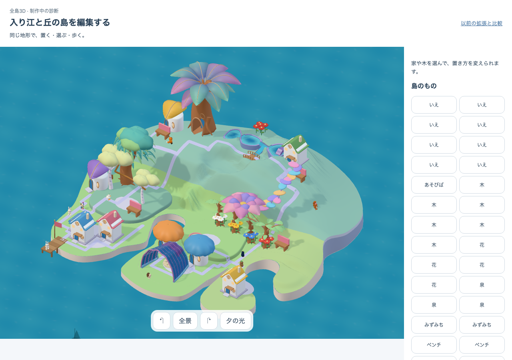
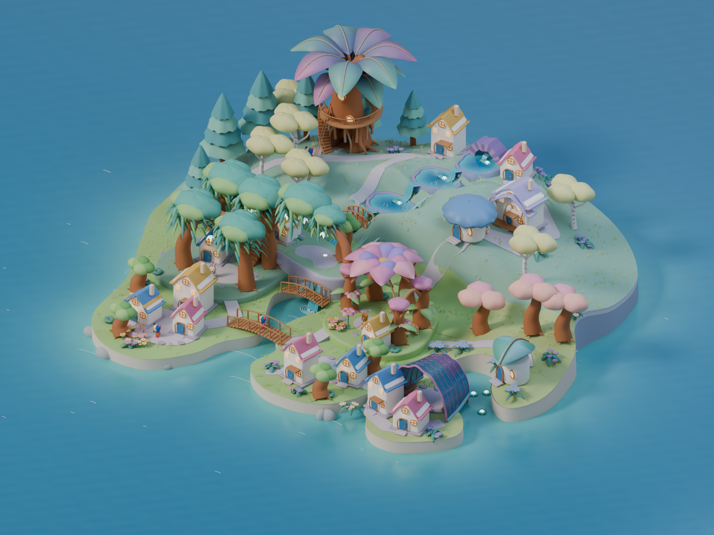

# 全島の森の面 — 次の構図の調査

2026-10-12。**調査のみ・次のapp実装は未着手。全島美術はHOLD。** 元の73取得権、32所有物の位置・個体・成熟、現行app/source/fixtureは変更していない。以下の36所有物は、通常commandを純粋計算で使った仮の取得・成熟診断であり、本人の取得・学習・保存の実績ではない。

[構築方針v8](../../product/island-construction-strategy.md) §M1/§5に従い、局所の枝・回廊より先に、森林の面・中央丘・水庭・集落・余白の全島構成を扱う。[共通世界契約](../../product/island-world-contract.md) §M1は、元の所有と土地を保つ明示合成状態への通常取得・`advanceNature` 診断を認める。同じ所有物・成熟で比較するM2と、M1の一例を32所有物に固定することは別である。

## 見た全景と不足の原因

| 実c2・32所有物 | 採用native-05 |
| --- | --- |
|  |  |

c2は入り江の矩形台座を解消しているが、中央/右丘の裸地が大きく、左の森も独立した少数の樹冠として見える。採用原本では左前景のwillow、後方のspire/birch、大樹、水庭の余白が重なり、樹冠が森林の面を作る。

主因は所有本数と配置、共有形の構成である。`tools/build-native-growing-kit.mjs` は個体willow 97mesh、birch 13mesh、spire 5meshを抽出しており、各個体の樹冠を大幅に欠落させた結果ではない。現在8本のうち、l10–l13は `nativePlaceGrove.ts:18` のcompact P02条件で一つのhollow-trunk/fan-crownへ集約され、l14/l15/l28/l29は同file:52の個体表示になる。採用原本の周囲の森林量を、そのまま8所有物へ読み替えることはできない。

同じ所有物で回復できる部分は、4支持株を保つ共同forest、元sourceの短い接続枝、元の入口・席とつながる場所の厚みである。原本のlocal archやgalleryを足すだけで、支持のない中央丘全域を長い樹冠で覆う案は採らない。現在のauthored galleryは実床・通路が未実装で、既存source gallery幅約0.320は実actorの余裕込み幅約0.568より狭い。

## 既存73権利内の限定4本案

これは最小の**初回比較候補**であり、全島構成に十分な最小本数を証明したものではない。新IDのspeciesは `treeForm` の保存ID由来で固定し、再抽選していない。

| 新所有ID | source species | 最終セル | 構図で試す役割 |
| --- | --- | --- | --- |
| l33 | willow / spread | (6,-7) | 左の森と水庭の間の丘肩 |
| l34 | birch / branch | (12,-5) | 右の中景。通路を切る(13,-5)から通常move |
| l35 | spire | (12,-9) | 右奥の縦の輪郭 |
| l36 | willow / spread | (10,-7) | 右丘の樹冠と水庭の枠 |

`place sapling` 4回、各20drops、合計80。`advanceNature` を18時間進め、各木はgrowth18のmatureになった。元のbankは0。残高9230→9150、32→36所有物、8→12本の木、8軒は不変。元の所有物レコードと全73取得権は一致。追加l34だけの無料move後もspecies/成熟は同一。[取得・移動結果](raw/clearance-result.json)、[仮状態](raw/four-layer-clearance-state.json)。

水庭と入り江を含む `authoredWorldFrame`、同じ `sceneLayout`/`buildObjectLayer`、実GLTFLoader/kitを使った。P02:p3 cluster、P02:p4 freeform、P03、P04、P05はgrownのまま。新しい孤立木のP01はseededであり、4本だけで新しい成熟forestになったとは扱わない。

### 棄却と最後の通過の範囲

- 最初の4本案には(3,-4)、(7,-10)が含まれ、主経路/P03を損なった。[初回結果](raw/result.json)を保持。
- 後の4本案 `(6,-7),(13,-5),(12,-9),(10,-7)` は通常domainだけでは全ownerへ接近できたが、既存の実花/殻/木を含めるとp6/p7/p8/p9等へ届かなくなった。[失敗の実mesh結果](raw/physical-screen.json)。新しい木のgeometryを除外しても失敗するため、主因は新しい占有セルと既存障害物が作る経路の切断だった。[切分け](raw/isolate-screen.json)。
- `(13,-5)` のl34を除いた場合だけ新たな接近不能が消えることを確認し、同じl34を `(12,-5)` へ通常move。最後の[実mesh結果](raw/clearance-physical-screen.json)で既存ownerの新たな接近不能は0。P02の家p3=9/p4=5、P04 p6=2/p7=7/p9=6の接近点を維持した。新4本と家のworld AABBは全組非交差。
- baselineでも **l14の接近点は0**。追加案の新規回帰と分けて残す。solidな木・水・花の中心へ直線で進めないことを、家/席/playへの接近不能と混同しない。

実装 `authoredFlowerObstructions.ts:14` の対象rootは花/殻のみで、groveはまだ含まれない。本診断では実tree/shared-tree/branchを一時的にeligible root名へ変更して三角形をindexへ入れた。これは**診断上の追加**であり、appが木を避けて歩ける証明ではない。全treeを含めたbaseline 211,560三角形→候補277,176三角形、reachable refs 1,380→1,267。実actorのradius0.244069、height0.550093、余裕込み半幅0.284069。c1とc2の実capture envelopeは完全一致した。[identity](raw/actor-envelope-identity.json)。

## 4本だけでは完成にならない根拠

source scale .45のwillowは幅1.697×高さ2.649×奥行1.345、birchは1.497×1.906×1.141、spireは1.151×2.240×1.151。全個体は元sourceの比率を保つ。l33とl36の樹冠のworld x boundsの間には**2.303**の隙間が残る。4本が経路を保っても、中央を埋めるforestの面を作るとはいえない。候補4本を描いた全景は未撮影であり、ここにあるc2画像は元32所有物である。

中央丘の9点 `(x=7..9,z=-7..-5)` を現water+cove合成worldで確認した。[9点の生結果](raw/central-contract-screen.json)。全点 `owns=false`、全点 `hasAuthoredPlacementSupport=false`。既存の歩行点を取得権へ転用できず、単にplacementをtrueにするだけでも通常配置は成立しない。半幅0.46の支持検査が見る高差は、例えば(8,-7)で約0.306、(8,-6)で約0.871となり、現行許容0.28を超える。権利だけでなく丘肩の実支持・接続が必要である。

## 優先する最小の次工程

**中央丘の肩を、実支持と購入可能な地点・入口を持つ一つの地区として設計する契約を先に決める。** 次の成果物は、局所archの仕上げではなく、森/丘/水/家を一緒に決めた編集可能な全島の構図案と、その支持・購入・経路の小さな実行例とする。

1. 元73権利、既存ownerのID/成熟/セルと既得支持を保存境界として固定する。採用native-05とc2原本は保持し、新しい地形/sourceを別versionで制作する。未取得の丘肩を変える場合は、旧床との接続・単一描画・既存水庭とP04への歩行帯を同じworldで定義する。支持だけの隠れた床、浮いた木、自由art anchor、背景植栽は使わない。
2. 新地区の取得地点・支持面・入口・価格・解放・購入履歴を共通世界と52/保存13の契約へ定義する。現 `commands.ts:71` はauthored worldでexpandを拒否するため、現在の通常購入で中央を取得済みと偽れない。実装前にこの不足を埋め、元73権利を減らさず追加取得だけを記録する。
3. その上で、追加の木を通常取得/成熟から配置し、中央に連続する樹冠と水庭の抜けを全景で比較する。既存木の移動案を比較するなら仮状態への通常moveと復元履歴を使い、本人保存を自動で並べ替えない。現在の固定位置保持という本調査の範囲とは別の比較である。

P02の4支持株を一幹へ集約する現分岐の改稿は、この全島構図に合わせて設計する。元species/年齢の4幹、源となる枝と支持を残す共同forestとして、複数の樹冠と通れる内側を作る。ただしこれだけで中央の未取得・未支持領域を覆えないため、土地/支持の契約より先に局所完成へ進めない。元sourceの短いarchを足す作業はその後の候補である。

## 証拠・再現・未検証

- [archive-manifest.json](archive-manifest.json)にコピー元、保存先、copy前/保存後/元file再読込のSHA256を記録。全コピー一致。各生probe JSONはimportしたapp/source/fixtureの開始/終了hashを保持し、最終probe・9点probeとも一致。
- c2画像と[raw shape report](evidence/c2-shape-report.json)はrootの既存成果物をそのままコピーした。URL、build/delivery/visual identityはreportを参照。本調査はbrowserを起動せず、c2のapp/sourceを変更していない。[元32所有物fixture](evidence/baseline-32-owner-fixture.json)も保存。
- `raw/` のscriptsと失敗結果は変更せず保存した。scriptsには当時のrepo/tmp絶対pathがある。再実行する場合はhashで一致する入力を隔離し、当時のtmp入力を復元する必要がある。現在のHEADだけで当時の未commit入力を復元できるとは扱わない。
- 元のprobe stdoutはtool sessionへ出力され、stdout fileは保存していなかった。生JSONをbyte-for-byte保持し、[report-extract.log.txt](report-extract.log.txt)はその事後抽出であると明示した。stdoutを後から再実行したログに置換していない。[archive.log.txt](archive.log.txt)は今回の保存作業の記録。
- 新規4本の全底面支持、全actor pose/利用/退出、preview/commit、move/store/reconnect実演、gallery、保存/PWA、自然の本人取得・実時間成熟は未検証。今回の診断から全島美術・実app統合・M1完成・M2移行を認めない。

## Doc Sync Report

- Change type: 調査証拠の保存。app/仕様挙動の変更なし。
- SSOT update needed: 現段階はNo。既存のM1診断契約内。土地取得の次工程を実装する際は52/共通世界/保存13の先行更新が必要。
- Required update: 本READMEと生証拠。
- No-change justification: memory/ADR/現行仕様を、この未採用の座標案や未実装契約で上書きしない。
- Verification: アーカイブhash照合。docs:checkの結果は [docs-check.log.txt](docs-check.log.txt)。追加のbrowser/coreは実行しない。
