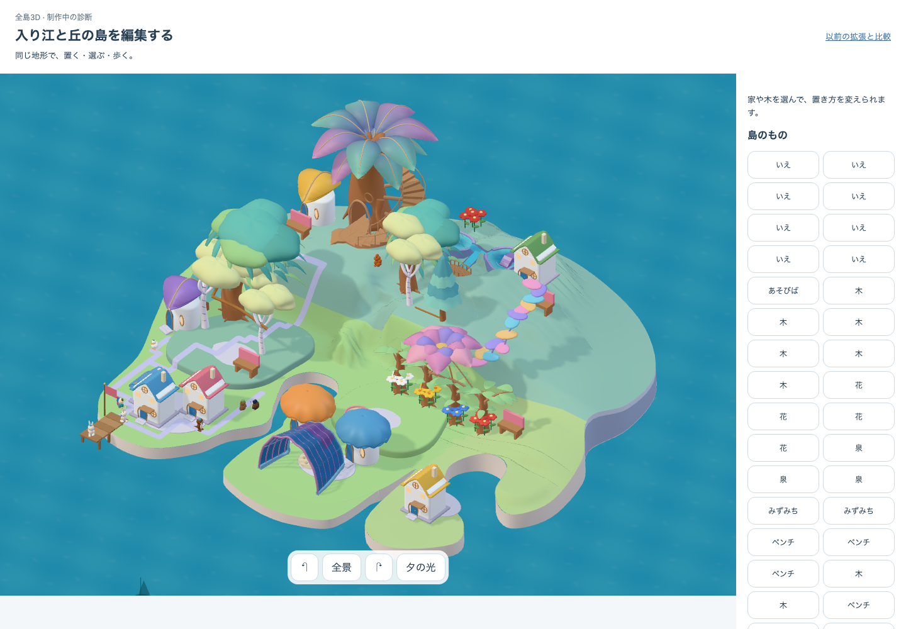

# 成長に応じた組立て — c6 と後続キャッシュ修正の証拠

**全体は未完了。** 森林の原形を固定4所有者・座標への差し替えから、成熟した同樹種の木の現在位置・成長時の変換へ追従する形へ一般化した。次の優先事項は、所有する地区を組み合わせ、育ち方に応じて地形・輪郭・接続が変わる島の構築である。この記録は地区取得、可変地形、M1完成の証拠ではない。

## 証拠の範囲

| 記録 | 確認できたこと | 確認できていないこと |
| --- | --- | --- |
| c6 core | `verify:core` exit 0、615 files / 5327 tests、6,550入力の固定 | **後続キャッシュ修正は含まない** |
| c6 初回UI | 島が描画された失敗時PNGを保存 | `whole-load` の ready が90秒で timeout。完了steps 0、成功captures 0。移動・収納・復帰の証拠なし |
| 別途の c6 identity 読取り | 7森林所有者 `l14/l15/l28/l29/l33/l34/l35`、host/world revision一致 | 編集の成功や通行保証ではない。実obstruction telemetryは13/35到達可能、22到達不可 |
| cache1 の同じ東岸4移動 | 3GiB heapのまま exit 0、51.004秒。35所有物・75権利・成熟・他31所有物を保持 | browser、実メッシュ通行、全3配置、美術、性能のPASSではない |
| focused cache tests | 9件PASSとの worker terminal 5835 の報告をrootが確認 | durable raw logは未取得。この保存作業では再実行していない |

c6 targetは `http://127.0.0.1:5363/prototypes/place-qa/authored.html?art=whole`、buildは `growth-assembly-c6`、candidateは `native05-growth-assembly-v1`。identityのapp versionは `growth-assembly-c6:52f0447d-9bbf-4b4f-844c-f77ceeeb3a08`。数値の抽出は [evidence-summary.json](evidence-summary.json)、原記録は [core report](c6/core-report.json.gz)、[core log](c6/core-execution.log.txt)、[初回UI report](c6/runtime/report.json)、[identity](c6/identity.json) に保存した。

## 実装と後続修正

森林factoryは樹種に合う原形を選び、実際の native tree 行列と原形の逆行列で配置する。元所有者ID・セル・年齢は由来情報となり、同じ固定座標への一致条件ではなくなった。若木は対象外で、元kit・pivot・所有地・床の条件と共有resourceの寿命を保持する。原形自体の美術判定はHOLDのままで、galleryや新地区の汎用構築をこの変更から推論しない。

後続修正は `authoredWorldFrame` と `authoredWaterFrame` が保持する過去frameを、新しいframeの生成前に解放するもの。表示中のcommitted/preview frameは利用側が保持する。森林factoryとdelivery testはc6 coreのSHAと一致し、2キャッシュmoduleはc6以後に変わっている。[4ファイルのSHAと比較](source-fingerprints.json)、[原形factoryの保存copy](source/nativeAuthoredForest.ts.txt)、[cache入力差分](cache1/input-changes.json) を参照。c6 coreを最新キャッシュの全core証拠に流用しない。

## 東岸4移動の結果

同じ成熟35所有物fixtureから、通常 `applyIntent` で `l14→(12,-9)`、`l15→(12,-8)`、`l28→(12,-7)`、`l29→(12,-5)` を順に実行した。各移動で現在の合成worldの `canPlace` と床支持を使い、新しい土地や所有者は足していない。4本ともgrowth 18、最終配置支持true。`P01:l14` は3本＋bench l26の grown/alcove、`P01:l29` は seeded/alcove、`P02:p3` は grown/clusterとして残る。

最終domainグラフは open 1,454 / reached 1,414、35所有物すべてに少なくとも1つの到達接近点がある。ただし、この計測は木・冠・galleryの実三角形や全actor幅を含まない。c6実画面の22所有物通行不可を解消した結果とは扱わない。[実行結果](cache1/execution-result.json)、[4移動・places・pathの原結果](cache1/east-shore-line-result.json)、[最終state](cache1/east-shore-line-state.json) を保存した。51秒はこの一回の処理時間であり、性能合格基準ではない。

以前のまとめ解析のOOMと、Aの31所有物接近不可、Cの未完了は取り消していない。[旧summary](prior-layouts/summary.json) と [旧README原文](prior-layouts/README.md.txt) はその時点の記録。後続cache1はBの4移動だけを補ったもので、全3配置やUI journeyをPASSに変えない。

## 保存方法

[archive-proof.json](archive-proof.json) に原path・コピー前後SHA・保存SHAを記録した。大きなcore JSONと再現用domain bundleのみ決定的gzip（mtime 0）とし、展開後bytesは原本一致。旧READMEは相対リンクの原文を変えず `.md.txt` として保管した。cache1の実行script・入力SHAを含むresult・[source closure bundle](cache1/domain-bundle.mjs.gz) を保存し、元の絶対pathを含むscriptを書き換えていない。本作業は読取りと証拠保存のみで、追加test・browser・buildは行っていない。
