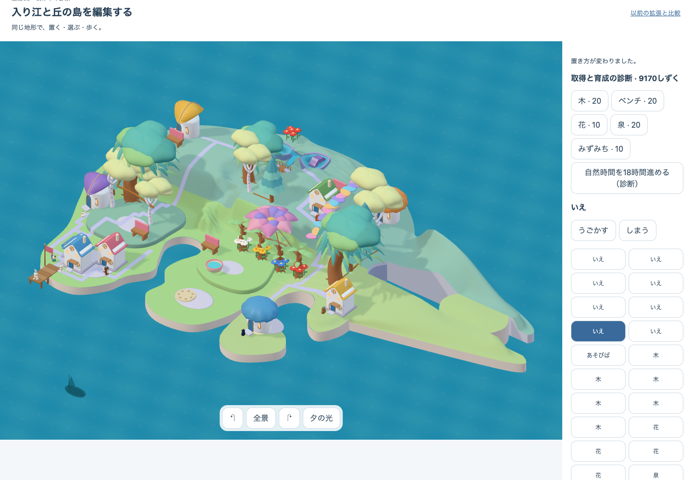
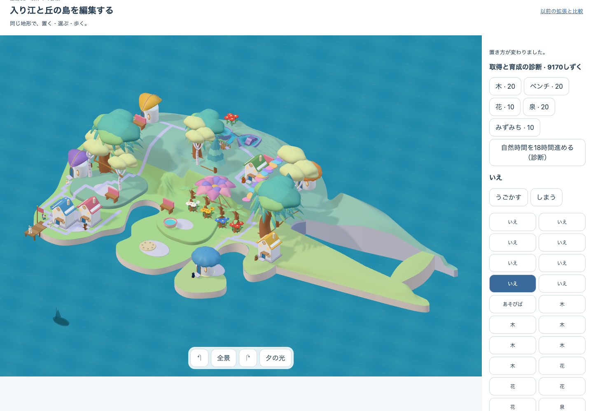

# 開いた入り江・粗い本体 v1 — 実画面判定

## 結論

**輪郭差は GO、魅力の完成は HOLD。** 旧案の「右へ伸びる一枚の岬」から、二本の腕、水面の負形、先端の細い接続を持つ輪郭へ変わった。同じ家8軒・成熟木4本・診断上の所有物35個を使い、北→東→入り江の三配置、分離、復元、回転、小画面を実アプリで通した。

この成果は方向を選ぶための DEV 診断であり、通常配布や美術完成の証拠ではない。生地形の面積が広く、先端の接続も地形の帯に見えるため、採用後は空間の用途、段差、橋らしさを作る必要がある。

## 実画面の比較

| 旧案：一枚の岬 | 新案：入り江と細い接続 |
| --- | --- |
|  |  |

- [新案を回転した実画面](./rotated.png)
- [スマートフォン幅](./phone.png)
- [タブレット幅](./tablet.png)
- [北側だけの段階](./north.png)
- [東側だけの段階](./east.png)
- [最終形を分離した状態](./separated.png)
- [分離後に復元した状態](./loop-restored.png)

## 固定した対象

- 実アプリ対象: `prototypes/place-qa/authored.html?art=whole&terrain=core`
- 配布状態: `DEV diagnostic`。通常島・本番配布への切替なし
- visual candidate: `native05-open-inlet-rough-v1`
- catalog revision: `735a6a219cb2efc079ba66766247adce3461fdb930fc95355ed48874b49985b0`
- build revision: `open-inlet-rough-v1-735a6a21`
- 固定入力: [focused preflight](../2026-10-13-open-inlet-rough-v1-focused-preflight.json)
- 実画面検査: [report.json](./report.json)

## 判定ゲート

| ゲート | 判定 | 根拠 |
| --- | --- | --- |
| 全島の輪郭差 | GO | 旧案の一枚の岬に対し、二本の腕と内部の水面が全景・回転・小画面で読める |
| runtime integrity | PASS | 固定source一致、北・東・入り江、分離・復元、回転、390/768幅を実ブラウザで完走 |
| 所有・配置の保持 | PASS（診断範囲） | 同じ家8軒、成熟木4本、所有物35個。三配置で所有内容を変えず、実床・配置支持を照合 |
| 視覚的な魅力 | HOLD | 生地形が長く空き、段差・用途・橋の造形が未制作。粗い構成判断には足りるが美術採用には足りない |
| 無説明の理解・安全 | HOLD | 独立観察 `N=0`。入り江と橋として子どもに伝わるか未確認 |
| 通常体験・配布 | HOLD | 通常取得、本人保存、学習往復、offline/update、16/32軒、実機性能、公開は今回の対象外 |

## 検証

- source/domain check: `north`、`east`、`loop` が PASS。最終 `loop` は追加・到達可能地点334、outer routeあり。
- focused integration: 1 file / 1 test PASS、397,423 ms。同じ8軒・4成熟木、三配置、全床・配置支持、renderer geometry、分離・復元を確認。
- actual-app E2E: PASS。固定候補、既存成熟島、北、東、入り江、分離、復元、回転、小画面を順に検査。
- 失敗も保存: 最初の粗形は東腕が既存地形に重なり source check が拒否。東腕の曲げだけを戻した。最初の E2E 起動は sandbox のブラウザ権限制約で候補読込前に停止し、権限付きの同一入力で再実行した。

## 次の判断

利用者がこの輪郭方向を採用した場合だけ R3 へ進む。次は装飾を増やす前に、単独→接続→成熟→住人の利用→分離→復元の一旅程と、入り江内部・外周接続の用途を一つずつ成立させる。採用しない場合は、この候補を磨かず輪郭戦略へ戻る。
