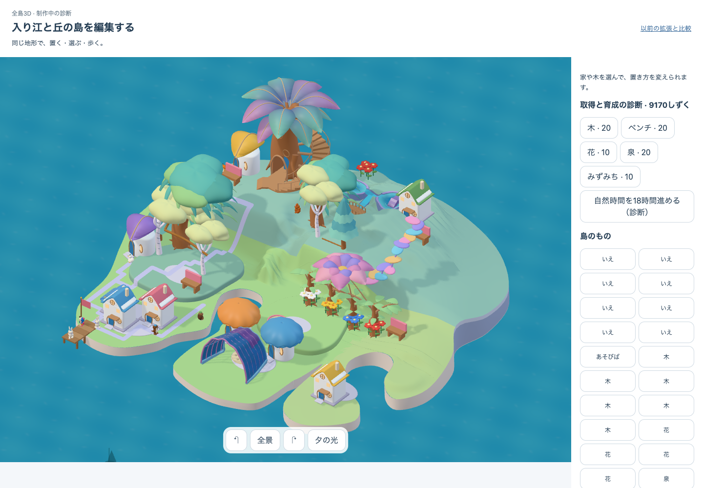
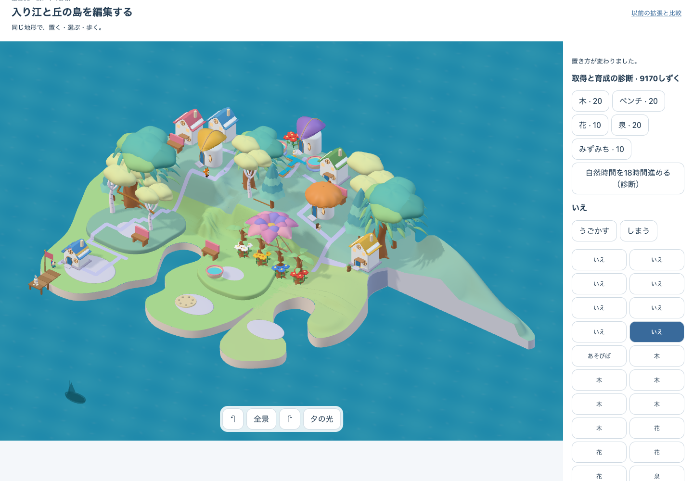
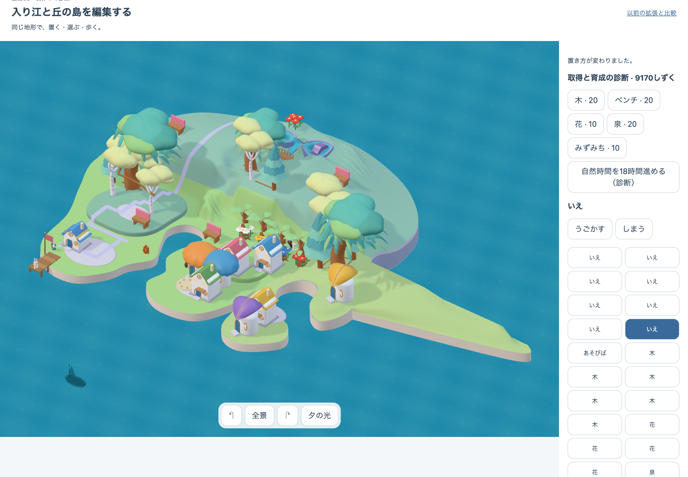

# Whole-island layout rough v3 / c2

## Outcome

- Rough composition comparison: **PASS**
- Runtime integrity: **PASS** (`report.json`: `pass: true`, `sourceFixed: true`)
- Release / finished-art acceptance: **HOLD** (outside this diagnostic)

The same diagnostic island was rearranged through visible controls into three deliberately coarse layouts. All three keep the same 35 owners, the same eight existing homes, and the same four existing mature saplings. No district or item was acquired.

## Runtime identity

| Field | Value |
|---|---|
| Actual app target | DEV diagnostic surface: `/prototypes/place-qa/authored.html?art=whole&terrain=core` |
| Delivery flag | DEV-only comparison; no production delivery flag or normal save rollout |
| Layout candidate | `native05-whole-island-layout-rough-v3` |
| Build revision | `core-growth-layout-rough-v3-c2-c8c18ef4` |
| Runtime visual candidate | `native05-growth-assembly-v1+source-shading-v1` |
| Catalog revision | `c8c18ef4a7f2378b5f328a887814345bd429c17624d4956bd961c1880fd1dd37` |
| Browser renderer | Three.js r185, WebGL 2, ANGLE Metal / Apple M4; no context loss |
| Focused preflight | [`../2026-10-13-whole-island-layout-rough-v3-c2-focused-preflight.json`](../2026-10-13-whole-island-layout-rough-v3-c2-focused-preflight.json) |
| Raw runtime evidence | [`report.json`](report.json) |

## Critical-path contact sheet

| Baseline | North shoulder | East cape | Connected loop |
|---|---|---|---|
|  |  |  |  |

## Visual gates

| Gate | Verdict | Evidence |
|---|---|---|
| Whole-island silhouette | **PASS** | North extends as a high right shoulder; east becomes a broad low cape; loop exposes two connected right-hand prongs. The outer read changes before inspecting individual props. |
| Major height structure | **PASS** | North carries the settlement over the raised shoulder, east concentrates it along the low shore, and loop combines the high and low masses. |
| Main paths | **PASS** | North climbs and crosses the ridge, east converges on the low settlement, and loop splits between western, northern, and eastern groups. |
| Forest / home grouping | **PASS (rough)** | North forms a ridge settlement, east forms one dense low cluster, and loop separates homes into multiple groups around a vertical tree line. The four moved trees are read as part of the forest mass, not as individually labelled objects. |
| Silent comprehension / safety | **PASS for this diagnostic** | All 35 owners remain reachable on dry/valid approaches, no loss or punitive feedback is introduced, and the three arrangements are visually distinguishable without explanatory copy. Independent child observation was not run. |
| Runtime integrity | **PASS** | North → east → loop ran cumulatively through the real shared renderer; ownership hash stayed `12bc6d812b913b4c30c7a34a86d95a242d96e1dad81a70ece2a50b90ebfcc686` after preparation; separation and loop restoration also passed. |

## Scope boundary

This bundle proves a coarse same-material layout comparison in the DEV diagnostic. It does **not** approve finished island art, normal save behavior, learning round-trips, 16/32-home scale, natural time observation, offline/update behavior, actor-use acceptance, device performance, or production delivery.

The earlier failed v3 run is intentionally preserved separately in `../2026-10-13-whole-island-layout-rough-v3-runtime/`; this c2 bundle does not overwrite it.
