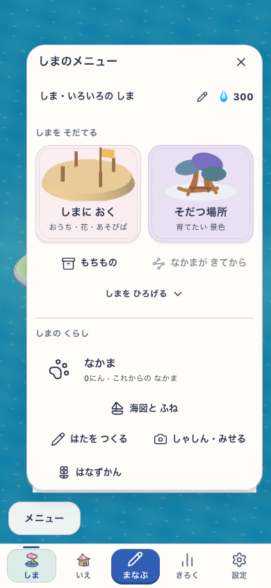

# 島メニューと置くものの整理 — 検証

2026-10-19 JST。利用者の「島を育てる・操作・ページ移動が混在している」という指摘と、Firefox上の[島画面再設計案](https://chatgpt.com/c/6ad53525-5898-83e8-b607-becbc3ff6e11)のフィードバックに基づく。

## 対象と契約

- 対象: ローカルGrowing本体、`/#/island`、`VITE_ISLAND_ENABLED=true`、候補 `island-purpose-menu-v1`。公開版ではない。
- 育成（置くもの／そだつ場所／もちもの／橋・拡張）、暮らし、ながめ、本人と音などの操作を分ける。家・記録・設定は既存5タブへそろえる。
- 配置一覧は新しい品と収納品を分け、品物で分類する。新規の家・畑・遊び場は結果の名前を先に示す。学習時間・自然時間・即時利用の違いを添える。
- 既存の海図、内部seed/landmarkコマンド、価格・解放、13種の記念品、初回無料家・再配置を保持する。DB・成長規則・routing・学習の変更なし。
- 変更前から存在する海図などの未コミット変更を保持した。今回の差分控えは `/tmp/sansu-island-menu-20261019-before`。

## 最初の診断

- 関連unit13件はPASS。typecheckで重複ページ移動を外した後の未使用navigateを検知し、importと変数を除去。初回ログ `/tmp/sansu-menu-typecheck.log`。
- 新タスクのDocs To Touch/Verification/Review By不足をdocs checkerが検知。必須欄を補い、Review Byはcheckerの要求する行形式へ修正。初回と再チェックのログは `/tmp/sansu-menu-core.log` と `/tmp/sansu-menu-core-recheck.log` に保持。
- DEV実画面の最初の候補 `output/island-menu-20261019-a/` は、小画面で初回カードの下端・無料表示が一覧の高さで見切れた。初見ではナビとの重なりと取り違えたが、島の表示領域はすでにナビを除いており、下端へ64pxを重ねて確保した中間bは不採用・確認中断。最終cでは余分な下端余白を足さず、一覧を77%まで広げ、短い横画面だけ見出しと切替を1段にして内容を別スクロールにした。最後の品の実hitとナビ境界を検査する。
- 最初の実UI aは320/390/768の3幅で完了し、568横の再配置確認待ちで失敗した（`report.json` と初回ログを保持）。最終driverの旧座標hit記録で、568横だけ「やめる」に当たっていたことを確認。実canvasに届く空きマスだけを選んで保存結果を検査する。失敗を保存の欠落と断定しない。
- 最終UIのcで、実再配置は保存されたが、座標0と-0のdeepStrictEqualだけが不一致となった。JSの同一座標比較（x/zの===）へ直し、再配置直後と再読込後の両方を検査する。初回cのreportを保持する。アプリの保存コードは変更しない。

## 結果

- 最終DEV実UI: `SANSU_MENU_OUTPUT=output/island-menu-20261019-e fnm exec --using=22 node tools/e2e-island-menu.mjs` がPASS。開始2026-10-19 07:25:30 JST、同じsource manifestのまま完了。320×568、390×844、768×1024（reduced motion）、568×320の4幅・40画面。音off、初回無料家の一覧、全7 seed＋16非花landmark＋解放色の花、分類、13記念品、無料再配置と再読込、タブの矢印/End/Escape、退出focus、44pxと末尾品の実hit、goal book・回転・utilityを検査した。
- 実UIの入力一致は `output/island-menu-20261019-e/report.json`。src全体のpath/hash mapをsortしてJSON化したSHA-256は `6ae9f10519a06a179b3bc795fb4fce5c87df196373e5cfe2822649d688f5b8bc`。対象は作業中の既存海図差分を含むローカル候補で、Git revisionのclean buildではない。
- CUAの1280×720実画面でも、実DOMの `data-menu-candidate=island-purpose-menu-v1`、revision `development-local`、build `development-local:e9091972-9e6d-4927-a59c-9c65368db78c`、delivery `mystic-island-v1`、Island=trueを読取確認。`rendered-menu.json` に記録。世界候補は既存 `mystic-island-shore-garden-v18`、cacheはDEV module・production SWなし。
- 最終の対象unitは4 files / 22 tests PASS（07:25、選択後の配置名を一覧と共通化した変更も含む）。初回13件の後に名前の共通化を行い、`growingCopy`・`placementName` を加えて再検査した。変更TSXと追加driverのeslint PASS、影響する12 driverの構文検査PASS。旧入口名を使う既存QAは新旧ラベル両対応へ更新したが、更新した全長編driverの再実行までは行っていない。
- classic `npm run e2e:smoke` は32件PASS（ログ `/tmp/sansu-menu-smoke.log`、診断先 `output/island-menu-smoke-20261019/`）。島の学習・本番SW更新の代用にはしない。
- `npm run verify:core` はdocs・入口guard・lint・typecheck・627 files / 5,411 tests・build/assetsがPASS。07:09開始、全unit972.27秒、最後の3D検証後にbuildまで完了。lintは既存4 warnings / 0 errors。最終の名前共通化後は関連4 files / 22 tests、eslintとbuildを別途再確認した。
- 最終 `npm run build` はPASS。PWA precache 143 files / 8.54 MiB（上限12 MiB）、Explore artwork 2.97 MiB（上限8 MiB）。公開・SW更新を実施したという判定ではない。
- agent index/portal生成はアプリ指定のNode22ではportalのNode24要件により失敗。Node24で再実行し、TASKSの現在参照hashが古いことを検知。変更前の美術キュー本文がbyte一致で残っていることと採用待ち/次工程の不変を照合し、`.agents/flow/portal-flow.json` のTASKS参照hashだけを更新。過去の実画面/成否hashは変更していない。生成とindex/portalチェックがPASS。

## 判定の限界

美術: 今回は既存の布・模型・挿絵を使った情報整理。新しい島の美術採用判定は行わない。

無説明理解・再訪: 実装者の確認のみ。子どもの独立観察は未実施でHOLD。

Runtime: 対象入力の自動検査と限定した実操作で評価する。診断fixtureの全品解放・収納品を実学習による獲得や本人保存の引継ぎへ読み替えない。実機・本番配布・全旧版からの更新は未確認。
