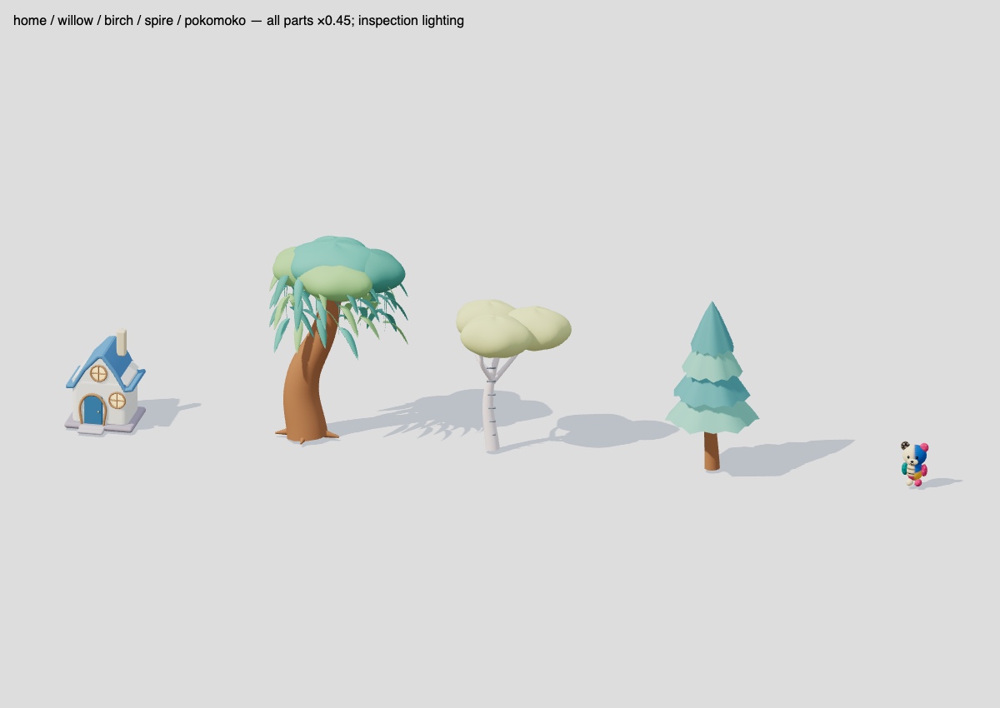
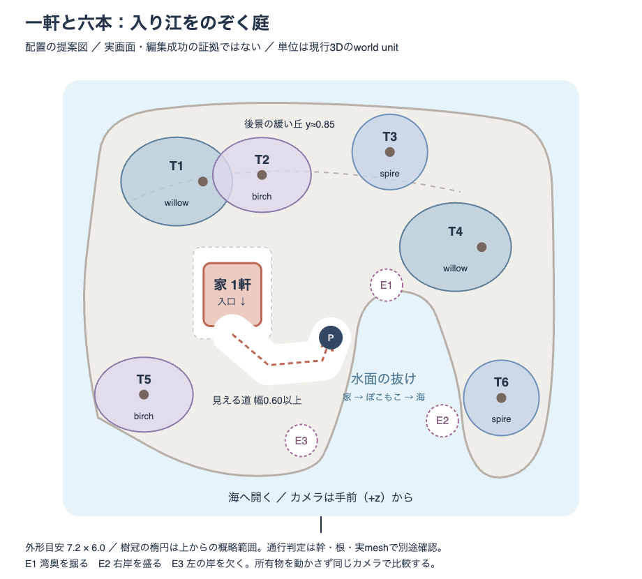

# Astra独立レビュー：一軒と六本の入り江

2026-10-21 JST。このセッションで実施した美術・制作方式のレビュー。**次は、native05の実物キットを使い、編集地形と接地・経路をコードで組み合わせる。現在の簡素な家と丸い木へ細部を足し続ける制作は止める。** Three.jsや既存の地形操作実験を捨てる判断ではない。

効く柱は、土地を変えて結果を見る「くふう」と、同じ家・木・ぽこもこが残る「愛着」。一角は制作方法を判定する試験範囲であり、島の成長・人口の上限にしない。にぎわい・ふしぎを削る提案ではない。

成果はレビューと次の制作案。製品実装、仕様の採用、保存・学習・経済・時計・所有権・routing・PWAの変更、公開の承認を含まない。既存のぽこもこの顔・頭身・耳・布・配色・着替えは保持する。

## 1. 判定と根拠の範囲

| 対象 | 判定 |
| --- | --- |
| 次の制作方式 | **併用を推奨**。Blender側で形と材質を持つ部品を制作・管理し、runtime側で同じ地表から岸・支持・道・足を導く |
| `living-cove-v1` の美術 | **HOLD**。地形操作の検討には使えるが、次の美術の母体はnative05キットへ移す |
| 次案 `cove-native05-corner-v1` | **未制作**。以下の図と寸法は制作指示であり、レンダー・合格証拠ではない |
| 無説明理解・安全・再訪 | **HOLD / 児童N=0**。本レビューは意図を知る作者側の専門判断。独立した児童観察の代わりにならない |
| runtime | 既存試作の限定7ロジック＋17ブラウザ検証は引き継ぎ資料の結果。今回再実行していない。キットの別ビューでの読込・描画・寸法取得は実施したが、次案の経路や編集は未検証 |
| 全アプリの美術連続性・配布 | **未評価 / HOLD**。簡素な隔離試作を、native統合済みの本体全体の品質とみなさない |

今回の視覚判断は、最初にnative05静止画、Little Habitatsの昼夕実画面、試作の390/768幅・旧新の木・主要フレームを見て作り、その後で[依頼資料の仮説](README.md)を読んだ。動画については10.76秒の実ファイルを調べ、0.5秒間隔の抽出列と主要フレーム、イベント記録、動作コードを照合した。**連続再生の滑らかさや音を実聴評価したとは扱わない。** 読む前からユーザーの問題意識とキットの存在は共有されているため、完全な盲検ではない。

- 目標：`whole-island-native-3d-05`、[1600×1200の原本レンダー](../2026-10-10-island-final-3d/whole-island-render.png)。全島の方向であり、一角のruntime benchmarkではない。
- 現試作：`living-cove-v1`、revision `749d7591c1a6dde6`、delivery `standalone-study-only`。[390幅](../2026-10-21-living-cove/evidence-final/390-new-tree-near.png)、[768幅](../2026-10-21-living-cove/evidence-final/768-observing.png)、[録画](motion/current-cove.webm)。撮影元URL・状態は[元の記録](motion/report.json)。
- Little Habitats：[昼](reference/little-habitats-day.jpg)・[夕](reference/little-habitats-evening.jpg)は2026-10-21撮影の同じ公開訪問庭。成熟状態・物量・光・カメラはSansuと一致していない。昼夕も同時刻ではない。[出典記録](reference/day-provenance.json)と[過去の実操作調査](../2026-10-21-little-habitats-research/README.md)を参照し、今回は外部へ再接続していない。
- 新規証拠：[キット検査画像と寸法](astra-evidence/kit-inspection.json)、[入力hashと今回の検証](astra-verification.json)。キットビューは1200×850の隔離診断で、製品画面ではない。

## 2. 独立した視覚所見

**東西に面積を足すだけでは届かない。上下を変えられることは必要な表現の幅を増やすが、それだけでも届かない。** 足りないのは、家の入口・樹冠の空間・岸の断面・水面の抜けが、一つの場所をつくる構成である。

| 軸 | 実際に見える差 | 次に変えるもの |
| --- | --- | --- |
| 構図 | native05には森の下、家の前、橋の先、水路の奥という大小の居場所がある。現試作は大きな床の上に物を置いた印象が強く、正面寄りの画角では手前の木が家とぽこもこを隠す。近景にしても関係物の重なりは改善していない | 家→見える歩行路→水辺の一点を主景とする。空地の全面を埋めず、使う空間と周縁のまとまりを分ける |
| 形 | native05は垂れる柳、細い白樺、段状の針葉、反る葉屋根など、輪郭の方向が違う。試作は五本のほぼ同じ丸い冠に、線と薄い葉の多い一本が加わり、粗さの水準が分裂している | 太い幹・複数の葉の塊・垂れ葉を持つ既存willowへ戻る。五本も同じ美術系列の樹種で揃える |
| 地形 | 試作の高い背面と前面の長い岸は、矩形の段を丸めた台に見える。盛り上がりの位置は分かるが、丘と低地を歩いて使う関係は弱い。native05は岸の湾曲と場所の高低差が構図を分ける | 奥は緩い丘、家前は平ら、岸は草→土の断面→浅い水を一続きに作る。表示だけ滑らかにして歩行床を別に残さない |
| 素材 | native05の葉の厚み、屋根の返り、白壁と青い扉、木の太さは低解像度でも残る。試作は多くの面が同程度の滑らかな色面で、薄い新葉だけが細かい | 材質数より、面の厚み・曲率・接地と影を優先。布は既存ぽこもこ、壁・木・葉・地面・水の応答を分ける |
| 光 | native05は柔らかい陰で接地と重なりを読ませる。試作は明るいが、水と空が近い平面色で、硬い木の影が目立つ。Little Habitatsは明るい水際と暗い断面で陸水の境界を読ませる | 昼の同条件で、広めの影・明るい環境光・局所の接触影を校正する。夕景やbloomで昼の弱さを覆わない |
| 動き | 記録には地形変化、家前から岸への移動、観察姿勢、Undo後の帰還がある。観察開始は体全体を一定角度に傾ける実装で、視線→減速→重心という段取りはまだ薄い | 「変わった岸を見る」を一つの因果に絞る。視線、停止、短い重心移動を既存rigの姿勢でつなぐ |

Little Habitatsから参考にするのは、**水の空白が陸の形を見せること、葉の塊に幹を見せる窓があること、高低差が場所の役割を分けること**。家や飾りの数、緑の配色、被写界深度、細かな草、完成庭の密度を移す必要はない。特に強いぼけはSansuの配置対象・入口・小さい相棒を読みにくくし得る。画像から作者の実装アルゴリズムや音の良し悪しは判定できない。

先行仮説の「新木だけ細かい」「岸と素材の境目が弱い」には同意する。ただし「空地が広い」は、空地を減らす指示にしない。水面と歩ける余白は残し、**空地に目的と縁をつける**。また「枝を増やす」「全体を明るくする」だけでは、今回見えた差を埋められない。

### 転用するもの・しないもの

| 元 | 転用する | 転用しない |
| --- | --- | --- |
| native05 | 太い形と薄い縁の対比、曲がった屋根、材質、木陰の空洞、異なる樹冠の高さ、岸と水の関係 | 原本の家・人の数、固定された全島配置、成長していない所有物への巨大冠 |
| Little Habitats実画面 | 凹凸のある岸の連続、陸と水の明度差、群れた冠と抜け、段差による奥行き | 他者の素材・固有物、成熟庭の物量、全面の緑、強いぼけ、未確認の音や内部手法 |
| 現試作 | 同じ地面を盛る/掘る、同じ相棒の実歩行、足場保護、Undo、同条件の比較方法 | 箱の家、単調な冠の反復、細かな葉の追加を主な改善手段にすること |

## 3. native05キットを実物とコードで確認した結果

実gzipを展開してSHAを照合し、既存の `makeNativeGrowingKit` で組み立て、既存ぽこもこと同じ `.45` の倍率で描画した。**12部品・273 source meshes・228,960 triangles・32 materials、gzip 2,554,378 bytes、展開後5,072,476 bytes**。GLBにはtexture参照とanimation clipがともに0。これは材質や形が存在しない意味ではなく、見えている色・roughness等と立体形状を継承できる一方、Blenderの光・環境・動作がそのまま付属するわけではない、という境界である。

次表は**原本のAABBではなく、既存kit関数の原点移動・家の回転補正後、`.45` で実測した幅×高さ×奥行き**。単位はworld unit。樹冠を含む外形であり、通行障害の体積ではない。

| 部品 | 寸法（概数） | 使い方・注意 |
| --- | --- | --- |
| `home` | 0.88 × 1.19 × 0.96 | 今回の一軒に最適。丸い壁・曲がる屋根・窓・青い扉・前段が一式ある |
| `cottage` | 1.03 × 1.19 × 1.04 | 初期の家として使う場合の既存選択肢。上記と二軒置かない |
| `home-upper` | 1.13 × 1.55 × 1.19 | 上階を得た家の形。今回の密度を上げるために付与しない |
| `home-cap` / `home-leaf` | 1.69 × 1.18 × 1.57 / 1.26 × 1.27 × 1.53 | 横に広い屋根。幅の違いは配置・入口の余白に効く。まず一軒の通常形で判定する |
| `willow` | 1.70 × 2.65 × 1.35 | 葉の塊と垂れ葉、太い曲がった幹、根をそのまま使う。現新木の置換候補 |
| `birch` | 1.50 × 1.91 × 1.14 | 白い幹と明るい冠。柳と同じ太さ・同じ冠にしない |
| `spire` | 1.15 × 2.24 × 1.15 | 尖る輪郭を一〜二本入れ、丸い塊だけの反復を切る |
| `fan-crown` | 3.73 × 1.53 × 3.64 | 大きな冠だけの部品。六本の単木へ飾りとして配らない |
| `hollow-trunk` | 1.59 × 3.34 × 1.21 | 窓と入口を持つ幹。対応する成熟・場所・経路が必要。今回の初手には使わない |
| `flower-crown` | 2.31 × 0.56 × 2.31 | 冠のみ。支える実株と成熟が別途必要。木六本の代用品にしない |
| `shell-roof` | 2.16 × 1.56 × 1.56 | 殻・肋骨・裾はあるが床と通れる開口の完成品ではない。今回追加しない |

[家の各形の実物](astra-evidence/kit-houses.png)・[大型部品の実物](astra-evidence/kit-large-parts.png)・[詳細寸法](astra-evidence/kit-inspection.json)。原本全島のGLBと`.blend`は保持し、キット抽出元GLBのhashも確認対象に含めた。

### そのまま載せると破綻する箇所

1. **倍率を統一してから測る。** `tree()` はIDから樹種を選び、成長に応じて倍率を変える。`home()` の既定は`.34`、stage 2ではさらに`.30/.34`が掛かり、`cottage()` の既定は`.58`。authored世界では既存契約の`.45`を明示する。この三つを既定値のまま混ぜたり、親子で二重に`.45`を掛けない。今回の図は検査用に`.45`の成熟形を基準とする。製品の幼木や家の段階を勝手に成熟へ変えない。
2. **原点は冠の中心ではない。** willowは原点からx方向へ約−0.45〜+1.25に広がる。単純な中心対称の円で並べると、水面や通路を覆う。根の支持原点・冠の範囲・選択範囲を分け、回転後の実meshを見て配置する。
3. **扉は通れる穴だと仮定しない。** `.45`の既存ぽこもこの静止AABBは約0.356 × 0.565 × 0.271。家の青い扉meshは元の向きで約0.241幅×0.405高、枠外形も約0.358幅×0.420高だった。これは通行開口の測定ではないが、相棒が自然にくぐれる証拠にはならない。次案は**玄関前まで歩く**範囲。入室が画面遷移なら既存の方式を守る。くぐる演技を足すなら、キャラを縮めず、別の家派生で開口・頭上・段を実体として作る。
4. **接地は中心一点では足りない。** 家には前段と基礎、柳には張り出す根がある。回転後の支持点全体を同じ地表で調べる。許容外の傾斜・根の浮きは、全体を地面へ埋めることで隠さない。家と幹は剛体として保ち、足元の小さな継ぎ目だけを地表へ接続する。
5. **現試作の衝突判定は再利用条件が限定される。** `walk.mjs` は箱の家の固定矩形と幹半径`.24`、足の中心＋四方向`.13`を使う。nativeの屋根・太い根・枝・段に対する検査ではない。キット交換後も17ブラウザ項目の旧PASSを持ち越さない。
6. **素材を一括上書きしない。** kitは材質ごとにgeometryをまとめ、instance間で共有する。色替えは既存の屋根paint経路と所有styleを保つ。汎用の紫材質や一つのroughnessで全meshを塗り直すと、再利用の理由を失う。

コード根拠：[読込](../../../src/components/island/growing/native/nativeGrowingAssets.ts)、[部品・原点・尺度・材質](../../../src/components/island/growing/native/nativeGrowingKit.ts)、[本体の転写契約](../../product/island-native-owned-art.md)、[試作の歩行](../2026-10-21-living-cove/walk.mjs)、[試作の描画](../2026-10-21-living-cove/viewer.js)。

### 足りないもの

新しい家や木を一式作り直す必要はない。初手で必要なのは、次の三つである。

- **編集地形用の断面設計**：岸の上面・丸い折れ・土の側面・浅瀬を結ぶ断面。nativeの`shoreProfile`は一つの外周の形の手掛かりであり、任意の掘削・凹岸・島の分割へ使える部品群ではない。kitには汎用の編集地形・歩行床・道のネットワークは入っていない。
- **支持と接続の情報**：家の支持輪郭、玄関前の停止位置、木の根の支持点、幹・低い枝の占有、地面へ接続してよい範囲。原本名とAABBだけでは不足する。
- **照明と動作のruntime調整**：原本exportはcamera/lightを含めず、clipもない。葉を揺らすなら材質別に一塊へ統合されたkitを無理に曲げず、必要な枝群だけを別pivotとして抽出する。最初は静止した良い冠で十分。

## 4. 制作方法の選択

| 方式 | 今回の得失 | 判定 |
| --- | --- | --- |
| runtimeコード形状を磨き続ける | 地形編集と整合しやすい。一方、採用済みの家・柳の形をもう一度実装し直す理由がなく、現試作では粗形と細葉の分裂が生じた | 主な美術制作には選ばない。地表・接続・作用の生成には使う |
| 全てをBlenderの固定一角にする | 一枚の美しい構成を作りやすい。ただし編集後の岸、足場、任意配置を保証できず、毎回完成絵へ戻す危険がある | 固定背景としては選ばない。部品と断面の作者判断に使う |
| **Blender資産＋コードの地形・接続** | 採用済みの形を保持しつつ、編集結果を同じ地表から描ける。支持情報と変形範囲の制作が必要 | **推奨** |

原本の[build-final-scene.py](../2026-10-10-island-final-3d/build-final-scene.py)自体が、Blenderをコードで組み立てている。したがって争点は「手作業かプログラミングか」ではない。**作者が見て選ぶ形を編集可能な部品として固定し、runtimeで変わる地表と所有物の関係だけを生成する**。これは既存の[構築方針](../../product/island-construction-strategy.md)とも一致する。

地形は当面、一つの高さ場で扱える丘・低地・湾・岬を対象にする。洞窟・張り出す崖・上下二重の床まで自由に掘れる方式とはしない。表示mesh、岸の交線、ray hit、足の高さ、支持・歩行判定は同じ地表を読む。作者が選んだ岸の断面をコード化し、根や基礎と地面の継ぎ目を局所的に処理する。WFC、流体計算、新しい全島生成器は初手に不要。

## 5. 一角の具体案「入り江をのぞく庭」

**焦点は家そのものでも大樹そのものでもなく、家から出たぽこもこが、木の間にできた水際を見に行く場所。** 家一軒、同じ所有木六本、既存ぽこもこ一体で始める。鳥・花・家具・灯りの追加で密度を埋めない。

[図の編集原本](astra-evidence/corner-plan.svg)。座標は提案する隔離制作fixtureの座標であり、現在の保存セルを移し替える指定ではない。xは左右、zの正方向が手前、yが高さ。約7.2×6.0の一角、水面は試作と同じy=0.08、家前の地面はy=0.42を開始値にする。

| 対象 | 根・家のanchor (x,z) | 形と役割 |
| --- | --- | --- |
| 家H | (−1.35, −0.05) | `home`、入口は+z。約1.2×1.4の支持・前段の余白を予約。入口と水を見る場所を同時に見せる |
| T1 | (−1.80, −1.70) | willow、yaw約180°。冠が左へ広がる奥の大きな塊。家の真上へ蓋をしない |
| T2 | (−0.90, −1.80) | birch。T1と冠を少し重ね、白い幹の窓を一つ残す |
| T3 | (+1.05, −2.15) | spire。丸い塊の横に尖る奥の輪郭を作る。T2との間に空を残す |
| T4 | (+2.45, −0.70) | willow、yaw約180°。湾の右肩から水を包む。左へ伸びる冠の下端を観察者の顔から離す |
| T5 | (−2.70, +1.55) | birch。手前左の縁。家の正面には置かず、入口を隠さない |
| T6 | (+2.75, +1.60) | spire。手前右の縁。湾の中央を塞がず、T5と同じ形・高さにしない |

樹種配分はこの制作fixtureの提案。**本体へ移すときにIDを作り直したり、ID由来の樹種・成長・所有styleを美術の都合で再抽選しない。** 実所有の六本が別の配分なら、その六本の別構成として撮影する。未所有の木を追加しない。

### 前景・中景・後景と尺度

- **前景**：左右の木と、海へ開く岸。中央の水と地面を見通せる。岸の一部に不均一な厚みを持たせるが、切り立つ直線の展示台にしない。
- **中景**：家の青い入口、ぽこもこ、湾の奥。歩く道の中心線はおおむね`(−1.35,.63) → (−.8,1.1) → (.02,1.03) → (.15,.68)`。有効幅`.60`以上を初期目安にし、実rigの歩行時占有を確認する。道の見える面も地表を読む。
- **後景**：T1/T2の塊、隙間を挟んだT3、右肩のT4。地面を奥へy≈`.85`まで緩く上げる。家前の平場を傾けず、丘への歩行部分は長い斜面にする。
- **冠の塊と隙間**：T1/T2は小さく重なる一群、T3は尖る独立形、T4は水の右縁。六個の等間隔の丸や一枚の巨大な蓋にしない。近景では幹の間の水、俯瞰では湾の輪郭が残る。
- **明暗と色**：既存nativeの材質を初期値にする。家の屋根は本人の色を保ち、青い扉とぽこもこの既存色が焦点。水は土・草より滑らかな反射、幹と根には接触影。全面の再配色はしない。

既存authored契約の`.45`でぽこもこは約`.565`高、家は約2.1倍、木は約3.4〜4.7倍の高さになる。画角を変えて顔を読ませ、人物だけを場面ごとに拡大縮小しない。`.45`をこの隔離試作へ使うことと、通常世界の倍率変更を同一視しない。

### カメラ

初期俯瞰は+zから約35〜40°の仰角を開始値にし、少し横を向けて家の側面と入口を同時に見せる。全体の外形と六本を画面内に収め、低密度の水面が画面の中心寄りへ抜けるようにする。近景は本人が選んだときだけ、入口・ぽこもこ・変えた岸を含む範囲へ寄る。目安は仰角30〜35°。数値を守るために主役を隠さず、実投影で最終調整する。

390と768で世界の配置は共通。UIの安全領域を先に取り、画角で対応する。編集のたびにカメラや所有物を動かして、前の良い構図へ戻してはならない。比較中は各カメラの値を固定する。

## 6. 三回編集しても同じ庭として成立する条件

**次の制作では、図の三つの編集を本当にUIから成功させ、状態差と画素を残す。今回成功を確認した、という意味ではない。** 既存動画の`05-edited`は足場保護で拒否された操作であり、この受入の成功一回には数えない。

| 順序 | 編集する場所と結果 | 編集後に残すもの |
| --- | --- | --- |
| E1：掘る | 湾奥の陸側(約1.0,−.12)付近を低くし、水面が奥へ伸びる | 左岸の観察位置、家からの道、T4の根。湾奥の位置が画面上でも変わる |
| E2：盛る | 右下の(約1.85,1.95)付近を盛り、短い岬を作る | 海への開口とT6の足場。湾全体を塞がず、E1の形を残す |
| E3：掘る | 左手前の陸側(約−.30,2.25)付近を欠き、前縁の線を変える | 家の支持と中景の道。右の岬と奥の湾を初期形へ戻さない |

各位置はbrush中心の開始案。実支持範囲と干渉すれば、**制作前に編集位置・brush幅を明示して決め直す**。実行時に別地点へすり替えたり、変化を拒否したまま成功扱いにしない。E1→E2→E3を累積し、その後Undo/Redo。固定seedの初期形へ戻してから一回ずつ撮るだけでは不足する。

### 追従・固定・拒否を分ける

| 分類 | 要件 |
| --- | --- |
| 地形へ追従する | 草/土の境界、水との交線、浅瀬、配置hit、通行候補、足の接点、既存anchorの支持高、道の面、短い根元の継ぎ目 |
| 勝手に変えない | 所有ID・x/z・向き・成長・style、幹と家の比例、ぽこもこのidentity、本人が選んだカメラ。境界を越えないy方向の接地補正だけは地表から導く |
| 事前に拒否する | 家の支持を削る、根の必要支持を失う、相棒の足元を水にする、家への帰路を切る、実meshに体が通らなくなる編集 |
| 拒否時の応答 | 対象の支持域または切れる経路を同じ場所に一度示す。地形・履歴・所有物は変更しない。「となりを掘る／先に家へ戻る」等の回復手段を示し、失敗音で責めない |

「帰路を保護する」は次案の検査条件。現試作の`history.guard`は現在の`canStand`を調べるだけなので、現在地が乾いていることから帰路の存在を推定しない。次案では候補地形上の支持と連結した帰路を、確定前に確認する。

試作は高さ1段が`.57`、grid間隔が`.7`で、単セルの高低差はぽこもこ約一体分に近い。細かく分割して表示するだけでは緩い斜面にならない。次案では一操作の高さとbrushの広がりを一緒に調整し、歩く斜面を実測する。開始案は一段`.14〜.18`程度、または同じ大きな変化をより広い範囲へ配る方式。**これは未採用の試作パラメータであり、製品の土地規則の変更ではない。** 見た目と判定を一緒に変え、崖には歩けないことが見える断面を用意する。

現行の[本体の床契約](../../product/island-expanding-runtime.md)は取得済みセルを水へ取り上げない。今回の自由な掘削試作をそのまま本人保存へつなげない。製品化時には、取得権を維持する編集可能範囲と保存・復旧の仕様を別途決める。本レビューでその境界を変更していない。

## 7. 最小限で効果の高いアクション

一文にすると、**「岸を低くする → 同じ場所に水が見える → ぽこもこがその岸へ歩き、立ち止まってのぞく」**。

| 優先 | 動作 | 最小の実装案・判定 |
| --- | --- | --- |
| 1 | 地面と水際が同時に変わる | 入力へ100ms以内に反応し、既存260ms前後の地形遷移を基準にする。遷移中も地形と交線を同じ高さ場から計算。水が坂を上る表現を足さず、低い面が水位以下になる結果を見せる |
| 2 | 変化の位置を水で返す | 実際に変わった水際へ短い一〜二本の弧を一回出す。陸へ突き抜ける同心円や、拒否された編集への成功波紋は出さない。1秒程度で通常水面へ戻す。流体計算は不要 |
| 3 | 視線と重心で「見る」を作る | 到着前に対象へ向き、最後の一歩で減速。足を置いてから小さく体を寄せ、0.6〜1秒ほど水面を見る。既存rigの姿勢・向きだけで行い、顔・耳・頭身や布の形を改変しない |

歩行は残す。動画の移動と到着は確認できるが、足滑り・停止時の慣性・細かな接地の良し悪しは今回の抽出頻度では合格にできない。コードでは距離に連動した小さな足の上下と体の左右揺れ、到着時の一括向き変更・約0.20radの前傾がある。まず歩行距離と足運び、到着の向き・減速を動画で校正し、表情や手振りの種類を増やす順にはしない。

根が支えられていないのに樹冠を揺らす演出、全ての木の常時揺れ、カメラshake、鳥の来訪、灯りの点滅は初手から外す。水・木・相棒の全てを同時に動かさず、操作の結果を主役にする。

Undo中も支持を守る。現在の相棒の位置が復元後に水になる場合は、旧地形上で帰路を使って安全な位置へ戻してから復元する等の明示的な段取りが必要。現試作の`restoreSupport()`による家前への位置復帰を、自然な歩行演技の合格とは扱わない。地形の自動整列で解決しない。

**音は未評価。** 元録画には音声streamがなく、Little Habitatsの過去調査も実聴していない。「参考作品より劣る／近づいた」とは言えない。次の試聴候補は、土の短い柔らかな音、水際の短い音、接地した歩行音の三つまで。BGM・常時環境音の追加は一角の合否に先行させない。音OFFでも同じ変化が読めること、音ON/OFF・背景化・連打時の重なりは別に実聴する。reduced motionでは途中の揺れやカメラ移動を省いても、変わった岸と観察対象を静止状態で残す。

## 8. 390/768、俯瞰/近景の受入と中止条件

次の制作は一候補に限定する。**準備済み→E1→E2→E3→Undo**を390×844・768×1024の両幅、俯瞰と近景の各カメラで残す。実canvasの寸法・UIを含む画面・camera値・同じ所有ID/位置・入力地形のhashを記録する。20場面を一枚または数枚のcontact sheetへ整理し、代表旅程を15〜25秒程度の動画でも残す。自動リプレイだけでなく、実際の入力で編集する。

native05から今回に相当する家・柳・白樺の局所も比較する。ただし原本全島との物量比較はしない。キットを同じrenderer・同じ光へ置いた診断と、製作した一角の実画面を並べ、部品単体の魅力が地形に載っても残ったかを見る。

| 条件 | 390の俯瞰 | 390の近景 | 768の俯瞰・近景 |
| --- | --- | --- | --- |
| 主景 | 家、六本、湾の外形が収まり、入口→観察点→水の関係が追える | 顔・両耳・足元・水との接点が見える。入口または入口へ続く道を同画面に残す | 同じ所有物・同じ関係を保ち、広いから飾りを増やさない |
| 相棒 | まず耳から足まで約22px以上を目安。姿を発見できるかは別に人で確認 | 同約56px以上を開始目安とし、顔が木・屋根・UIに隠れない | 少なくとも390の相対的な読み取りを下回らない。近景は相棒と岸の両方が主役 |
| 冠と抜け | 丸い塊・垂れ葉・尖る形が区別でき、中央の湾が一枚の冠で閉じない | 細葉のノイズが顔や水際と競合せず、根と幹の支持が見える | 同じ形を保ち、光と接触影で前中後景が分かれる |
| 支持と道 | 家から観察点、帰路が繋がり、直線の台に見えない岸の曲率が読める | 足・前段・根に浮き、地面への不自然な埋没、交差がない | ray/経路検査に加え、実meshの貫通を画像と動画で確認 |
| 編集結果 | E1/E2/E3の違いをcopy無しで指せる。各編集後も主景が残る | 変わった水際と見ている方向が一致する | 両カメラで同じ結果。水の線だけを動かして地面が同じ、という代用は不可 |
| UI | 既存の操作域を確保。主役をUIの下へ隠さない | 「全体へ」等で戻れ、近景のために操作を失わない | 文字拡大とreduced motionも別に確認 |

画素数は配置を校正する開始値で、美術や児童理解の合格点ではない。旧Exploreの116px俳優や52/60 benchmarkを、そのまま島の全景へ流用しない。

### 続行を決める三つの独立ゲート

1. **美術**：実画面をnative05の該当部分と比べ、形、素材の触感、深さ、焦点、相棒との関係、次に触りたい期待を各々確認する。スキルの六軸を使う場合も各8/10以上を作者側の基準とし、根拠の画像を付ける。弱い一軸を合計点で相殺しない。今回の静止画間は条件不一致が大きいため総合点を付けていない。
2. **無説明理解・安全**：次案の実動作を初見の観察者へ、意図を教えずに見せる。5人中4人以上が「どの岸をどう変え、誰が何を見たか」を同じ意味で説明し、4人以上が続けたいと答えることを試行ゲートにする。怖さ・痛み・閉じ込め等の信頼できる読み取りがあればHOLD。作者・本セッションを人数に含めない。これも翌日の再訪の証明ではない。
3. **runtime**：全三編集で状態が実際に変わり、支持・帰路・Undo/Redo・同じ所有物を守る。拒否・通常・sound-off・reduced motionを区別して記録する。次案の実装範囲に応じて検証matrixを適用する。本体へ接続する段階では、起動→一角→次の目的地の実画面、版・flag・候補・cache/update状態、保存/PWA等の必要検証を別途揃える。

### 「もう少し細部」を止める線

- **第一回の実画面で**家が見えない、湾が葉で閉じる、接地が破綻するなら、小物を足さず、冠の位置・岸の断面・camera・支持のどれが原因か一つに絞って直す。
- **同じ大きな問題が二回の比較でも残るなら制作方法を変える。** 岸の台状の輪郭が残るなら、高さサンプルへsmoothstepを掛けるだけの造形をやめ、作者が選んだ凹岸・凸岸・低い段差の断面を共有地表として再構成する。冠が雑然とするなら、散らした一枚葉の追加をやめ、kit原本またはBlenderで調整した枝群へ戻す。
- キット単体は良いのに一角で弱くなるなら、まず尺度・配置・光・接地の接続工程を変える。根拠なしにレンダラー全体の交換や新しい全島生成を始めない。
- 片方の幅、初期状態、夕景だけで成立するものは続行判定にしない。三編集で失敗するなら、完成絵への自動復元や操作禁止の拡大で隠さず、許容する形と支持設計へ戻る。
- **一角が通ってから**成長差、別の所有配置、別の地区へ進む。この順は今回の明示依頼に限定した制作判断で、全島計画の完了宣言ではない。

## 9. 次の一手と残る不明点

次の制作物は「同じキットの一軒・六本と既存ぽこもこ、編集できる一つの入り江」。最初の比較では昼の静止構図・三編集・帰路を優先し、次に上記三つの応答だけを加える。新規Blender制作は岸の断面と根元/基礎の継ぎ目、必要なら入口の派生に限定する。大量の完成島・新商品・追加住人を作らない。

残る不明点は、提案座標の実投影と枝の遮蔽、三編集後の実mesh支持/帰路、近景での素材と影、動作の連続した手触り、実音、実機性能、子どもの理解と再訪である。**配置図・AABB・既存24項目PASSから、この一角の合格を推定していない。**

## 10. 文書変更と検証

変更分類は設計レビューと制作案・検査証拠。親仕様や美術の正本は現行契約のまま。新しい制作候補を製品仕様へ採用した扱いにはしない。原本のREADME・入力manifest・検証結果は当時の引き継ぎ記録として保持し、このレビューの実施結果は別manifestへ記録した。

今回実施したのは、元の29入力hash照合、実キットのhash/メッシュ/寸法確認、ローカルChromeの三つの部品ビュー、配置図の表示検査、文書リンクと`npm run docs:check`。コマンド・日時・結果・出力hashは[astra-verification.json](astra-verification.json)、[docs検査ログ](astra-evidence/docs-check.txt)に記録する。診断ビュー初回の自己影ノイズはshadow bias設定を修正して再撮影し、キット由来の欠陥とは判定していない。

アプリ・試作の実装を変更していないため、lint/typecheck/unit/build/e2e/PWAは今回再実行しない。元の全体portal更新には共有TASKSのflow evidence不整合が報告されており、今回そのhashや生成物を上書きしない。agent:index/portalの全体再生成・再合格は今回の範囲外。commit、push、公開、デプロイ、外部送信・アップロードなし。
