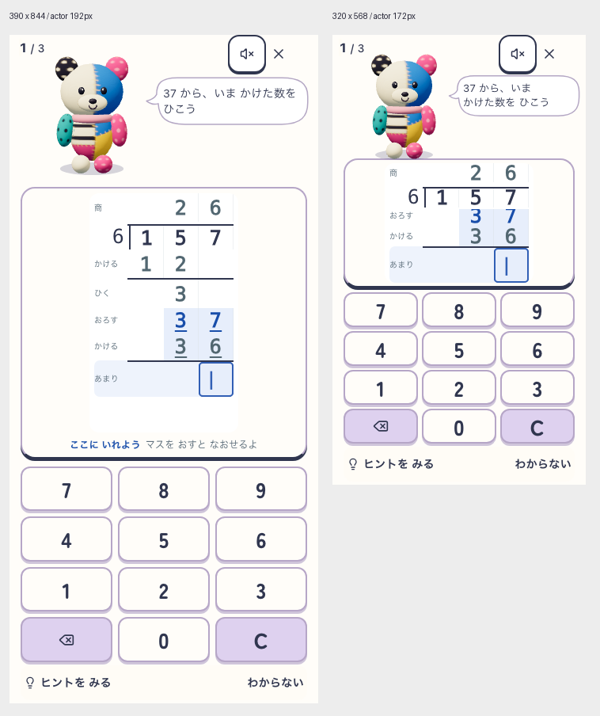

# 丸い会話吹き出しを学習画面へ実装

2026-10-21。ユーザーの「実装」により、文字削減ラフを実コンポーネントへ反映。元の全身192px／小画面172pxを左上に保ち、計算指示を丸い輪郭と一体の曲線のしっぽで示す。薄い箱と回転四角のしっぽを撤去。短い横画面は左相棒160px／右の紙とキーへ再配置する。

## 変更

- 島名・静的教科名・復習範囲・重複する筆算見出しを省き、問数と48pxの音・退出を残す。mixの教科予約操作は削除しない。
- 指示は同じ元文字列を顔横へ一度だけ表示し、語のまとまりを折返し候補にする。単語が幅を超える場合は切らず折り返す。13px以上を維持。CSSによる図形で、画像素材・モデルidentityは変更しない。
- 正誤の返事は別の固定領域。ヒントは指示下へ内部scrollで表示し、紙とキーの面積を減らさない。お手本の指示は通常吹き出しへ二重に送らない。
- headerへ移したヒントの観測は実表示と同じ問題IDを必要とする。観測正本に保存済みhintを見ただけで実表示と推定しない。問題ID照合の回帰テストを追加。
- 短画面では入力/訂正の補助文を常設せず、現在段を優先。操作名・強調・支援入口は維持。文字拡大で指示の通常枠を超えた場合、または短画面のmix選択併置はページscrollで全文・操作への到達性を保つ。全操作を同時に収めたという意味ではない。
- 仕様01/07/44を更新。採点、問題生成、SRS、保存形式、通常の自動確定は変更していない。

## 検証

| 対象 | 結果・範囲 |
| --- | --- |
| 最終対象unit | PASS。6ファイル112件。筆算、入力保留、支援、返事、実表示観測 |
| 型・lint・build/assets | PASS。lintは既存4警告、precache8.83MiB/12MiB |
| docs:check / 現行入口guard | PASS。docsは既存の期限警告あり |
| classic smoke | PASS。32件。IslandのUX合格とは分ける |
| 5 viewport | PASS。390×844、320×568、568×320、768×1024、1024×640で37・36・入力の可視性/中心hit、全操作44px以上を測定 |
| 実UI操作 | 誤答→hint→modelを390/320/568で操作。正誤で紙・キー不変、hintでキー不変、通常吹き出しは一つ。320ではhint後も現在段を目視確認 |
| キーボード/再開 | 物理1キーで正答・追加確定なし次問、reloadと退出/再入場で同じplan/cursor保持。reduced motion。回転capture |
| 拡大 | 指示だけ26pxにした明示診断で全文と下部支援へscroll到達。OS文字拡大/ブラウザ200%zoomそのものではない |
| 全体unit初回 | FAIL。653ファイル中652PASS、5536件中5535PASS/1FAIL。編集中の実行でLearningSupportテストにContext Provider undefined。最終同ファイル18件と上記112件はPASS。全体の最終再完走は未実施 |
| agent:index:check | FAIL。既存共有の `.agents/map.html` がstale、portal検査へ未到達。別作業の生成物を巻き込んで更新しない |

実行結果は同じフォルダのlog、[5幅とruntime metadata](probe.json)、[320の実操作](flow-320.json)、[390](flow-390.json)、[568](flow-568.json)、[再開と拡大診断](extended.json)、[最終対象SHA](source.json)を参照。DEV runtimeはIsland flag-on、delivery mystic-island-v1 / root snap-root-v1、learning candidate pokomoko-pop-live-v8、layout speech-companion-v2。SW非制御。プローブ16対象ソースの開始・終了SHA一致。実画面でありDOM/CSS注入のラフではない。問題は隔離した157÷6全筆算の明示fixtureで、通常planner選択の証拠ではない。

## 調整中の失敗と限界

初回小画面では補助説明と縮む履歴領域により37が隠れたため、紙を単一履歴scrollにし、表示行と短画面補助説明の配分を修正。最終5幅は現在3行の可視性と中心hitを確認。横画面の入力幅42.6pxを検出し44pxの最小幅を追加して再測定した。

複数幅で同じplanを初期revisionへ巻き戻す最初のflowは2幅目hintで停止。新規の独立profileで各幅を実行して通過。初回の拡大検査は正答後の次問が通常数値問題で吹き出しがないことを想定していなかったため、元の筆算表示中に診断を移して通過。元ログはローカル `output/playwright/speech-implementation/` に保持。

美術は作者による実画面確認。児童のかわいさ/発話理解/入力理解、実iPhone/WebKit、実音声、PWA更新/オフライン、長期再訪、全連続正解演技の部位別接触・全問題種の全幅合格は未確認。公開・release合格ではない。commit/push/deployなし。
