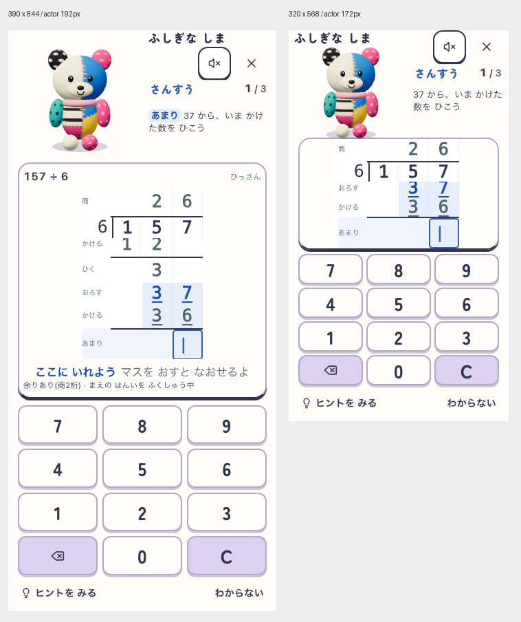

# 大きさを保って上へ移す配置ラフ

2026-10-21。ユーザーの「元の大きさをなるべく保ち、上へ移す」を優先した検討。製品へ未反映。

## 比較結果

- 390×844：相棒192px、左に全身、右に島名・音・退出・科目・進捗・現在の筆算指示。
- 320×568：島名を相棒の上へ置く追加案で172px。音・退出は右上48×48px。筆算37・36・入力欄、数字キー12個、支援ボタンが同時に収まる。
- 568×320：192pxの相棒・筆算・キーの3列案。長い指示・桁数の増加では中央列幅の追加確認が必要。
- 音は状態を区別できるアイコンを候補とする。読み上げ用ラベルと、再生失敗時の文字案内を維持する。今回のDOMラフは音の状態遷移を実装・検証していない。

## チャッピー相談

[ぽこもこ内「筆算配置案比較」](https://chatgpt.com/g/g-p-6ad58d0857b881918e46e346350848e7/c/6ad75886-d5c0-83ec-8f33-cc19ef39e6c7) に10:59 JST、通常192px・小画面156px・横画面192pxの実画面 contact sheet を共有。回答完了を確認。

元の大きさを残し、左に相棒・右に情報をまとめる方向を支持。音と退出の48pxアイコン化を支持し、音の再生状態と失敗時案内を残すよう指摘。小画面172pxを情報の再配置で再検討する提案を受け、上掲の172px案を追加した。追加172px画像は下記12:32の再相談で確認済み。

## 証拠と限界

[初回9ケースの測定](report.json)、[追加172pxの測定](report-172.json)。日時、実行対象メタデータ、対象10ソースの開始・終了SHAを収録。追加172pxでは対象ソース不変、現在の筆算3行の可視性と中心ヒット、全操作部の可視性・中心ヒット・44px以上を確認。

ブラウザ内CSS・DOMのみのラフ。元モデルを使用し、製品ソースはこの検討では変更していない。feedback画像の「もういちど」は衝突確認用の合成ラベルで、実回答フローの証拠ではない。実際の正誤反応・ヒント・祝い・音・保存・実機・子どもの理解は未確認。公開合格・実装完了を意味しない。

`left-320x568` は最初の156px案、`left-172-320x568` が追加172px案。右寄せ・中央案は比較用で採用していない。

## 12:32 JST 追加172pxの再相談

同じ会話へ `large-comparison.png`（通常192px・小画面172px）と実測の範囲を共有し、回答完了を確認。ChatGPTは両画像を確認したと回答し、156pxより172pxを有力と評価した。島名が通常では右上、小画面では相棒の上でも自然と評価。通常192px／小画面172pxを実装比較の第一候補へ絞る意見を得た。

取り入れる指摘：耳と島名、足と紙の距離が近いため、実際の正解・連続正解・誤答・ヒントで描画の安全領域を検証する。静止画で重なっていないことは動作中の合格ではない。筆算とキーの位置、44px以上の操作面、長名・文字拡大、既存の採点・保存・再開・音失敗時再試行を維持する。

音の通常アイコン表示を支持し、短い状態案内を筆算・キーを動かさない場所へ出す提案。既存の失敗・再試行案内は維持するが、初回操作案内の新設や演技の縮小・移動量制限は今回未採用。演技と衝突するか自体が未確認のため、実測前の必須変更とは扱わない。音アイコンが子どもに伝わるかも未実証。

今回の再相談では製品変更・公開を行わない。記録更新後 `npm run docs:check` PASS（既存の棚卸し期限警告あり）。

## 右側指示の吹き出し相談

同じ会話で、既に共有した通常192px／小画面172px画像を土台に文章で相談し、回答完了を確認。吹き出しを付けた実画面は未制作・未共有。ChatGPTは「一緒に解く感じ」が強まる可能性を評価し、現在指示だけを吹き出しへ入れ、正誤は既存の固定返事領域へ分ける案を支持した。指示を正誤で置き換えない。

比較候補：白地、薄い1px枠、小さなしっぽを相棒側へ。寸法は未実測の開始値として通常左右余白8px・角丸10〜12px、小画面左右余白5〜6px・角丸8〜10px・しっぽ6×5px。外幅の提案116〜128pxなどは実測値ではなく、そのまま採用しない。配色は白を選び、追加提案のクリーム色は採用しない。

長文では意味を削ったり文字を縮小せず、装飾・余白を減らし、必要なら枠なしへ戻す。音失敗案内は計算指示に混ぜない。受入条件は全文可読・顔とのつながり・筆算現在段と全キー同時可視・正誤やヒントで位置不変。上部高さに制約があるため、動的高さを増やす提案も実測前の採用事項ではない。児童が相棒の言葉として理解するかは未確認。相談のみで製品実装は変更していない。
