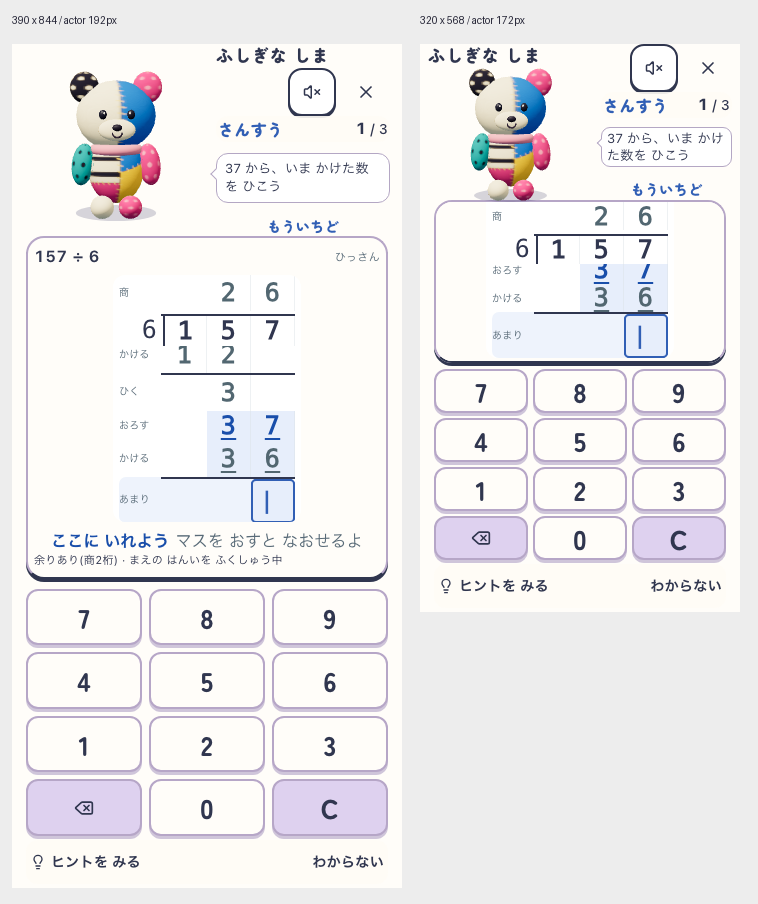

# 指示を吹き出しにするラフ

2026-10-21。ユーザー依頼「らふ」。製品ソース変更なし、既存ローカルアプリ上のDOM/CSSによる配置案。

通常390×844は全身192px、小画面320×568は172px。右側の既存計算指示に白地・薄い1px枠・左向きのしっぽを追加した。島名・音・退出・科目・問数は外側。通常は左右8px、小画面5pxの内側余白。文字13pxを維持し、小画面も今回の指示全文は2行に収まる。筆算とキーの高さは吹き出し前から不変。

比較画像の「もういちど」は固定返事領域の衝突確認用にDOMへ追加したラベルで、実誤答操作の証拠ではない。指示を返事で置き換えない配置を示している。

[測定記録](report.json) に時刻・runtime候補・対象10ソースのSHA・各要素寸法を記録。指示文字の枠内包含、筆算現在3行の可視性と中心ヒット、全操作の可視性と中心ヒット・44px以上を両幅で確認。音・退出48px。対象10ソースの開始終了SHA一致。

最初の撮影では390から320への変更をreload後に行い、紙のscroll位置の影響で現在行が固定ヘッダーに隠れた。viewportを先に変更してからreloadする撮影順序へ修正し、両幅で再撮影した。自動回転時の製品動作合格には読み替えない。

実回答・正誤遷移・連続正解演技・ヒント・長文・長名・文字200%・音失敗・実機・子どもの理解は未確認。長文では意味を省略せず装飾を減らす候補。今回の2画面は配置ラフで、公開版・実装の合格ではない。docs:check PASS（既存の棚卸し期限警告あり）。

## 吹き出し実画面のChatGPT監査

ユーザー「チャッピーと相談して完璧なレイアウトか」に対し、[ぽこもこ内「筆算配置案比較」](https://chatgpt.com/g/g-p-6ad58d0857b881918e46e346350848e7/c/6ad75886-d5c0-83ec-8f33-cc19ef39e6c7) へ上掲comparison.pngを初めて共有。両幅の確認と回答完了を確認した。前の文章による吹き出し相談とは区別する。

判定は「局所修正して実装候補」。完璧とは評価しなかった。維持するものは192px／172pxの全身、左相棒＋右情報、控えめな白地、指示と返事の分離、筆算と全キーの面積。

取り入れる改善候補：

1. 吹き出しが顔より低く、説明カードに見えるという視覚評価。顔とのつながりを強める配置比較を行う。上へ8〜12pxはChatGPTの未実測提案であり、科目・問数との衝突確認前には採用しない。
2. 「もういちど」が離れた別の発話に見えるという評価。既存固定領域を維持し、学習状態として整える比較候補。今回のラベルは合成なので実際の返事コンポーネントの不具合とは認定しない。
3. 指示の語のまとまりを跨ぐ折り返しを改善する。画像では通常は「かけた数／を」、小画面は「かけ／た数」と分かれる。余白・幅・語のまとまりを比較し、意味を省略したり13px未満へ縮めたりしない。

小画面の耳と島名・足と紙の近さも懸念。実際の正誤・連続正解・ヒント、演技のはみ出し、長文・長名・文字200%・回転・音失敗案内は今後の実測条件。児童が発話やアイコンを理解するかは未実証。静止画の意見交換で埋めない。今回の監査は記録のみで、製品・ラフ画像の変更や公開は行っていない。docs:check PASS（既存の棚卸し期限警告あり）。
