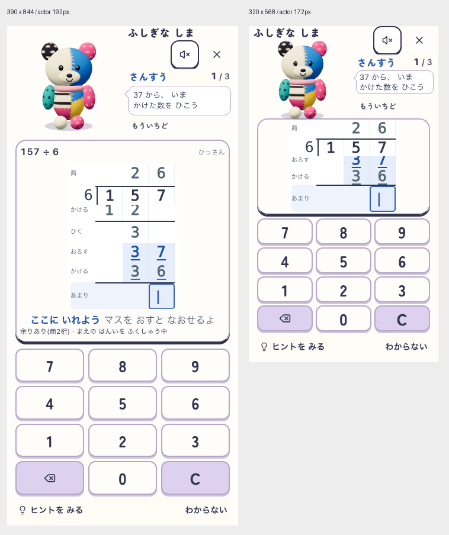

# 吹き出しラフの局所修正

2026-10-21。ユーザー依頼「修正」。直前の吹き出しラフを修正し、製品ソースには未反映。

- 吹き出しを8px上げ、しっぽを上寄りへ変更。
- 元の指示の意味・13pxを維持し、「37 から、」「いま」「かけた数を」「ひこう」のまとまりで自然に折り返す。今回の両幅は2行。長文・拡大時に強制nowrapを適用する製品仕様は決定していない。
- 返事の配置を通常14px・小画面10px上げ、吹き出し下の左に寄せる。合成ラベルは12pxの落ち着いた状態表示へ変更。指示と置換しない。
- 全身192px／172px、筆算カードとキー寸法・位置は前ラフを維持。科目・指示・返事のbox非重複を測定。最小の小画面gapは科目と指示のbox間約1.3pxであり、長名・文字拡大の成立までは保証しない。

[測定記録](report.json)。今回の指示全文の枠内包含、現在3行の可視性と中心ヒット、全操作の可視性・中心ヒット・44px以上、相棒・紙・キー位置の前ラフとの一致、合成返事前後の紙位置不変、対象10ソースの開始終了SHA一致を確認。

最初の小画面比較で既存紙スクロール位置が41px異なり、入力は見えても37・36が固定部分に隠れた。失敗記録はローカル `output/playwright/companion-bubble-refined/first-scroll-failure.log` に保持。修正版撮影は小画面で紙を手動相当の操作により現在入力下端が紙下端5px内側になる位置へそろえた配置fixtureである。自動scroll・再開・回転の合格ではない。

実回答や誤答は操作していない。「もういちど」はDOMに追加した配置確認用ラベル。演技・長文・文字200%・音失敗・実機・児童理解は未検証。今回の修正版はChatGPTへ未再送。docs:check PASS（既存の棚卸し期限警告あり）。

## 文字の整理に関する再相談

ユーザー「不要なもじないの？ さんすうはみりゃわかるしふしぎなしまも」「ほかは？」「チャッピー相談」を受け、[同じぽこもこ内会話](https://chatgpt.com/g/g-p-6ad58d0857b881918e46e346350848e7/c/6ad75886-d5c0-83ec-8f33-cc19ef39e6c7) にこの修正版comparison.pngを共有（先方添付名comparison(1).png）。両幅の確認と回答完了を確認。文字を消した画面はまだ制作していない。

相談結果：島名・さんすう・ひっさん・復習範囲の説明を常時表示から外す候補。範囲を記録や詳細に残す提案は未実装候補で、新しい画面追加を決定したものではない。157÷6の式は筆算内の157と6が常に判読できる場合だけ省略候補。入力・訂正の案内は条件付きであり、初回案内や迷い検知は存在すると扱わない。段階ラベルは最初の比較では維持し、とくに商・あまりを残す。現在指示・正誤・問数・支援・操作のアクセシブル名は維持。

削減で空いた場所は顔横の吹き出しと余白へ戻す。文字を削っただけでは横幅は自動的に増えないため、具体配分は次の配置ラフで測定する。相棒192px／172pxと全12キー・現在段を維持。返事領域は固定し、入力待機中に常時埋めない。入力・訂正が説明なしで分かるか、退出先が伝わるかは児童・実機未確認。

今回の作業は相談記録のみ。製品・ラフ画像への文字削除は未反映。docs:check PASS（既存の棚卸し期限警告あり）。
