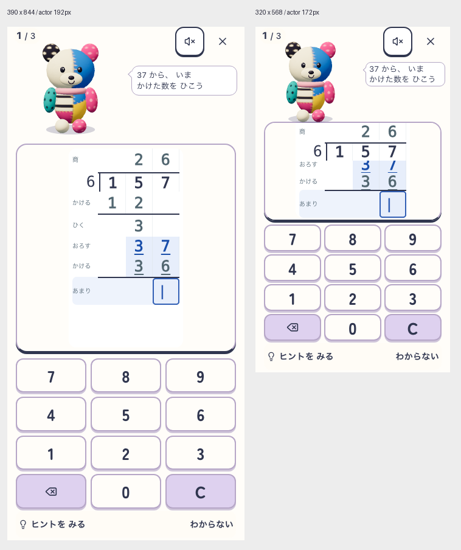

# 文字を整理したラフ

2026-10-21。ユーザー「らふ」。製品変更なしのブラウザ内DOM/CSS配置案。

島名・教科名・ひっさん・復習範囲説明を非表示。筆算内の157と6が固定表示される今回のfixtureでは、重複する式も非表示。問数は左上、48pxの音・退出は右上、計算指示は顔横（通常y64・小画面y58）に配置。ぽこもこの192px／172px、紙とキーの位置・面積、計算段階のラベルを維持。

入力・訂正の常時案内も非表示にした比較候補。初回や迷った場合の案内は未実装・未検証であり、これだけで子どもが入力・訂正を理解できるとは言えない。通常比較画像は待機中なので返事を表示しない。feedback画像の「もういちど」は衝突確認用の合成ラベルで、実誤答ではない。

[測定記録](report.json)：指示全文の枠内包含、現在3行の可視性と中心ヒット、全操作の可視性と中心ヒット・44px以上、相棒と紙とキー寸法維持、対象10ソース開始終了SHA一致。小画面の紙scrollは現在段へ手動相当で合わせた配置fixture。自動scroll・回転・再開・実演技・長文・文字200%・音失敗・実機・児童理解は未確認。今回の文字削除画像は下記の吹き出し相談で共有済み。docs:check PASS（既存の棚卸し期限警告あり）。

## 吹き出しがかわいくないという評価の再相談

ユーザー「吹き出しかわいくないな チャッピー相談」。[ぽこもこ内「筆算配置案比較」](https://chatgpt.com/g/g-p-6ad58d0857b881918e46e346350848e7/c/6ad75886-d5c0-83ec-8f33-cc19ef39e6c7) へこの文字削減版comparison.pngを15:37 JSTに共有。回答完了を確認。製品・画像への変更は今回行っていない。

ChatGPTは以前の「控えめで調和」という評価を見直し、現状は会話より説明カード・tooltipに見えると評価。原因候補は小さな回転四角のしっぽの後付け感、横長の硬い箱、顔からの距離、細い均一線と詰まった余白。これは静止画に対する視覚的な意見であり、児童の評価や因果の実証ではない。

次の比較候補はAふっくら丸い漫画吹き出し（第一候補）、B少し不均一な絵本吹き出し、C輪郭を主張しない丸い会話面。Aは本体から自然につながる曲線のしっぽ、少し厚みのある線と上下余白で言葉を包む方向。Bは作為的なゆがみ、Cは再び説明カードへ見える懸念がある。

ChatGPTの未実測開始値は通常幅168〜176・高さ54〜60・角丸16・線1.5、小画面幅118〜124・高さ46〜52・角丸12〜14・線1〜1.5px。現在の小画面幅は131pxであり、提案どおり狭める判断はまだしない。実寸で文字領域を確保し、しっぽを大きくするだけ／角丸だけの微変更で改善と扱わず、顔との関係と輪郭全体を比較する。

白基調、元モデル192px／172px、指示の意味・13px以上、現在段・全12キー・支援・44px以上を維持し、削った文字は復活させない。可愛さ・実動作の安全性・児童理解は別判定。新しい吹き出しの実寸ラフは未制作。記録更新後docs:check PASS（既存の棚卸し期限警告あり）。
