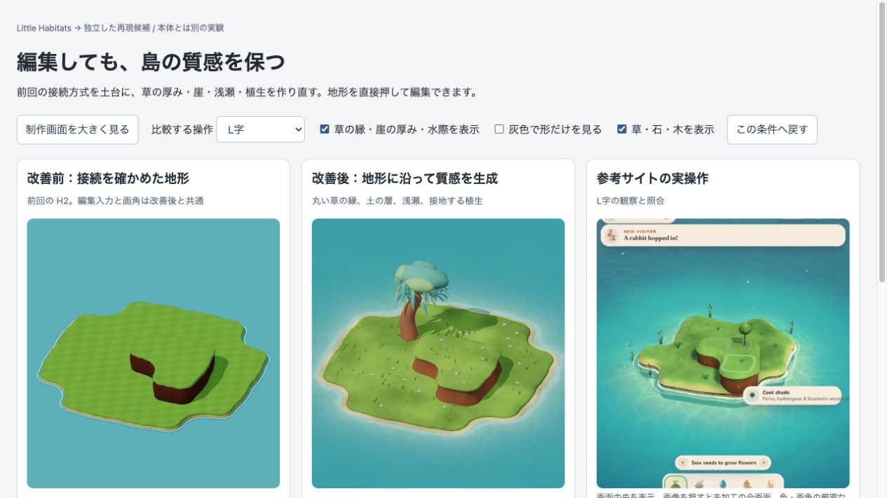
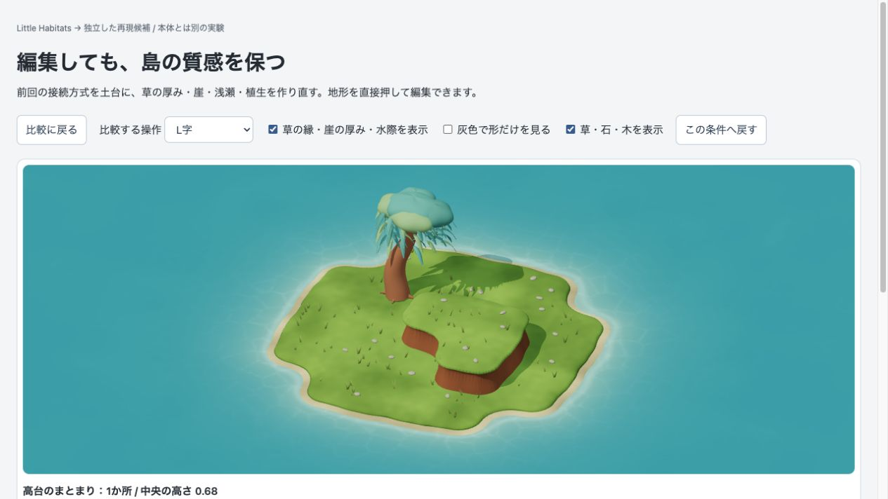

# チャッピー監査の送信資料（2026-10-22 明示承認後に送信済み）

送信先: [ぽこもこ／土地拡張案を比較](https://chatgpt.com/g/g-p-6ad58d0857b881918e46e346350848e7-hokomoko/c/6ad7354d-f4f4-83e8-a296-b462d76d7d72)

## 添付する2画像

- `evidence/final-ell.jpg`: 左は前回H2、中央は改善後、右は参考サイトの実操作画像。
- `evidence/focus-final.jpg`: 改善後の拡大実画面。

## 送る質問・要約

ユーザーから「どうなん？ チャッピー監査」と再依頼です。前回の制作方式相談から変更した実装について、成立範囲と過剰な合格判定を厳しく監査してください。添付する今回の実画面2枚は候補 contour-art-validation、revision ff435073e65b43a6です。動画・ソース全文・実機操作は提供していません。美術の所見は今回の画像、動作・方式の所見は以下の要約に限って評価してください。古い画像を現行版と扱わないでください。

目的は、一角を飾ることではなく、同じ所有物でも育て方・編集によって魅力ある島の輪郭と生活空間が変わり、本人が実際に歩いて使える制作方式の成立です。

現行はローカル独立試作。本体・所有・保存・学習・配布は変更なし。高さと材質を持つ小さい正方格子から丸い区画の境界を滑らかに接合し、CPU上で上面の肩、草の縁、土の側面、砂浜を生成。描画と支持床は同じ三角形。低地の境界から浅瀬色と光の模様を作り、固定種の草・石を床へ置く。既存native05の柳1本を使用。全景に家はなく、前回の家1軒・木6本の共通worldにはまだ戻していません。

検証: 単独/隣接/L/四角/対角/逆対角/隙間/穴の8入力を同じ規則で描画。10個の対象ロジック検査。CPU床とThree.js raycastは80地点で最大誤差2.8e-8。柳の根元437頂点の支持を確認。塗替えは高さを維持、その次の盛土で上昇。Undo/Redoで入力復元、水面pixelsと草の根元も再生成一致。CSS390幅でクリック編集とUndo、横はみ出しなし。

歩行は汎用経路探索ではなく、対角2地点間の固定直線を60区間に分け、半径0.17の足裏12点と局所段差を検査してから既存キャラを約2.2秒で動かす。掘削で切ると歩かない。歩行中編集は古い歩行を中止し、キャラを非表示へ戻す。木も支持がなければ非表示にする装飾扱い。所有物や人物を保持したまま安全な編集を成立させる契約とは未接続。編集再計算252ms（単独）、435〜580ms（2案比較）、歩行フレームP95 17.6msはローカル1環境の診断値。実機/動画による自然さ/子どもの無説明理解は未確認。

質問:

1. 実画面で見える参考との差を、構図・輪郭・素材・尺度から指摘してください。
2. 今回の前進と、まだ「仕組みが成立」と言えない穴を分けて判断してください。
3. ここから局所の磨き込みを重ねても目標に届かないとすれば、何を切り替えるべきですか。
4. 次の1つの実装実験を、固定する条件・変更する要因・失敗時の扱い・完了基準まで具体化してください。家や木を新規追加して密度だけ上げる、試験件数だけ増やす、自由編集を狭めて合格させる提案は避けてください。最大1200字程度。
