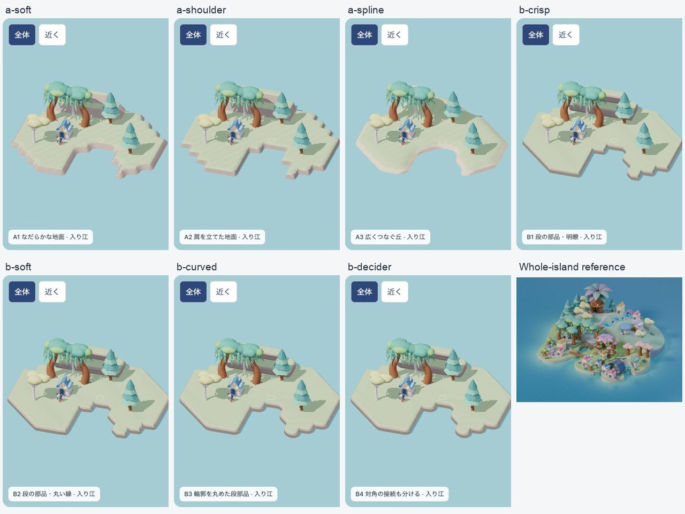

# 7案を実際に動かした地形方式比較

2026-10-22 JST。前回の[調査](../2026-10-22-making-methods/README.md)から、編集・歩行できる比較試作へ進めた。[比較ページ](comparison.html) / [触れる試作](index.html)。

**結論：B4は岸の境界処理を続けて研究する候補。目標の美術へは全案未達。** 岸の断面を変えても、広い平面に家と木が別々に立つ構成は残った。今回の結果から地形方式だけを勝者にする根拠は得られていない。次は家前・木陰・岸の関係から地形と居場所を構成する別実験が必要。対象は「くふう」と「愛着」の制作基盤で、学習・所有・成長の製品規則は変更しない。

## 実際に作ったもの

同じ家1軒・木6本・ぽこもこ1体、同じ格子と高さ入力、昼光・材質・画角で、二つの方式系列に7候補を実装した。部品はコードで断面と接合を設計した研究用生成物。Blenderで十分に造形した完成キットではなく、その方式全体の上限を測ったものではない。

| 候補 | 差分 | 実画面からの判断 |
| --- | --- | --- |
| A1 | 格子間の連続した滑らかな高さ場 | 岸の波打ち、局所的なこぶ。細い陸の歩く幅を失う |
| A2 | 肩と平面を残す補間断面 | 足場を残しやすいが、格子の角張りが強い |
| A3 | 16近傍のB-splineで広く連続する丘 | 傾斜は自然になるが、細い陸の木1本を支持できない |
| B1 | 共通輪郭に上面・肩・側面・裾を接続 | 境界は明瞭。厚い板に見える |
| B2 | 同じ部品の縁を広く丸める | 縁だけでは輪郭全体の角張りは消えない |
| B3 | 閉じた輪郭を丸めてから上面と側面を生成 | 曲線の岸へ改善。固定対角分割の偏りは残る |
| B4 | B3に、曖昧な対角を中心値で判定する分割を追加 | 対角の筋状接続を解消。等値の場合は陸を分ける |

7つの独立アルゴリズムとは数えない。地形入力は入り江・木移動・家移動・細い陸・対角陸水・二方向段差の6条件。カメラが同じでも画面幅による縦方向の余白は異なる。

## 検証結果

- 固定版 `beba3793a1b0d73d`、candidate `terrain-method-trial`、delivery `standalone-study-only`。対象URLは `http://127.0.0.1:5281/docs/design/2026-10-22-terrain-method-trial/`。製品のPWAや本人保存へ接続しない。
- 390×844 CSS幅の42条件、768×1024の21条件を実ブラウザで操作して撮影。最終版の入力hashと依存assetは [source-manifest.json](source-manifest.json)。画像はブラウザ側で縮小されたJPEGで、画像ファイルのピクセル数とCSS viewportを混同しない。
- 実モデルの根元を同じ描画三角形へ照合。A3/細い陸だけ木t6が不支持。他の41条件はこの根元判定を通過。全任意配置・枝や冠の接触の保証ではない。
- 7案とも、入り江で掘削→盛土→固定の近い水辺へ歩行→帰宅→Undo/Redoを実操作。各案149フレームの往復サンプルが支持判定を通過し、到着・帰宅時の描画面と足元の差は約1.32e-8。編集入力の完全復元を確認した。新しく作った岸それぞれへの自動目的地導出は未実装。
- 細い陸は木が入口を塞ぐため、家から先端へは全案で通行不能。切断操作と復元は全案で成立した。「切断したから初めて不通になった」とは主張しない。
- 木の障害を除き、細い陸上から始める**別の幾何診断**ではA2/B1〜B4は切断前に通れ、切断後に不通。A1/A3は切断前から幅不足。対角の陸はB1〜B3だけが筋状につながり、B4では接続を解消。
- 地形のCPU生成はこの環境でA系列55〜63ms、B系列3〜13ms。三角形数・処理内容が異なる試作の実測で、描画FPS・実機性能・制作コストの比較ではない。
- B4でキーボードによる自由編集、中立色の地形表示、近景切替を確認。タッチ端末・reduced-motion・任意の連続編集は未検証。

データ：[表示条件](evidence-final/browser-matrix.json) / [tablet](evidence-final/tablet-matrix.json) / [往復](evidence-final/journeys.json) / [切断・復元](evidence-final/cut-journeys.json) / [幾何接続](neck-connectivity.json) / [集計](summary.json)。

## 失敗を残した修正

1. 初回の共通地形の段差が柳の根へかかった。簡易円形支持が通っても実根元判定は失敗。全候補で同じ段差開始位置を奥へ変え、所有物を移動せず再検査した。[初回記録](evidence/attempt-1.md)。初回logを最終版の結果に混ぜない。
2. A3の細い陸の支持失敗は未修正のまま比較へ残した。平滑化が歩ける面積を減らす例であり、支持検査を緩めていない。
3. B3の対角分割による筋状接続を発見し、B4を別候補として追加。以前の候補も比較画面へ残した。
4. 帰宅時、最初のRAF時刻と経路の重複点が重なり位置がNaNになった。[初回失敗](evidence/walk-first-failure.json)を保存し、負の経過時間と距離0を扱う `motion.mjs` へ修正。最小回帰と7案の往復を再実行した。
5. 最初の撮影はブラウザの110%ズームにより指定値とCSS幅が異なった。実際の `innerWidth/innerHeight` を照合し、正しい390/768幅で撮り直した。旧撮影を最終証拠に使わない。

## 実行・判定の境界

`fnm exec --using=22.23.3 node docs/design/2026-10-22-terrain-method-trial/build.mjs` で独立bundleと入力manifestを生成。

`fnm exec --using=22.23.3 node docs/design/2026-10-22-terrain-method-trial/check.mjs` は有限頂点、同じ入力からの再生成、三角形面の支持サンプル、重複経路点/負の時刻差を検査。[生ログ](logic-check.txt) / [結果](logic-results.json)。ブラウザ操作はCUAで実施し、診断JSONは画面の「この試作の計測」から読み取った。

美術：全案HOLD。独立理解/安全：未実施。runtime：この独立試作の上記旅程に限り確認。全モデルの厳密な衝突、任意地形の接合・自己交差保証、長距離歩行、成長・保存・PWA、本体統合、子どもの理解・再訪、実機性能は未確認。自動検査数で目標到達へ読み替えない。

今回の製品正本の変更は不要。新方式の採用や製品挙動の変更ではなく、制作方法の比較試験である。commit/push/deployなし。

文書検査 `npm run docs:check` はPASS（既存の期限超過WARN14件）。新規JS/MJSの構文、source/bundle hash、最終画像の参照、操作結果の一致を確認した。[最終検証記録](verification.json)。Three.jsの既存shadow方式の非推奨警告は残り、エラーとして隠していない。本体の全lint/型/テスト/buildはこの独立試作では再実行していない。
