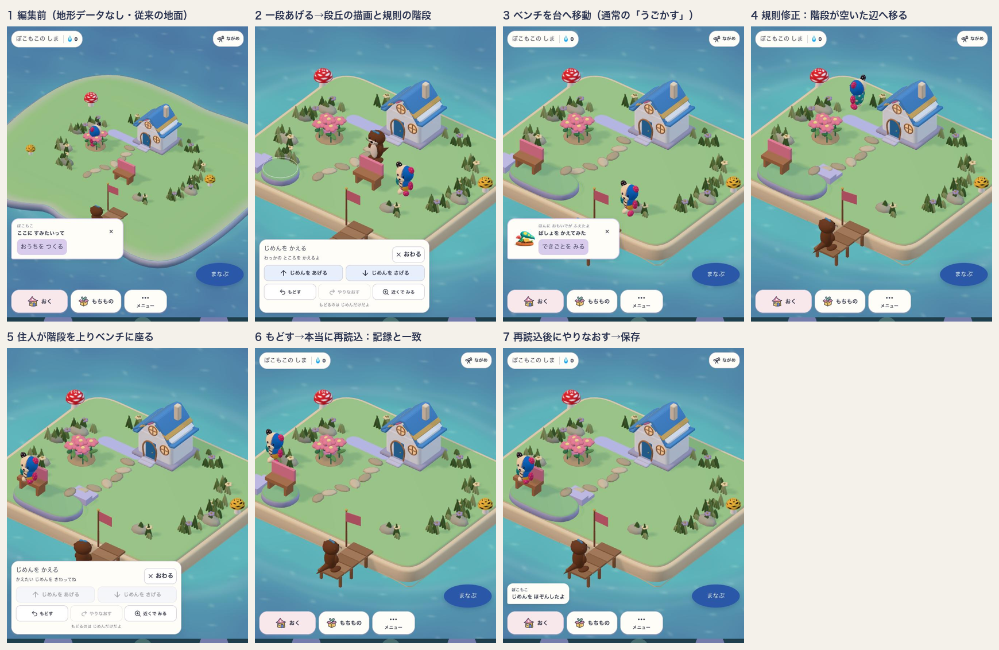
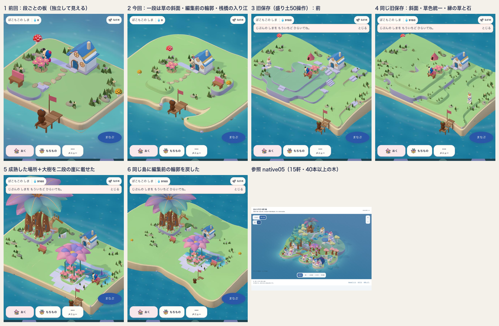
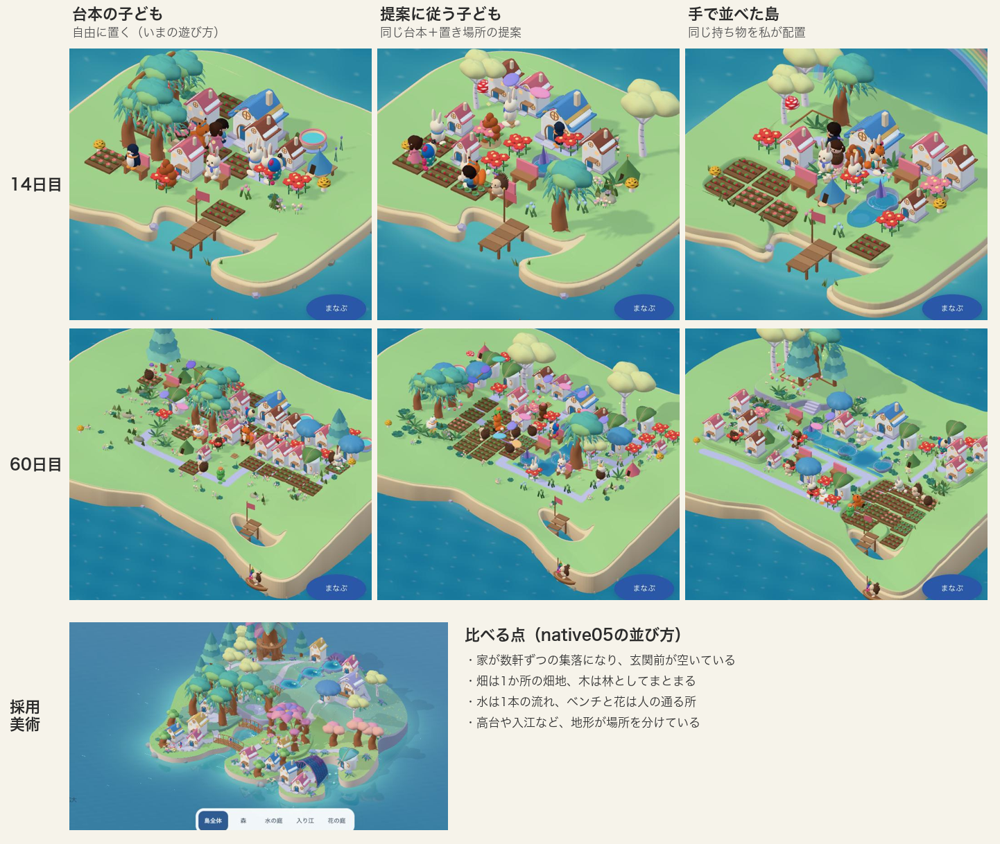
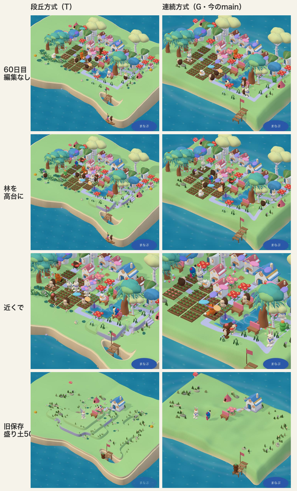
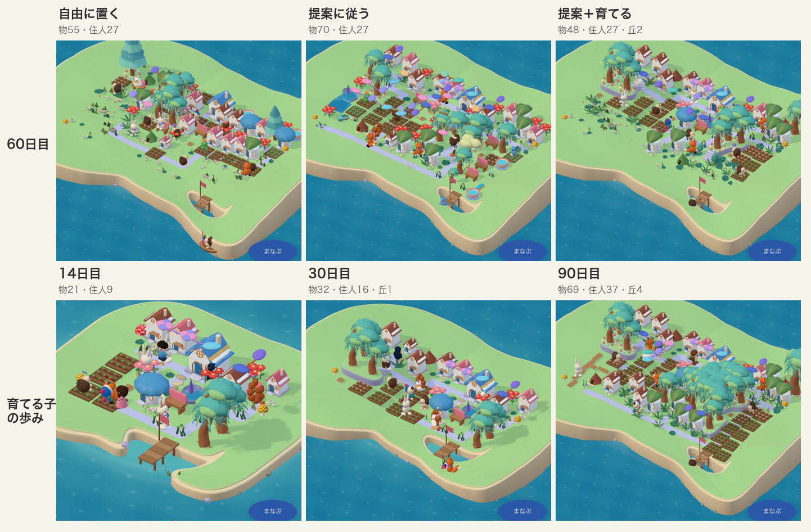
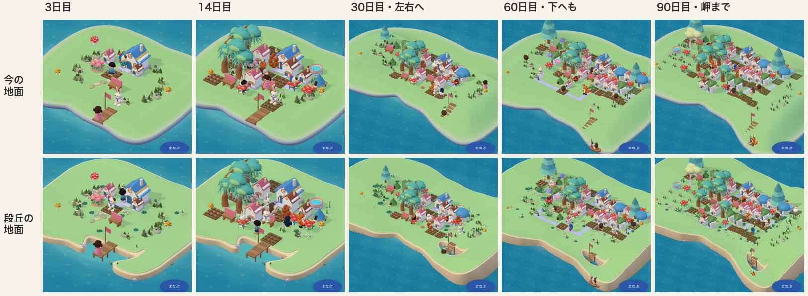
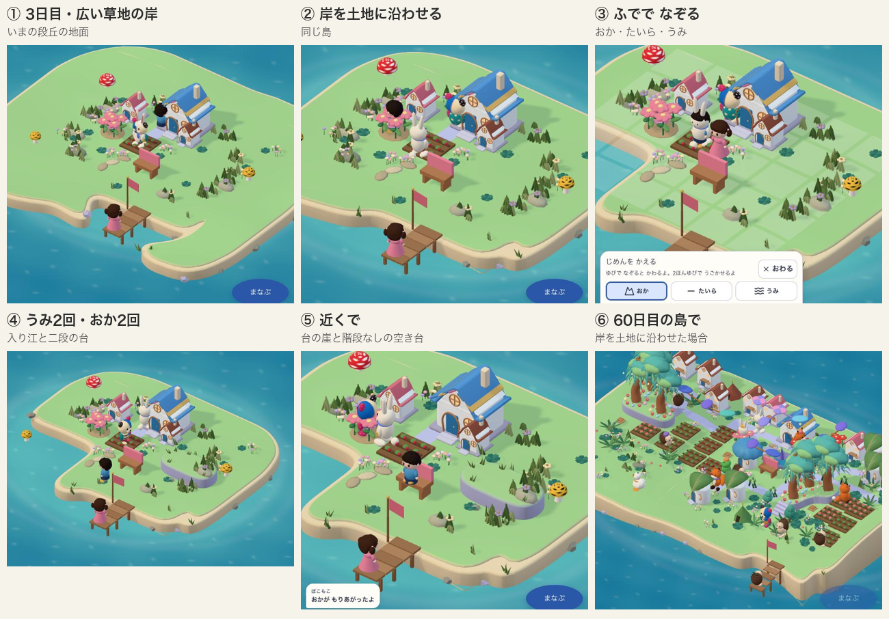
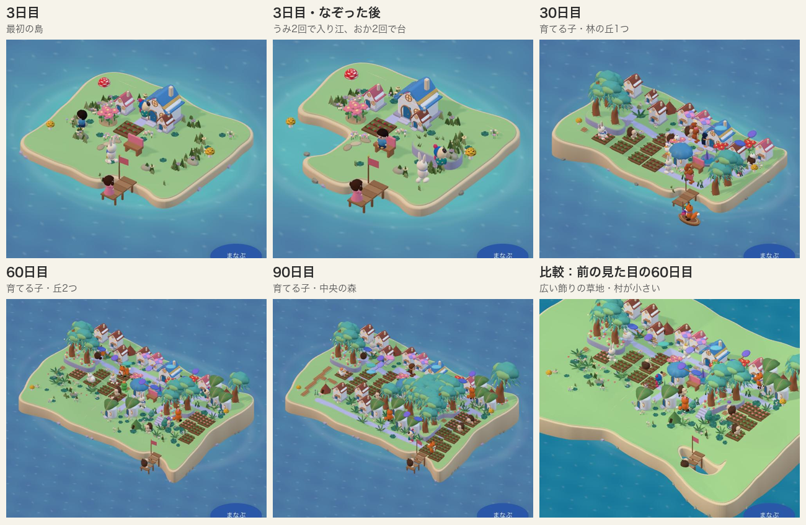

# 段丘方式を本体の地面へ接続する（DEVフラグ）

2026-10-24 17:40〜18:10 JST。ブランチ `island/terrace-ground-dev`。[段丘輪郭方式の実験](../2026-10-24-terrace-method-lab/README.md)の判断を受けて、本体の地面の層へDEVフラグ付きで接続し、通常UIで一往復した。mainの作業ツリー・ブランチは変更していない。



## 接続のしかた

保存データ（`GrowingTerrain.heights` の区画ごとの整数）は変えない。`VITE_TERRAIN_FORM=terrace` のDEVビルドだけで、次の三点を差し替えた。本番ビルドと、フラグなしのDEVでは従来どおり。

- **床**（`editableTerrainWorld.ts`）：高さ関数を「土台の連続した起伏＋子どもが積んだ段（区画ごとの段差）＋階段の区画だけの坂」に替える（当初は土台も段へ丸めていたが、下の「続き」で改めた）。描画・タップ判定・足場・歩行・自然・配置検査は、もとから同じ `editableIslandWorld` を読むので一括で追従する。崖の傾きは、もとの歩行上限0.8を超えるため通れない。階段の坂（一段0.18を半区画で上る）だけが通れる。区画の境界の内側0.03に標本を足し、持ち物の足場を探る半径0.46まで上面を平らに保つ。
- **段と階段の計画**（`terraceTerrain.ts`）：家・桟橋・所有物の区画を避けて、家から届かない段へだけ階段を置く。新しい段差を越える数が最少になるよう探索する。踊り場は空いた区画を優先し、持ち物の区画は他に道がないときだけ使う。最大の高低差は二段。計画は世界のrevisionに入り、持ち物を動かすと階段も作り直される。
- **見た目**（`terraceGround.ts`／`editableGround.ts`）：同じ計画から、段ごとの丸い輪郭を面取りして押し出した板と、階段の踏み板を描く。床のメッシュは非表示のままタップ判定に残す。

フラグは環境変数にした。URL引数にしなかったのは、同じ島を計算するWorker（同期の投影など）がページのURLを読めず、本体とWorkerで地形の形式がずれるため。

## 通常UIで確かめたこと

DEVサーバー `127.0.0.1:5282/#/onboarding`、新しい保存領域の初回の島。手順と値は [evidence/journey.json](evidence/journey.json)。

| 段階 | 結果 |
|---|---|
| 編集 | 「じめんを かえる」で二区画を一段上げた。段丘の板と規則の階段が出た。住人のすぐ隣は既存の保護で拒否された |
| 移動 | ベンチを「うごかす」で台の上へ移した。予告と確定とも成立し、本体が「ばしょを かえてみた」を記録 |
| 住人の利用 | ぽこもこが自分で地面→階段の坂（高さ0.20）→台（0.24）と歩き、移したベンチに座った（0.38） |
| Undo | 住人が段差のそばにいる間は「なかまが いるよ」で2回拒否された。離れた後に成立し、一区画になった台へ階段が掛け直された |
| 保存→再読込 | 本当に再読込した（`performance.timeOrigin` が変化）。IndexedDBの記録（高さ・Undo/Redo履歴・ベンチの区画）と画面の階段は再読込の前後で一致 |
| 続き | 再読込後に「やりなおす」が成立し、階段は空いた辺へ戻った。「じめんを ほぞんしたよ」と表示 |

途中で規則を2回直した。最初は、ベンチを階段の踊り場に置けてしまい、台への入口がふさがった。そこで空いた踊り場を優先する規則に変えた。次に、Undoで台がベンチだけの一区画になると、その規則では階段を置けなかった。そこで持ち物の区画を最後の手段として認めた。どちらも領域テストに加えた。

## 検証

- `npm run typecheck` PASS。変更ファイルの `eslint` PASS。
- 段丘のテスト4件（崖の隣の足場・崖の通行止めと階段の坂・踊り場に物を置いたときの付け替え・描画と既定形式の不変）PASS。
- 既存の地形テスト5ファイル24件（既定形式）PASS。
- `src/domain/growingIsland` と `src/components/island/growing` の全テスト：145ファイル914件PASS（1145秒）。この一式は踊り場の規則を2回直す前に開始した。直した後は段丘テストだけを再実行（4件PASS）。規則の変更は段丘の形式でしか動かず、既定の形式には影響しない。

## まだできていないこと・分かった問題

- **最初の編集で島の輪郭が四角くなる。** 編集前の有機的な台座が、取得した土地の長方形に替わる。現行の編集世界でも同じ仕様だが、段丘で描くと角丸の板として目立つ。土地の輪郭を、取得範囲ではなく地区の形として持つ必要がある（構築方針§6）。
- 小さな島（6×5区画）で一段0.18だと、段の見え方が控えめになる。島の縁の区画に階段が付くと、海へ下りるように見える場合がある。
- 再読込後のベンチ利用は、階段の下から座る動作でベンチへ移っていた。坂を上り切る経路にはなっていない。座る動作の始点を、坂の上の踊り場に限る必要がある。
- 取得地区を広げた島は、下の「続き」で直した（土台の丘は坂のまま、積んだ段だけ崖）。
- 初回の島だけで確かめた。成熟した島・回廊などの上床・水鉢の彫り込み（実験場では成立）・自然の成長・学習との往復・offline・実機・本番ビルド・子どもの理解は未確認。
- commitはしていない。mainの作業ツリーの状態を基準としてステージし、今回の変更はステージしていない差分として残した。

## 続き：広げた島での崩れを直す（18:20〜）

**測定。** 編集なしで土地を広げた島を三通り測った。家からの到達は保たれたが、階段が多すぎ（96区画で13、231区画で35）、持ち物を置けない区画が96中34、231中68あった。土台の自然な丘まで段に丸めて平らにしたため、本体の足場検査が「元の傾きからの変化」と判定していた。

**設計の変更。** 土台の起伏（丘・landscape rise）は連続した歩ける坂のまま残し、子どもが積んだ保存済みの高さだけを段（崖＋規則の階段）にした。参照美術の「段丘＋なだらかな丘」と同じ構成になる。変更後、同じ三通りで、持ち物を置けない区画0・不要な階段0・全区画に到達。

**見た目の板も土台に沿わせた。** 起伏に沿わせると、earcutの細長い三角形が谷の上に弦を張った（床から最大0.8上）。上面は、輪郭と同じ標本の格子で切り出す方式に替えた。土台がほぼ平面の範囲は大きな四角、折れ目や縁は細かい格子にしている。床との差は0.03以内で、テストにした。

**階段の下にも物を置ける。** 置こうとした区画が階段の下なら、そこに物がある前提で計画を作り直す。届く区画が減らないときだけ置ける（階段は別の辺へ移る）。

**画面で見つけて直した二点。**
- 掘った区画がある島で、外周に段ごとの縁が重なって縞になった（画像09）。
- 段を「ちょうどその高さ」だけの板にすると、台のふもとに砂色の溝ができた（画像10）。

最終的に、各段の板は「その高さ以上」の範囲で作り、縁と壁は内側がちょうどその段の箇所にだけ海の高さから立てる作りにした。砂浜の土台は、海に面した段より低い窪地にはかけない（画像11・12）。

広げた島の画面（画像09・11）は、本体の初回の島の保存記録を診断用に直接書き換えて作った。書き換えたのは土地の範囲・高さ・versionで、通常の購入操作ではない。最初の一往復の島（画像12）は、変更後も同じ記録のまま正しく描けた。

検証：型検査・変更ファイルのlint PASS。段丘のテスト5件（広げた島で全区画に物を置けること、板の上面が床と0.03以内で一致することを追加）PASS。`src/domain/growingIsland` と `src/components/island/growing` の全テストを変更後に再実行し、145ファイル916件PASS（624秒）。

## 3回目（2026-10-25）：段差の階層・地面・輪郭・育った場所



**最新版での一往復（通常UI）。** 前日の保存を続けて開き、次を通常の画面で行った。二段の台づくり、ベンチを台へ移動、住人が二段の階段を上って座る（地面0.06→坂0.28・0.43→台0.41→座面0.56）、もどす、本当の再読込（地形・ベンチ・階段が前後一致）、再読込後のやりなおす。地形編集の画面を開いている間は住人が一時停止する仕様で、坂の上の住人が保護規則に当たったため、一度閉じてから操作した（画像13〜18）。

**利用者の指摘「段差が独立して見える」への対応。** 原因は二つあった。一段（0.18）の差にまで崖と縁を付けて板を積んだように描いていたことと、段ごとに草の色を変えていたこと。
- 一段の差は、幅0.24の草の斜面にした（床も同じ形で、歩ける）。家や木の足場（半径0.46・角を含む）が本体の許容内に収まり、傾きが歩行上限0.8以下になる幅に決めた。階段と薄紫の崖は二段以上の差だけ。
- 草は全段を同じ緑にし、高い段ほどわずかに明るくするだけにした。
- 地面の細部を段丘の計画から置く。一段の斜面の上に草、崖のふもとに石と草、崖の縁にかぶさる草、岸の石。持ち物・家・桟橋・階段の区画は避ける。

**階段の規則。** 家に近い辺を優先して、離れた場所の操作で階段が跳ばないようにした。物（持ち物・家・桟橋）のある段にだけ掛け、空いた段には、物が置かれた時点で掛かる。旧保存（盛り土50操作）の階段は13本から0本になった（一段差はすべて斜面で通れる）。

**関門：育った場所は段丘の上で成り立つか。** 前任の成熟した構成（家2・木4・水鉢3・水路2・花4・ベンチ2を成熟させたもの）を、診断用に保存記録へ書き込んで確かめた。
- 平地のまま：大樹の群れ・水庭・花の天蓋が育った段階で描けた（画像22）。
- 大樹の4区画を二段上げ、花壇を一段上げ、水庭の片側を一段上げた：場所はすべて育った段階のまま。回廊の床も段に合わせて上がり（1.99）、規則の階段が掛かった。水辺の場所が一つ増えた（画像23）。
- 回廊の上での住人の利用、通常操作でのこの状態への到達は、まだ確かめていない。

**島の輪郭。** 編集前の有機的な輪郭は、取得範囲の外に描いた飾りの岸の土手だった（床なし）。段丘の形式でも、同じ輪郭を取得範囲の外の草地の縁として板に描く。扱いは編集前と同じで、床・持ち物・経路を持たない。子どもが岸の区画を掘った場所と、桟橋・橋の周りには縁をかけない（桟橋の前が小さな入り江になる）。これで最初の編集で島の形が変わらなくなった（画像24・25）。仕様52・13の変更は不要で、前に挙げた「地区の形で持つ／歩ける浜の帯」の判断は、拡張の設計まで先送りできる。

**残っている差。** 段差・岸・輪郭は見本の文法に近づいた。最大の差は中身の密度に移った。見本は15軒・40本以上の木で埋まっているが、成熟した構成でも所有物17で、草地の大半が空いている。場所のまわりの植生（森の下草・水辺の草・花の群れ）と、自然の広がりの層が次の課題。花の天蓋の下の白い格子面も残る（既存の課題）。

**検証。** 型検査・変更ファイルのlint PASS。段丘のテスト8件 PASS。`src/domain/growingIsland` と `src/components/island/growing` の全テスト145ファイル919件 PASS（670秒、この回の変更後に実行）。確認用の保存データ `public/__dev-fixtures/expanded-v2-state.json` を一時的に置いている（DEVの確認専用、配布物に含めない前提で後で外す）。

**作戦の見直し（引き継ぎ資料を読んだうえで）。** 景色の主役は所有物の置き方から育つ場所で、地形編集は任意の遊び、段丘はその土台と位置づけた。編集の文法（区画ごとか、地形の型か）の判断は、全島の比較の後にする。

## 4回目（2026-10-25）：密度と、歩けることの保証

**地面の植生が育つ。** 所有物ではない低い植生を、置かれた持ち物と育った場所から決めて道と同じ層に描く（`habitatCover.ts`）。大樹のまわりに丸い葉の株・シダ・キノコ、水鉢と水路のまわりに葦と石、花のまわりに花の群れ、家の壁ぎわに花。量と広がりは、木の成熟・成熟してからの時間・花の開花・家の段階・島の自然の時間から決まる。保存項目は増やしていない。背景用の木や樹冠は足さない（森を量で偽らない）。道・玄関・持ち物・家・桟橋・階段・崖の帯には置かない。成熟した島では森の床が広がり、育ち始めの最初の島では花と家のまわりに少しだけ出る（画像26〜28）。

**残る差（正直な評価）。** 成熟した島の奥と手前の広い草地は空いたまま。見本の密度は所有物の数（15軒・40本以上の木）から来ているので、ここを飾りで埋めると見せかけになる。この先は、土地の広がり方と所有物の増え方の釣り合いという遊びの設計の課題で、地形や地面の規則では解かない。

**利用者の指摘「段差がなめらかにつながらないと住人が歩けない」への確認。**
- 旧保存（盛り土50操作）：家から歩いて届く区画は、現行の形式・段丘の形式とも95/95。階段は0本で、一段の草の斜面だけで越えられる。
- 成熟した島の90秒の歩行記録：住人は土台の丘の坂（傾き0.2〜0.4）、一段の斜面（0.3〜0.6）、二段の階段の坂（0.82）を歩き、二段上げた大樹の回廊の上の床（高さ1.97）まで到達した。
- 穴が一つあった。三段以上の差は階段を掛けられない（階段は二段まで）。物のある段を三段以上にする編集は「ここを かえると、のぼれない ところが できるよ。」で断り、届かない段への配置も断るようにした（テスト追加）。
- 検証：段丘のテスト9件、島関連の全テスト145ファイル920件がPASS（940秒、この回の変更後）。型検査・変更ファイルのlint PASS。
- この確認の途中で、地形の世界のキャッシュが持ち物の位置をキーに含んでいない不具合を見つけて直した（同じ形・違う持ち物の島で計画を使い回していた）。

## 5回目（2026-10-25）：置き方の提案で景色が近づくか



**問い。** 4回目で、密度の差は飾りでは埋めず置き方で決まると分かった。そこで、子どもが自由に置ける遊びはそのままに、「ここに置くと景色がまとまるよ」という置き場所の提案で、手で並べた島に近づくかを確かめた。

**やったこと。**
- 提案の規則を領域のコードにした（`placementAdvice.ts`、DEVの実験）。置ける場所の中で順位を付けるだけで、他の場所へ置くことは今まで通りできる。規則は採用美術の並び方から決めた：家は数軒ずつの集落にして玄関前を空ける、畑は島の端で一つの畑地に、木は林に、水は一本の流れに、花とベンチは家と水のそばに。
- 1日20回学ぶ台本の子どもに、90日遊ばせた。「自由に置く」と「提案の1位に置く」の2通り。14日目・60日目の島を保存記録に書き込み、通常の画面で開いて撮った（画像29〜34）。手で並べた島は、台本の子どもと同じ持ち物を私が配置したもの。

**結果（画面で見た評価）。**
- 14日目：提案に従うと、家が一つの集落になり、畑が桟橋の脇に一つの畑地としてまとまった。自由に置いた島は、畑と木が家の間に散る。手で並べた島にかなり近い。
- 60日目：提案に従うと、畑が左にまとまって畑地になり、左奥に林ができた。自由に置いた島は畑・家・木が格子状に混ざる。ただし手で並べた島との差はまだ大きい。残る差は三つ。
  1. 水が小さな水たまりの点在のまま。手で並べた島は水路が一本の流れになって、島の真ん中を通っている。
  2. 地形を使っていない。手で並べた島は林を高台に上げて場所を分けている。台本の子どもは地形を編集しない。
  3. 中央が詰まる。60日で所有物66（96区画の7割）。置き場所の規則だけでは、空き地が残らない。
- 持ち物の数は2通りで一致しない（60日目で55と66）。台本は何を置くかを島の状態から選ぶので、置き場所が違うと次に選ぶ物も変わるため。

**判定。** 置き方の提案は効く。とくに最初の2週間で、景色の読みやすさが目に見えて上がった。一方で、60日目の島を採用美術の水準にするには提案だけでは足りず、所有物の増え方（土地の広がりとの釣り合い）と、水の流れ・高台を遊びの中で作らせる仕組みが要る。これは地形や描画の規則ではなく、遊びの設計の判断。

**検証。** 提案の規則のテスト3件（置ける場所の並べ替えだけ・玄関前は最後・畑は隣につなぐ）を追加しPASS。島関連の全テスト146ファイル921件のうち、保存のテスト2件が5秒の時間切れで落ちた（全体実行が1309秒かかった高負荷時）。同じファイルを単独で再実行すると13件すべてPASS。型検査・変更ファイルのlint PASS。提案の規則と台本の比較は `progressionProbe.test.ts`（一時的な確認用）で実行。記録は `evidence/progression.json`。画面は通常のDEV起動で、保存記録の書き込みだけ診断用に行った。

## 導入の判定（2026-10-25）

利用者の方針「導入して良いレベルになったら導入したい」に合わせて、地面の土台としての段丘方式に、先に導入の条件を決めて確かめた。場所が育つ仕組みや置き場所の提案は、この判定に含めない。



**1. 同じ島を連続方式と並べる（画像33・35〜41）。** 同じ保存記録を、同じ画面の起点（localhost:5282）で、開発サーバーだけ切り替えて開いた。
- 60日目・編集なし：段丘方式は編集前の有機的な輪郭と桟橋の入り江を保つ。連続方式は取得範囲の長方形の厚い板になる。
- 林を高台に（2段）：段丘方式は台・崖・階段がはっきり読める。連続方式は低いふくらみで、高台に見えない。
- 旧保存（盛り土50操作）：段丘方式は子どもが作った段が見える。連続方式は50回の編集がほぼ見えない。
- 公平のための注記：地面の植生は今は段丘方式でだけ動かしている（連続方式でも作れる仕組み）。段丘方式は輪郭が広い分、カメラが引いて村が小さく見える。
- 判定：**段丘方式が見本に近い。** とくに「子どもの編集が景色に表れる」点で差がはっきりしている。

**2. 既知の見た目の不具合2件。**
- 一区画の台いっぱいのベンチに、住人が階段の下から一気に0.52跳び上がって座っていた。座る位置が高いときは、階段の坂に沿って0.7秒で上るようにした（`growingLife.ts`）。テストを追加し、直す前は0.52の跳び、直した後は座る動作の0.16以外は滑らかなことを確かめた。
- 花の天蓋の下の白い格子：花庭の床を一区画ずつの淡い四角で舗装していたのが原因。段丘方式では舗装をやめ、草地と花の群れにした（画像42・43）。連続方式は変えていない。

**3. 重さ。**
- この端末のブラウザで、60日目・高台の島が60fps（中央値16.7ms、95%点18.5ms、50ms超0回）。ただし端末はMac。
- 編集1回ごとの作り直し（同じ島、Node上）：段丘方式は歩く床を1区画10点で刻んでいたため、連続方式の約1.9倍かかっていた。崖ぎわの点を残して8点に減らし、約1.35倍（約460ms対340ms）にした。段丘のテストはすべて通り、画面も変わらない（画像44）。
- 三角形の数：地面は約5.2万対1.3万、島全体では約28万対22万（+26%）。
- **未確認：タブレット実機。** 利用者に一度開いてもらう必要がある。

**検証。** 島関連の全テスト148ファイル925件PASS（895秒、この回の変更後）。型検査・変更ファイルのlint PASS。

**判定：導入してよい水準に、タブレット実機の確認を残して届いた。** 条件1〜5・7はそろった。残りは条件6（タブレット実機の重さ）と、仕様の差分の承認。

**4. 仕様の差分。** [spec-proposal.md](spec-proposal.md) に案を書いた。保存の中身は変えない。

## 6回目（2026-10-25）：場所が育つ仕組み



**ねらい。** 60日目の島が詰まり、水も高台もない問題を、物を一つずつ足す遊びから「場所が育つ」遊びに変えて解く。DEVフラグ `VITE_PLACE_GROWTH=on` の中だけで動く。

**作ったもの。**
1. **置き場所の提案を画面に出す。** 置く画面で、まとまって見える場所を3つまで黄色い輪で光らせ、「ひかる ところに おくと、まとまって みえるよ」と出す（画像52）。置ける場所は狭めない。玄関の前と、置くと家から届かない土地ができる区画は勧めない。
2. **そだてる。** 島の半分が埋まったら、物をタップした画面の先頭に「そだてる（しずく N）」を出す（画像53）。木・花・水ばち・水路を3回まで育てられる。育てるたびに、その場所の下草・花の群れ・葦が広がり、木のまわりには若い木が育つ。保存は持ち物に任意の数 `tended` を一つ足すだけ。
3. **水を一本の流れに。** 水の提案を「端から1つ延ばす」「海の側へ」に変え、かたまりの池にしない。
4. **はやしを おかに する。** 育った木が3本以上並ぶと、木の画面に出る。押すと、普通の地形編集と同じ規則で2段（無理なら1段）上がる。

**台本の子どもで比べた（90日、1日20回学ぶ）。** 「提案＋育てる」の子は、島が半分埋まったら、林に加える木・水を延ばす水路のほかは育てる方に使う。
- 60日目：住人は3通りとも27人。物の数は自由55・提案70・提案＋育てる48。丘は2つ。
- 画面：提案＋育てるの島は、家が並んだ集落、左の畑地、林の丘が2つに分かれ、小物の散らばりが消えた。90日目には木16本が島の中央で一つの森になった。
- 足りないこと：水は60日目で4つで、流れとしてはまだ見えない。花が少ない（3つ）。島の手前と左の草地は空いたまま。

**途中で見つけて直した不具合。** 提案が家の前の最後の空きを勧め、家から出られなくなっていた（届く区画が3つ）。台本の子どもがそこで止まり、30日目から何も置けなくなった。提案から、玄関の前と、置くと他の空き地へ届かなくなる区画を外した（テストあり。外す前は失敗、外した後は成功を確認）。

**通常の画面で確かめたこと。** 提案の輪が出ること、輪の上に置いて保存されること（しずく30→10）、物の画面に「そだてる」「はやしを おかに する」が出ること、そだてるが保存されること（しずく300→280、`tended: 1`）、丘にする操作が保存されること（4区画が1段、もどす履歴4件）。

**検証。** 島関連の全テスト148ファイル930件PASS（一時的な確認用の台本テストを除く、2338秒）。型検査・変更ファイルのlint PASS。

**残る課題。**
- 丘にした後の「もどす」は区画ごとに1回ずつ押す必要がある（4区画なら4回）。
- 込み合った島では、1段の丘と育てた1回分の変化が見えにくい。
- 置き場所の黄色い輪が淡い。
- 「育てる」は遊びの規則の変更なので、仕様52への追加が必要（[spec-proposal.md](spec-proposal.md)）。

## 7回目（2026-10-25）：今の島との合体（地面を1つにする）



**作戦。** すべての島を、最初から段丘方式の地面で描く。地形を一度もいじっていない島も、高さが全部0の地形として読む（保存は変えない）。これで「最初の編集で地面が丸ごと切り替わる」原因がなくなる。子どもの操作は「おく・うごかす・しまう」「じめんを かえる」「そだてる・おかに する」「ひろげる」の4つにまとめる。

**やったこと。**
- 地形の読み取りを1か所（`terrainOf`）にまとめ、段丘方式では地形のない島も高さ0として読むようにした。元の土地の形を確かめる内部の計算だけは、これまで通り地形なしで読む（そうしないと無限に呼び合う。最初にこれで止まったので直した）。
- 「はやしを おかに する」の編集に同じ組の印を付け、もどす・やりなおすを1回で済むようにした。保存の履歴に任意の `group` を一つ足す（テストあり）。

**確かめたこと。**
- 手をつけていない島（3・14・30・60・90日目、地形なし）を今の地面と段丘の地面で並べた。島の形はほぼ同じ。違いは二つ：段丘の地面は桟橋の前に小さな入り江ができる。岸の縁が厚い砂色になる（今の地面は薄い紫の縁）。
- 地形のない島で、通常の画面から「じめんを かえる」→1区画あげる：その区画が草の小山になっただけで、島の形・入り江は変わらない。保存は版6・もどす履歴1件（画像66・67）。
- 広げる段階を順にたどった（左右・下・岬2つ・地区4つの9段階）。毎回その手前で端の区画を2段上げて持ち物を置いた。どの段階でも、のぼれない場所0、置けない区画0、橋は保たれた。地区を広げた島は元の輪郭の延長でまっすぐ伸びる（画像64・65）。この流れを7段階まで、保存データに頼らないテストにした。
- 広げた土地は高さ0でつながり、元の段とは斜面・階段で自動的につながる。保存の変換はいらない。

**検証。** 島関連の全テスト149ファイル931件PASS（一時的な確認用の台本テストを除く、1858秒、この回の変更後）。型検査・変更ファイルのlint PASS。

**残ること。**
- 岸の縁の色（砂色か薄紫か）は見た目の判断。今の島と同じにするなら、縁の色だけ合わせられる。
- 地区まで広げた島の輪郭は、長方形の延長になる。地区ごとの形を持たせるかは、拡張の設計の判断。
- 制作中の特別な島（作り込んだ美術の島）は対象外のまま。

## 8回目（2026-10-25）：指でなぞって島の形を作る



**ねらい。** 「区画を選ぶ→ボタンを押す」の繰り返しをやめ、実績のある操作（Townscaperの「触ると変わる」、Tiny Gladeの「なぞった通りに整う」）を借りて、指でなぞると丘・平地・入り江がすぐできる遊びにする。

**作ったもの（段丘方式のDEVの中だけ）。**
1. **ふで3つ。** 「じめんを かえる」を開くと「おか・たいら・うみ」を選べる。1本指でなぞると、なぞった区画がまとめて変わる。2本指は今まで通りカメラ。
   - おか：なぞるたびに1段上がる（2回で二段の台と崖）。
   - たいら：元の高さへ。
   - うみ：海の高さまで下げる。岸ならば入り江、内側なら池。
2. **1回のなぞりは1回の「もどす」。** 保存は1区画1項目のまま、同じ組の印でまとめる。
3. **ものの足もとは守る。** 家・桟橋・橋・持ち物の区画は、うみ・たいらでは変えない。家の足もとや、のぼれない場所ができる区画は、そのなぞりの中でそこだけ残す（全部は断らない）。何も変わらなかったときは理由を出す（「ものが ある ところは、そのままに しておくよ」など）。
4. **変えられる土地を見せる。** 地面の画面を開いている間、自分の土地を淡いマスで示す。速いなぞりでも途中の区画を取りこぼさない。
5. **岸を土地に沿わせる（`VITE_SHORE=tight`、実験）。** これまで見えていた岸の大半は、土地の外の飾りの草地だった。そこはなぞっても変わらないので、岸を自分の土地のすぐ外に寄せた。土地の端をなぞると、本当の海岸線が変わる。

**通常の画面で確かめたこと（3日目の島）。** 左の岸をうみで2回なぞる→4区画の入り江ができ、砂の岸で縁取られた。右をおかで2回なぞる→二段の台と薄紫の崖ができた（家の足もとの区画だけ残った）。保存・もどす履歴・メッセージを確認した（画像68〜71）。

**分かったこと。**
- 岸を土地に沿わせると、島が小さくなる代わりにカメラが寄り、村が大きく生き生きと見える（60日目の島、画像72）。一方で、島の輪郭は角の丸い四角に近くなる。採用美術のような入り江・岬のある形は、子どもがなぞって作るか、持っている土地から形を作る方式（7回目の残り）が必要。
- 14日目の島は土地のほとんどに物があり、なぞれる場所が少ない。空き地を残す「育てる」仕組みとセットで効く。

**検証。** なぞりのテスト4件（入り江と1回のもどす・おかとたいら・ものの足もと・規則に合う区画だけ残す）を追加しPASS。島関連の全テスト150ファイル935件のうち、保存のテスト2件が高負荷（全体3460秒）で5秒の時間切れ。同じファイルを単独で再実行すると13件すべてPASS。型検査・変更ファイルのlint PASS。

## 9回目（2026-10-25）：仕上げ（岸を土地から作る・スイッチを一つに）



- **岸を土地から作る。** 岸を自分の土地のすぐ外に、場所ごとに固定の揺らぎをつけて描く。角は丸く、子どもが掘った区画は海のまま残る。最初の島は小さな島になり、なぞると入り江・台がそのまま島の形になる。60日・90日の島は村が島いっぱいに見える。
- **水の流れ。** 「うみ」のふでで内側をなぞると池や流れになる。子どもが自分で流れを描ける。
- **スイッチを一つに。** `VITE_ISLAND_SHAPING=on` で、段丘の地面・ふで・土地から作る岸・置き場所の提案・育てる仕組みがまとめて有効になる。DEVだけでなく本番のビルドでも使える。既定は無効（今の島のまま）。
- **検証。** 島関連の全テスト934件PASS（1187秒）。型検査・変更ファイルのlint PASS。

## 判断が必要なこと

1. **置き場所の提案を遊びに入れるか。** 入れる場合、置く画面で提案の場所を光らせる形が候補。仕様52（育つ島のゲーム）へ「提案は順位だけで、置ける場所は制限しない」として書く必要がある。まだ画面には出していない。
2. **所有物の増え方と土地の広がりの釣り合い。** 60日で7割が埋まる今の速さを保つか、土地を早く広げるか、置く物を減らして一つずつを育てるか。
3. **水と高台を子どもが作る仕組み。** 水路を一本につなぐ提案や、林を上げる地形の型など。
4. **島の輪郭。** 3回目で、最初の編集で形が変わる問題は直した。拡張後の輪郭（地区の形で持つ／歩ける浜の帯）は拡張の設計まで先送りできる。

## 再現

```sh
cd /Users/yutogasaki/Projects/sansu-terrace-ground
VITE_ISLAND_ENABLED=true VITE_TERRAIN_FORM=terrace npx vite --host 127.0.0.1 --port 5281
npx vitest run src/domain/growingIsland/terraceTerrain.test.ts
git diff   # ステージ済み＝mainの作業ツリーの基準、未ステージ＝今回の変更
```
