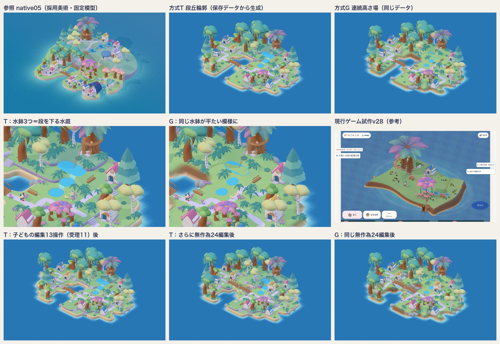

# 段丘輪郭方式の実験 — 地形の作り方を選び直す

2026-10-24 16:50〜17:20 JST。島の制作方式を目標から選び直すため、方式比較の単位を「水庭の一画」から「地形の表現そのもの」へ変えた。製品source・本人保存・通常配布は変更していない。commit/push/公開なし。



## 何を確かめたか

採用native05のBlender制作スクリプト（`2026-10-10-island-final-3d/build-scene.py` の `island_plate`）を読んだ。地形は**離散した高さごとの滑らかな閉輪郭を、丸い面取り付きで押し出して重ねた板**でできていた。一方、ゲーム本体（`editableGround.ts`）は「描画・タップ判定・足場」が一枚の連続三角形面を共有する。そのため、見える地形も歩ける斜面にせざるを得ない。結果として、平たい一枚板・茶色い側壁・地面に描いたような池になっていた。

参照のGLBをthree.jsで表示した既存ビューアは目標とほぼ同じ見た目を出せている。描画器の性能は主因ではない。そこで、**同じ保存データ形式**（区画ごとの整数高さ＝`GrowingTerrain.heights` と同型、所有物の区画・向き）から、二つの地形生成器を切り替えて比べた。

- **方式T（段丘輪郭）**：高さごとの領域をぼかして等値線を取り、丸い輪郭の板を面取りで押し出して重ねる。側面は薄紫の石、海面の段は砂。歩行面は段の平らな上面で、段差には規則で置く階段、水1区画には橋を掛ける。水鉢は所有物で、その段に穴を彫って水面を張り、一段下の水鉢へ滝を掛ける。
- **方式G（現行）**：同じ高さを `rawHeight` と同じsmoothstep双線形で連続面にする。急斜面は茶色、岸は砂の坂。水鉢は地表の水色の面。
- 家・木・大樹・花の天蓋・住人・橋・地被は、両方式とも参照GLBの部品をそのまま切り出して使う。光・正射カメラも参照ビューアと同じ。

## 結果

| 確かめたこと | 方式T | 方式G |
|---|---|---|
| 参照との地形の見え方（全景・近景・丘） | 段・岸・崖の縁・浅瀬の輪が、参照と同じ造形の文法で出る | 段が丸い盛り上がりに溶け、岸は砂のぼやけた坂、急斜面は茶色。v28と同じ傾向 |
| 水庭（水鉢3つ＋段差） | 縁のある窪みが段ごとに下り、滝でつながる | 平たい水色の模様。一部は斜面に埋まる |
| 子どもの編集13操作（受理11） | 形の文法を保持。新しい段に階段12・橋1を自動配置、全戸の入口が接続 | 形は溶けたまま。全戸接続 |
| 同じ種・同じ出発点からの無作為編集24回 | 受理24／拒否67。T固有の拒否は「階段の場所」1回 | 受理24／拒否65 |
| 住人の実利用 | 拠点から自動の階段を1回上り、新しく盛った段へ移したベンチに到着 | （歩行は斜面で成立） |
| 保存→再読込 | 島データ・階段・橋が一致（階段と橋は再検証付きのヒントとして保存） | 島データ一致 |
| 全再生成の時間（同じMac、5回） | 52〜66ms | 19〜27ms |

数値は [evidence/run.json](evidence/run.json)（bundle SHA256 `15a33fad…`、`capture.mjs` で自動取得、console error 0）。画像は `evidence/` に保存した。ゲームのv21で観測した1.3秒・v27の2.6〜3.2秒とは計算範囲が違うため、直接は比べない。ただし、地形方式そのものが数秒の待ちの原因にはならないことは分かる。

## 判断

**地形は方式Tへ切り替える。島全体を作り直す必要はない。作り直すのは「地面の層」だけ。**

- 支配的だった要因は地形の表現だった。素材・描画・部品の質ではない。描画と歩行面を一枚の連続面に兼ねさせた構造が、参照の段丘造形を原理的に作れなくしていた。v28の「池が平たい」もこの一例で、池部品の作り方の問題ではない。
- 方式Tは保存データの形を変えない。所有・成熟・学習・保存の層は保持できる。変えるのは地面の生成・歩行面・接続部品（階段・橋・水鉢の穴と滝）の導出。
- 「現行の自動生成」と「美術部品を接続規則で組む」の二択は、適切な比較軸ではなかった。役割分担が答えになる。地形は参照と同じ作り方の規則生成、階段・橋・滝・家・木は美術部品を規則で置く。
- これまでの試作チェーン（`2026-10-23-place-brush-trial` の文字列置換transform群）へは積み増さない。本体の地面の境界へ新しく接続する。

## 失う自由度と代案

- 段差の移動には階段の場所が要る（下の区画が空いていること）。置けない場合、入口を切る編集は「いえや ベンチに いけなくなるよ」で拒否する。今回の試料では、無作為24回の拒否数はGとほぼ同じだった。過密な島では差が増える見込みで、未測定。代案は、空いた長い境界を歩ける草の坂として描く縁の種類を追加すること。参照の大きな丘も坂を使っている。
- 隣り合う2段以上の差は崖になり、直接は上れない。中間の段が必要。
- 斜めにしか接しない段どうしは、見た目もくびれて別の段になり、歩行もつながらない。
- 橋は、水1区画を挟んだ海面の段どうしにだけ掛かる。広い水は渡れない。
- 掘って水になるのは海面の高さだけ。丘の上の水は水鉢（所有物）で作る。

## まだ届いていないこと

- **全島美術は未完。** 参照との差は残る。密度と主景の大きさ、地面の細部（草・飛び石・花のまとまり）、段丘と坂の併用、地区ごとの主景が足りない。これらは地形方式ではなく内容と配置規則の層の課題。
- 無作為編集後は、1区画の小さな台と階段が増えて画面が騒がしくなる。空き区画まで全部つなぐ貪欲探索のため、階段の数は編集の履歴でぶれる（入口は常に保持）。「行き先のある場所だけをつなぐ」規則へ絞る必要がある。
- 本体の `/#/island`、配置予告、タップ判定、既存の大樹回廊などの上床、旧保存の見え方は未接続・未検証。特に旧保存の高さは連続面用に付けられている（本体の段差は区画幅の0.18）。段丘で描くと崖が増える可能性があり、実保存での確認が必要。
- 実機の性能（推定でMacの3〜5倍）、ドラッグ中の予告、子どもの理解・再訪は未確認。
- 部品は参照GLBから名前と位置で切り出した。ゲームの部品キットとは別。ベンチは貝殻の集会所の座板で代用している。

## 次の一歩

1. 方式Tを本体の地面の境界（`editableGround` と `editableTerrainWorld` の床）へ、DEVフラグ付きで別ブランチに接続する。歩行面は段の上面と階段・橋の四角形を `WorldFloor` として出す。
2. 本体の通常UIで「地形編集→所有物移動→住人の利用→Undo→保存→再読込」を一往復する。実保存の旧データの見え方も確認する。
3. 接続規則を絞る（行き先のある場所だけ）。坂の縁を加え、全景を参照と同縮尺で再比較する。

## 再現

```sh
node_modules/.bin/esbuild docs/design/2026-10-24-terrace-method-lab/lab.ts --bundle --format=esm --outfile=docs/design/2026-10-24-terrace-method-lab/lab.bundle.js
python3 -m http.server 8241 --bind 127.0.0.1 --directory docs
node docs/design/2026-10-24-terrace-method-lab/capture.mjs
python3 docs/design/2026-10-24-terrace-method-lab/contact-sheet.py
```

`http://127.0.0.1:8241/design/2026-10-24-terrace-method-lab/` を開くと、方式T／G／参照の切替、あげる・さげる・うごかす、もどす、ほぞん、ランダム12回を操作できる。`?fresh` を付けると見本から始まる。保存はこのページ専用のlocalStorageで、本人の島には書き込まない。
