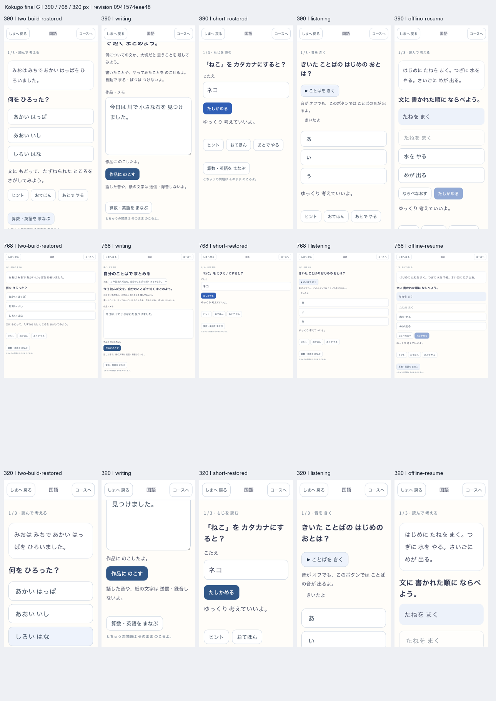

# 国語の本体実装と検証

2026-10-25。利用者の「いっきに実装」に対応したローカル実装。[現行契約](../../product/kokugo.md)、[境界の決定](../../adr/2026-10-25-kokugo-course-boundary.md)。

## 対象

幼児3〜4歳／5〜6歳／小1〜小6の8目安、かな・漢字・語彙・文・読解・表現の6領域46単元。41採点単元×6例、5自由活動単元×3題、読書3作品。初回設定・追加本人・設定・学習の教科切替から利用できる。

選択、語順、根拠の選択、短答、音声、自由作品を持つ。初答・支援・独力・異なる編集family・対象条件・後日の事実を分け、未知の短答を自動誤答にしない。中断した本文・選択肢・音声hash・下書き・支援を予約へ固定する。作品の保存版は次の下書きで失わない。

学習DB v11は専用6表の追加。既存のmath/vocabの予約や実績を再分類せず、国語だけの新規本人に算数の既習memoryを作らない。完了outboxと送信元の証拠検証、島の共通台帳で2しずく・2まち時間を一度だけ配送する。本人削除の耐久フェンスも共用する。

## 検証の区別

技術検証は、headless Chromiumと固定された本番形式build、fake IndexedDBの障害／競合試験を用いる。国語の通常旅程は隔離した既存本人fixture、初回旅程は空のブラウザから実UIで本人を作成する。実児童の観察や教材採用を意味しない。

最終結果、対象hash、コマンド、実行時刻、実際のversionと未確認範囲は `verification.json` と各reportに記録する。DEVの途中診断にはHMRを含むため、固定buildの受入と分ける。旧Exploreの表示判定で初回smokeに失敗した記録を残し、変更を止めた再実行と区別する。保護者の既存PIN仕様は変更せず、smokeの古い入力判定を明示的なpassword属性の確認へ合わせた。

## 未確認・後続

全配当漢字の教材化、児童／国語校閲者による採用、音声の実聴、実機、継続的な学習効果・自発的再訪は未確認。3教科mix、作文／長文の報酬単位、手書き認識、録音、縦書き、教科横断の推薦は後続の仕様判断である。教材の訂正・追加供給は既存の履歴を本人の誤りへ書き換えない。

公開、push、commit、DBの外部移行は行っていない。作業開始時からある多数の未commit変更を含むローカルの候補で、国語の変更以外をこの作業の成果へ読み替えない。標準ポータルの別の島タスクの根拠hashの不整合は、そのタスクの状態を変えずに報告する。

## 固定ビルドの実画面

[更新・offline・通常旅程のreport](production-update/report.json)は390／768／320pxの3ケース、[空の初回からのreport](production-intake/report.json)は390／768pxの2ケース。各画面のroot revision／version、Island=true、NatureTown=false、実SW制御を照合する。contact sheetは更新後の最終Cだけから構成し、元のPNGを各reportと同じフォルダに保持する。実スピーカーの聞こえ方を測った証拠ではない。

最終更新試験の入力は[build B](build-b-inputs.json)と[build C](build-c-inputs.json)、実配信metadataは[B](build-b-version.json)と[C](build-c-version.json)。過去のA→B診断の入力[A](build-a-inputs.json)も保持する。別々の固定sourceから実際にbuildし、hash付きの実JSとSWを切り替えた。本文の版を変えた教材訂正の実配布試験ではない。対象ビルドに含む既存の島・地形等のdirty変更の採用判断は、この国語の検証で変更しない。

本人削除は別タブの設定画面から実際に実行し、専用6表の削除と学習画面の安全な退出を確認した。最終source hashは `0941574eae4880829601994193da9e590107c6ca1e9e77c1f19eed5d122e9fb1`、root revisionは `kokugo-0941574eae48`。

## 自動検証の集計

全体単体試験は[分割実行の内訳](unit-suite.json)で667ファイル・5,614件PASS。初回の既存DB版／mock不一致を修正し、完了済み95ファイルを保持して残り572ファイルを再実行した。単一実行の無失敗へ読み替えない。標準smokeは32件PASS。build・型・lint・実更新／offline・新規本人の結果は[検証一覧](verification.json)とログ（ローカルログ：`logs/remaining-suite.log`）を参照。

文書検査と旧agent索引の生成／一致検査はPASS。標準ポータルは既存の島タスクのflow根拠hashで停止し、生成済みポータルのcanonical文書snapshotも古い。直接再現ログ（ローカルログ：`logs/portal-render.log`）を保持する。別タスクの採用状態や証拠hashをこの作業で更新して合格にはしていない。
