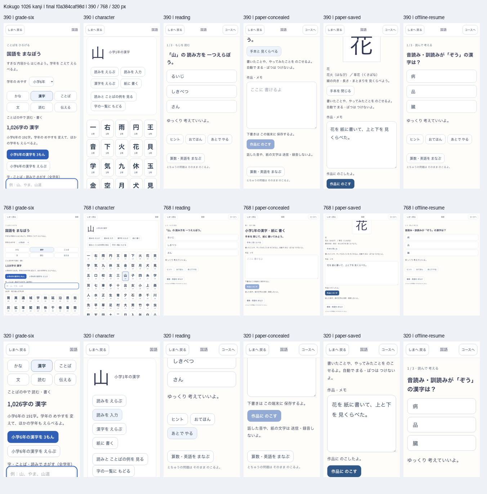

# 全配当漢字の実装と検証

2026-10-25。利用者の「全配当漢字もいっきに実装して」に対応したローカル実装。[現行仕様](../../product/kokugo-kanji.md)。

## 提供する内容

小1 80／小2 160／小3 200／小4 202／小5 193／小6 191の1,026字を収録。2,052用例と、学年別24コース（読みを選ぶ・読みを入力・漢字を選ぶ・紙に書く）を追加した。初期46単元は保持する。漢字・用例・代表音訓で全学年を検索し、学年または一字に絞って練習する。

配当と小学校段階の代表音訓は[文部科学省の原資料と取得hash](sources.json)に基づく。用例は独自の選定・読み付けである。媛・岐・滋・阪は、小学校段階に単字音訓を置かないため地名で2問を用意する。同じ字だけの例や県名等の延長は独立した文脈へ数え直さない。

読みと表記選択、紙の筆記技能を分離する。手本・検索による露出を各回答形式の既存進捗へ記録し、見た直後に独力を得ない。作品は専用の問題IDで本人に保存する。字ごとの最低確認条件を満たさないものは、回数で習得済みにしない。復習期日を早い練習や手本で先送りしない。

## 固定版と共有作業の境界

最終ビルドは[入力manifest](candidate-3-inputs.json)のsource hash `f0a384caf98df60a101109ee9ef5a3fe60254702abf3777805ba590dfde2d335`、[実version](version.json)のrevision `kanji-f0a384caf98d`。直前の国語固定版 `kokugo-0941574eae48` に今回の国語ファイルを重ねた隔離ソースでbuildした。

共有作業ツリーには別作業の地形編集の型エラーがあり、今回の国語変更へ混ぜて直していない。共有ツリーの診断（ローカルログ：`logs/shared-tree-typecheck.log`）と、隔離した国語候補の型を含むbuild（ローカルログ：`logs/build-final.log`）を区別する。現在の全共有ツリーや別の島タスクの採用・配布合格を意味しない。実利用者のDBは触らず、ブラウザ試験は新規の隔離した本人を使った。commit・push・公開・deployは行っていない。

## 読みの品質検査

最初の選択肢監査では「じ」の「滋」等、中高段階の音訓なら正しい誤答候補が[8件見つかった](alternate-reading-before.json)。提示する代表音訓は小学校段階を保ち、誤答候補の除外には全校段階の常用音訓を使うよう修正した。[最終の全字照合](alternate-reading-after.json)は該当0件。短答の正しい別読みも受け付け、未知の表現を自動誤答にしない。検査は辞書の全語義や全ての熟字訓・実児童の理解の証明ではない。

## 実画面

[通常旅程のreport](production/report.json)は390／768／320幅、全学年の件数、一字の再開、別読み入力、手本後の支援扱い、紙の手本の閉鎖と再表示、作品保存と再読込、地名の2問、実SW下のofflineを確認した。

コマンド・検査日時・対象版・初回失敗・残った条件は `verification.json` に整理する。自動検証は教材校閲、実聴、実機、実児童の学習効果や自発的再訪を代替しない。筆順動画・手書き認識・全音訓や全語義の教材化は含まない。

## 更新と検査の初回失敗

[更新・旧予約保持のreport](update/report.json)は直前の国語固定版から最終版への実SW更新を390／768／320幅で確認した。既存の算数・英語の予約、作品、短答・並べ替え、音声・報酬・本人削除も維持する。

検査側では、保存作品を読み込む前のdisabled入力欄を読んだ初回失敗を保持し、編集可能になるまで待ってから内容を照合した。標準smokeの応答時間はDOMが最初に操作可能になった瞬間へ計測を移し、ブラウザとの往復時間を除いた。画像解析は既に読み込めた短い達成画像に不要なdecode待ちを挟まず、その場の実寸法を採る。550ms等の基準や画像の合格条件は変更していない。

標準32シナリオの再実行では旧Exploreの物理キー「10」が保存の切替中に「1」だけになる間欠的な失敗を観測した。[観測記録](diagnostics/smoke-final-details/smoke-report.json)を保持し、対象の再実行（ローカルログ：`logs/resume-targeted.log`）と漢字追加前のソースでの実行（ローカルログ：`logs/resume-baseline.log`）も区別した。国語を合格させるために旧Exploreの入力や保存処理を変更していない。

## 全体試験の集計

最初の候補で通った656ファイルを保持し、不足していたテスト原本と運用入力を[固定して補完](test-fixtures.json)、失敗・変更影響のある検査を最終候補で再実行した。[分割実行の内訳](unit-suite.json)は668ファイル・5,630件PASS。初回のコピー漏れ・タイムアウトを[初回結果](diagnostics/unit-first.json)として保持する。単一の最終版フル実行の無失敗へ読み替えない。標準smokeは最終フル実行31/32で、失敗した既存Exploreの再開シナリオは対象再実行でPASSしたが、間欠的な保存／入力競合の観測を残す。
