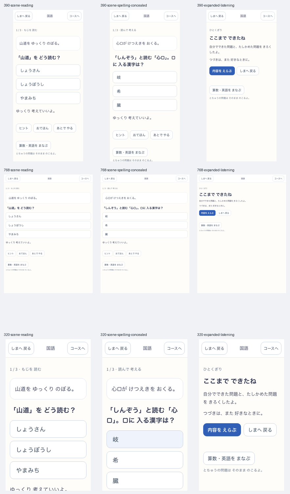

# 国語教材の校閲・例題と復習の増量

2026-10-26。利用者の「教材の校閲と例題・復習教材の増量もいっきに」に対応したローカル実装。[国語の正本](../../product/kokugo.md)・[漢字の正本](../../product/kokugo-kanji.md)。

## 教材

全1,026字・2,052用例をAIで校閲し、難しい文語、配当学年と音訓段階の混同、身近さを見直して[39語を差し替えた](corrections.json)。読みの表面不一致を一律に誤読とせず、[連濁・活用・熟字訓・後の学習段階の語を区別した](reading-review.json)。字の配当学年は、その語の全音訓が同学年という意味ではない。[一次資料の取得記録と追加根拠](sources.json)を残す。これは人の国語校閲者による採用審査ではない。

全字へ[短い場面文を2本ずつ、計2,052本追加](scenes.tsv)。字・単語だけの出題と、意味のある場面で読む出題を分けた。同じ場面を読み選択／短答／表記選択へ展開しても露出は共有し、県名の接尾辞や清潔／清潔さ等で文脈数を水増ししない。全字が最低3露出群・2編集文脈群を持つ。表記選択では文中の対象字をすべて伏せ、答えの漏れを防ぐ。

初期41採点単元へ126問を加え、246→372問。自由活動15件を含めて387教材、読書は3→6作品にした。「あ」だけだった音の入口へ「い・う」の6語とローカル音声を追加し、導入の例と採点する例を重ねない。生の字の部分読み、否定文の包含と同義の区別、敬語の選択、子どもに不適切な誤答表現も改稿した。[静的教材・音声hashの監査結果](audit.json)。

## 復習・保存

支援や手本の接触から24時間以内は、別の場面でも独力確認にしない。旧進捗は過去の独力事実を変更せず、最後の既知接触から保守的に新しい証拠だけを制限する。

教材を使い切った後は、既出例でも期日到達・最後の接触から24時間・無支援の初答正答を満たすと「前の例の後日復習」を残し、1/3/7/14/30日の予定を進める。新しい例での独力数、文脈群、未見例での後日確認数には加算しない。早い練習、支援、誤答後のやり直し、時計の逆戻りでは期日を進めない。報酬の保存・配送証拠は既存契約を保つ。

新教材は `kokugo-starter-2` / `kokugo-kanji-2`。改稿語に新IDを付け、旧予約の問題・順序・答え・下書きは固定のまま残す。DB v11の既存表に任意fieldを加えるだけで、schema migrationはない。

## 対象版と検証

直前の固定漢字版 `kanji-f0a384caf98d` に国語の変更だけを重ねた隔離ソースを使用した。共有ツリーの別の島・地形・ポータル作業はこの候補へ取り込んでいない。最終版、コマンド、初回失敗、入力hash、未確認範囲は `verification.json` へ記録する。異なる版の検査を一回の最終版フル実行へ読み替えない。

ブラウザ試験は新しい隔離プロフィールと実UIを使う。390／768／320幅で、全学年の字数、未見の場面文、表記の伏字、手本後の支援扱い、全12音声、紙の作品、再開、実SWのofflineを確認する。場面文に移ると問題の先頭を表示する。作品・報酬・別タブからの本人削除、旧版からの実SW更新も別の旅程で確認する。

人の国語校閲者の審査、音声の実聴、実機での導入、児童の理解・学習効果・自発的な再訪は未確認。全音訓・全語義・全教科書の教材化、筆順動画や字形認識は追加していない。この作業ではcommit・push・公開・deploy・実利用者DBへの操作は行わない。

最終版は `editorial-f80f926967d3`、source hash `f80f926967d362952653a0cae601c44983ad87be69d272c225be21c5c1447d38`。[入力manifest](candidate-inputs.json)と[実version](version.json)、[検証後の入力照合](input-integrity.json)、[共有ツリーの所有範囲との一致](owned-integrity.json)を保持する。

| 検査 | 結果と対象 |
|---|---|
| 全体の単体テスト | 候補2で669ファイル・5,638件PASS。[全件の内訳](unit-suite.json) |
| 最終版の国語 | 候補6で5ファイル・50件PASS。既知例の間隔、24時間、長く開いた手本、旧語根と固定予約、原子性・重複配送・削除を含む |
| 型・lint・build | 最終版でPASS。lintは国語以外の既存警告4件。現在の共有ツリーの型検査も別途PASS |
| 既存の標準smoke | 候補3で32/32 PASS。classicの回帰であり、現在の島の美術評価とは別 |
| 国語全体の旅程 | [候補4の保存・作品・報酬・別タブ本人削除・offline](main/report.json)、全3幅PASS |
| 最終版の追加教材 | [候補6の全学年・新場面・伏字・全12音声・作品・offline](kanji/report.json)、全3幅PASS |
| 実SW更新 | [旧漢字版→候補6](update/report.json)で旧読解予約・作品・報酬・削除・offline、全3幅PASS。旧漢字語根の双方向比較自体は単体試験で検査 |
| 資産予算 | precache 173ファイル・9.30 MiB / 12 MiB |
| 文書ポータル | 既存の別タスク `2026-09-27-living-fantasy-first-playable.md` のflow source hash不整合で未通過。Node22での前提検査（ローカルログ：`logs/sansu-editorial-portal22.log`）。完全な `agent:index:check` は既存ポータル検査中にSIGKILLで終了し、残りは未実行。実行ログ（ローカルログ：`logs/sansu-editorial-agent-index-check.log`） |

全体試験後に変更したのは国語の先頭表示、導入例、手本完了時の接触、旧語根の比較と検証用ハーネス等の[13入力](verification-delta.json)。これらを最終版の50件・build・lint・実画面と更新で検証した。候補6で全体669ファイルを一回再実行したとは扱わない。

初回のテスト前提の変更、生成音声の空ファイル、テスト側のコース再選択、build完了前に開始したブラウザ検査は `diagnostics/` と `verification.json` へ残す。初回失敗を消して一回の無失敗検証へ読み替えない。
