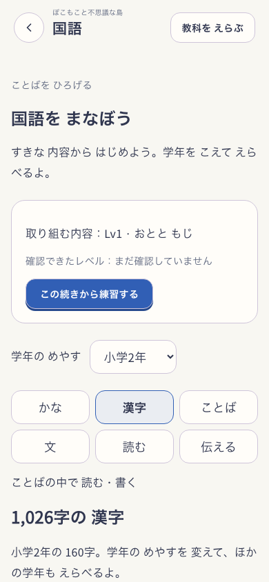
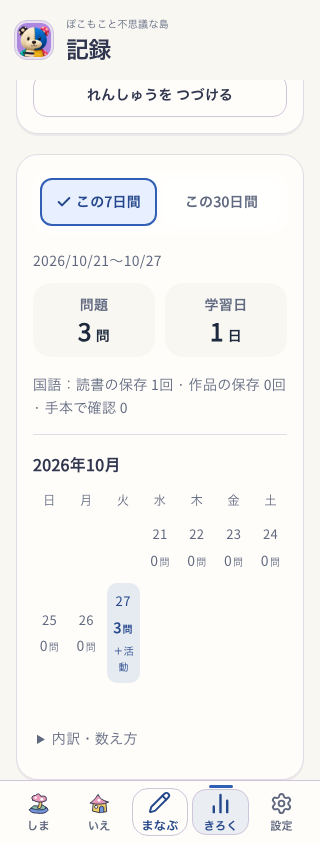
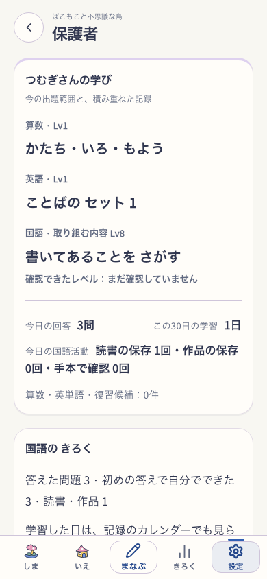

# 国語と他教科の体験の統一

2026-10-27の「どうにかして」に対応するローカル実装。愛着の柱を支え、学習への再訪と記録のつながりを整える。教材の正誤・支援・復習・到達判定・島報酬・保存形式は維持する。

## 変更

- 設定の4択に加え、通常学習と国語の科目切替を同じ設定欄へつなぐ。「国語だけの追加ボタン」「算数・英語へ戻す」の2対1の入口を整理した。
- 国語も共通Header・ボタン・Utilityトークンを使う。やさしい表示ではヘッダー、操作・領域選択、記録の見出しをひらがなへ寄せ、教材本文と読字の評価条件は自動変換しない。
- カタログ・共通進捗・保護者に、取り組む内容と確認済みLvを区別して表示。未確認や自由活動に架空の習得Lvを付けない。技術的な教材IDは選択肢の表示から外し、診断用属性へ残した。
- 未完は同じ予約へ戻る。未完がなければ保存済み単元の続きへ進める。表示中の学年目安を変えても、「続き」は保存済みの単元と目安を使う。
- 既存の国語events・作品revision・明示的な最新保存時刻を読み取り、共通カレンダーへ表示する。回答、スキップ、手本での確認、読書の保存、作品の保存を分ける。下書きは回答・保存作品の数へ入れず、重複・本人・朝4時の日付境界を検査した。保存履歴にない過去の再読日は復元しない。
- 国語の実績があるのに共通の空状態が出る条件を除いた。保護者の今日の回答・30日の学習日も同じ定義で表示する。従来だけのグラフ・範囲変更・復習候補は算数・英単語の対象範囲を明示する。

## 実画面

本人と記録は隔離した合成fixture。最終buildの実UIで読書を保存し、国語3問に回答して確認した。公開版や実児童のデータではない。build/version・delivery・flag・入力hashは[検証結果](verification.json)に記録。

## 検証と残る範囲

- 全体の単体テスト682ファイル・5,715件PASS。最終の保存時刻投影と表示調整は、対象13ファイル・83件、lint/typecheck/build、実UIを追加確認した。
- 国語・漢字の既存E2Eは390/320/768幅でPASS。実回答、支援、作品・下書き、科目切替、同予約、本人削除、国語の実SW offlineを確認した。記録と保護者の回答数、空状態の消失、やさしい表示も照合した。
- 空の状態からの初回島配置・国語だけの本人作成・3問・続き・記録は390/768幅でPASS。算数の既習memoryや従来の回答ログを作らず記録へ反映した。
- 全体スモーク2回は各30/32。既存Exploreの即時数字読取／1,500ms待機と、変更した保護者操作名で失敗。操作名を従来の「学習範囲を変更」に戻し、対象教科は説明へ明示。保護者の単独2件、既存の根の場面の単独6件は同じ制限でPASS。単一の全体スモークが完走PASSしたとは扱わない。
- 初回E2Eにも、同時実行中の島配置／学年選択への未遷移があった。失敗画像とログを保持し、後続の実導入では両幅PASS。根本原因を今回の国語変更や環境だけに断定しない。
- ローカル詳細は `output/kokugo-continuity-fix-20261027/` に保持。実機iPhone、児童の理解・再訪、教育効果は未確認。追加の公開・pushは行っていない。

[今回の仕様](../../product/kokugo.md)／[先行した監査とChatGPTの回答取得失敗](../2026-10-27-kokugo-continuity-audit/README.md)。今回の修正をChatGPTとの合意や独立監査の完了とは説明しない。
