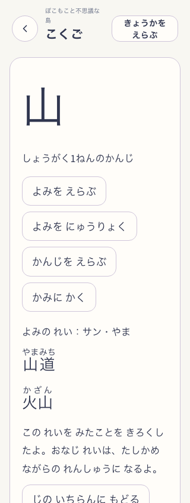
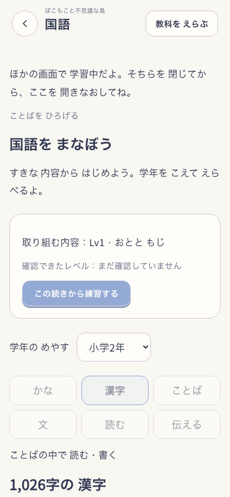
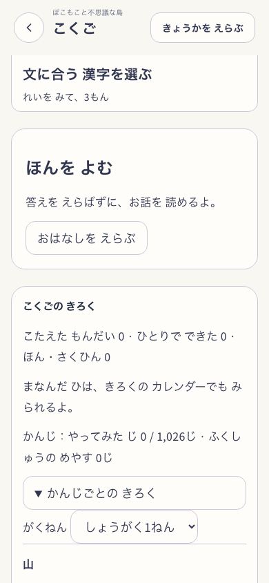

# 国語の追加監査と修正

対象は[統一後の追補](../2026-10-27-kokugo-continuity-audit/README.md)で実再現した4件。既存の未commit変更を保持した作業コピーへ追加した。公開・push・commitは行っていない。

## 修正

- 別タブが学習の利用権を持つ場合も、国語ヘッダーから退出・教科設定へ移動できる。予約・回答・手本接触などの書込みは無効のまま。実際の保存中は退出を待つ。
- 共通navigationは、履歴keyのある親へ従来通り戻り、keyのない安全な明示hrefへはreplaceで戻る。記録から国語→教科設定で算数・英語へ変更しても、国語へ入り直して選択を上書きしない。
- 全配当漢字の一覧・検索・詳細・記録の操作案内をやさしい表示へ追従させた。対象字、読み、語の手本、問題本文と評価は保持した。
- 筆算設定と設定一覧の要約を、算数を含む選択に限定した。非表示でも保存値を保持する。
- 退出条件の点検で見つけた漢字の手本接触・読書保存の実行中状態を親へ伝え、保存中の教科変更・内容変更も保護した。読書は連打と失敗後の解除を検査する。

正本は[国語コース](../../product/kokugo.md)、検査入口は[verification matrix](../../ai/verification_matrix.md)。学習判定・保存schema・報酬規則を変更しない。

追加の画面点検で、320pxのヘッダーが「こ…」へ省略されることを発見した。狭幅だけ共通ボタンの文言を折り返して教科名の幅を確保し、実画面の検査へ教科名の非省略条件を追加した。

## チャッピー相談

相談先はぽこもこプロジェクト内の[国語体系仕様提案](https://chatgpt.com/g/g-p-6ad58d0857b881918e46e346350848e7/c/6add888e-7a10-83ec-94f5-06e68667501b)。2026-10-27に所属・非応答中・空の入力欄を再確認した。今回の再現4件と修正案の要約を入力する段階で、自動承認レビューが「非公開の内部情報を送る具体的承認が未確認」として拒否した。ユーザーへ送信範囲を明示して確認中。拒否を回避した送信・別経路の送信はしていない。今回のChatGPT回答は未取得で、上の判断はCodexのコード監査に基づく。

## 検証

対象18ファイル・157件はPASS。全体実行でtimeoutした島の保存3ファイルも、この1並列の再実行でPASSした。全体suiteは2回とも5秒timeoutが出て中断しており、今回の最終sourceに対する全体完走PASSはない。14:41のホストload averageは82.23だったが、timeoutの根因をこの観測だけで断定しない。

型検査PASS。全体lintは今回追加した戻り先検査に2 errorが出た。条件を保持して文字列検査へ修正し、変更対象と新規ファイルのlintはPASS。既存5 warningは残る。初回のnpm buildと、狭幅調整後の本体Vite build・容量検査はPASS。最終版のPWAは175ファイル・9.45MiB / 12MiB、探索画像は2.97MiB / 8MiB。

国語の通常E2Eは390/768/320で回答・下書き・作品・教科切替・本人削除・実SW offlineをPASS。全配当漢字E2Eは同3幅で件数・別読み・場面文・手本接触・作品・再開・offlineをPASS。両者は最後の表示だけの調整前の版で、版ごとの範囲を[検証一覧](verification.json)に分けた。最終版 `development-local:38e8b02f-e46c-47b6-8258-e098ee653e7b` は共通UIの3幅と教科名非省略をPASSし、ブラウザー例外・通信失敗は0。アプリ入力の比較では前候補から国語の狭幅CSSだけが変わった。

初回の追加ブラウザー検査はsandboxでChromium・serverの起動が拒否された。権限を切り替えた後、Python配信ではCSS/JSへの接続リセットを記録した。標準Vite previewへ切り替え、同じ判定・待ち時間で通過した。初回証拠は保持する。

共通smokeは別記の通り未合格。初回の実行中にCSS変更・build出力のHMRが入ったため、入力を止めて同じ32シナリオで再実行した。再実行は28 PASS / 4 FAIL。初回の3件は再実行で通過したが、別の4件が失敗した。今回変更した国語画面とは別経路の旧Exploreで、根因は未確定。最初の失敗を合格へ書き換えず、全体smoke・配布の合格は出さない。

- Snap Root 390px：popped画像の表示判定。
- fixed-tenの中断再開：物理数字入力が期待10、実際0。
- last-light rescue：60秒timeout。
- Root Tangle 1080×1920：物理数字入力が期待2、実際?。

ログと診断は `smoke.log` / `smoke-stable.log` / `smoke-stable-diagnostics/` に保持。これらの既存シナリオの入力・待ち時間・予算は変更していない。

一時的なログ・全入力hash・生の実画面は `output/kokugo-loop-20261027/`。子どもの理解・教育審査・実iPhone・公開版の受入は今回の自動検査とは別。保存schema・学習判定・報酬は未変更。今回の修正は未commit・未push。

## 最終版の実画面

最終版、Island=true、NatureTown=false、delivery=snap-root-v1、visualLineage=pokko-field-v1。合成本人を使い、reduced motionで実コンポーネントを操作した作者の点検であり、独立した子どもの理解評価ではない。数値の美術採点はしない。

