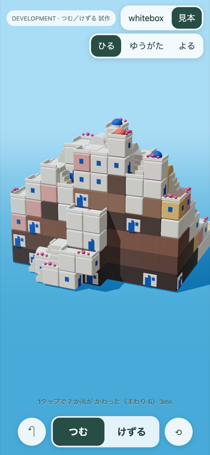
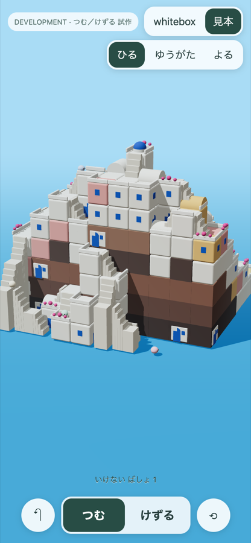
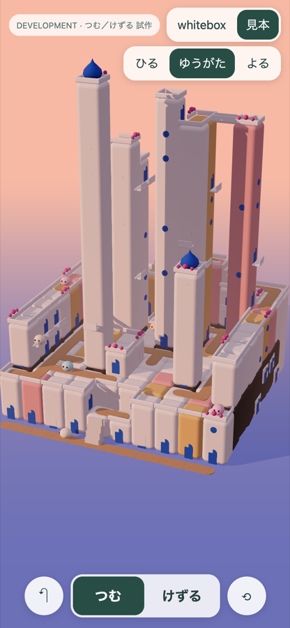
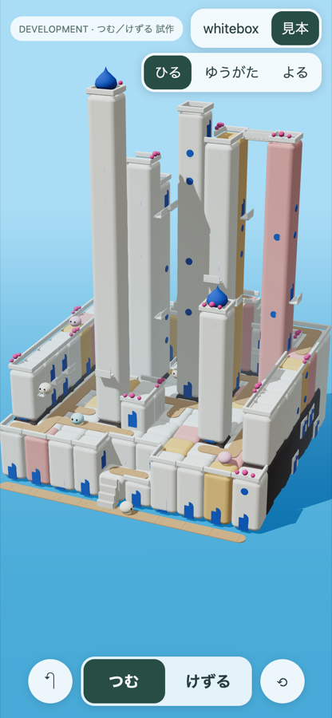
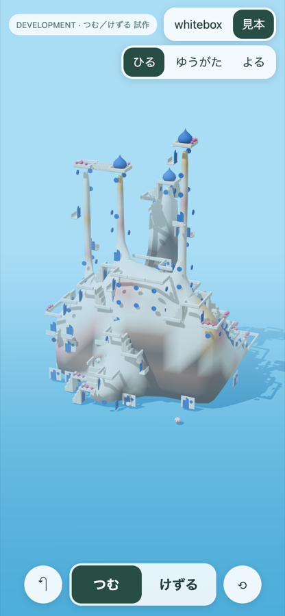
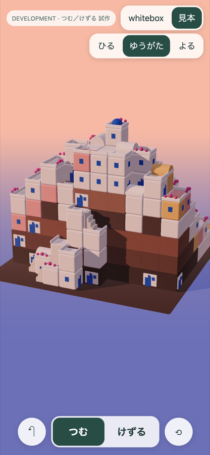
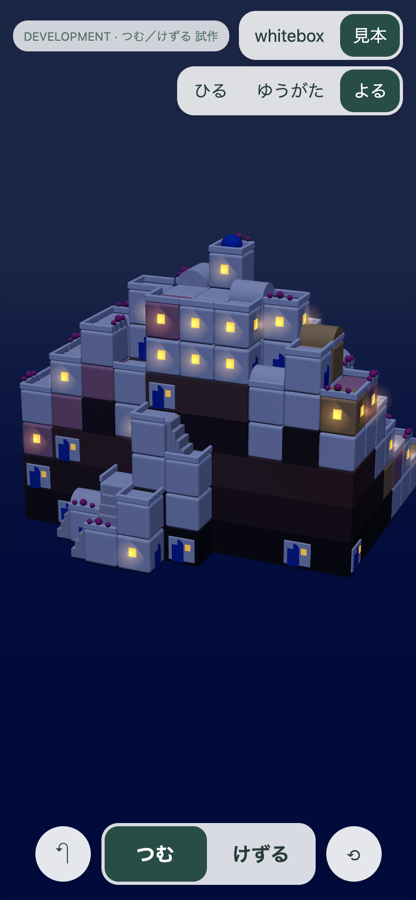
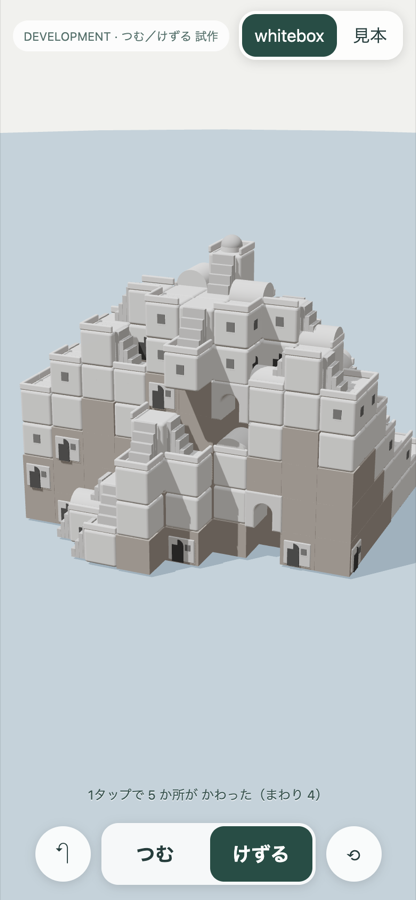

# 「つむ／けずる」ひとつで、白い崖の村になる（試作）

2026-10-28 JST。ブランチ `island/terrace-ground-dev`（基点 `17d2ac00`）。本体には接続していない単独の試作ページ。本番ビルドには入らない（`prototypes/` はビルドの入力にない）。



## なぜ作ったか

子どもから「たいらにするしかなく、上げ下げにならない」「サントリーニ島みたいな島を作りたい」と言われた。地面の高さを塗る方式では、子どもが一マスずつ塗っても崖の村にはならない。高さの数字をいじる作業になる。

そこで、地面の高さを塗るのをやめる。ブロックを積むと、まわりを見てそれが地面にも家にもなる方式を試す。操作の決まりは発明せず、何をしても美しく見える箱庭（Townscaper、Tiny Glade の系統）から借りる。

## 操作

- 道具は「つむ」「けずる」の二つ。長押しは使わない。選んだ道具は、もう一度押すまで変わらない。
- **タップ**：触った面の向こう側に1つ積む（上面なら上、側面なら横に張り出す）。「けずる」なら触ったブロックを取る。
- **なぞる**：通った列を、それぞれ1段上げる（けずるなら1段下げる）。
- **もどす**：ひとなぞり、またはひとタップの単位で戻す。
- 何もない所をドラッグすると視点が回る。

## 見た目を決めるルール（`src/prototypes/stackLab/stackRules.ts`）

| 状態 | なるもの |
|---|---|
| 上が空いている | テラス。落ちる縁には低い白壁（花がつくことがある） |
| 上に2つ以上積まれている | 岩の崖。高さごとに地層の色。面のいくつかが洞窟の家（白い戸口と青い扉） |
| それ以外 | 白い家。足元に地面がある面に扉、他の面にときどき窓 |
| 下が空いて、左右が支えられている | アーチ |
| 同じ高さの四方に何もない | 塔の上に青いドーム（ときどき水玉） |
| テラスの一部 | かまぼこ屋根、ときどき黄土色・ばら色の家（見本だけ） |
| 1段違いで接するテラスのまとまり | その二つのまとまりにつき階段を1つ |
| それでも地面から行けないまとまり | 2段以上のがけに長い階段。空いたマスを1マス1段で上り、曲がってもよい（がけのジグザグ道）。短い階段のマスを通るときは、その短い階段を外して道を計算し直す |

最初は、階段の道筋を島全体の探索で決めていた。すると1タップで62か所が変わり、遠くの階段まで付け替わってちらついた。そこで、階段は接している二つのまとまりだけで決めるように直した。いまは1タップで4〜7か所が変わる。触った近くの屋根・壁・階段・ドームが一緒に変わり、少し弾んで落ち着く。

## 住人の行き来（2026-10-29 追加）

「住人が行き来できない」と言われた。調べると、住人がいなかったうえに、見本の村は港から行けなかった。見本の村は海からがけでそびえていて、80マスが地面から届いていなかった。

- 住人を5人置いた。テラスを歩き、階段を上り下りする（`residents.ts`）。階段がある所を、少し選びやすくしている。
- 足元がけずられたり埋まったりしたら、いちばん近い床へ跳ねて移る。壁の中に取り残されない。
- 長い階段を足した。はじめはまっすぐな階段だけにしたが、港がせまくて置けなかった。そこで、曲がってよい形に変えた。
- 結果、見本で地面から行けない床は80マスから1マスになった。残る1マスは、ドームの塔の上。
- 住人5人を40秒見た。0〜6段、0〜2段、0〜2段、6〜8段、3〜6段の高さを行き来した。けずったあと、壁の中にいる住人は0人だった。
- 開発用の表示に「いけない ばしょ」のマス数を出す。



## 高い建物と、道を歩き回る町（2026-10-29 追加）

「サントリーニはたとえで、背の高い、有機的な建物をたてて、住人が歩き回るイメージ」と言われた。そこで、目標を特定の島の見た目から次の三つに置き直した。
- 縦に高く伸びる
- マス目を感じない
- 中や周りを住人が行き来する

途中で「みちがあって歩き回る感じないね」とも言われた。

- **高さ**：積める高さを8段から16段にした。見本は「広場のある町」に作り替えた。広場に塔が立ち、ふたごの塔は上の方で橋がつながる。
- **入口**：ブロックごとに入口を一つまで決める。前に床があればドアにする。高い所で前が空中なら、ときどきバルコニーにする。
- **建物の中を通る**：同じ列で途切れずにつながったドアどうしは、中でつながる。住人はドアに入って見えなくなり、上のドアやバルコニーから出てくる。一番上のドアからは屋上へも出られる。これで、塔の外に長い階段を並べなくて済むようになった（見本の長い階段は39本の階段のうちの1本から0本に、行けない床は0）。
- **橋**：同じ高さの床どうしの間が1マス空いていれば、自動で橋がかかる。
- **外の階段**：建物の中ですでにつながっている段の間にも、半分ほどは外の階段を残す。住人が外を上り下りする姿が見えるようにするため。
- **道**：ドアの前を「行き先」とし、一つのドアから一番近い次のドアへ、外の最短の道を敷いていく（木が伸びるように）。外からつながらないドアは、別の道の網を始める。道は茶色の石だたみで描く。
- **住人**：10人にした。行き先のドアを決め、道を一番安く（道は1、テラスは3、建物の中は8）通って向かう。ドアに着くと、ときどき中に入り、別のドアから出てくる。
- **有機的な見た目**：三つの方法を試した。
  - ブロックごとにふくらませ、ずらし、ひねった。積み上げたマシュマロに見えた。
  - 全体を一枚のなめらかな表面にした（Surface Nets）。細い塔が針のようにやせ、窓や手すりが宙に浮いたのでやめた（下の図の右）。
  - いまは、同じ列で縦につながった家を1本の丸い柱として描いている。段の継ぎ目は消えたが、まだ角柱に見え、有機的とは言えない。
- ドームは玉ねぎ形、窓は丸にした。

| ゆうがた | ひる | やめた案（なめらかな表面） |
|---|---|---|
|  |  |  |

ヘッドレスで40秒見た結果は次のとおり。道は53区間、ドアは54、バルコニーは31。行けない床は0。住人10人のうち1人は高さ10の塔の上まで上った。屋内にいた時間の割合は、人によって0〜39%だった。

## 確かめたこと

手順はヘッドレスのChromium（SwiftShader）で、390×844の画面で行った。

- 5回のタップで、変わった所は4・5・5・2・5か所。
- 斜めに一なぞりで、329個のブロックが335個になった。新しい塔にドームが二つ（青と水玉）出た。「もどす」で329個に戻った。
- 1回の変化に、ルールの計算と描き直しで3〜4ms（長い階段を足した後は4〜17ms）（このPC・ヘッドレスでの参考値。表示の画面には出ていない）。
- 見本では、ひる・ゆうがた・よるを切り替えられる。夕方は白壁が桃色に染まる程度の光、夜は月明かりで壁が読め、窓に灯りがともる。

| ゆうがた | よる | whitebox（けずってアーチ） |
|---|---|---|
|  |  |  |

## まだわからないこと・弱いところ

- 実機のスマホでは触っていない。指でのタップの精度、なぞりと視点回転の取り違え、速さは未確認。
- 見本は、まだ積み木の村に見える。サントリーニの丸い白壁、うねる路地、崖の高さの迫力には届いていない。
- 部品（家・テラス・階段）はルールが決めるので、子どもは選べない。形は自由だが、部品は自由ではない。
- 住人は歩くだけ。暮らし（洗濯物、灯りの物語）、学習とのつながりは入れていない。
- 長い階段の踊り場が、白い柱のように太く見える。
- 3段以上のがけを上る長い階段は、まわりに空いたマスがないと置けない。そのときは「いけない ばしょ」に数える。
- 毎回すべてのメッシュを作り直している。島が大きくなると重くなる。

## 開き方

```
VITE_ISLAND_ENABLED=true npx vite --host 127.0.0.1 --port 5282
```

`http://127.0.0.1:5282/prototypes/stack-lab/`。見本は `?look=sample&time=dusk`（`day`／`night`）。
