# そだつ島：形は子ども、道と家と木は島（試作）

2026-10-29 JST。ブランチ `island/terrace-ground-dev`（基点 `17d2ac00`、未commit）。本体には接続していない単独の試作ページ `prototypes/grow-lab/`。本番ビルドには入らない。前の試作 [つむ／けずる](../2026-10-28-stack-carve-lab/README.md) の続き。

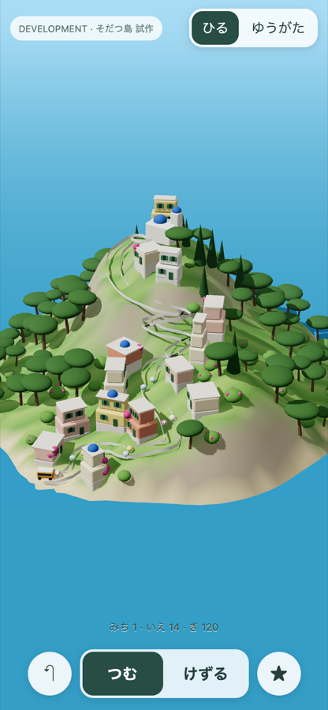

## なぜ作り替えたか

前の試作は、ブロックが密集した町だった。これを見たユーザーからは「有機的な感じないね」と言われた。続けて「カプリ島とかバスをくねくね道はしってて建物あって自然があってみたいな」とも言われた。目標を、緑の島をくねくね道が上り、乗り物が走り、建物が点在する景色に置き直した。

役割分担は話し合って決めた。

- **子ども**：島の形を「つむ」「けずる」で作る。ときどき特別な建物を1つ置く（アプリでは学習で手に入る想定。試作では★ボタン）。
- **島**：道、バス、家、木を自分で育てる。

建物を全部自分で置くと「並べる作業」になり、サクサク感がなくなる。島が勝手に育てれば、道の先で何かが育つ驚きが残る。

## ルール（`src/prototypes/growLab/`）

| 何が | どう決まるか |
|---|---|
| 地形 | なめらかな高さの地形（20×20、0.5間隔）。筆は丸い山の形で、同じ所を何度盛っても針にならない |
| 道 | 港から特別な建物へ、急すぎない（勾配0.3まで）一番安い道を探す（16方向）。急な山では、この上限のせいでつづら折りが自然に出る。2本目からは、すでにある道へつなぐ。道ぞいの地面は削って平らにする |
| 家 | 道から少し離れた斜面に、道の方を向いて建つ。自分の敷地を平らに削る（段々の敷地）。1〜3階で、上の階ほど後ろに下がる。緑の雨戸、ときどき青いドームや花 |
| 木 | 道や家から離れた緑の斜面に生える。開けた斜面は笠のような松、高い所は糸杉、家のまわりは茂み |
| 合わなくなった物 | 家は近くの道ぞいへ引っ越す（色と階数はそのまま）。木はよけて、ほかの場所に育ち直す（下の「断らない」を参照） |
| バス・住人 | バスは港から本道を上り下りし、両端で止まる。住人9人は道の端を歩く |

## 確かめたこと

ヘッドレスのChromium（SwiftShader）で、390×844の画面で行った。

- はじめの島は、道1本、家14軒、木120本。
- 4回のタップと一なぞりで丘を盛った。1回あたり5〜35ms（このPCでの参考値）で、道・家・木が付け直された。
- ★で灯台を置くと、道が2本になった。
- テスト6件が通る。勾配の上限を守る、まっすぐより長いつづら折りになる、2本目は既存の道につながる、道の下が平らになる、家は道の上に建たない、など。

| ゆうがた | 丘を盛って灯台を置いた後 |
|---|---|
| 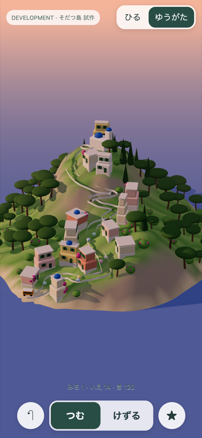 | 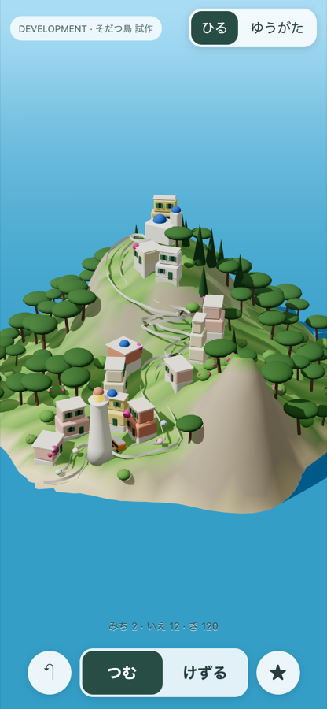 |

## まだわからないこと・弱いところ

- 実機のスマホでは触っていない。
- 盛った丘は急なため、岩の色のままで木も生えない。
- 家は道の両側がいっぱいになると止まる（14軒前後）。灯台を置いても、その近くに家が増えるまでは確かめていない。
- 家の建物はまだ箱形。曲線の建物（前の試作の輪郭の方法）は入れていない。
- 住人は道を往復するだけで、家に出入りしない。
- 夜、学習とのつながり、育つ様子の演出（少しずつ建つ）は未確認か未実装。

## 断らない（2026-10-30）

利用者の「いろんな制約で道とかそれぞれ作れないとか微妙だよね。サクサクつくれる？」「道以外も網羅的に検討して」「試作で確かめる」を受けた。

考え方：**子どもの操作はいつでも必ず通る。困ったことは島が自分で片づける。** 子どもが置いた物（特別な建物）は守り、島が育てた物（家・木）はよけてよい。

| 何が | 前 | いま |
|---|---|---|
| 道 | 急な坂（勾配0.3より上）と水は通れず、つながらないことがあった | 道で上れない所は階段（勾配1.1まで）、もっと急ならケーブルカー、水の上は橋になる。高さを1上るのにかかる手間が「つづら折りの道 ＜ 階段 ＜ ケーブルカー」の順になるようにしたので、道で上れる所はいつも道が選ばれる。一段だけちがう種類がはさまったら、まわりと同じ作りにそろえる |
| 盛った丘 | 針のように細く高くなり、岩の色で何も生えなかった | 盛った土は砂のように崩れて、勾配1.8より急にならない。丘は横へ太る。急な所は濃い緑で、茂みは勾配3まで生える |
| 家 | 合わなくなると消えた | 近くの道ぞい（2→4→島じゅう）へ引っ越す。道ぞいがどこも空いていない時だけ消える |
| 特別な建物 | 下を掘ると埋もれた | 丘ごと持ち上がり、下を掘ると高床（脚つきの台）で水の上に立つ。家と同じく自分の敷地を平らにする |
| ★を置く | 水の上をタップすると何も起きなかった | 一番近い岸に置く |
| 港 | 岸の水ぎわで、道が小さな橋から始まることがあった | 乾いた格子点に港を置く |
| もどす | 地形と特別な建物だけを戻した | 1回で、地形と、島が動かした家・木もまとめて戻す |

### 確かめたこと（ヘッドレスChromium、390×844）

3つの難しい場面を、新しく読み込んだ島で試した。

1. **灯台を置いて、その下にとても急な丘を盛る（6回）**：丘は高さ7.8で崩れが止まった。灯台への道は「道→階段→道→階段…」と、4か所の階段をはさんで最後までつながった。最後の1回で家4軒が引っ越し、家は15軒、木は120本になった。
2. **教会の下を5回掘る（高さ−1.4）**：教会は高床で残り、道は「道→階段→橋」で教会までつながった。
3. **一本しかない道の真ん中に丘を4回盛る**：道は丘をよけて回り道になり、最後までつながった。最後の1回で家2軒が引っ越し、全体では13軒から11軒に減った（引っ越し先がなかった分）。4回もどすと、道・家13軒・木119本まで、すべて元どおりになった。

- 1回盛るごとの付け直し：3〜14ms（このPCでの参考値。描画は含まない）。
- テストは21件が通る。丘の道は全部ふつうの道で上る、針のような丘でも階段かケーブルカーで頂上まで届く、島を横切る水路には橋が掛かる、家は色を保ったまま近くへ引っ越す、など。

| とても急な丘と灯台 | 近くから見た階段 |
|---|---|
| 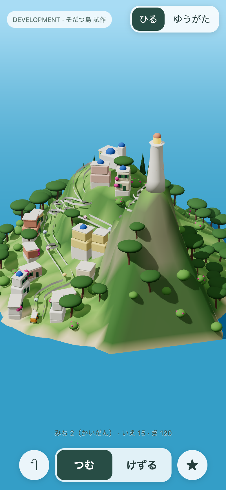 | 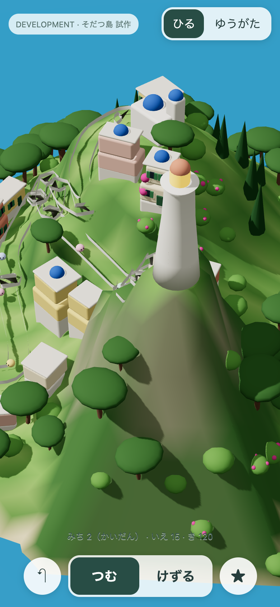 |

| 教会の下を掘った後 | 道の上に丘を盛った後 |
|---|---|
| 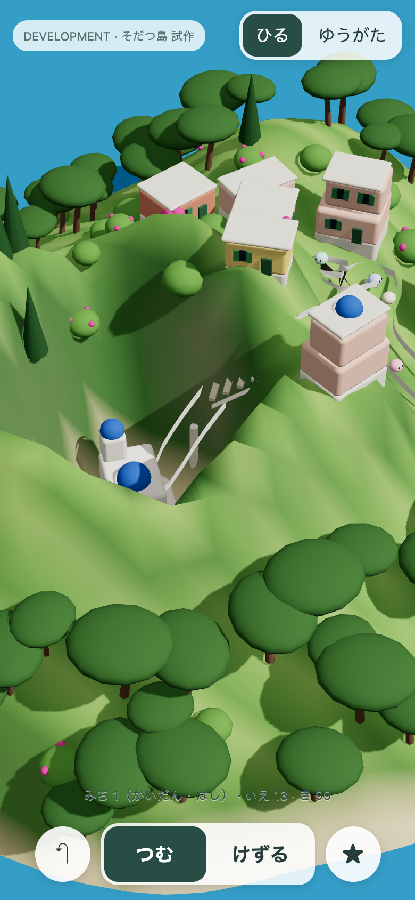 | 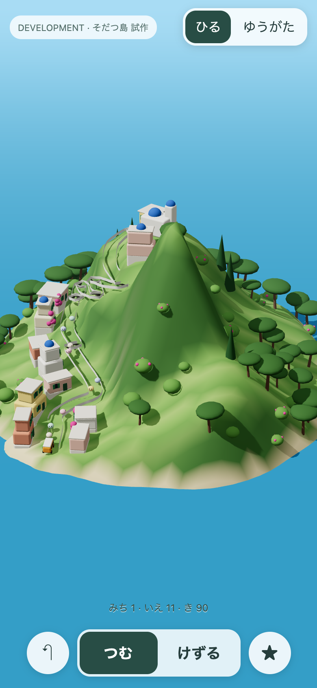 |

### まだ弱いところ

- 土が崩れて丘がなだらかになるので、3つの場面ではケーブルカーは一度も出なかった。ケーブルカーの絵は、画面ではまだ確かめていない（テストでは出る）。
- 階段は、段の板がばらばらの向きに並んで見え、まだ雑。
- 掘った穴は細く、水が教会の床の下にほとんど隠れて、池らしく見えない。
- 家は道ぞいがいっぱいだと引っ越せずに消え、増えもしない（11〜15軒）。
- 引っ越しは一瞬で起きる。動く様子は見せていない。
- 実機では触っていない。

## さわり心地（2026-10-30）

利用者の「圧倒的にかいてきにする」を受けた。

前の版は、指が動くたびに道を探し直し、家と木を全部作り直していた。家が1軒建つたびにも、木120本を作り直していた。

| 何が | いま |
|---|---|
| なぞっている間 | 地面だけが変わる。道・階段・橋・家・木・バス・住人は、作り直さずに地面と一緒に上下する |
| 島が考え直す時 | 指を離した時と、なぞったまま0.38秒止まった時。指を離したフレームを先に描いてから考える |
| 地面の動き | 新しい高さへ、少し遅れてやわらかく追いつく（約0.07秒） |
| 家・木 | 1軒・1本ずつ覚えておき、変わった物だけを動かす。引っ越す家は小さく跳ねて、すべるように移る。新しい物は少し弾んで出てくる。なくなる物は縮んで消える |
| なぞり方 | 指が動くたびに盛る。量は時間に比例するので、ゆっくりなぞっても速くなぞっても、1秒あたりの盛り方は同じ |
| 手ごたえ | 指の下に白い輪（けずる時はうすい橙）が出て、盛るたびに少し広がる。盛ると高くなるほど高い音、けずると低い音が小さく鳴る。家が建つ時は小さな鈴の音。対応する端末では、触れた時にごく短く震える |
| 描画 | 画素の細かさは1倍から始め、余裕があれば1.5倍まで上げる。影の解像度は半分にした |
| 島が育つ間合い | なぞっている間は、家や木が勝手に増えない |

### 確かめたこと（ヘッドレスChromium、CPUを4倍遅くしてスマホに近づけた）

- 2秒あまりのなぞり（指の動き51回）で、1回の処理は中央値1.3ms、最悪21.9ms。
- 前の版は同じ条件で、1回あたり中央値19.9ms、最悪70.6msだった（描画を除く）。
- 指を離した後の考え直しは25.8msと14.6msの2回。
- 難しい3つの場面（急な丘、教会の下を掘る、道の上に丘）は、前と同じ結果になった。テスト21件が通る。
- 画面のエラーはなかった。

| なぞっている最中（指の下の輪） | 指を離して落ち着いた後 |
|---|---|
| 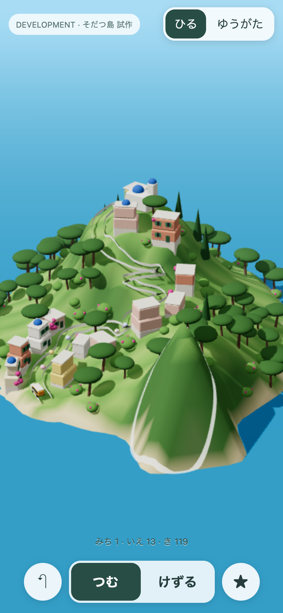 | 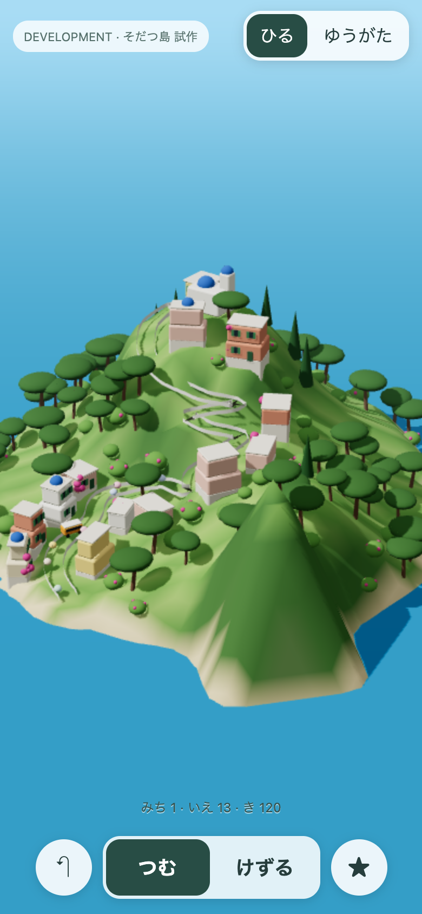 |

### まだわからないこと

- この測り方は、CPUを遅くしただけ。描画は画面を持たない仮のGPUなので、実際のスマホでのなめらかさは分からない。実機ではまだ触っていない。
- 音は、実機で大きさと気持ちよさを聞いて確かめていない。消す切り替えもまだない。
- 盛った丘は、とがった山の形になりやすい。
- 家がすべって引っ越す様子は、静止画では確かめていない。

## 現行の島と混ぜる（2026-10-30）

利用者に「どっちが魅力的か」を聞かれた。景色はそだつ島、中身（住人・自分の物・色）は現行の島が強い、と見立てた。そこで、そだつ島の地面・道・町の上に、現行の島の物を乗せて試した。利用者が「試作で確かめる」を選んだ。

| 何を | 試作でどうしたか |
|---|---|
| 住人 | アプリ本体のぽこもこ（カワウソ・うさぎ・きつね）の形を、そのまま島の大きさに縮めて道を歩かせる。家3軒ごとに1人ふえ、最大18人。最初の家の戸口には、カワウソが1人待っている |
| 子どもの家 | 島は子どもの家から始まる（丘の上）。🌱で、たねを好きな所に置ける。たねは、芽→丸い小さな家→2階と旗→水玉ドームの塔、と育つ。アプリでは学んだ時間で育つ想定で、試作では数秒ごとに育つ。道は、この家へ向かって伸びる |
| ふしぎカラフル | 子どもの家は必ず、ぽこもこの水玉の屋根と色面の帯。町の家は、およそ5軒に1軒だけ、黒ふちの色面の壁か、水玉のドーム（青に白、まれに黄色に黒）。松も、およそ13本に1本は、うす紫に水玉の「ふしぎな木」 |
| 特別な建物 | ★（灯台・塔・教会）はそのまま |

| 全体 | 子どもの家が育つ（たね→芽→家→塔） |
|---|---|
| 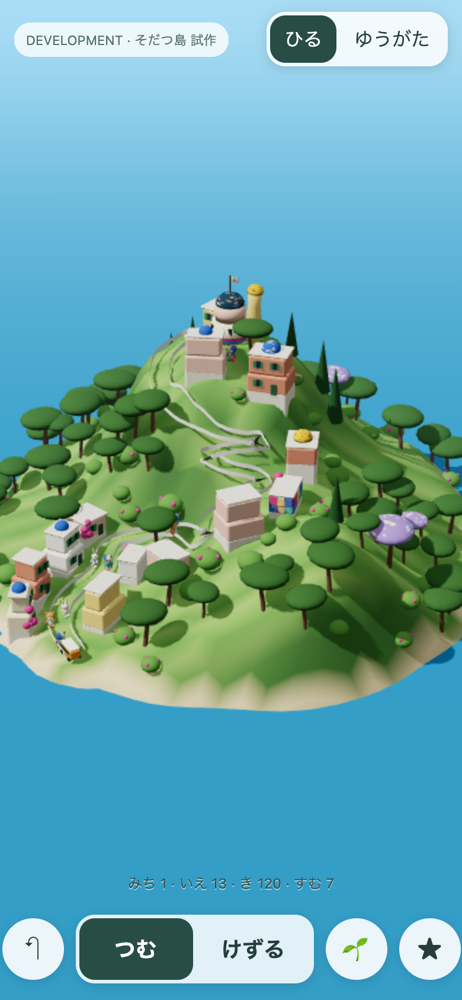 | 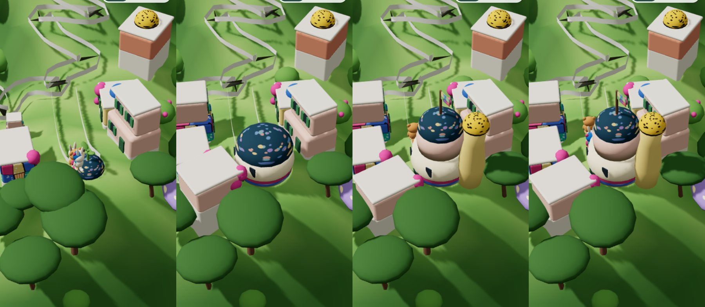 |

| 道を歩く住人 | 差し色（左：子どもの家と町、右：色面の壁と水玉ドーム） |
|---|---|
| 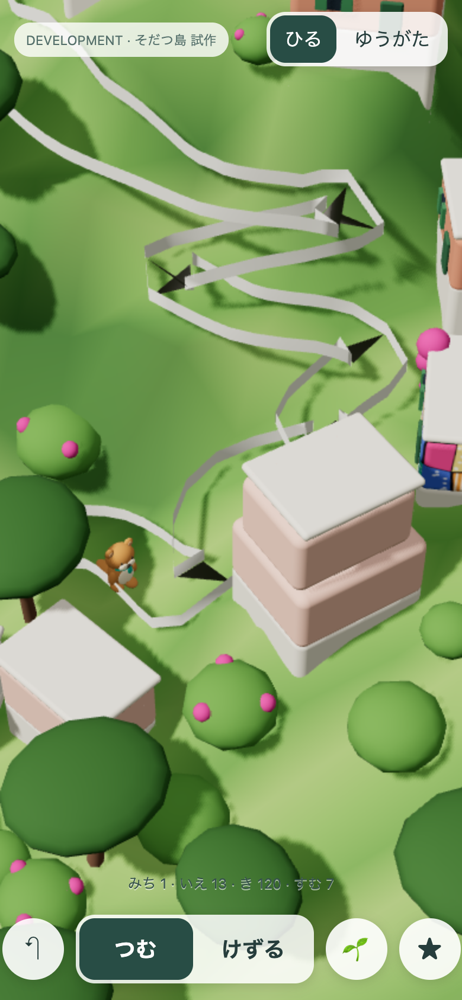 | 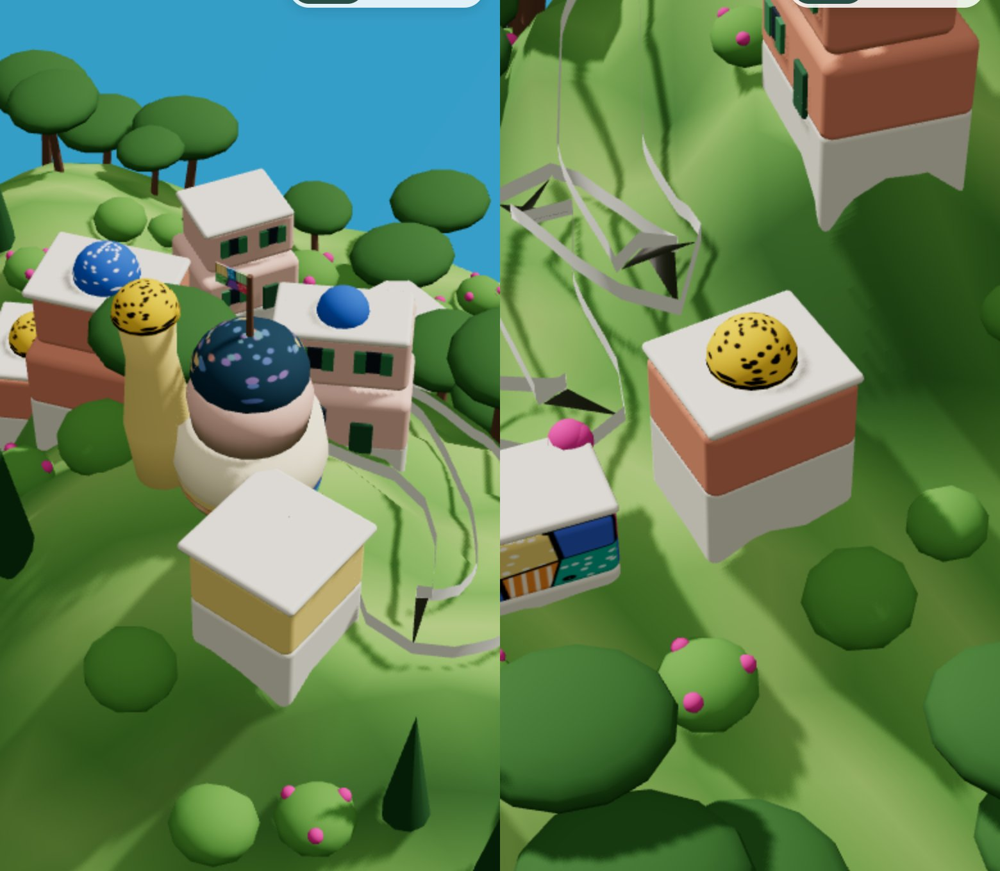 |

### 見て分かったこと

- 遠くから見ても、丘の上の子どもの家（水玉の屋根と黄色い水玉の塔）と、うす紫の木が目に入る。ただのカプリ島の写しではなく、ふしぎな島に見える。
- 差し色は「ところどころ」で足りている。全部の家に入れなくても、島全体の印象が変わった。
- 住人は、近くで見ると本体のぽこもこだと分かる。島全体を映す距離では、点にしか見えない。
- 町の家の多くは、まだ白い四角い箱のまま。

### まだわからないこと・問題

- **道の見た目が壊れている**：つづら折りの曲がり角で、道の帯がねじれて黒いとげが出る。近づくと目立つ。住人を足す前からあった問題で、今回は直していない。
- **重さ**：CPUを4倍遅くした仮の画面（GPUのない描画）で、なぞる間の1フレームは中央値44ms→75msに増えた。住人を消すと49msなので、増えた分のほとんどは住人。GPUのない描画なので、実際のスマホでどれだけ重いかは分からない。実機では触っていない。
- 住人は道を行き来するだけで、家に出入りしない。道の端で何人か重なる。
- 子どもの家の育ち方は、2階の段階が短く、すぐ塔まで育ってしまう。
- 保存の形（段→高さ）や、仕様52の書き直しは、まだ何もしていない。

## 全体を通して整える（2026-10-30）

利用者に「道がずいぶん細い、あとは？」と聞かれた。気になる所を9つ挙げたら、「トータルでやらんと整合とれんよね」と言われた。そこで、住人・戸口・道・家の大きさを互いに合わせて、全部を1回で直した。

**大きさの物差し**：住人は家1階分（0.55）の8割ほど。道の幅は0.9で、バスと住人が並んで通れる。家は道から、道の幅の半分＋家の大きさの半分ほど離れて建つ。木は道から0.85以上離れる。

| 何を | 直す前 | いま |
|---|---|---|
| 道 | 路面が裏向きに作られていて、上から見えていなかった。白いふち2本だけが見え、細い線に見えた | 路面を上向きにした。幅0.5→0.9。明るい石だたみに、濃いふちの帯。白い壁は、地面が下がっている側にだけ立てる。曲がるたびに少し費用がかかるので、つづら折りは長くゆったりした区間になる。階段も角を丸めた |
| 町の家 | 平らな屋根の白い箱 | 角の丸い箱か、塔のような丸い家。2〜3階が多い（4階もある）。上の階ほど少しずつ下がり、ずれる。屋根は、屋上テラス（鉢植えとパラソル）、ドーム、かまぼこ屋根、小さな塔のどれか |
| 木 | 同じ形の松を120本、ばらまいていた | 70本まで。多くは立っている木のそばに生えるので、林と原っぱができる。海辺はヤシ（海へ傾く）、斜面は松とオリーブ、高い所は糸杉、急な所と庭は茂み |
| 海辺 | 何もない | 道の始まりに、丸い船着き場・木の桟橋・ゆれる小舟 |
| 住人 | 遠くでは点。道の端で重なる | 少し大きくした（0.34→0.4）。1人ずつ道ぞいに自分の家があり、ときどき戸口まで歩いて中に入り、数秒して出てくる。12回見て、そのつど0〜7人が家に出入りしていた |
| 構図 | 島が画面の真ん中に小さく、上は空 | 縦長の画面では、上からのぞく角度にして、島が画面いっぱいになる |
| 音 | 消せない | 上に🔈の切り替え。この端末で覚えておく |
| 描く回数 | 1フレームに1120回 | 家・木・住人の体は、それぞれ1〜2回で描く。282回 |

| ひると夕方 | 船着き場と、町の道を歩く住人 |
|---|---|
| 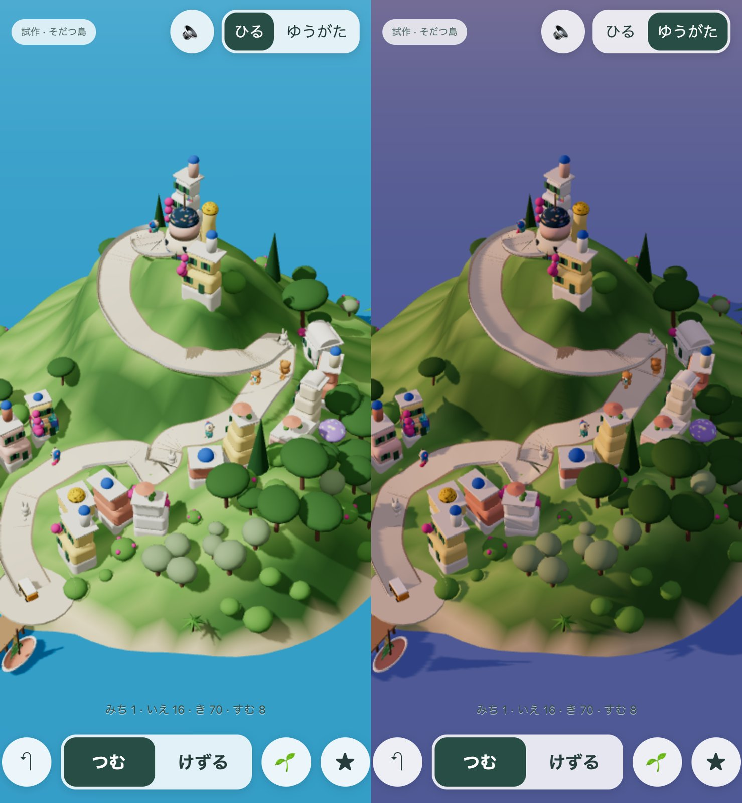 | 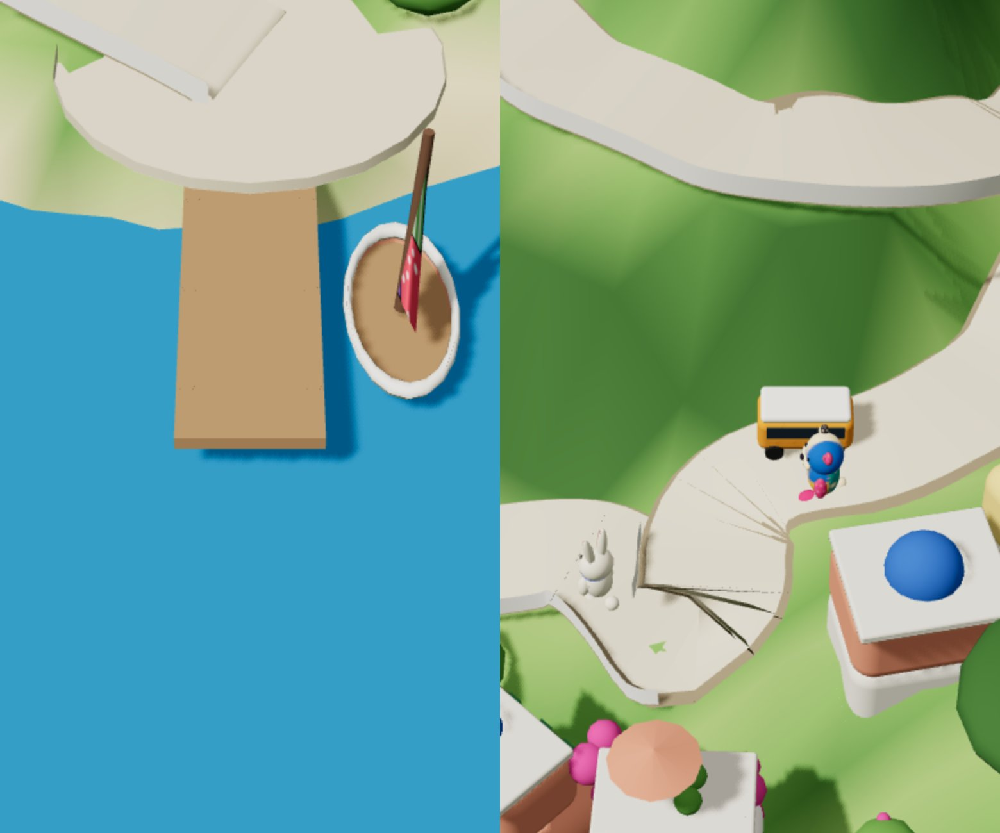 |

### 確かめたこと

- テスト21件・型・lintが通る。画面のエラーはない。
- 前に書いた「道の曲がり角の黒いとげ」は出なくなった。路面が裏返っていたことと、白い壁が曲がり角で自分と重なっていたことが原因だった。

### まだわからないこと・問題

- **重さ**：CPUを4倍遅くし、GPUのない描画で測った。1フレームは中央値約83ms（前は75ms）。島が画面いっぱいになって描く面が増えたため。プログラム側の仕事は1フレーム約3.5msで、住人の動きの計算はほぼ0ms。遅いのはGPUのない描画が三角形を描く部分で、住人の丸い体の細かさが効いている。実際のスマホのGPUでどうなるかは分からない。実機では触っていない。
- 階段の曲がり角では、段がまだ少し扇形に開く。
- 船着き場の丸い台は、少し大きすぎて岸からはみ出す。
- 家に入る住人は、戸口で小さくなって消える。扉は開かない。
- 子どもの家と町の家は、まだ作りが別物に見える（子どもの家だけ丸くて水玉）。

## 子どもが一から作れるか（2026-10-30）

利用者に「ユーザーがこんな島つくれるの？」と聞かれた。それまでの画面は、私が用意した丘（`sampleIsland`）から始めていた。そこで `?start=blank` を足した。何もない小さく低い島から始まり、道も家もない。

子どものさわり方を6通り作って、実際の指と同じ量だけ盛り・けずりをし、学習数回分ほど島を育てた（`grow(60)`）。

| 名前 | さわり方 |
|---|---|
| ていねい | 丘を2つ盛り、小さな谷を1本けずる。たね1つ、★1つ |
| らくがき | あちこちを30回なぞる（3回に1回はけずる）。たね2つ |
| 1か所 | 同じ所に25回盛り、てっぺんにたね |
| ほる | 少し盛ってから、18回けずる。たね1つ |
| 形だけ | 20回盛るだけ。何も置かない |
| 置くだけ | ほとんど盛らず、たね4つと★2つ |

最初の島：

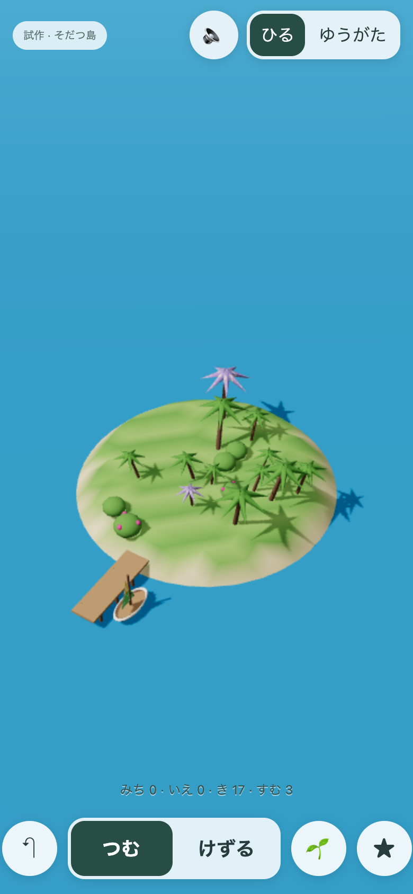

### 直す前：子どもには、あの島は作れなかった

左上から、ていねい・らくがき・1か所、下の段が、ほる・形だけ・置くだけ。

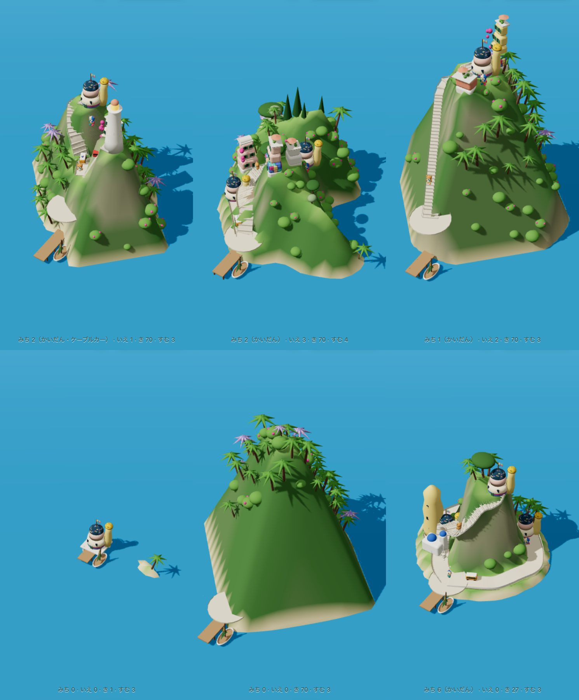

- 盛ると、とがった山になった。道はほとんど階段になり、平らな所がないので、家は0〜3軒しか建たなかった。
- 何も置かないと、道も家もできなかった。
- 全部けずると、島が消えた。

子どものさわり方が悪いのではない。島の側が、私の用意したなだらかな丘でしかうまく育たなかった。

### 直したこと

| 何を | どうしたか |
|---|---|
| 盛った土 | すべり落ちる急さを1.8→1.1にした（見本の丘と同じくらい）。同じ所に盛っても、とがらずに島が広がる。ななめにもすべるので、まるく広がる |
| 世界のはし | はしの近くでは、地面が海へ下がる。島が四角く切れない |
| 家 | 急な坂（1.05→1.6）にも建つ。白い土台を坂の下まで作る、がけの町の建ち方 |
| 道 | 港から島で一番高い所へ、いつも道がのぼる（近くに★やたねがあれば、そちらへ）。何も置かなくても町が育つ |
| 砂州 | 利用者が「砂州を残す」を選んだ。どれだけけずっても、子どもの家のまわり（家がまだなければ島の真ん中）に、家と浜と港が入る小さな砂州が残る。島は消えない |

### 直した後

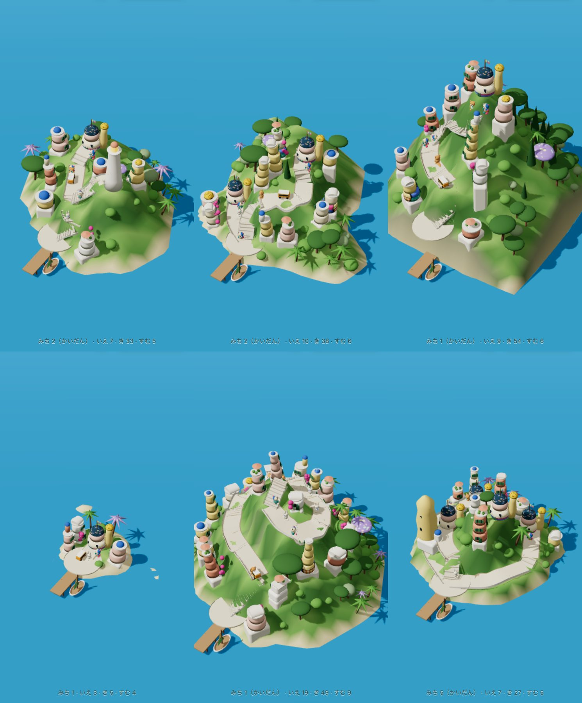

| さわり方 | 家 | 住人 |
|---|---|---|
| ていねい | 8 | 5 |
| らくがき | 10 | 6 |
| 1か所 | 8 | 5 |
| ほる | 3（砂州の小さな島） | 4 |
| 形だけ | 19 | 9 |
| 置くだけ | 6 | 5 |

- 6通りすべてで、島が残り、道・家・住人がそろった。ほった島は、子どもの家と小さな町と港がのる砂州になる。

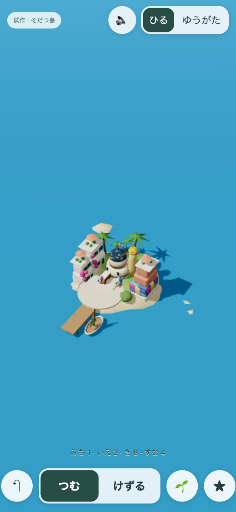

- 見本の丘も、急な坂に家が建つようになり、家が16→23軒にふえた。

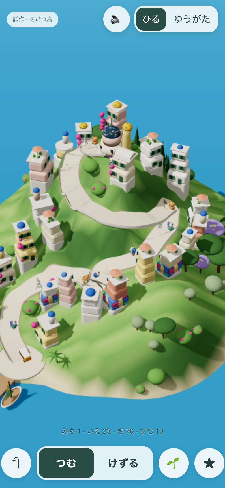

- テスト21件・型・lintが通る。橋のテストは、細い堀だと両岸の土がすべり込んで埋まるようになったので、広い堀を掘るように直した。

### まだわからないこと・問題

- 1か所に盛り続けると、島が世界のはしまで届き、はしの1辺がまっすぐになる。
- 置くだけの島は、たねと★で小さな島がいっぱいになり、町の家が6軒しか入らない。
- 砂州は、子どもがその上をけずっても戻る。けずった手ごたえが消えるので、実際にさわって違和感がないかは確かめていない。
- 試したのは、なぞり方をまねた6通りだけ。本物の子どもには、まだ触ってもらっていない。

## 検証しきる（2026-10-30）

利用者に「検証しきって」と言われた。APIで呼ぶのではなく、本物の指の操作（タッチの押す・動かす・離す）で全部の操作を通し、速さ・メモリ・画面の大きさを測った。見つかった問題はその場で直し、もう一度測った。

### 指の操作で通したこと（15項目、すべて通る）

| 確かめたこと | 結果 |
|---|---|
| 何もない島から始まる（置いた物も道もない） | 通る |
| 🌱を押すと「たねを おく ばしょを タップ」が出る | 通る |
| 島をタップすると、そこにたねが置かれる | 通る（**直す前は0.7ずれていた**。始めの地面が画面の形に書き込まれておらず、平らな海面に当たっていた） |
| たねに道が届く | 通る |
| なぞると指の下が盛り上がる（0.70→1.72→1.96） | 通る |
| なぞっている間は道が変わらず、指を離してから考え直す | 通る |
| 子どもの家の上を3回けずっても、地面は砂州の高さ（0.55）より下がらない | 通る |
| けずっている間、家は乾いた地面の上にある（画面上の最低0.43。浜の線0.3より上） | 通る |
| ★を押してタップすると特別な建物が建つ | 通る |
| ↶で最後の1つだけが戻る | 通る |
| 海から始めたドラッグは、視点を回すだけで地面を変えない | 通る |
| 🔈で音が消え、読み込み直しても消えたまま | 通る |
| ゆうがたに切り替わる | 通る |
| 画面のエラーがない | 通る |

### 直したこと

| 見つかった問題 | 直し方 |
|---|---|
| 最初のタップが0.7ずれる | 始めに地面の高さを画面の形へ書き込む |
| 育つ・なぞるたびに形のデータがたまっていく（84→233→352） | 作り直した家・木・特別な建物の形を、そのつど片づける。直した後は、島が育つ分だけ増えて止まる（27→100→106） |
| 指を離した後の考え直しが重い（CPU4倍遅い条件で74〜219ms） | 家の土台を家本体と分け、地面が変わっても土台だけを差し替える。引っ越す家は大きさも保つ（前は大きさが変わり、作り直していた）。道の探索を型付き配列にした。直した後は17〜47ms |
| 起動して最初のなぞりで1回だけ0.1秒ほど止まる | 音の仕組みと、指の下の輪の描き方を、読み込み時に用意しておく |
| いちばん小さいiPhone（幅320）で、↶と★が画面の外に出る | 幅360以下では、下のボタンを少し小さく詰める |
| 横長の画面（iPhone横・iPad横）で、丘のてっぺんが切れる | 横長では、同じ角度のまま少し引いて映す |
| 何もない島に、ヤシが70本ぎっしり生える | 木の数は、陸の広さに合わせる（陸1あたり0.5本、最大70本） |
| 道がまだないのに、丸い船着き場だけがある | 道ができてから船着き場を作る |

| 何もない島の始まり | 4つの画面の大きさ（幅320・390の縦、844の横、iPad横） |
|---|---|
|  | 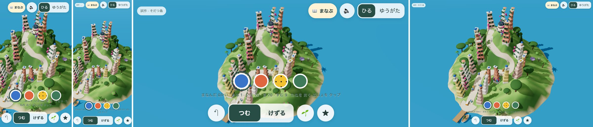 |

6通りのさわり方も、直した後にもう一度育てた（上の「直した後」の画像を差し替えた）。家はそれぞれ7・10・9・3・19・7軒、住人は5・6・6・4・9・5人で、6通りとも島と町が残る。

### 速さ

| 条件 | 1フレーム（中央値） | 遅いフレーム |
|---|---|---|
| MacのGPU（Apple M4）で描画、iPhone幅、画素1.5倍 | 約13ms | なぞる間とその後の約230フレームで、34msを超えたのは0回 |
| 同じGPUで、CPUを4倍遅く | 約13〜14ms | 約250フレームで0〜1回（最大43ms） |
| GPUを使わない仮の描画、CPU4倍遅く | 約80ms | 前に書いた遅さは、ほぼこの描画の遅さだった |

なぞる1回の処理は中央値2.5ms、最悪で約12ms（CPU4倍遅い条件）。

住人の出入りは、直した後にもう一度18秒見て、1.5秒ごとに0〜8人が家に出入りしていた。全テストを同時に流している間は画面がほとんど進まず、出入りが起きなかった。これは測る側のCPUが埋まっていたためで、試作の不具合ではなかった。

アプリ全体の検証も通った：lint（エラー0、注意5件はすべて元からあるファイル）、型、build、テスト691ファイル・5778件。

### 確かめられなかったこと

- **実際のiPhone**：iOSシミュレータはこのMacに入っていなかった（iOSの実行環境がない）。実機でも触っていない。MacのGPUはスマホより速いので、上の13msはスマホでの値ではない。
- 音の大きさと気持ちよさは、耳で聞いていない。
- 本物の子どもには、まだ触ってもらっていない。
- 階段の曲がり角で段が少し扇形に開くこと、住人が戸口で小さくなって消えること（扉は開かない）は、そのまま。

## 子どもが良い感じに作れるように（2026-10-30）

利用者に「ユーザーが良い感じに島つくれる？」と聞かれた。直した後の6通りを見て、良い感じが3通り、まあまあが2通り、良くないが1通りだった。それとは別に、3つの問題を挙げた。

- どの島も似て見える。
- あの景色になるまでの時間が決まっていない。
- 1か所に盛った島と、置くだけの島がうまくいかない。

利用者が「ぜんぶ」と言ったので、全部直した。

### うまくいかない島を直す

| 問題 | 原因 | 直し方 |
|---|---|---|
| 1か所に盛ると、まっすぐな長い階段1本になる | いちばん急な斜面（1.1）では、道が向ける16方向のうち、ゆるくのぼれる向きがなかった | 道の向きを24方向にふやし（横1・縦3のゆるい斜め）、道ののぼれる急さを0.3→0.4にした。丘を回りこんでのぼる道になる |
| 盛った島のはしが四角く切れる | 土のすべりが、なぞった所のまわりの四角い範囲の中だけで起きていた | 土がはしまで届いたら範囲を広げる。世界のはしは円で区切る |
| 置くだけの島が狭く、建物が押し合う | 置く物に場所がなかった | 子どもが置いた物（たね・★）は、まわりに少し陸を作る（前は子どもの家だけ）。陸46→72、家5→11 |
| 道と地面が食い違う（最大0.46浮く・沈む） | つづら折りの2本が近いと、先に処理した方の高さで地面を削っていた | 地面は、いちばん近い道の高さに合わせて削る |

### 島ごとの違い：たねの色

🌱を押すと、4つの色が出る（しろ・ゆうやけ・みずたま・もり）。選んだ色でたねが置かれ、子どもの家がその色になる。そのまわりに育つ町の家も、いちばん近い子どもの家の色に似てくる。「みずたま」の町は、半分ほどの家に水玉か色面が入る。同じ丘・同じ置き方でも、色だけで島の印象が変わる。

| 選ぶ画面 | 同じ島を4つの色で（しろ・ゆうやけ・みずたま・もり） |
|---|---|
| 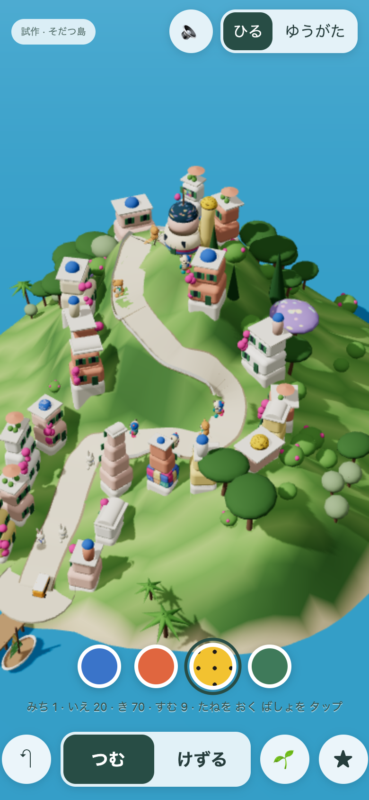 | 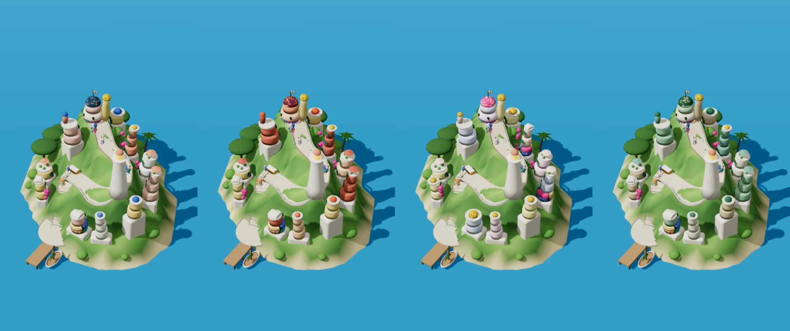 |

### 学習で育つ

`?pace=learn`（何もない島から始める時は、これが標準）では、島は時間では育たない。📖まなぶ を押すと、学習1回分として島が6歩育ち、新しい物が1つずつ順に出てくる。アプリでは、学習を1回終えるとこれが起きる想定。

町の家は道の長さで上限が決まり、家を建てる場所がなくなると、家が1階ずつ高くなる。家ごとに2〜4階までと決めてあるので、町の高さはそろわない。前は全部の家が5階の細い塔になり、柱の林のようになっていた。

何もない島から、ひと通り盛ってたねを置き、毎回学んでから少しさわる、を15回くりかえした。

| 学習の回数 | 0 | 1 | 2 | 3 | 5 | 8 | 15 |
|---|---|---|---|---|---|---|---|
| 子どもの家 | たね | 芽 | 2階と旗 | 塔まで | | | |
| 町の家 | 0 | 5 | 9 | 11 | 13 | 16 | 18 |
| 階の合計 | 0 | 13 | 21 | 28 | 31 | 38 | 45 |

左上から0・1・2回、下の段が3・8・15回：

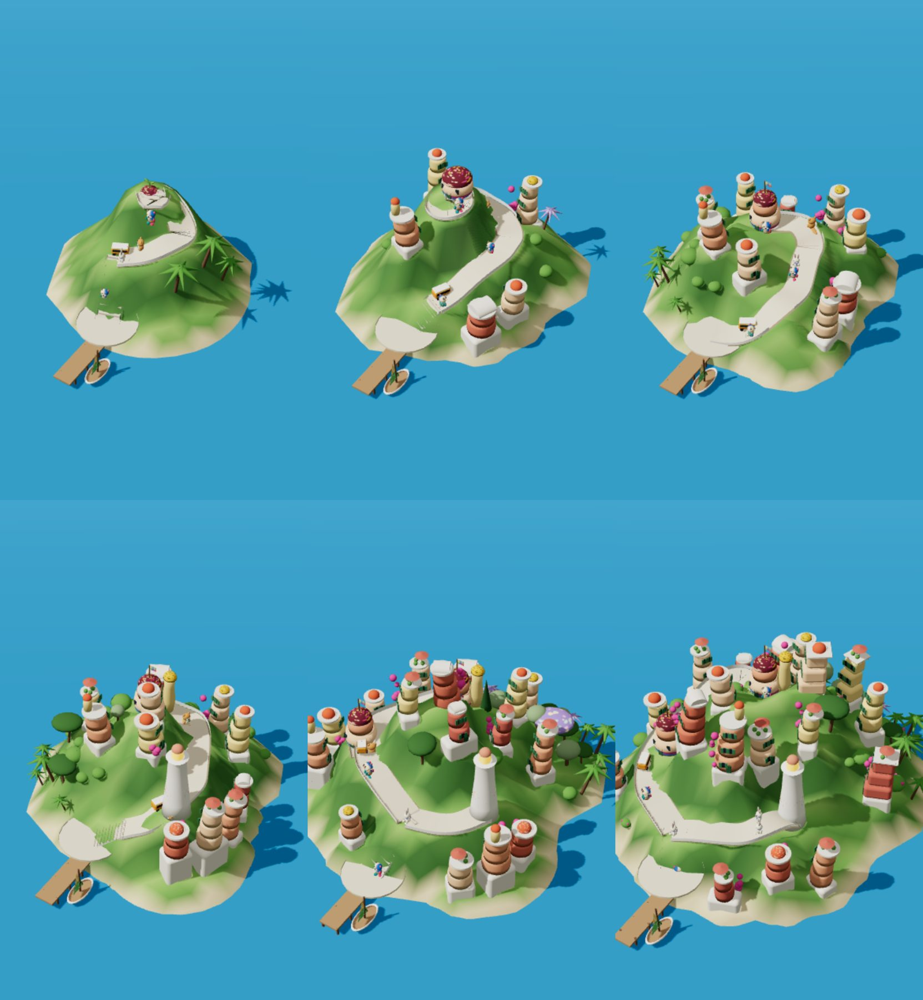

- 1回目から、家が5軒建ち、たねが芽になる。最初の数回で、目に見えて変わる。
- 3回目に★（灯台）、6回目に2つ目のたねを置いた。新しい物を置くと道がふえ、町がまた広がる。
- 学習1回で6歩という量は、私が仮に決めた。

### 6通りのさわり方（全部直した後）

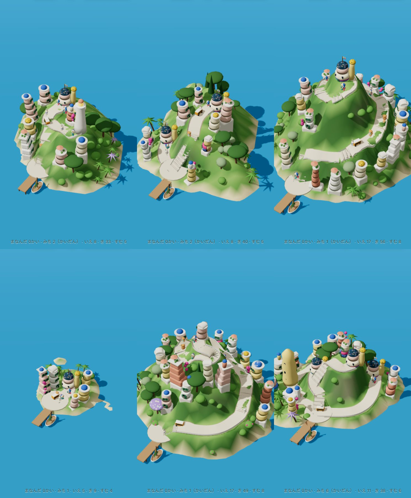

| さわり方 | 家 | 住人 |
|---|---|---|
| ていねい | 8 | 5 |
| らくがき | 8 | 5 |
| 1か所 | 17（前は9） | 8 |
| ほる | 5 | 4 |
| 形だけ | 17 | 8 |
| 置くだけ | 11（前は5） | 6 |

1か所に盛った島も、丘を回りこむ道と町になった。6通りとも、道・家・住人・港がそろう。

### さわり心地をもう一度測った

| 測ったもの | 結果 |
|---|---|
| 指の操作のチェック | 21項目すべて通る。🌱で4色が出て、1回のタップで選べる。たねは選んだ色になり、色の選択は消える。学習しないと何も育たない。📖で1回分育ち、「まなんだ 1かい」と出る |
| なぞる1回（CPU4倍遅い） | 中央値1.6〜1.8ms、最悪約10ms。前は2.5ms |
| 指を離した後の考え直し（CPU4倍遅い） | 19〜51ms |
| MacのGPUで1フレーム | 約13ms。CPU4倍遅くしても、約240フレームで34ms超えは0〜1回 |
| メモリ | 育てずに80回なぞって、形のデータ165→166。たまらない |
| 画面の大きさ | 幅320の縦、390の縦、844の横、iPad横のすべてで、ボタンが画面内にあり押せる（幅360以下では「試作」の札を隠し、上の列を詰める） |

**途中で見つけて直した重さ**：土のすべりを島全体に広げたら、なぞる1回が2.5→10msに重くなった。なぞる間はすべりを数回だけにして、指を離した時に、なぞった所から最後まですべらせる。すべりが小さな動きを止めずに続けていた（毎回20ms）のも、少しの差なら止めるようにした。道の探し方は、ゴールへ向かう見当をつけて探すようにした。

### まだわからないこと

- 実際のiPhoneでは見ていない（このMacにはiOSシミュレータの実行環境がない）。
- 本物の子どもには、まだ触ってもらっていない。良い感じかどうかは、私が画面を見て判断した。
- 学習1回で育つ量（6歩）と、色の種類（4色）は、仮に決めた。
- 町が育ちきった後は、家が高くなるだけになる。15回より先で、まだ変化が感じられるかは確かめていない。
- 家に入る住人は、戸口で小さくなって消える。階段の曲がり角では、段がまだ少し扇形に開く。

## 道の見た目（2026-10-30）

利用者に「道の見栄えも、灰色以外もいるな」と言われた。住人の行き来をうながす仕組み（行き先・人通りで育つ）とは別に、道の見た目だけを先に作って見比べた。利用者が「道の見た目だけ先に」を選んだ。

**作ったもの**
- **使われ方で4段階**：誰も通らない「ふみあと」（細い土の道、ふちなし）、「じゃり」、「いしだたみ」（ふちと、低い側の白い壁）、「タイル」（街灯と花の鉢が交互に並ぶ）。人通りの仕組みはまだないので、今は `?road=0〜3` で全部の道を同じ段階にして見比べる（標準は「いしだたみ」）。
- **選んだ色で舗装が変わる**：道は、いちばん近い子どもの家の色に合わせる。

| 色 | じゃり | いしだたみ | タイル |
|---|---|---|---|
| しろ | 白い砂利 | 白い石だたみ | 白と水色に青い輪 |
| ゆうやけ | 赤土の砂利 | テラコッタのレンガ | オレンジと黄色に白い点 |
| みずたま | パステルの粒 | パステルのモザイク | 濃いパステルのモザイクに白い水玉 |
| もり | 緑のまじる砂利 | 木の板を横に並べた道 | 緑とクリームに緑の輪 |

- **広場**：道が子どもの家に着く所に、小さな丸い広場がある。床は、みずたまの島は黄色に黒の水玉、ほかは黒ふちの色面。
- **階段・橋・船着き場**も、同じ色の舗装と段にそろえた。

左から ふみあと・じゃり・いしだたみ・タイル、上から しろ・ゆうやけ・みずたま・もり：

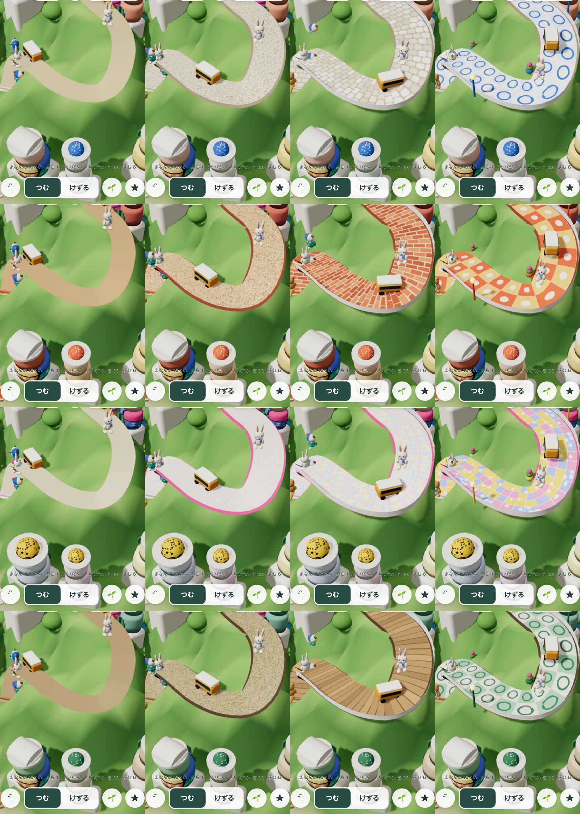

上から見た島（タイルの段階、左から しろ・ゆうやけ・みずたま・もり）。家の横の広場が見える：

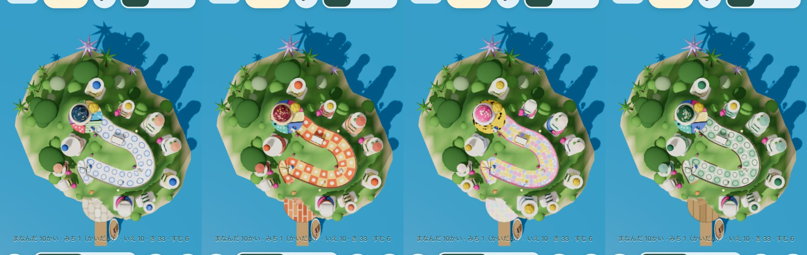

### 確かめたこと

- 試作のテスト21件、型、lintが通る。指の操作のチェック21項目が通る。
- 描く回数は1フレーム321回（街灯と鉢のぶん少し増えた）。MacのGPUで1フレーム約13ms、CPU4倍遅くしても約250フレームで34ms超えは2回（最大49ms）。
- なぞる1回は中央値1.5〜1.8ms、指を離した後の考え直しは21〜51ms（CPU4倍遅い）。

### 見て気づいたこと・まだのこと

- 上から見ると、タイルの道はすごろくの道のように見える。ふしぎな島らしいが、模様が大きく強いので、町の家より目立つ。
- 「ふみあと」は、ふちがくっきりしすぎて、踏みあとらしく見えない。草とのさかいを、ぼかす必要がある。
- 段階は、まだ島全体で1つ。人通りで区間ごとに変わる仕組みは、まだ作っていない。
- 実機と、本物の子どもでは、まだ見ていない。

## 住人の行き来と、子どもが道を引く版（2026-10-30）

利用者に「ある程度道路をおいて住人が通れるようにしないと発展しない」「住人の行き来をどうやってうながすかやね」と言われた。作戦を考えた後、「出来れば一気にいきたい」と言われたので、私が自分でできるところを一度に作った。子どもに触ってもらうことと、実機で開くことはできないので、手順を書いた。

- [iPhoneで開いて、子どもに触ってもらう手順](playtest.md)
- [本番の島へ入れる案](integration.md)（まだ決定ではない）

### 行き来で、道と町が育つ

- 島が1歩育つたびに、住人の3人に1人が出かける。家（町の家と子どもの家）から、行きたい場所（子どもが置いた物と港）へ、道を通って行く。
- 道の地点ごとに足あとを数える。足あとが5で「じゃり」、24で「いしだたみ」、70で「タイル」になる。すぐ近く（1マス分）の足あとも数えるので、なぞって道が少しずれても、舗装は元からやり直しにならない。
- 新しい家は、足あとの多い所の近くに建つ。

学習の回数で育つ様子。左上から0・1・3回、下の段が5・8・15回：

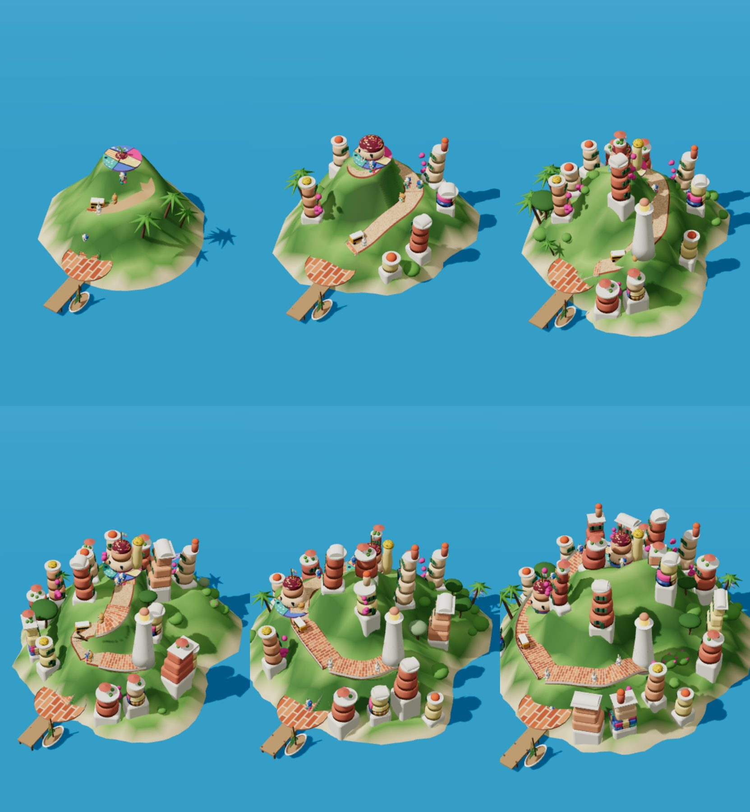

- 1回目で、ふみあとがじゃりになる。
- 5回目で、よく通る所がレンガになる。
- 15回目で、いちばんにぎわう所がタイルになる。

港と灯台のあいだ、子どもの家への道のように、行き来の多い道ほど先に立派になる。

### 子どもが道を引く版（`?roads=draw`）

- 「つむ・けずる」の横に「みち」が出る。なぞった線に沿って、およそ1.3ごとに止まる所を置き、島がその間の道を探す（つづら折り・階段・橋）。地面は盛らず、けずらない。
- 島が引くのは、港から子どもの家までの道だけ。★の建物には、子どもが道を引くまで届かない。
- 届いていない場所があると、住人が2人、道がいちばん近づく所に立って、そちらを眺める。説明の言葉は出さない。
- ↶ は、最後に引いた1本を丸ごと戻す。

左：灯台に道が届いていない。住人が道のはしで眺める。右：「みち」で引いて学習6回。道ぞいに町ができる。

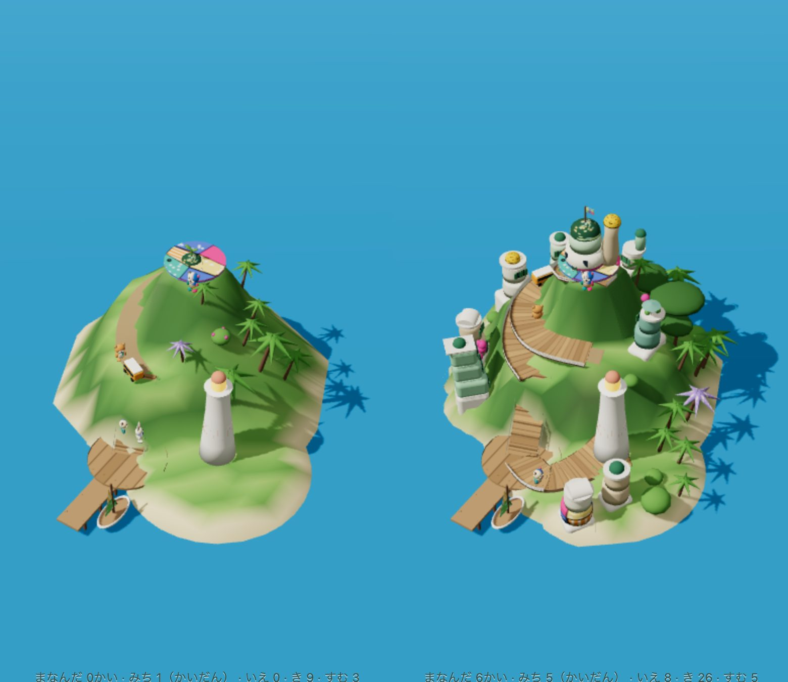

### 確かめたこと

- 試作のテスト24件が通る。足あとの数え方、届かない場所、舗装の段階のテストを足した。
- 指の操作のチェック21項目が通る。道を引く版も、本物の指で9項目を確かめた（みちが出る、届かない時に眺める、引いた線が道になる、地面は変わらない、学ぶと道ぞいに建つ、↶で1本戻る、エラーなし など）。
- 6通りのさわり方は、どれも舗装が育ち、家が建つ。
- 4つの画面の大きさで、道を引く版のボタンも画面内に収まる。
- なぞる1回は中央値1.8ms、指を離した後は20〜53ms（CPU4倍遅い）。MacのGPUで1フレーム約12〜14ms。育てずに80回なぞって、形のデータは180→180でたまらない。

### まだのこと

- 住人のふきだし（学習ごとに行きたい場所が浮かぶ）は作っていない。説明しすぎにならない出し方を、子どもの反応を見て決めたい。
- 歩いている住人の姿は、足あとの数え方とは別に、今までどおり道を往復している。出かける姿は、まだ見えない。
- 足あとの量（1歩で3人に1人）と、舗装の段階の数（5・24・70）は、仮に決めた。

## 目指す瞬間に近づける（2026-10-30）

利用者に「目標にとどいてるか？」と聞かれた。景色はかなり届いたが、[仕様52](../../product/52_growing_island_game_spec.md) §0.2の「目指す瞬間」のうち3つがまだない、と答えた。「そちらでわかる範囲で」と言われたので、その3つと見た目の残りを作った。途中で「しまのUXとして もっとも だいじ？」と聞かれた。私は、**学んで戻ると自分の島に変化があり、それを自分の指で開けること**と答えた。仕様52の一周（しこむ → まなぶ → ひらく）の芯で、学習に行く理由と、自分の島だと感じる気持ちがここで生まれる。

### 作ったもの

| 目指す瞬間（仕様52 §0.2） | 試作で |
|---|---|
| 3. つぼみを開けるのが楽しみで、学習に行く | 📖まなぶ を押しても、島はまだ育たない。育つ所（若いたねのそば、いちばんにぎわう道ばた）に、水玉の光るつぼみが出る。家2階ほどの大きさで、遠くからでも見つかる。子どもが触ると、輪が広がって開き、その分の育ちが音と一緒に1つずつ起きる |
| 2. 待っている子のために家を建て、戻ると住んでいる | 桟橋の先に、住みたい子が1人、頭の上に家を浮かべて待っている。最初の家はぽこもこの家で、2つ目からのたねが家に育つと、浮かんだ家が跳ねる。子どもが触ると、その子は道をたどって家まで歩き、住む。次の学習の後に、また次の子が来る。急かさず、帰らない |
| 5. 小さな木が、いつのまにか大木 | 木は小さく生え、島が育つたびに少しずつ大きくなる。松とオリーブは1.8倍、糸杉は1.5倍まで |

見た目：家は上の階ほど少しずつ回って、積み木より「育った」形に見えるようにした。角も、より丸くした。ふみあとは、草とのさかいがぼけて、ところどころはげて見える。

左から：学習1回目のつぼみ（丘の上と道ばた）、桟橋で家を浮かべて待つ子、触ると家へ歩く、学習16回目（木が大きく育った）：

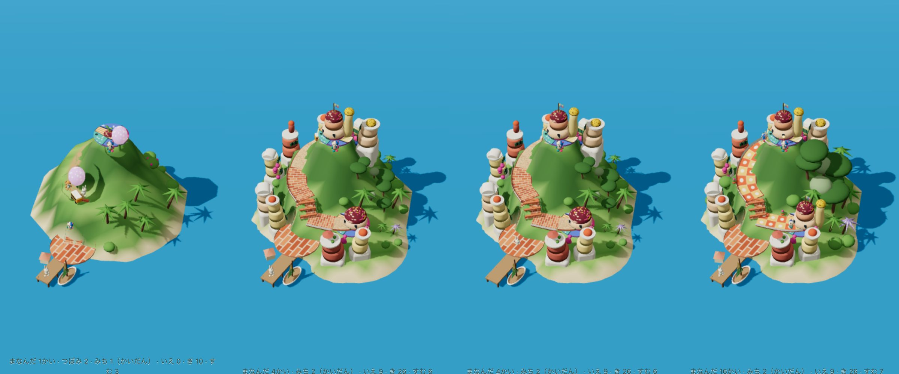

### 確かめたこと（本物の指で）

- 学習するとつぼみが出て、開けるまで何も育たない。触るとつぼみが全部開き、家が0→6軒建ち、たねが芽になる。
- 2つ目のたねが家に育つと、桟橋の子は「家がある」状態になる。触ると歩き出し、家に着くと住人が1人ふえる。
- 学習12回で、木の平均の大きさが0.83→1.23倍になり、いちばん大きい木は1.72倍になった。
- 指の操作のチェック22項目（📖とつぼみの項目を、新しい流れに合わせて直した）、道を引く版9項目、試作のテスト24件がすべて通る。6通りのさわり方、4つの画面の大きさも通る。
- 育てずに200回なぞっても、形のデータは181〜187の間で、たまり続けない。描く回数は1フレーム372回。なぞる1回は中央値1.7〜1.9ms（CPU4倍遅い）。

### 目指す瞬間の、いまの状態（私が確かめられた範囲）

| 目指す瞬間 | いま |
|---|---|
| 1. 開いたらすぐ触って遊べる | 試作ではできる。なぞる反応は速い。実機は見ていない |
| 2. 待っている子のために家を建て、戻ると住んでいる | 試作でできた。本番の船・入居の規則（すみごこち・ごはん）とは、まだつないでいない |
| 3. つぼみを開けるのが楽しみで学習に行く | 仕組みはできた。楽しみになるかは、子どもで見ないと分からない |
| 4. 思っていなかった形の町ができる | 地形・道・人通り・色で、町の形が変わる |
| 5. 小さな木が大木になる | できた |
| 6. 「じぶんで つくったの？」と言われる | 分からない。誰にも見せていない |

### まだのこと

- 出かける住人の姿：足あとは数えているが、歩く姿は今までどおり道を往復している。
- 学習ごとのふきだし。
- 実機と、本物の子ども（[手順](playtest.md)にも、つぼみと桟橋の子で見ることを足した）。

## 実機なしで効く所を足す（2026-10-30）

利用者に「実機はさわれんから、それ以外で効果でるのをやりたい」と言われた。実機がなくても画面と数字で確かめられて、しかも遊びに一番効く所を選んだ。いちばん大事な「学んで戻って、自分の指で開ける」瞬間の手ごたえ、島が生きている感じ、見せたくなる気持ち、そして弱いスマホでの安全策。

| 足したもの | 中身 | 確かめたこと |
|---|---|---|
| つぼみが開く手ごたえ | 触ると、がくが開いて、つぼみがふくらんで消える。光る粒（きらきら）が40個ほど舞い上がる。家が建つ時、たねが育つ時、家が高くなる時にも、小さなきらきらが出る | 本物のタップで、開いた直後に40個のきらきらが出ている |
| 出かける住人の姿 | 島が育つたびに数えている行き来のうち1つを、本当に歩かせる。家から道をたどって灯台・港・子どもの家へ行き、着くと跳ねて家に戻る。同時に4人まで | つぼみを開けた後、最大4人が同時に出かけていた |
| しまの しゃしん | 📷を押すと、今の島を、ぽこもこの水玉のふちで囲んだカードにする。「わたしの しま」、家・住人・木の数、学んだ回数、日付が入る。「ほぞん」で絵として保存できる。ほかへは送らない | 1080×1350の絵ができ、保存のリンクが絵になっている。とじるで閉じる |
| 弱いスマホでの安全策 | 1.5秒ごとに速さを見る。一番低い解像度でも遅い状態が2回続いたら、まず影をやめ、それでも遅ければ住人を減らして出かける姿もやめる | GPUのない描画でCPUを4倍遅くすると、数秒で一番軽い段階まで下がり、1フレームの中央値が145→115msに軽くなった。MacのGPUでは下がらない |

左から：開いたつぼみのきらきら、出かける住人、しまのしゃしん：

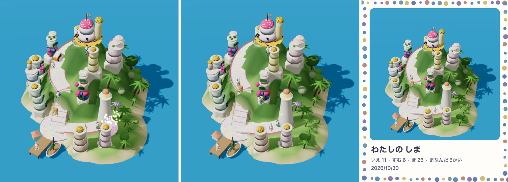

### ほかに直したこと

- 幅440以下では「試作」の札を隠す。幅360以下では 📖 の文字を隠してアイコンだけにする。上の列に📷が増えて、いちばん小さいiPhoneで 📖 が画面の外に出たため。
- 速さの見張りを「90フレームごと」から「1.5秒ごと」にした。とても遅い機械では、90フレームに20秒以上かかり、気づくのが遅すぎたため。

### 確かめたこと

- 指の操作22項目、道を引く版9項目、つぼみ・桟橋・木の10項目、今回の6項目が通る。試作のテスト24件、lintが通る。
- 4つの画面の大きさで、見えているボタンがすべて画面内にあり、押せる。
- 育てずに80回なぞっても、形のデータは177→183で、たまり続けない。
- なぞる1回は中央値1.6〜1.8ms（CPU4倍遅い）。MacのGPUで1フレーム約13〜15ms。
- 1回だけ「なぞっている間は道が変わらない」が通らなかった。これは、なぞりを0.38秒止めると島が考え直す作りのため。GPUのない遅い描画で、指の動きの間が0.38秒より空いたとみている。その後3回続けて通った。

### まだのこと

- 実機と、本物の子ども。
- 学習ごとのふきだし。
- 写真の保存は、iPhoneのSafariでの動きを見ていない。

## 島の見た目を上げる（2026-10-30）

利用者に「つぎやることは、もっと島の見た目をバリューアップのやつにして」と言われた。前の画面を見て、弱い所を次の順に挙げた。

- 海が一色で、島がそこで終わって見える（いちばん大きい）
- 坂の家の土台が白い箱で、柱のように見える
- 草地がつるつるのプラスチックのよう
- タイルの道の青い輪が強すぎる
- 空に何もない

| 直したもの | 中身 |
|---|---|
| 海 | 島の高さを海が知っていて、浅い所はエメラルド、沖は深い青になる。岸には寄せては返す白い波の帯が出る。ところどころに日のきらめき、ゆっくりしたうねりがある。夕方は紫がかった色になる |
| 家の土台 | 白い箱をやめ、石を積んだ段々畑の石垣にした。屋根のふちのはみ出しを小さくした |
| 草地 | 草のふさ700と、野の花260（ピンク・黄・白・うす紫）を、道・家・岸を避けて散らす。地面が決まるたびに置き直す。波打ちぎわには岩を置いた |
| 空 | 白い雲が島のまわりの海の上をゆっくり回り、影を落とす（町の上はふさがない）。海鳥が4羽、島の上を旋回する |
| タイルの道 | しろ・もりのタイルの輪を、細く淡くした |

左が前、右が後（ひる）：

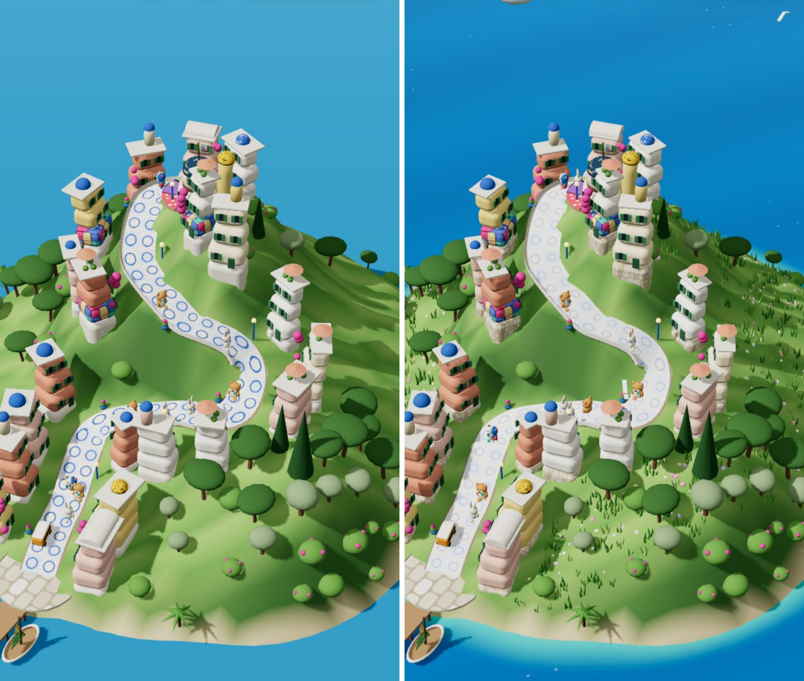

夕方：

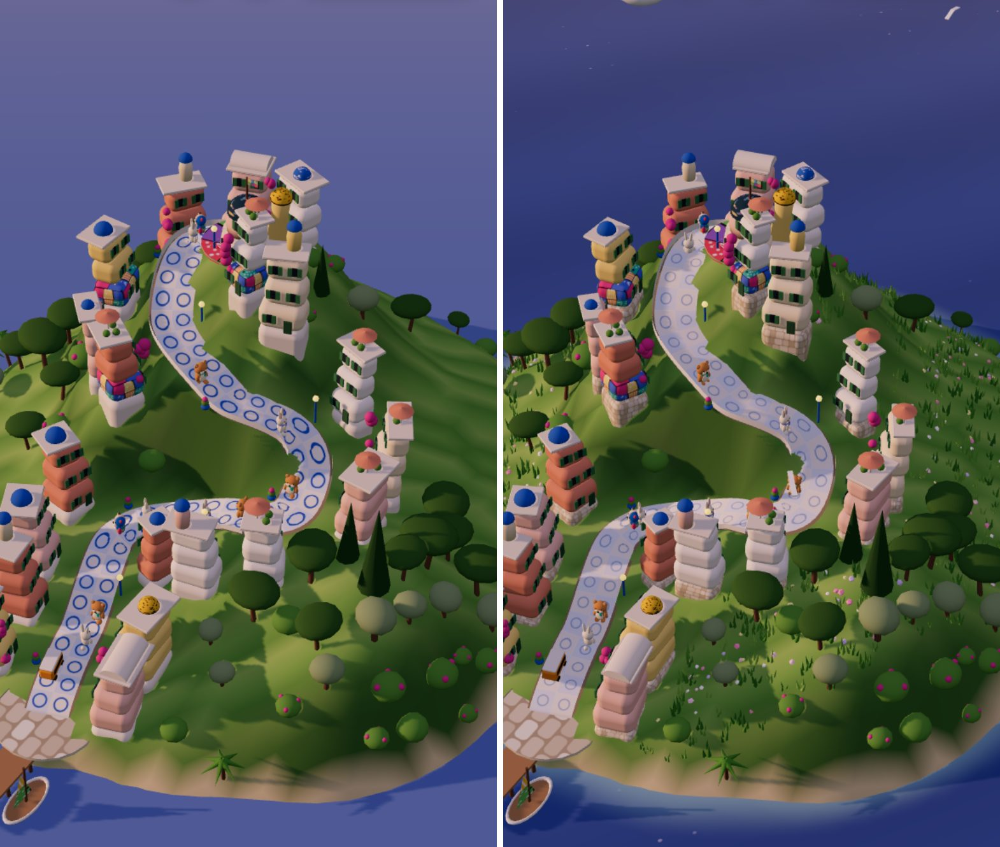

近くで見た町（石垣の土台、淡くした輪）：

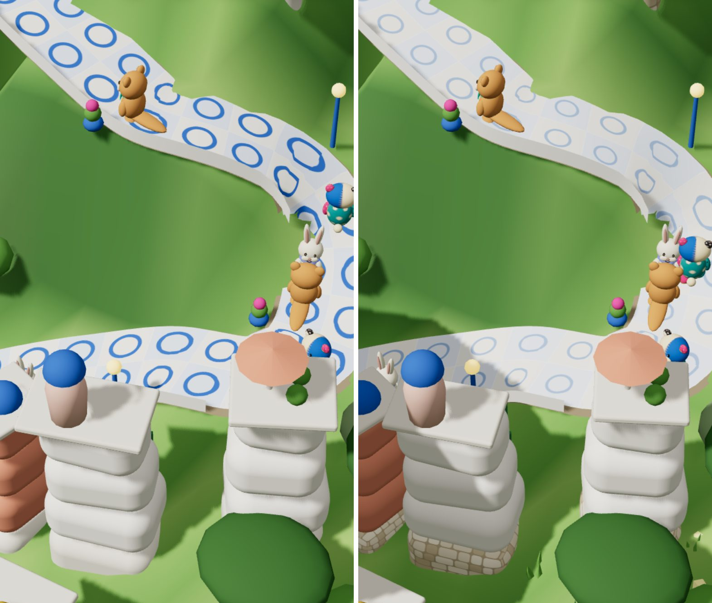

### 途中で見つけた失敗

最初に入れた海の色の計算に、`patch` という名前を使っていた。これはGPUの言葉で予約された語で、計算が組み立てられず、海が描かれなくなった。全体の画面では前の海が残っていたので気づかず、船着き場に寄った画面で、海底と空が見えて分かった。名前を変えて直した。あわせて、見た目を撮る時に画面の裏のエラーも拾うようにした。直した後は、エラーは出ていない。

### 確かめたこと

- 指の操作22項目、道を引く版9項目、つぼみ・桟橋・木の10項目、手ごたえ・写真・軽くなる仕組みの6項目、試作のテスト24件がすべて通る。
- なぞる1回は中央値1.6〜1.7ms、指を離した後は21〜75ms（CPU4倍遅い）。草地を置き直す分、少し増えた。
- MacのGPUで1フレーム約12〜15ms。なぞる間とその後の約230フレームで、34ms超えは0〜2回。
- 育てずに80回なぞっても、形のデータは210前後で、たまり続けない。

### まだのこと

- 白い家が多く、上の階が重たく見える。
- 実機での見え方と速さ。海の計算は、スマホのGPUでどれだけ重いかを測っていない（遅ければ、自動で軽くなる仕組みが働く）。

## 家を仕上げて、夜をつくる（2026-10-30）

家と光をまとめて仕上げた。

| どこ | 何をしたか |
|---|---|
| 家の形 | まくらのように丸かった角を、しっくいの壁らしく締めた。階と階の境に細い縁を入れた |
| 窓 | 前だけでなく横と裏にも窓。上がアーチのガラス、両わきに色のよろい戸、下に窓台。3つに1つほど花箱 |
| 色 | よろい戸・扉・手すり・パラソルを、家ごとに6色（緑・青・水色・朱・紫・黄）から1つ。白い家でも重たく見えない |
| 扉とバルコニー | 1階はアーチの扉と、扉わきの小さな灯り。ときどき日よけ。上の階の4割ほどに、手すりと植木のバルコニー |
| 時間 | 「ひる・ゆうがた」の切り替えを、☀️→🌅→🌙 と回る丸ボタン1つにして、「よる」を足した |
| 夕方 | 窓の7割に灯りがともり、街灯がつく。海は浅い所が夕焼け色 |
| 夜 | 窓がみな灯り、街灯と扉の灯りにやわらかい光の輪、街灯の下に光だまり。灯台の光が海の上を回る。星と、草地を漂うほたる。暗すぎないよう、青い月明かりで町が見える |

左が前、右が後（ひるの町）：

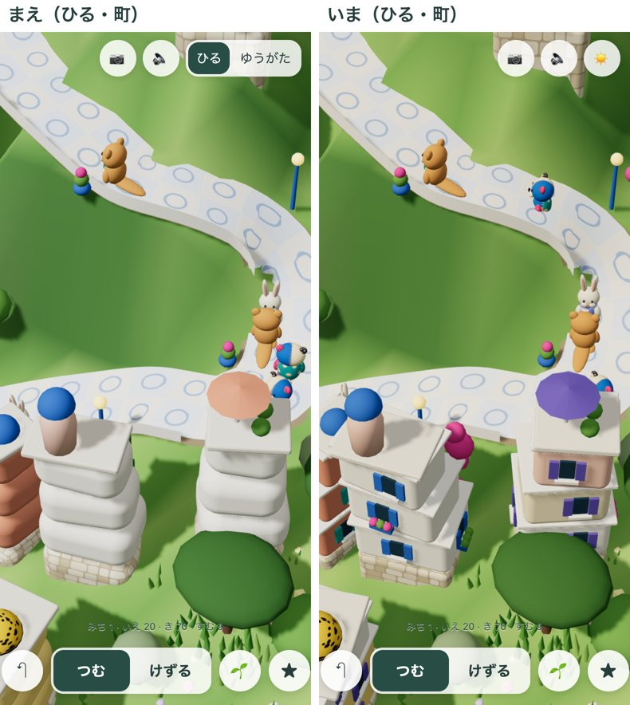

夕方（灯台を置いた島）：

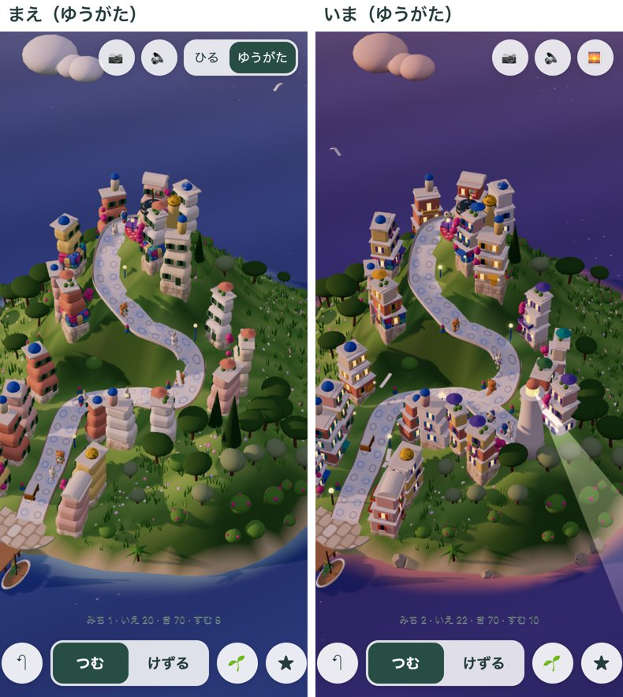

ひると、新しく作った夜：

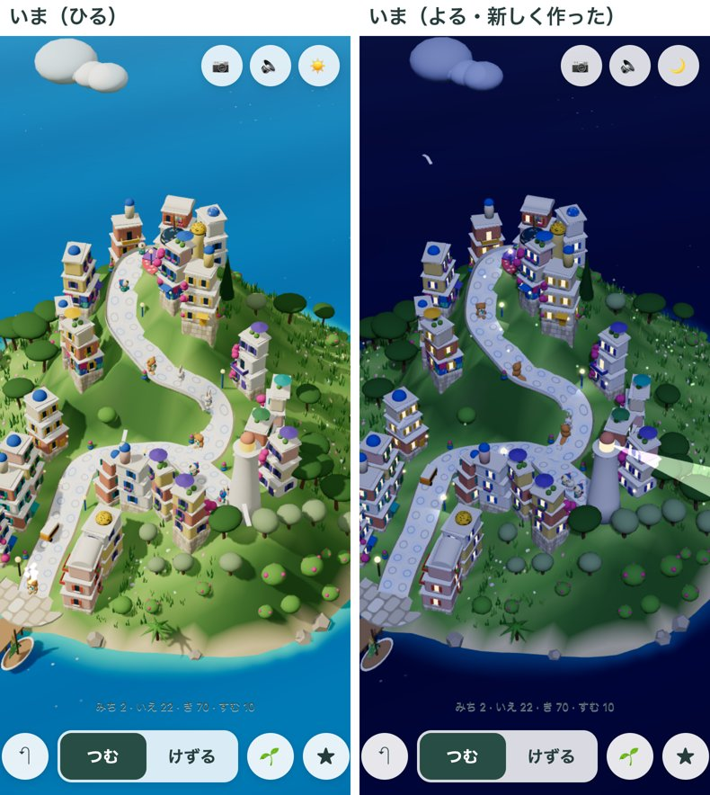

### 確かめたこと

- 指の操作24項目（時間ボタンを3つ回すのを足した）、道を引く版9項目、つぼみ・桟橋・木の10項目、手ごたえ・写真・軽くなる仕組みの6項目、6つの遊び方、試作のテスト12件がすべて通る。つぼみの確認は1回だけ、旅人の到着と木の育ちが時間内に終わらなかったが、続けて3回は通った。
- なぞる1回は中央値1.7〜2ms、指を離した後は16〜66ms（CPU4倍遅い）。前と変わらない。
- MacのGPUで1フレーム約13ms。夜は光の輪の分だけ少し増えて約16ms（3倍の画素で測定）。
- 10回つくり直しても、形のデータは270前後で、たまり続けない（共有の部品が増えた分、前の210から上がった）。

### まだのこと

- 実機での見え方と速さ。夜の光の輪と海の計算は、スマホのGPUで測っていない。
- 夜は今、子どもがボタンで選ぶ。学習の時間や本当の時刻と結びつけるかは、決めていない。

## 海辺と、住人のくらし（2026-10-30）

島のまわりと、町の中の暮らしをまとめて足した。

| どこ | 何をしたか |
|---|---|
| なぎさ | 砂と草の境を、まっすぐな線から波打つぼかしにした。波の届く所は濡れた砂の色。岸が急な所は岩場の色 |
| 白波 | 岸の白い帯を広げた。少し沖に、浜へ寄せてくる細い波の線を足した |
| 砂浜 | 平らな砂の上に、パラソルとタオルを最大5か所。ときどき砂の城やボール。濡れた砂に貝がら |
| 海の上 | 帆かけ船2そうが島のまわりを回り、ブイ4つが波にゆれる |
| ベンチ | 道ばたに、道の長さに合わせてベンチ。歩いている住人がときどき座り、足をぶらぶらさせて景色を見て、また歩き出す |
| 立ち話 | 同じ道で向かい合ってすれ違う2人が、立ち止まって向き合い、♪・♥・☀などの吹き出しを出す。言葉は出さない |
| 市場 | 道ができると、船着き場にしま模様の日よけの屋台。果物の箱が並ぶ |
| 洗濯物 | 屋上テラスの家の半分ほどは、パラソルの代わりに洗濯物が干してある |

左が前、右が後（島全体）：

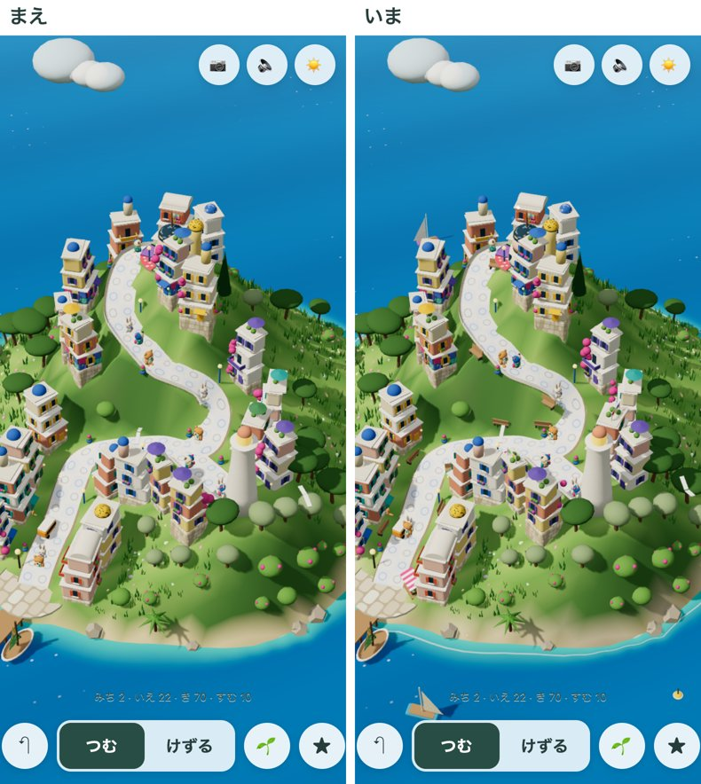

なぎさ：

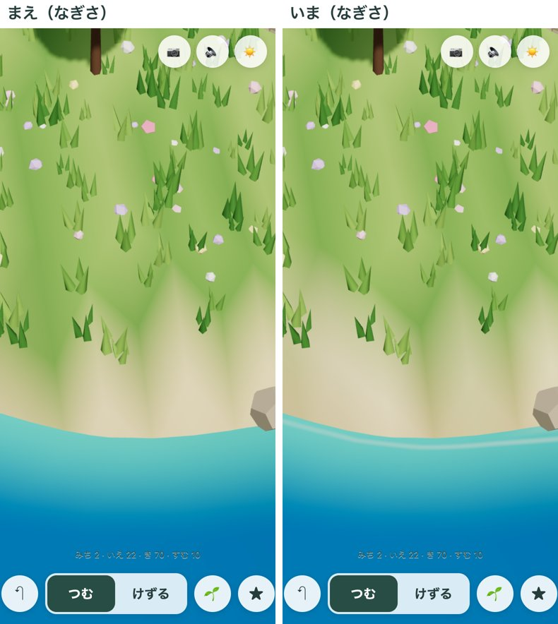

砂浜のパラソルと、道での立ち話：

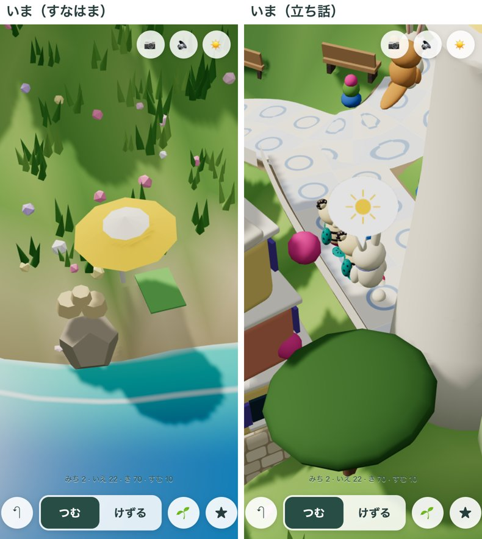

### 確かめたこと

- 指の操作24項目、道を引く版9項目、つぼみ・桟橋・木の10項目、手ごたえ・写真・軽くなる仕組みの6項目、6つの遊び方、試作のテスト12件がすべて通る。
- 見本の島で36秒見ていると、座る住人は0〜2人、立ち話は0〜1組で、座っては立ち、話しては歩き出すのをくり返す。
- なぞる1回は中央値1.5〜1.7ms、指を離した後は23〜95ms（CPU4倍遅い）。1回だけ95msが出た。MacのGPUで1フレーム約13ms、夜も約13ms。
- 10回つくり直しても、形のデータは290前後で、たまり続けない。

### まだのこと

- 砂浜はまだ細い。見本の島は岸が急で、平らな砂が少ないため、パラソルは3か所しか置けなかった。広い砂浜にするには、島の形の作り方（岸の傾き）から変える必要がある。
- 砂と草の境は、地面の細かさ（0.5きざみ）のせいで、近くで見るとまだ少しギザギザする。
- 何もない島から始める版で、ベンチや立ち話が十分に起きるかは、道が育った後でしか見ていない。
