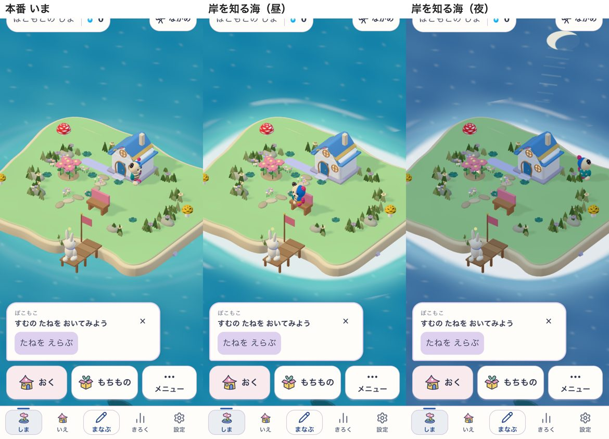
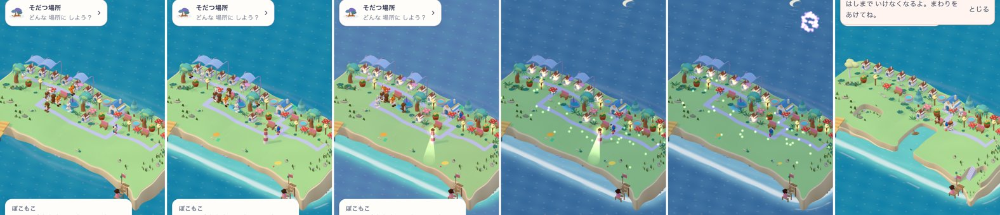
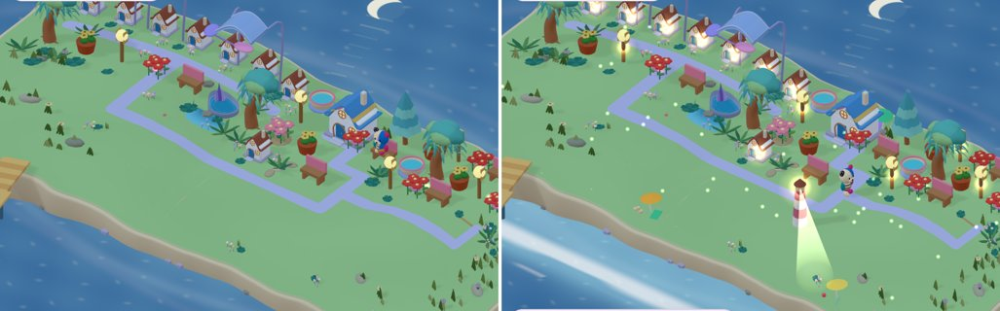
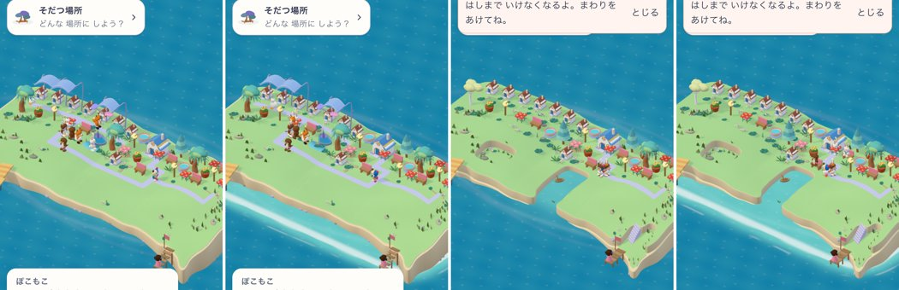
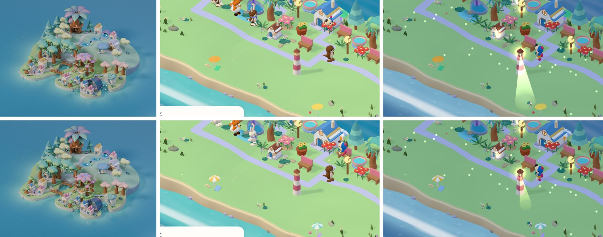
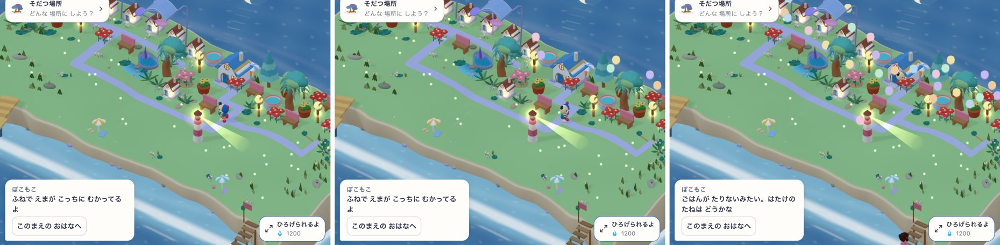

# そだつ島を本番の島へ入れる案

[そだつ島 試作の記録](README.md)の続き。**まだ決定ではなく、案**。[仕様52](../../product/52_growing_island_game_spec.md)は書き換えていない。子どもに触ってもらった結果（[手順](playtest.md)）を見てから、利用者が決める。

2026-10-31 に、試作の今の姿（砂浜・家・夜・住人のくらし・学習とのつながり・カメラ）に合わせて書き直した。

## 本番と試作は、土台がちがう

試作は、本番の島の「地面と町の見え方」を作り直したもの。本番の遊びの規則（たね・住人・船・時計・しずく・保存）は、試作にはほとんど入っていない。土台の違いは次のとおり。

| | 今の本番 | 試作 |
|---|---|---|
| 地面 | 土地のマスごとに、整数の段（1段0.18）を保存する。斜面・崖・階段は毎回つくる。§1.5で、なぞれば必ず変わり、2段はジャンプで上る | 0.5ごとの点のなめらかな高さ。盛った土は斜面をすべり、波打ちぎわでは砂がなだらかに広がる |
| 土地 | 取得したマスだけが島。しずくで向きを選んで広げる（§9） | 20×20の世界の円の中なら、盛った所が島になる |
| 道 | 家と場所の入口をつなぐ小道が、マスの上に描かれる（`placePaths`） | 島が港から家・行き先まで、坂・階段・橋・ロープウェイ付きの道を引く。人が通るほど石畳に育つ |
| 家 | 全部、子どもが置いた「すむ」のたねから建つ | 島も、道ぞいに町の家を建てる |
| カメラ | 正面寄りの決まった向きで、島の物と入口が収まるように合わせる | 自由に回せる。島の大きさに合わせて寄り、育つと引く |
| 時間帯 | 昼・夕方・夜がある。空と海の色が変わる | 同じ3つ。空の色の移り変わり、星・月、窓と街灯の明かり、灯台の光、ほたる |

なので、**地面と道と町を試作の作りに置き換え、遊びの規則は本番のまま残す**のを基本にする。ただ、地面の置き換えは保存に触れて重い。先に、保存にも規則にも触れない「見た目だけ」の部分を入れられる。

## 持っていく物を、3つに分ける

### A. 見た目だけ（保存・規則に触れない。先に入れられる）

本番の今の地面の高さと、今ある物の位置だけを読んで描く。切り替えフラグの裏に入れ、外せば今の本番に戻る。

| 部品 | 本番で何に当たるか | 気をつけること |
|---|---|---|
| 海：水深で変わる色、岸の白い波、途切れ途切れの寄せ波、日のきらめき | 今の海（深い色・浅い色の2色） | 本番の地面の高さから水深の絵を作る。本番の水辺（入り江・池・流れ）とずれないか |
| 砂浜の色：波打ちぎわの濡れた砂、岩場 | 今の地面の砂と草の色 | 地面の作り方はそのまま。色だけ |
| 夜：空のドーム、星、月、窓と街灯の明かりの光の輪、ほたる | 今の昼・夕方・夜 | 美術の判定（下記）を通す |
| 灯台の回る光、浜のパラソル・砂の城・貝、帆かけ船・ブイ | とうだい等のめじるし、海の飾り | めじるしの位置と所有は変えない。飾りは置き場所を取らない |
| 花火：その回のつぼみを全部開けたら上がる | §11 ひらく の演出 | 保存しない。消音の設定を守る |
| カメラ：島の大きさに合わせて寄り、子どもがピンチしたらその後は子どものもの | 今の `growingCamera` の合わせ方 | 本番の正面寄りのカメラは変えず、寄る距離の決め方だけを借りる |

本番の家は、本番の美術で描いている。試作の家の見た目（窓・よろい戸・バルコニー・ドアの灯り・屋上の洗濯物）をそのまま持ち込むと、美術が二通りになる。持ち込むなら、AGENTS.md のとおり [美術の進め方](../../../.agents/skills/sansu-art-direction-loop/SKILL.md) で、実画面と採用の見本を比べてから決める。

### B. 規則が変わる（仕様52を書き換えてから）

| 部品 | 仕様52のどこが変わるか | 関わる決めること |
|---|---|---|
| なめらかな地面、土のすべり、砂浜の広がり | §1.1・1.2・1.5 の地形、§18 の保存（段→高さ） | 3 |
| 島が引く道、人通りで育つ道、坂・階段・橋・ロープウェイ | §1「道を引く はない」はそのまま。道の形と育ち方を足す | 1 |
| 町の家 | §3「家は全部たねから」 | 2 |
| 住人：道を歩く、ベンチに座る、すれちがうと話す | §7.5 くらし | 2（町の家に住むか） |
| 学んだ分だけ増える灯り（最大48）と船（最大5） | §10 学習とのつながり、§18.1 保存する物 | 4 |
| 子どもが引く道（`?roads=draw`） | §1「ないもの：道を引く」 | 1 |

### C. 試作にだけ残す

- URLの切り替え（`?start=blank`、`?pace=time`、`?time=`、`?roads=draw`）。本番では時間で育つ版は使わず、§2のまちの時計で育てる。
- 調べるための窓口（`window.growLab`）と速さの記録。
- 1つのファイル（`main.ts` 約2,800行）にまとめた作り。本番では、本番の分け方（`domain/growingIsland` に純粋な規則、`components/island/growing` に描く物）に合わせて分ける。地面・道・行き来・育ちの計算（`terrain.ts`・`roads.ts`・`traffic.ts`・`growth.ts`）は、すでに描く部分と分かれているので、規則の側へ移しやすい。

## 決めること

1. **道は、島が引くか、子どもが引くか。** 子どもが引くと「自分の町」になりやすいが、仕様52の「道を一本ずつ引かせない」を変えることになる。港から子どもの家までは島が引くので、どちらでも止まらない。子どもの反応で決める。
2. **町の家は誰の物か。** 案A：町の家は景色とにぎわいで、住人は今どおり「すむ」のたねの家に住む（しこむ一周を残す）。案B：船の子が、空いた町の家に住める（たねを置かなくても来る）。案Aをすすめる。仕様52の §0.1「待っている子のために家を建てる」を守れるため。
3. **土地は、しずくで広げるか、盛れば広がるか。** 試作は盛れば広がる。今の取得の仕組みと所有権をどう引き継ぐかを決める必要がある。すすめる案：取得したマスの中だけ、なめらかに盛る・けずる（しずくで広げる仕組みは残す）。砂浜と浅瀬は、取得したマスの外側の海に、見た目として広げる。
4. **学んだ分の灯りと船を、どう数えるか。**（2026-10-31 利用者の「いっきに」で、すすめる案Bを仮に採る） 本番は、数え終わった学習の記録を消していく（`learnedFloor`）ので、今の保存からは「これまで何回学んだか」を数え直せない。案A：灯りの数を1つ保存に足す（仕様13の保存の変更になる）。案B：保存を足さず、開けたつぼみの数など、すでに保存している物から決める。案Bをすすめる。保存の変更を後回しにでき、見た目だけ（A）の段階に入れられるため。
5. **呼び名。**（同じく、本番では「ちょうちん」を仮の名前にする。子どもの前に出す前に、もう一度見る） 試作では学んだ分の灯りを「ひかりのたね」と呼んだが、本番には別の「ひかり」（旧い通貨、§18.2）がある。子どもが混ざらないよう、本番では別の名前にする（例：ちょうちん）。

## 進め方

| 段階 | すること | 合格の見方 |
|---|---|---|
| 0 | 子どもに触ってもらい、決めること1〜3を決める。4・5は利用者が決める | 子どもの様子のメモ |
| 1 | **見た目だけ**（A）を、切り替えフラグの裏で本番の島に入れる。海・砂浜の色・夜・灯台・浜の小物・花火・カメラの寄り方。保存と規則には触れない | 本人の島で、昼・夕方・夜を切り替え、つぼみを開け、地面をなぞって、見た目が付いてくる。フラグを外すと今の本番と同じ。iPhoneで、なぞる間と育つ時に止まらない |
| 2 | 地面を置き換える（`VITE_ISLAND_SHAPING` の裏）。今の家・持ち物・住人を、新しい地面の上に立たせる。高さの保存と、段からの引き継ぎ | 本人の島で「盛る・けずる → 物が一緒に動く → もどす → 閉じて読み込み直す」を実際に操作して一致する（仕様52 §1.1の合格の見方） |
| 3 | 道と町：道・階段・橋・港、町の家、舗装の色と段階、広場、ベンチ | 同じ操作で、道が届き、家が建ち、読み込み直しても同じ |
| 4 | 行き来とくらし：行き先と人通り、住人が座る・話す。まちの時計で、通った道と町が育つ。学んだ分の灯りと船 | 学習1回ごとに、目に見える変化がある |
| 5 | 見た目の仕上げと実機の速さ | 実機で、なぞる間と育つ時に止まらない |

段階2から、本番の保存に触れる。本番の島で遊んでいる子の記録を壊さないよう、段階ごとに切り替えの裏で出し、自分たちで確かめてから広げる。段階1は保存に触れないので、子どもに触ってもらう前でも始められる。

## 段階1を始める前に確かめること

- 本番の海（`worldScene.ts`）と、本番の水辺（入り江・池・流れ、`authoredWater*`）が、水深の絵とどう重なるか。
- 本番の昼・夕方・夜（`nativeGrowingLighting.ts`・`worldScene.ts`）と、試作の時間帯の表（空・日・海・窓・街灯の色）の対応。
- 本番の画質の段階（pixelRatio 1→1.5、影・MSAAなし）の中で、光の輪・星・ほたるが重くならないか。試作はMacのGPUで1コマ約12〜13ミリ秒。iPhoneではまだ測っていない。
- 本番のカメラ（正面寄り）で、試作の帆かけ船・花火・灯台の光がどこに見えるか。

## 段階1の1つめ：岸を知る海（2026-10-31）

本番の海は、島の形を知らない。島のまわりに楕円の明るい帯を描くだけで、土地を広げても、掘って入り江にしても、浅瀬は同じ形のまま。試作の海は、地面の高さから水深を知っていて、浅瀬・岸の白い波・途切れ途切れの寄せ波が、本当の岸の形に沿う。

これを、**開発中だけ** `?island-sea=coast` を付けた時に、本番の海（`three/garden/garden.ts` の `life-sea`）へ重ねた（`three/garden/coastSea.ts`）。

- 取得したマスのうち、海面（−0.40）より高い所を陸として、1マス4点の白黒の絵にする。描かれた岸はマスより少し外にあるので、陸を半マス太らせてから、ぼかす（はじめは3/4マス太らせていたが、幅2マスの入り江が埋まったので減らした。下の続きを参照）。
- 海の色は、その絵の濃さで決める。島のすぐそばは浅い色、岸には白い波、少し沖に途切れ途切れの寄せ波。
- 置き場所は、本番がマスを描く位置（`point`）から取る。島の形が変われば、地面と一緒に作り直される。
- 保存・規則・学習には触れない。フラグを付けなければ、本番は今のまま。

本番の島で、左から 今の本番／昼／夜（iPhoneの幅390と、タブレットの幅768）。**訂正（同日）**：この画像は `crowded` のつもりだったが、撮影用の島が読み込まれておらず、はじめの小さい島が写っている。本番の島の保存先が `terrainIslands` に移っていたのに、古い表へ入れていたため。`crowded` での確認は下の続きにある。

### 確かめたこと

- 本番の開発画面で、作り物の島を読み込み、フラグありとなしを撮った。どちらもエラーなし。
- 1秒あたりのコマ数は、フラグありもなしも約63（画面の更新の上限）。重さの違いは、この測り方では見えない。GPUの時間は測っていない。
- lint・型チェック・build・全テストは、下の commit の時点で通した。

### 分かったこと

- 本番の開発画面は、本番用とは別の島の保存（`SansuGrowingIslandPreviewV1`）を使う。作り物の島を入れて見るときは、こちらに入れる。
- 本番の島は、厚みのある板のような形で、側面がまっすぐ海へ落ちる。岸の白い波は、この板の縁に寄せる形になる。試作のような、砂浜がなだらかに海へ入る岸は、地面を置き換える段階2まで出ない。

### まだのこと

- 掘って作った入り江・池・流れのある島、広げた島、美術で作った地区（`authored`）では見ていない。美術で作った地区は、別の海（`buildAuthoredGrowingSea`）を使うので、今は変わらない。
- 美術の判定（実画面と採用の見本の比較）はしていない。
- iPhoneの実機では見ていない。
- 段階1の残り（夜の光、灯台、浜の小物、花火、カメラの寄り方）は、まだ入れていない。→ 下の「段階1の残り」で入れた。

## 段階1の残り：夜の光・灯台・浜・船・花火（2026-10-31）

**開発中だけ** `?island-look=lab` を付けると、段階1の見た目の部品が全部、本番の島に出る（`growing/labLook.ts`）。岸を知る海もこれで一緒に付く。海だけ比べたい時は、今までどおり `?island-sea=coast`。

| 部品 | 本番の何を読むか | 出る時 |
|---|---|---|
| 窓の灯り | 2階建て以上の家（すむ のたね、段階2以上）。カメラ側の面に置く | 夕方は弱く、夜は強く |
| 街灯・灯台の灯り | 今ある `lantern`・`lighthouse` | 夕方・夜 |
| 灯台の回る光 | 灯台の灯の位置 | 夕方は弱く、夜。ゆっくり回る |
| ほたる | 岸でも物の上でもない陸のマス | 夜だけ |
| パラソル・タオル・砂の城・ボール・貝 | 岸のマス（陸で、となりが海）のうち、物が置かれていない所。島の名前の種で、毎回同じ所 | いつも |
| 帆かけ船2そう・ブイ3つ | 島の大きさから決めた沖の輪 | いつも |
| 花火 | つぼみが残っていて、最後の1つ（または「ぜんぶ ひらく」）で全部開いた時 | 3回。島の向こうの海の上で開く |

- 保存・規則・学習には触れない。花火は保存しない。音は出さない（消音の設定に関わらない）。動きを減らす設定の時は、花火を上げず、船・ほたる・灯台の光を止める。
- 船の数は、決めること4の案B（もう保存している物から数える）をまだ当てていない。今は2そうで固定。
- 星と空のドームは入れていない。本番の正面寄りのカメラは海を見下ろしていて、空が画面に入らないため。月は本番にもとからある。

### カメラの寄り方

本番のカメラ（`growingCamera.ts` の `frameCamera`）は、**すでに**島の実際の形（描かれた地面・家・物の点）に合わせて寄る。子どもがピンチした拡大率（`view.zoom`）も、島が育っても残る。試作から借りることは、島が育った時に、なめらかに寄り直す動きだけ。今は一度に切り替わる。動き自体は子どもにとって小さな差なので、段階1では入れず、段階5の仕上げで見る。

### 確かめたこと

本番の開発画面（`VITE_ISLAND_SHAPING=on`）で、撮影用の島 `crowded`（家8軒・街灯5本）を `terrainIslands` に入れて開いた。灯台は撮影のために1本足した。

iPhoneの幅390で、左から 今の本番（フラグなし・昼）／昼／夕方／夜／花火（「ぜんぶ ひらく」を押した約1.4秒後）／掘った入り江のある島（昼）：

タブレットの幅768の夜で、左が今の本番、右がフラグあり。窓・街灯・灯台の灯り、灯台の光、ほたる、パラソル：

岸を知る海を、`crowded` と、掘った入り江・池・角の欠けを足した `crowded` で。左から 今の本番／岸を知る海／入り江の島の今の本番／入り江の島の岸を知る海：

- どの画面でもエラーは出なかった。1秒のコマ数は、フラグありもなしも約59〜63で、画面の更新の上限に当たっている。重さの差は、この測り方では見えない。
- 花火は、つぼみ2つを「ぜんぶ ひらく」で開けた時に3回上がった。はじめは島の奥の町の上で開いて家と重なったので、島の向こうの、もっと高い所へ移した。
- パラソルは、はじめ小さすぎて見えなかったので、1.6倍にした。

### 入り江で分かったこと

- **白い波が太すぎた**：大きい島では、描かれた岸がマスのすぐ外にあり、小さい島より陸の絵が外へはみ出していた。そのため手前の岸に白い帯が太く出た。白い波を細い帯にして、その内側は浅い色に戻した。
- **入り江の口をふさいでいた**：陸を3/4マス太らせていたので、幅2マスの入り江が陸の絵で埋まり、白い波が入り江の口をまっすぐ横切った。太らせ方を半マスに、ぼかしも少し弱くした。今は浅瀬が入り江の中まで入り、白い波も口から少し入り込む。小さい島の白い波も残る。
- **子どもの島にも入り江はできる**（2026-10-31 訂正）：はじめ「掘る機能は本番では切ってある」と書いたが、まちがい。公開ビルド（`vercel.json`）は `VITE_ISLAND_SHAPING=on` で、仕様52 §1.2 のとおり、子どもは うみ のふでで入り江・池・流れを作れる。今回の入り江の島は、開発画面で撮影用の島に高さを書き込んで作った。子どもが実際に掘った島では、まだ見ていない。
- 掘った池（海とつながらない穴）は、本番の今の描き方のまま、乾いた穴に見える。海の側の問題ではないので、今回は触らない。

### まだのこと

- 美術の判定（採用の見本との比較）はしていない。窓の灯り・パラソル・船は、本番の美術とは別に作った簡単な形のまま。
- iPhoneの実機では見ていない。GPUの時間も測っていない。
- 美術で作った地区（`authored`）では見ていない。
- 本番の島は板のような形なので、パラソルは砂浜ではなく、岸ぎわの草の上に立つ。砂浜は段階2で地面を置き換えてから。
- 学んだ分の船と灯り（決めること4）、なめらかに寄るカメラは、まだ。

## 美術の判定：見本との比べ（2026-10-31）

採用の見本は [native-05](../2026-10-10-island-final-3d/README.md)（全島の3D美術）。それと、本番の島に出した段階1の小物を、同じ撮影用の島（タブレット幅768）で並べた。左が見本、中が昼、右が夜。上の段が直す前、下の段が直した後：

見本の小物は、太くて丸い、やわらかいおもちゃの形。色は花と同じ、やさしい色。本番のベンチ・鉢・家も同じ作り。これと比べて：

| 部品 | 直す前 | 直したこと |
|---|---|---|
| パラソル | 薄い円盤で、上から見ると色の点にしか見えない。色が試作のこい色で、本番の花・ベンチから浮く | 白と色の縞の、丸いかさにした。柄を太くし、上に玉を付けた。色は本番の花の色から取った。タオル・貝・ボールも少し厚く大きく |
| 灯台の光 | 正面のカメラからは、草を照らす大きな緑のスポットライトに見えた | 細く短くし、先を少し上げた。色を暖かい色にして、うすくした |
| 帆かけ船 | 島から遠い円を回っていて、長い島ではほとんど画面の外にいた | 島の横幅・奥行きに合わせた楕円を、岸の近くで回る。1.5倍の大きさ。向きを進む方向に合わせた |
| 窓の灯り | 夜、家全体が白くぼやけて光った | 少し小さく、窓の高さへ下げ、夜の強さを0.85に |
| ほたる | 見本にない。夜の草の上に出る小さな光で、本番の絵とぶつからない | そのまま |

- **判定は仮**：見た人は作った私だけ。[美術の進め方](../../../.agents/skills/sansu-art-direction-loop/SKILL.md)の点数（60点）と、説明なしで見てもらう確認は、まだしていない。本番に出すかは、利用者が実画面を見て決める。
- 船は、撮った瞬間には画面の下のパネルの裏にいた。回っているので見える時はあるが、正面のカメラでは、手前の海の多くがパネルに隠れる。見える場所に止める港などは、段階3の港と一緒に考える。
- 灯台の光は、正面のカメラから見下ろすと、まだ少し地面を照らしているように見える。光の向きを空へ向けるか、灯台の頭だけを光らせるかは、利用者の判断で決める。

## 段階2の準備：今の保存から、新しい地面へ（2026-10-31）

### 今の保存（調べたこと）

- 公開ビルドでは、地面を変える機能はもう入っている（`vercel.json` の `VITE_ISLAND_SHAPING=on`）。子どもが地面を変えた島は、`terrainIslands` の記録に `state.terrain` v1 を持ち、記録は保存6になる（[保存13](../../product/13_data_storage_migration_spec.md)）。変えていない島は保存5のままで、高さ0として読む。
- 保存しているのは、取得したマスごとの **整数の段**（−4〜12、1段0.18）と、直近64回の「もどす・やりなおす」の記録（前と後の段）だけ。斜面・崖・階段・歩ける床・水辺は、毎回ここから作る。
- 地面の高さは「島のもとの丘 ＋ 景色の起伏 ＋ 段×0.18」。マスの間はなめらかにつなぐ（`editableTerrainWorld.ts` の `rawHeight`）。
- 規則は段の数で決まる（仕様52 §1.5）。1段は草の斜面、2段は住人が跳ぶ、3〜4段は物のある所にだけ階段、5段以上は上れない。置けるか・歩けるか・断るかの判定は、全部この段の差から出る。
- 試作の地面は、0.5ごとの点の **なめらかな高さ**（小数）。盛った土は、急すぎると斜面をすべり落ちる。波打ちぎわは砂がゆるく広がる。段という考えがない。

### 引き継ぎ方の2案

| | 案1：保存は段のまま、描き方だけ変える | 案2：なめらかな高さを保存する |
|---|---|---|
| 保存 | 変えない。保存の版も上げない | 新しい地面の形（例：0.5ごとの点の高さ）を、新しい表に保存する。今の記録は書き換えず残す（仕様52 §18.2 と同じやり方） |
| 引き継ぎ | いらない | 新しい版で最初に開いた時に、今の段から点の高さを計算して写す。もどすの記録64回分も、新しい形へ写し直すか、引き継ぎの時に消すかを決める |
| 規則 | 仕様52 §1.5 の「1段・2段・3〜4段」はそのまま | 段がなくなるので、斜面の角度で決め直す。置ける・歩ける・断るの判定を全部書き直す。仕様52と保存13の書き換えが要る |
| 見た目で得るもの | 岸の砂浜（海の高さに近いマスを砂のゆるい坂にする）、段の角を丸める、草と土と岩の色の分け方 | 上に加えて、自由な丘、土のすべり、どこでも砂浜 |
| 失うもの・危ないこと | 試作の「盛った土がすべって広がる」は入らない | 古いタブ・古い版が新しい記録を読めないよう、表を分ける必要がある。子どもの島を壊す危険が、案1よりずっと大きい |

### すすめる案

**案1から始める。** 保存に触れずに、段階2の見た目（砂浜・丸い角・色）を本番の島に出せる。子どもがもう作っている段の島が、そのまま新しい地面になる。利用者が前に言った「サントリーニみたいな島」の段々の形も残る。

案2は、子どもに案1の地面を触ってもらって「段ではなく自由な丘を作りたい」という様子が見えてから考える。その時は、上の表のとおり、仕様52と保存13を先に書き換える。

### 案1の最初の一歩（まだ作っていない）

1. `?island-look=lab` の裏で、海の高さに近い岸のマスを砂の色と、海へゆるく下りる坂にする（岸を知る海と同じ、陸の形を読むだけ）。
2. 段の角（崖の上の縁）を少し丸める。
3. 合格の見方は仕様52 §1.1 と同じ：本人の島で「なぞる → 物が一緒に動く → もどす → 閉じて読み込み直す」を実際に操作して、地面と物が一致する。高さの保存は変わらないので、読み込み直した時に形が戻ることも確かめる。

## 学んだ分の灯りと船（2026-10-31）

決めること4の案B（保存を足さず、もう保存している物から数える）で、`?island-look=lab` の裏に入れた（`growing/labLook.ts`）。呼び名は仮に「ちょうちん」。子どもの前に出す前に、もう一度見る。

**数え方**：学習1回は、まちの時間を2時間ためる（仕様52 §10）。まちは、ためた時間を使う時に時計を進めるだけなので、「使った時間＋たまっている時間」は学習でしか増えない。その半分を、この島で学んだ回数とする（`learnedOnIsland`）。`learned` と `learnedFloor` は数え終わった記録を消すので使わない。

| 学んだ回数 | 島 |
|---|---|
| 1回ごと | ちょうちんが1つ増える（最大48）。子どもが置いた物のまわりに、いつも同じ場所で浮かぶ。夕方と夜は色つきの光を放つ |
| 12回（まちの1日）ごと | 帆かけ船が1そう増える（はじめ1そう、最大5そう） |

- 学習から島へ戻ると、増えた分だけが、下から順に浮かんでくる。前に見せた数は、開いている間だけ覚えておく（保存しない）。アプリを開き直した最初の1回は、浮かばずにそのまま出る。動きを減らす設定の時は浮かばない。
- 新しい島（旅で移った島）は、まちの時計が0から始まるので、ちょうちんも0から。

撮影用の島 `crowded`（タブレット幅768、夜）で、学んだ回数を 0回／10回／40回 にした：

- 島から「きろく」へ移り、保存のまちの時間を学習5回分ふやして島へ戻ると、増えた5つだけが浮かぶ扱いになった（`rising: 5`）。エラーなし。
- ちょうちんは子どもが置いた物のまわりに出るので、物の多い町に集まる。広い草地には出ない。
- 船は増えたが、正面のカメラでは手前の海がパネルに隠れ、撮った瞬間に見えたのは一部だけ。
- まだ：iPhoneの実機、本当の学習画面から戻った時の見え方（今回は保存を直接書き換えた）、美術の判定。

