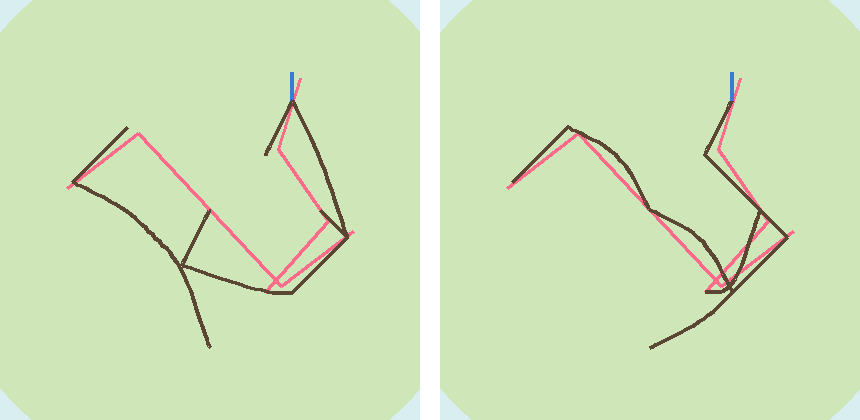
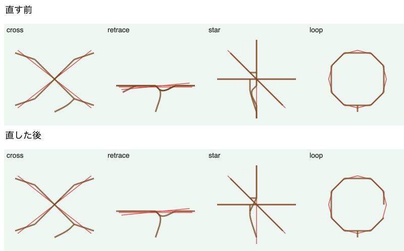
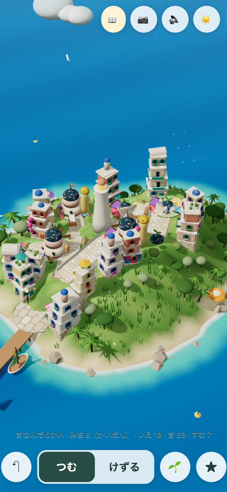
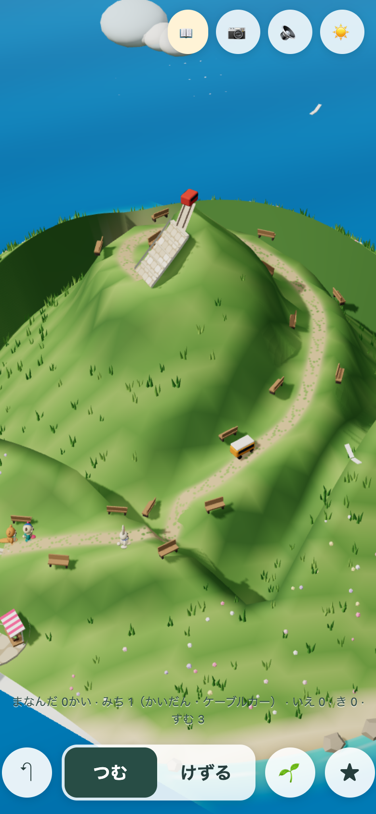

# そだつ島 試作を、子どもに触ってもらう

[そだつ島 試作の記録](README.md)の続き。2026-10-31 に、今の試作に合わせて短く書き直した。

**ねらいは1つ**：子どもが、自分から「もう一回」「見て！」と言うか。これが、試作を本番へ運ぶかどうかの一番の手がかり（[本番へ入れる案](integration.md)の段階0）。

## 準備（5分）

1. MacとiPhoneを、同じWi-Fiにつなぐ。
2. Macのターミナルで次を実行する（止める時は `Ctrl+C`）。

```bash
cd /Users/yutogasaki/Projects/sansu-terrace-ground && npx vite --host 0.0.0.0 --port 5290
```

3. iPhoneのSafariで開く。`192.168.11.22` は2026-10-31時点のMacのアドレス。開けない時は、Macで `ipconfig getifaddr en1` を実行して出た数字に置き換える。

| 版 | 開くページ |
|---|---|
| A：島が道を引く | `http://192.168.11.22:5290/prototypes/grow-lab/?start=blank` |
| B：子どもが道を引く（「みち」のボタンが出る） | `http://192.168.11.22:5290/prototypes/grow-lab/?start=blank&roads=draw` |

- Macが「受け入れますか」と聞いたら、許可する。
- 共有ボタンから「ホーム画面に追加」すると、全画面で遊べる。
- **作った島は保存されない。** ページを読み込み直すと、最初の小さい島に戻る。1人の途中では読み込み直さない。次の子の前に読み込み直す。

## 遊んでもらう（1人10分）

- 1人でもよい。できれば2〜3人。AとBを5分ずつ試す。どちらを先にするかは、子どもごとに入れ替える。
- 言うのは「島を つくってみてね」だけ。操作は教えない。困って止まったら、30秒待ってから「どうしたい？」と聞く。
- **学習の代わり**：大人が「いま べんきょう おわったよ」と言って、右上の📖を押す。2〜3分に1回。押すと島につぼみが出る。つぼみに気づくか、開けるかは子どもに任せる。
- ボタン：📖まなぶ／📷しゃしん／🔈おと／☀️時間／↶もどす／つむ／けずる／（Bだけ）みち／🌱おうちの たね／★とくべつな たてもの。

## その場でメモすること

名前や顔の写真は残さない。子ども1、子ども2…で書く。

| 見ること | 書くこと |
|---|---|
| 最初の1分 | 最初に何を触ったか |
| 止まった所 | どこで、何秒、何をしようとしていたか |
| 「見て！」 | 何を見せたか。いつ言ったか |
| 道 | A：道ができたことに気づいたか。B：引けたか、どこへ引いたか |
| 学ぶと育つ | 📖の後、つぼみに気づいたか、自分で開けたか、何が変わったと言ったか |
| 住人・船 | 歩く住人や、船着き場で待つ子に気づいたか。家を建てて迎えたか |
| 時間 | ゆうがた・よるに切り替えたか。灯りや花火に反応したか |
| 10分のあと | 「もっと やりたい？」に、自分から「やる」と言ったか。終わる時に嫌がったか |
| 聞く | 「どこが すき？」「もっと どうしたい？」の答えを、子どもの言葉のまま |

## この結果で決めること

1. **道は、島が引くか、子どもが引くか**：AとBで、止まった回数・「見て！」の回数・好きと言った方を比べる。
2. **町の家は誰の物か**：子どもが、自分で建てていない家を気にしたか。「ぼくの いえ」と言ったか。
3. **学習1回で、どれだけ育つか**：📖の後に変化に気づくまでの時間。気づかなければ、1回の育ちを大きくする。

メモは、写真でもテキストでも送ってもらえれば、この文書の下に、子どもの言葉のまま書き写して、上の3つの答えの案を作る。

## Webで試す（2026-10-31）

Macを動かさずに試せるよう、試作を非公開のWebページにした（利用者のClaudeのアカウントで開く）。開くと、大人がAかBを選ぶ画面が出る。中身はMacで開く試作と同じ。

## 試してわかったこと

- **B で道がぐちゃぐちゃになる**（利用者、2026-10-31）。なぞった線を1.3ごとの点に分け、点を1つずつ「いちばん近い道」へつないでいたため、点ごとに別の枝道が生えていた。なぞった線を1本の道として扱うよう直した。線のうち今ある道にいちばん近い点だけを道につなぎ、そこから両方向へ、となりの点どうしを順につなぐ。坂・階段・橋は今までどおり島が合わせる。

同じ2本の線（赤）を描いた時の道（茶）。左が直す前、右が直した後。上から見た図：



- **直した後も「ある程度よくはなった」**（利用者、2026-10-31）。重ねて・交差させて描く形を4つ試すと、今ある道のそばをなぞると、その横にもう1本道ができて二重になっていた。今ある道にそってなぞった所は、その道に乗せ、道どうしがすでにつながっている所には新しく道を作らないよう直した。道を横切るだけの線は、横切る道に引き寄せない。

4つの描き方（交差・重ねなぞり・3本が1点で交わる・輪）。上が直す前、下が直した後。赤がなぞった線、茶が道：



- まだ：重ねなぞりで、小さな曲がりが1か所残る。3本が交わる所に小さな三角の道が残る。iPhoneで指でなぞった時の見え方は、実際に触って確かめる。

## 道は島が引く、高さは1段ずつ（2026-10-31）

iPhoneで B を試した画面は、まだぐちゃぐちゃだった（浜にばらばらの階段、てっぺんに突き出た階段、「みち 33」）。利用者の言葉：「ぐちゃぐちゃ。あと、高さ出す操作も難しい」。

原因は、子どもが地面の高さと道の通り方の2つを自由に決め、断らない島がそのずれを全部、階段・橋で埋めにいくこと。道の線を整えても、高さが自由なままだと散らかる。そこで利用者と決めた（案1）：

- **道は島が引く（A）に決める。** 子どもが決めるのは、家や建物を置く場所だけ。試遊ページは A だけを開く。比べるために、試作の `roads=draw` は残す。
- **高さは、触るたびに1段（0.6）。** 「つむ」で触った所が、まわりより1段高い平らな台になる。「けずる」は1段下げる。指を滑らせると、触った時と同じ高さの台が広がる。海を触ると、1段目の陸ができる。本番の島の「段」の作りに近い。

触って3回で、高さは 0.7 → 1.2 → 1.8 → 2.4 と1段ずつ上がった。台を何か所か作り、家7つと灯台を置いて育てると、道は8本、まじる階段は少しだった（下の図）：



- まだ：遠くから見ると、段の縁がやわらかく、段に見えにくい。iPhoneで指で触った時の分かりやすさは、実際に触って確かめる。

- **「高さそんなにあげられない？」**（利用者、2026-10-31）。画面の同じ所を16回タップすると、5回目の高さ3.6で止まっていた。山が高くなると、指は山のてっぺんではなく手前の斜面に当たる。斜面から1段上げても、もう埋まっている所なので何も変わらなかった。しかも山は少しずつ手前の岸へずれ、岸の近くは丸い海岸の決まりで高さが4ほどに抑えられていた。直したこと：斜面を触った時は、近くのてっぺんを探し、そのてっぺんを中心に1段上げる。平らな所を触った時は、今までどおりその場に台ができる。同じ所を16回タップすると7.8まで、見えているてっぺんを触り続けると8.85（島の真ん中で上げられる一番上）まで上がった。

てっぺんを触り続けて、16回で真ん中が8.85まで上がった島：



- まだ：1段は0.6なので、一番上まで14回ほどかかる。岸に近い所は、丸い海岸の決まりで低めになる。
