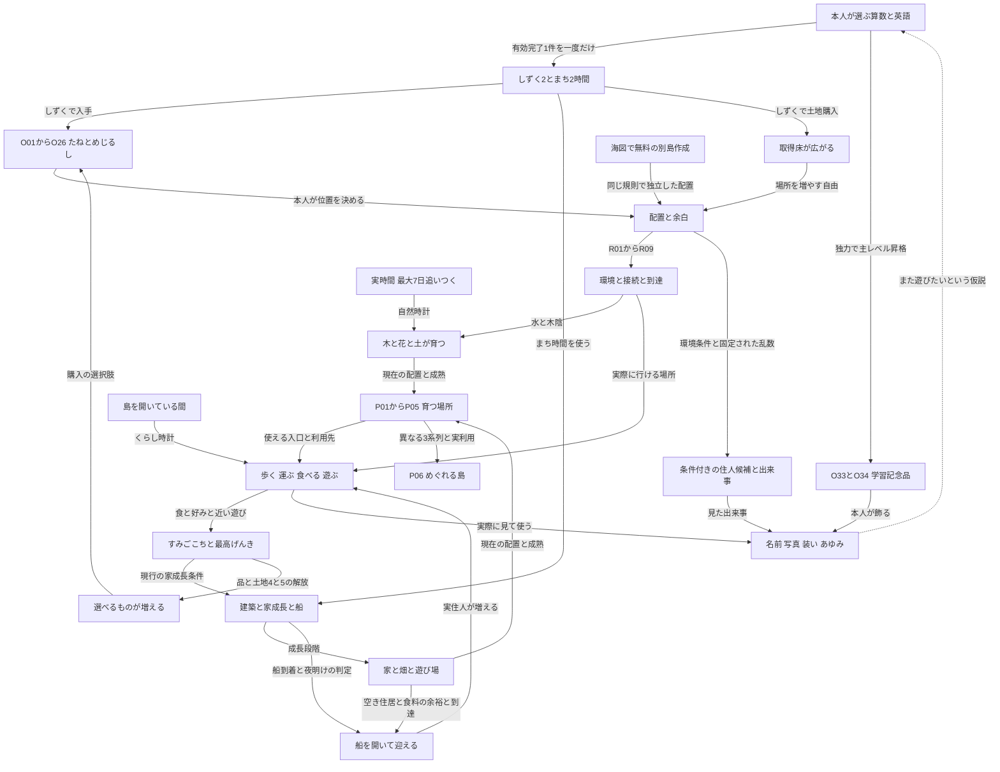

# 現行の島の体験と育成の関係

**実装前のsnapshot（2026-10-19 v0.3協議時）。** 採用した現在の規則は[52](../52_growing_island_game_spec.md)と[v0.4](growth-proposal.md)。旧品の移行根拠としてこの台帳を保持する。
2026-10-19読解版。仕様案との比較用の現行マップ。数値の正本は[52](../52_growing_island_game_spec.md)、[場所目標](../island-place-goals.md)、[場所初期値](../island-place-goals.json)、[海図](../island-voyages.md)。実装の観測は正本の補足として区別する。

## 総覧

最後の破線は意欲の仮説であり、自動的な学習開始や強制条件ではない。P06を達成しなくても土地を買え、島を増やせる。C関係やP目標を解放階段にしない。

## 時計と資源

| ID | 起点と単位 | 動かすもの | 保持と境界 |
|---|---|---|---|
| T01 まち | 有効完了1件に2時間 | 建築6時間、家の成長、船、夜明けのすみごこち・入居等 | 仕事がなければ未使用時間を保持。島を開いて待つだけでは増えない |
| T02 しぜん | 実経過。1回の不在追いつき最大7日 | 植物、土、広がり、木の年齢 | 時刻逆行は進行0。移動で個体年齢を初期化しない |
| T03 くらし | 島が前景で開いている間 | 歩行、着座、運搬、食事、遊び | 学習報酬やまち時間を発行しない |
| T04 景色 | 端末ローカル時刻 | 朝5〜10時、昼10〜16時、夕16〜19時、夜 | 表現のみ。成長や抽選へ渡さない |
| しずく | 有効完了1件に2 | 品物と土地の購入 | 同じ完了を二重受領しない。誤答・中断・お手本だけは0、減額なし |
| 学習記念 | 島開始後の独力の主レベル昇格 | 収納へ記念品。本人が置く | 開始レベルへの遡及配布なし。島切替で再配布しない |

まちの毎朝6時に、建築→家成長→すみごこちとげんき→入居→道の順で処理する。同じ時間を全個体へ渡しても、学習の受取は1件につき一度。既存の出題・採点・支援・独力・SRSを島の都合で変えない。

## おくものの全目録

価格は新規取得のしずく。Lvは最高げんきLv、人数は迎えた住人の条件。直接置く前から完成品として働く意味ではない。存在理由欄は**現行の機能から分かる役割**で、各品を最初に採用した歴史的理由まで断定しない。

### たねと自然

| ID | 品とコード上の種類 | 入手と解放 | 直後と育つ結果 | 時計と役割 | 関係 |
|---|---|---|---|---|---|
| O01 | すむ home | 40、初期。初回1個無料 | 杭と旗→テント→こや→いえ→ふたかいだて | T01、住居枠1/1/2/2 | R01/R05/R06/R10、P02/P04 |
| O02 | たべる farm | 40、住人1人 | 畝→周囲に応じた畑 | T01で建築、食2人分、水の影響あり3 | R01/R02/R06、E06 |
| O03 | あそぶ play | 60、Lv2 | 囲い→周囲に応じた遊び場 | T01で建築、あそび4 | R01/R10、P04、E03 |
| O04 | しぜん wild | 10、初期 | 芽→花/草/しだ等 | T02の植物成長、自然景観 | R01/R02/R08/R11 |
| O05 | 木のなえ sapling | 20、住人1人 | 苗→成熟木→大木→ぬしの木 | T02。成熟から7日/30日で長期変化 | R02/R03、P01/P02 |
| O06 | おはな flower | 10、赤黄白は初期、青Lv2 | 苗→咲いた花 | T02、色と庭と交配 | R02/R03/R04、P03/P05 |
| O07 | 自生の花と草 | 購入なし、広がり条件 | 隣の空地へ発生→成長 | T02、自然の変化 | R08、占有と入口保護 |
| O08 | 交配した花 | 購入なし、開花異色の親 | 空いた間のセルに新色→開花 | T02、図鑑と発見。親を消費しない | R04、P05 |
| O09 | うえ木ばち planter | 30、住人2人 | 鉢を置き、植物と食の運搬元を作る | T02/T03、ごはん1 | R02/R06、O16 |
| O10 | いちば market | 120、Lv4 | たね→市場 | T01、ごはん4 | R06、人口の供給余力 |
| O11 | おまつりひろば festival | 160、Lv5 | たね→広場 | T01/T03、あそび6 | R10、集まり |
| O12 | ふしぎ wonder | Lv3/5/7/9で各1個、無料 | 6まち時間→ハートの木/光る水玉アーチ/水玉の家 | T01、あそび3、環境2点 | R01/R11、特別な記念 |

O01/O02/O03は通常6まち時間と家からの到達が建築条件。O04は自然時計の別経路。O05の成熟判定は実装では成長量18、花は成長量6が基準（[`environment.ts`](../../../src/domain/growingIsland/environment.ts)）。水分で成長速度が変わるため、「18実時間で必ず成熟」と読み替えない。

### 水と食卓と遊具と飾り

| ID | 品と種類 | 価格と解放 | 主な働きと存在理由 | 成長と時計 | 関係 |
|---|---|---|---|---|---|
| O13 | 水ばち water-bowl | 20、初期 | 水源、水環境2点 | 配置即時、T02へ作用 | R02、P03/P04 |
| O14 | みずみち water-channel | 10、住人1人 | 実接続された通水路、通水時水1点 | 配置即時。水源から最大8セル | R02、P03 |
| O15 | ふんすい fountain | 50、Lv8 | 水環境2点、水好きの環境 | 即時/T03。水路水源と同一視しない | R01/R10/R11 |
| O16 | ピクニックテーブル picnic-table | 40、住人2人 | 屋外の受渡しと食事先 | T03、食料そのものを増産しない | R06、E06 |
| O17 | ベンチ bench | 20、初期 | 座る、あそび1、席のある庭 | T03、独立した成熟なし | P01/P02/P03/P05、E02 |
| O18 | ブランコ swing | 30、Lv2 | 乗る・こぐ・降りる、あそび2 | T03 | E03、R10 |
| O19 | すべりだい slide | 40、Lv6 | 登る・滑る、あそび2 | T03 | E03、R10 |
| O20 | トランポリン trampoline | 40、Lv7 | 跳ねる、あそび2 | T03 | E03、R10 |
| O21 | おんがくのひろば bandstand | 30、Lv4 | 30秒の演奏と住人ごとの音、あそび2 | T03、通貨を生まない | E07、R10 |
| O22 | パンやさん bakery | 70、Lv4 | 到達時ごはん3 | 配置即時/T03 | R06、人口の供給余力 |
| O23 | ほしのあかり lantern | 40、Lv3 | あかり2点、夜の景色 | 即時 | R01/R11/R12 |
| O24 | とうだい lighthouse | 80、Lv6 | あかり4点、ランドマーク | 即時 | R11/R12 |
| O25 | 木のさく fence | 20、Lv3 | 囲い、通行を遮る | 配置即時 | R05。道を引く道具ではない |
| O26 | ポスト postbox | 20、住人3人 | あそび1、景色の小物 | 配置即時 | R10。郵便配送との固有連携は未定義 |

O13〜O26は14項目。この表の外のO05/O06/O09と合わせ、新規のめじるしは17種（[`LANDMARK_PRICE`](../../../src/domain/growingIsland/rules.ts)で照合）。所有済みのものは現在の解放段階にかかわらず配置できる。移動・再配置・収納・色の試し直しは無料。未建築種の取消は実支払額を返し、完成品の収納を購入額の払戻しと混同しない。

### 旧所有物と学習記念品

旧5品の名称は[`growingCopy.ts`](../../../src/components/island/growing/growingCopy.ts)で確認できる。新規購入表へ混ぜず、既得の現物・表示・実利用を保持する。採用当時の個別理由は未調査。

| ID | 旧品 | コード上の種類 | 現行で確認した扱い |
|---|---|---|---|
| O35a | かざぐるま | pinwheel | 所有と表示を保持。新規購入なし |
| O35b | 花のアーチ | flower-arch | 同上。交配花の親やP05の花株と同一視しない |
| O35c | すなば | sandbox | 所有と実利用を保持、PLAY_SUPPORTは2 |
| O35d | えんげい小屋 | garden-hut | 所有と実利用を保持、PLAY_SUPPORTは2 |
| O35e | としょしつ | library | 所有と実利用を保持、PLAY_SUPPORTは2 |

小屋/図書室の旧施設関係は[自然統合](../island-nature-integration.md)と[暮らす島48](../48_island_life_spec.md)が由来。Growingの新規解放に再導入する意味ではない。各旧利用の全画面・現保存互換は本マップ作成では実行確認していない。

| ID | 教科と主レベル | 記念品の姿 |
|---|---|---|
| O33a | 算数1〜3 | かずのつみき blocks |
| O33b | 算数4〜7 | くらべっこのてんびん balance |
| O33c | 算数8〜12 | けいさんのふんすい fountain |
| O33d | 算数13〜14 | くくのとけいとう clock |
| O33e | 算数15〜18 | かけわりのふうしゃ windmill |
| O33f | 算数19〜20 | しょうすうのほし star |
| O33g | 算数21〜24 | ぶんすうのはなだん flowerbed |
| O33h | 算数25以上 | ちえのとう tower |
| O34a | 英語1〜3 | ABCのつみき abc |
| O34b | 英語4〜6 | ことばのほん book |
| O34c | 英語7〜9 | ことばのふうせん balloon |
| O34d | 英語10〜13 | えいごのちきゅうぎ globe |
| O34e | 英語14以上 | ことばのぼうえんきょう telescope |

これは[`gifts.ts`](../../../src/domain/growingIsland/gifts.ts)の**形の対応**で、主レベルの有効範囲を新設しない。各到達レベルに現物1つ、同じ姿でも別の習得の証となる。52§10の「10種」と実装の算数8＋英語5＝13種には不整合がある（Q01）。本文を勝手に13種へ確定しない。置くと現行はあそび2。

### 常設のものと自由な表現

| ID | 対象 | 入手と役割 | 他との関係 |
|---|---|---|---|
| O27 | ぽこもこの家 | 初期拠点、玄関、基礎ごはん2 | R05/R06、室内、訪問する住人 |
| O28 | みはらしのはし | 住人1人以後無料、収納と再設置可 | 同じ島の見晴らし台へ歩く。別島へは接続しない |
| O29 | 桟橋と入居船 | 購入なし、住みたい旅人1人が待つ | 次の航行48＋2×住人数まち時間、R06/R09 |
| O30 | 海図と島間の船 | 別島の無料作成と切替 | 島の独立座標と共通財布 |
| O31 | 一時の客と出来事 | 環境条件と実日の判定 | R12。入居人口に数えない |
| O32 | 派生した大樹/泉/共同屋根 | 直接購入しない場所の形 | P01〜P06。元の個体の所有を消費しない |
| H01 | 島名と住人名 | 任意命名、個体への愛着 | えま/えいたの固有名は維持 |
| H02 | 屋根色と旗 | 色は初期無料、旗の模様Lv7 | 所有外観。別の能力値なし |
| H03 | 服色と帽子 | 服6色Lv8、帽子5種＋いつものLv9 | 既存の人間/動物住人。新規アバターではない |
| H04 | 部屋の模様と壁紙とラグ | 現行の学習レベル/単語との対応 | 単語の読み上げ、室内の愛着 |
| H05 | 手紙と来客 | 島の出来事に結びつく | ポスト購入を必須とは定義しない |
| H06 | 写真と島カードとあゆみ | 本人が撮る/見る/残す | 島別履歴。外部共有の新機能なし |
| H07 | 本と任意の目標 | S1〜S5、A1〜A6、P01〜P06 | 任意の導き。ゲームの操作ロックではない |
| H08 | 同端末のきょうだい訪問 | 見る・一日一輪の花 | 他プロフィールと分離、贈り物の一度だけ反映 |

## 何と何をどうすると育つか

「入力＋配置＋時計→結果→できること」を以下の規則で網羅する。定義のない専用関係は「未定義」であり、一般の通水や木陰まで無効という意味ではない。

| ID | 入力と置き方 | 待つもの | 結果 | 機能への作用と限界 |
|---|---|---|---|---|
| R01 | O01/O02/O03/O04の建築時に周囲2セルの水/木/花/あかり | 各たねの建築 | 最も強い環境のstyleを固定 | 水→木→花→あかりの同点優先。建築後に移動してもstyleは変わらない |
| R02 | O13から辺接続したO14、最大8セル | 通水は現在配置、土はT02 | 流れている水、湿り、植物の育つ速度 | 近いだけの乾いた水路に給水しない。噴水を水路水源とみなさない |
| R03 | O05同士、またはO06同士を辺接続/通れる1セルの直線隙間で接続 | 接続即時＋元個体のT02 | 根/樹冠/花床が共有形へ | 斜めのみは接続しない。個体は消費しない |
| R04 | 咲いた異色花2株を2セル以内、間に空地 | T02、24時間ごと40% | 子の色が芽吹く | 親を消費せず、1株1組/回、花は土地25%まで。毎回成功とは限らない |
| R05 | 家の玄関から対象への歩ける接続 | 配置再計算/T03 | 建築・入居・暮らしの到達 | さく等で塞ぐと理由を知らせる。所有と既得段階は失わない |
| R06 | 到達する畑/鉢/市場/パンと住居の空き | T01で完成、入居判定は夜明け | 基礎2＋畑2/水3＋鉢1＋市場4＋パン3 | **現行入居は既に住居と食料の余裕。** 食事アニメ完了は新しいゲートではない |
| R07 | 土地・配置・接続・余白・席・家のstyle | 配置＋各個体の成熟 | P01〜P05の形と段階 | 最小数量条件は後表。目標を選ぶことは必須ではない |
| R08 | 咲いた自然種/自生花、湿り0.35以上、隣の空地 | T02、12時間ごと50% | 野生の花/草が広がる | 土地40%まで。玄関/種/所有物へ侵入しない。摘める |
| R09 | 場所の入口間の歩行距離3以内、同じ到達領域 | 配置と実利用 | C01〜C04の関係、P06 | 距離以外の個別条件も必要。架空の食料や人口を足さない |
| R10 | 家から3セルの好み/遊び、届く食の余裕 | T01の夜明け | すみごこち★0〜3→合計の最高げんきLv | 家成長と品/土地解放へ作用。入居へ直接の追加条件ではない |
| R11 | 島全体の水/木/花/畑/あかり点 | 候補が決まる時点 | 島の性格、来やすい住人 | 合計6点以上、最大系統が全体30%以上。既に決まった船は再抽選しない |
| R12 | 景色と環境と日ごとの決定的乱数 | 参加から実時間24時間区切り | 小さな出来事と一晩の客 | 学習量・往復で抽選を増やさず、留守の日を一括抽選しない |

水が畑へ影響すると食の容量が変わる。木陰/水/花が家の近くにあるとstyle判定や好みに関係するが、家の人数枠を直接増やさない。遊具は実動作と現行の暮らし/げんきへ関係し、新しい学習報酬を作らない。ポストと手紙配送の固有接続は未定義。

### 建築時の姿

| 主環境 | 家O01 | 畑O02 | 遊び場O03 | 自然O04 |
|---|---|---|---|---|
| 水 | 高床の家 | れんこん | 水あそび | あし/水辺の花 |
| 木 | 木の上の家 | きのこ/木の実 | ブランコ | しだ |
| 花 | 花の屋根 | いちご | 花のベンチ広場 | 花 |
| あかり | 窓の多い家 | かぼちゃ | ちょうちん広場 | ほたる草 |
| 特になし | 丸い屋根 | にんじん | 広場 | 草むら |

水点＝水ばち2/実通水路1、木点＝成熟2/若木1、花点＝開花1、あかり点＝灯り2/灯台4。同じstyleの畑でも水が現在届くかを別に判定する。姿の固定と現在の供給を混同しない。

### 花の全色関係

赤＋黄→オレンジ、赤＋白→ピンク、赤＋青→紫、青＋白→水色、黄＋白→クリーム、黄＋青→ミント。オレンジ＋紫/ピンク＋水色/クリーム＋ミント→ふしぎな水玉。基本4＋混色6＋水玉1＝11色。親色の図鑑登録があればヒントを出す。P05成立に珍色は不要。

### 場所P01からP06

| 場所 | 現行の最小入力 | 空間と成熟 | 育つ結果と実利用 |
|---|---|---|---|
| P01 木陰の庭 | 成熟木2、ベンチ1 | 木の同じ領域、庭2セル以上、到達する席 | 根と樹冠、木陰で座る。列/角/くぼみ |
| P02 大樹の住まい | 成熟木4うち大木2、木styleのこや以上1、席1 | 同じ木領域、玄関/庭/回廊の連続した実床 | 中空幹と枝の回廊。列/塊/中庭 |
| P03 青い泉の庭 | 水ばち3、供給水路2、開花1、席1 | 同じ通水、花へ給水、席へ到達。段泉は実床高が必要 | 岸/池/段泉。段/曲がり/岸への開き |
| P04 入り江の集会所 | こや以上2、完成遊び場1、水ばち1 | 海岸、遊び場への水、庭2セル以上、両玄関と入口へ到達 | 共同の殻屋根と庭。向かい合う/岸に列/中庭 |
| P05 花の屋根の庭 | 開花4、席1 | 花の同じ領域、席/入口に到達 | 花弁のアーチ/大屋根/中庭 |
| P06 めぐれる島 | 森/水/花/集落の異なる3系列以上 | 場所入口へ歩け、現行revisionで実在するぽこもこと住人の利用がある | 島を巡る任意の到達記録。P01/P02は同じ森系列 |

各場所の「仕込む→つながる→育つ→暮らす」は、別通貨や追加時計ではない。席等の付属物は主要領域から歩行2セル以内。実床・入口・頭上の余裕が成立しない回廊や空洞を使える完成形として描かない。モデルの完成画像だけでは実利用や自然取得を達成扱いにしない。

| 関係 | 場所同士 | 追加の実条件 | 結果 | 増やさないもの |
|---|---|---|---|---|
| C01 | 森＋泉 | 到達と水/木陰の実作用 | 木陰から水辺へ続く | 水/木陰効果の二重加算 |
| C02 | 泉＋花 | 花への実給水と席への到達 | 水辺の花庭 | 交配倍率/珍色保証 |
| C03 | 森＋集落 | 家の玄関から木陰へ到達 | 家から木陰への往来 | 食料/入居枠 |
| C04 | 花＋集落 | 花庭と共同空間へ到達 | 花の下で集まる | 祭り回数/学習報酬 |

森＋花、泉＋集落に専用C関係は未定義。一般の水・木陰・通行は作用する。以上で4系列の全6組について、専用定義の有無を区別できる。

### 出会いの全領域

| 条件 | 出来事 | 性質 |
|---|---|---|
| 水/森/花/畑/あかりの性格 | 好きな住人の候補重み3、それ以外1 | 船が現れた時に固定 |
| 珍しい種と対応する環境 | ペンギン/ふくろう/かえる、基本重み0.35で対応環境3倍 | 通常の入居容量は同じ |
| 環境点の合計 | きらきら色5〜15% | 学習量/まち時間の長さで増やさない |
| 土の平均湿り0.42以上 | 虹 | R12の実日の出来事 |
| 好みが同じ二人の家が2セル以内 | なかよしが並ぶ | 実在する二人 |
| 夜の景色と灯り2つ以上 | 流れ星 | 見ている間の一時演出、記録なし |
| 灯りから2セル以内の水ばちと近い開花 | みなものたびどり | 一晩の客、住人にしない |
| 成熟木2セル以内の到達するベンチと開花2 | こもれびのおきゃく | 同上 |
| 開花6以上 | ちょうちょの群れ | R12 |
| 水ばち/噴水2以上、または灯台 | くじら | 一晩の客 |
| 図鑑5色以上 | にじいろのとり | 一晩の客 |
| 灯り3つ以上 | つきのうさぎ | 一晩の客 |

R12は日ごとの乱数60%、まれな客はその中の30%の日に候補。表示待ちを保存し、再読込で失わず、同日を再抽選しない。流れ星の景色条件を、成長時計や新たな夜限定の取得条件へ一般化しない。

## 人口と家と解放

入居には、船が着き、到達する空き住居があり、食料を支える人数が現在住人数より多いことが必要。最初の2人分の食はO27の基礎供給。**すみごこち/あそび点/げんきLvは、現行入居へ直接の追加ゲートではない。** 同居の旧住人は追加住宅枠を使わないが、食とすみごこちでは数える。

| 家の変化 | 現行の待ち時間 | 追加条件 | 人数枠 |
|---|---|---|---|
| たね→テント | 配置から6まち時間 | 到達、初回無料導入は別特例 | 1 |
| テント→こや | 現段階開始から24まち時間 | 入居中、住人平均★1、Lv2 | 1 |
| こや→いえ | 現段階開始から48まち時間 | 入居中、平均★2、Lv4 | 2 |
| いえ→ふたかいだて | 現段階開始から96まち時間 | 入居中、平均★3、Lv6 | 2 |

時間起点は[`town.ts`](../../../src/domain/growingIsland/town.ts)の`stagedAt`（なければ`builtAt`）。全段階を建築後24/48/96時点に到達するという累積表ではない。52の表記だけでは起点を誤読しやすい（Q02）。

すみごこちは、近い好きなもの、食の余裕、近い遊びで各★。静か好きは遊び場が近くにないことを使う。家と対象の実到達が必要。全住人の★合計の最高値がげんきで、下がらない。

| Lvと閾値 | 新規の選択肢と条件 |
|---|---|
| 1 / 0 | すむ、しぜん、初期の花/ベンチ/水ばち |
| 2 / 3 | あそぶ、ブランコ、青い花、こやへの成長 |
| 3 / 8 | 灯り、さく、ふしぎ種1 |
| 4 / 15 | 音楽、パンや、市場、いえへの成長 |
| 5 / 25 | おまつり広場、拡張4、ふしぎ種1 |
| 6 / 40 | すべりだい、灯台、ふたかいだて、拡張5 |
| 7 / 60 | トランポリン、旗模様、ふしぎ種1 |
| 8 / 85 | 噴水、住人の服色 |
| 9 / 115 | 帽子、ふしぎ種1 |
| 10 / 150 | 島カードの特別な枠 |

人数による解放は住人1人で畑/木/水路、2人で食卓/鉢、3人でポスト。Lv解放とは別。家や品を動かして現在のすみごこちが下がっても既得の段階・品・最高Lvは戻さない。

住人は通常7動物（うさぎ/カワウソ/キツネ/カモ/リス/ハリネズミ/ことり）、人間のえま/えいた、珍しい3動物。動物は同種の複数個体可、えま/えいたは各島1人ずつ。性格はげんき/のんびり/はずかしがり/くいしんぼう。現在動かす最大12人は描画予算で、総人口上限ではない。

## 個体から複数の島へ

| 階層 | 本人の選択 | 育つもの | 保持するもの | 再計算するもの |
|---|---|---|---|---|
| 個体 | 買う、置く、移動、塗る | 木の年齢、家段階、花色 | ID/所有/年齢/style/住人 | 周囲の水/木陰/到達 |
| 場所 | 列/塊/余白/水の曲げ方 | P01〜P05の形と実利用 | 元個体と達成済み履歴 | 現在の接続/入口/形 |
| 地区 | 隣へ土地を広げ、場所を結ぶ | 複数の場所と往来 | 取得床と既存座標 | 経路とC関係 |
| 一つの島 | 誰を迎え、どうつなぐか | 人口/性格/歴史 | 土地/全所有/写真/住人 | 現在の環境と行動 |
| 複数の島 | 海図で始まりと行先を選ぶ | 別々の構想と育成 | 島ごとの状態、共通受領の一意性 | 復帰島の自然追いつき |

「地区」は現行の土地購入のまとまりを説明する言葉と、制作中の[世界契約](../island-world-contract.md)の安定ID/局所座標/実3D床/接続口を持つ保存設計で意味が異なる。後者への通常保存切替は、この地図では完了扱いにしない。

### 土地と橋と船

| 段階 | 取得範囲と方向 | 費用 | 追加条件 |
|---|---|---|---|
| 初期 | x0〜5、z0〜4、6×5 | 初期 | ぽこもこの家と既存座標を保持 |
| 拡張1〜3 | 現行の東/西/南 | 120/240/480 | 個別の取得形を正本とする |
| 拡張4/5 | 東西へ各3列 | 720/960 | Lv5/Lv6 |
| 拡張6 | 東西南から本人が選ぶ | 1200 | 追加Lv条件なし |
| 拡張7以降 | 東西は3列、南は3行ずつ | 前回＋240 | 回数上限なし |

大きい模型の8/16/32軒は比較例で人口上限ではない。大きい島の海図上の絵は縮尺/距離を保証せず、隣の島と絵が接しても拡張を止めない。同島の橋O28、入居船O29、島間船O30の三つを区別する。

### 複数島の共有と独立

| 項目 | 範囲と規則 |
|---|---|
| 新島 | 無料。庭は花2、森は苗2、水辺は水ばち1と水路1。育成方向を固定しない |
| 島別 | 名前/土地/所有/家/住人/土/自然時計/まち時計/未使用まち時間/写真/履歴 |
| 共通 | 同じプロフィールのしずく、完了IDと刈込境界、最初の受取対象時刻、記念品受取済み範囲 |
| 学習の反映先 | 受け取り時点の現役島にまち時間。復元島の古い財布で共通値を上書きしない |
| 記念品の現物 | 獲得した島に残る。他島作成で再発行しない |
| 休止島 | 戻る時に自然だけ追いつく。学習由来のまち時間を移し替えない |
| 切替と保存 | 退避/復元は同一transaction、表示元の島IDと命令を照合。古い画面の書込を拒否 |
| 写真と復旧 | 撮影島に帰属、schema8対応writerと復帰版が必要。旧版へ単純rollbackしない |

新島の初期素材や無料家の現物は新島に留め、共通通貨へ換金できるという規則は追加しない。独立座標なので橋や物流が島を横断する機能はない。

## 体験の全領域

| ID | 体験 | 起点と条件 | 繰り返す楽しみと長期の意味 |
|---|---|---|---|
| E01 | 触る | ぽこもこ、住人、家、木、花、水 | 音と動きの返事、同じ個体の愛着 |
| E02 | つまんで運ぶ | O17等の使える空き対象 | 座る/こぐ/泳ぐ等。所有や通貨を増やさず繰り返す |
| E03 | 遊具で遊ぶ | ベンチ/ブランコ/滑り台/トランポリン | 育った場所へお気に入りの住人を連れていく |
| E04 | 選んで置く | 取得品と空地、結果の影 | 自分の配置の意図を形にする |
| E05 | 動かす/しまう | 無料、住人のいる家は収納不可 | 経路回復、分離/再接続、景色の比較 |
| E06 | 育てて運び食べる | O02/O09/O16/O27、R02/R05/R06 | 届く経路が見える暮らし。入居容量とアニメを区別 |
| E07 | 演奏する | O21、見えている実住人 | 4つの伝承曲と住人ごとの音、何度も集まる |
| E08 | 家の中で過ごす | O27、H04/H05 | 来客、本、壁紙の単語、学習と暮らしを結ぶ |
| E09 | 自然の成長を見る | T02、木/花/土 | 翌日の開花、7日/30日の木、昔の姿との比較 |
| E10 | 水をつなぐ | O13/O14、R02 | 流れ/乾き/湿り、置き直す実験 |
| E11 | 花を混ぜる | R04、図鑑 | 同じ基本色から別の庭。珍色を必須にしない |
| E12 | 大きい場所を育てる | P01〜P05 | 若い接続→成熟形→実際に使う |
| E13 | 場所同士を結ぶ | C01〜C04、P06 | 森から泉へ、家から庭へ、長期の往来 |
| E14 | 旅人を迎える | 到着船/空き家/食料余裕 | 船を開き名前を付け、次の家を構想する |
| E15 | 住人の違いを知る | 種類/好み/性格/なかよし | 同じ島で異なる場所を使う個体への愛着 |
| E16 | ふしぎに出会う | R11/R12 | 条件を予想し、見逃しても失わず次を楽しむ |
| E17 | 土地を広げる | しずく/現行条件/方向選択 | 昔の場所の先へ別の場所をつなぐ |
| E18 | 橋を渡る | O28 | 同じ島の見晴らし台で短い散歩 |
| E19 | 別の島を育てる | O30 | 元の島を残して、同じ規則で別構想 |
| E20 | 色/服/帽子/部屋を選ぶ | H02/H03/H04、現行の解放 | 見分けと表現。自由部位の着せ替え拡張なし |
| E21 | 写真/あゆみ/図鑑を見る | H06、実際に記録した事実 | 自分の島の成長を見返し見せる |
| E22 | 訪問と花の贈り物 | H08、同端末別プロフィール | 他の子の島を見る、一日一輪 |
| E23 | 目標を選ぶ | 本、スターター、任意達成 | 今試したいことを自分で選ぶ。閉じて再開可 |
| E24 | 学んで帰島し開く | 本人が「まなぶ」、T01とつぼみ/船 | 仕込む→学ぶ→自分で開く。通常学習を短縮しない |
| E25 | 不在/中断から戻る | 所有の保存、自然追いつき | 枯れ/退去/催促なし。昔の場所が続く |

初日はE01〜E05と無料入居、翌日は自然の変化と同じ場所の遊び、一週間は配置と複数住人の違い、長期は地区の関係と昔の場所の変化を楽しむ想定。各日を必須の学習量や締切にしない。[初回導線](../island-first-play-onboarding.md)が52§14の旧「設定後に島到着」に優先し、最初は島と無料体験、その後本人が学習を選んだ時に設定する。

## 網羅性と残る照合

| ID | 問い | 現在の扱い |
|---|---|---|
| Q01 | 記念品10種と13kind | 形の全対応を記載。52本文との差は正本改訂時に解消 |
| Q02 | 家の48/96時間の起点 | 実装は現段階開始時。次期案でも起点を明文化 |
| Q03 | 食料の供給と本物の物流 | 供給は入居判定、運搬は実行動。両者を同一イベントとしない |
| Q04 | 旧5品の由来と完全な利用 | 名称と種類を確認。歴史的採用理由/全旅程は未調査 |
| Q05 | 地区の造成が土地取得を増やすか | 派生形から権利を増やさない。DEV地区と通常保存は別 |
| Q06 | 図の全要素に行先があるか | O→R/P/Eを接続。Hは愛着、旧品は互換保護、装飾に架空の経済役割を付けない |
| Q07 | 全組み合わせが専用形か | 4系列の6組をC4定義＋2未定義で区別。全物同士の専用合成はない |
| Q08 | 入居の循環 | 初回無料住居/成長と基礎食2が入口を作る。新案でも保持 |
| Q09 | 別島で報酬を再受領するか | 共通ID/受領範囲、一度だけ反映。新島で所有物の現金化を新設しない |
| Q10 | 公開/面白さが確認されたか | このマップは静的読解。現在の配信、実機性能、子どもの理解/再訪は未検証 |

現行値の出典：[価格と解放](../../../src/domain/growingIsland/rules.ts)、[環境](../../../src/domain/growingIsland/environment.ts)、[人口と供給](../../../src/domain/growingIsland/community.ts)、[家の成長](../../../src/domain/growingIsland/town.ts)、[記念品](../../../src/domain/growingIsland/gifts.ts)、[表示名](../../../src/components/island/growing/growingCopy.ts)。コード上で観測した値は、この文書を理由に正本へ自動昇格しない。
