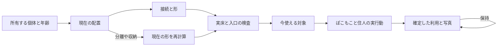

# 成長と空間の規則

2026-10-20。詳細設計候補。[全体入口](README.md)。現行v0.4を土台に、チャッピーとの第1ラリーで「現在の構造・現在の利用・過去の履歴」を分けた。提案した体験の完成と、現在のコードの存在を区別する。

## 1 五つの判定を共通にする

| 判定 | 入力 | 出力 | 判定に混ぜないもの |
|---|---|---|---|
| 接続 | 配置済みの元個体、系列別のjoin/water辺 | 木/花の成分、実通水領域 | 画面上の近さ、斜めの見た目 |
| 形 | 接続成分、余白、実地形 | 単体/列/塊/中庭/自由形 | 図鑑や目標を選んだか |
| 成熟 | 個体の成長量/年齢/家段階 | 各個体の現在の姿 | 新しい共通レベル、利用回数 |
| 到達 | 実床、玄関、入口、占有、全身形状 | actorごとの利用可能な経路と退出先 | 見た目だけの道、歩行辺による給水 |
| 利用 | 実actor、実対象、現在world、行為 | 今の動作と、実際に確定した利用事実 | 架空の群衆、カメラ外の未描画を見た記録 |

「近い」「水が届く」「歩ける」「そこで使える」は別の結果。派生形は追加の所有物や資源ではない。木陰・水・食料・住居枠の計算を、P/C成立時に重ねて加算しない。

## 2 現在と履歴の状態

| 軸 | 値 | 更新と保存 |
|---|---|---|
| 個体 | 未成熟/成熟/長期年齢、家段階、色/由来 | 現行の時計・保存を継承。無料移動で初期化しない |
| 現在の構造 | 単体/若い接続/成熟した接続/分離/収納 | 現在の所有・配置・成長から導出 |
| 現在の利用 | 利用可/経路不足/対象なし/大型部品未対応 | actorと実床から導出。地上の利用と上階を別判定 |
| 履歴 | 初接続/成熟の事実/実利用/写真/記念 | 確定した事実を保持。現在の再計算で消さない |

| 操作 | その場で変わること | 保持すること | 利用中のactor |
|---|---|---|---|
| 主材を動かす | 接続/水/木陰/形/到達を再計算 | 元ID/成熟/年齢/色/家の姿 | 旧対象の予約を取消し、安全な実床へ退出 |
| 主材を収納 | 現在の材料と環境から除外 | 収納された元個体と履歴 | 消える床で行為を続けない。住人のいる家は現行どおり収納不可 |
| 再接続 | 成熟済みなら既存成熟に適合する形を再導出 | 以前の利用/記念の受領 | 現在の対象だけを再選択。過去の場所へ強制ワープしない |
| 水路を切断 | 通水と畑の現在容量を再判定 | 土の現在湿りと植物の成長済み量 | 水辺の対象が残るか再検査。成熟/住人を失わない |
| 入口を塞ぐ | 現在の利用・新入居・該当建築を待機 | 家段階/所属/所有/履歴 | 通れる別経路を使う。なければ安全に待つ |
| 予告を取消 | 元のworldと表示に戻す | 全確定状態 | 予告床を確定の歩行先に混ぜない |

「以前の中庭で一緒に座った」という記録は当時の形の記録。今は分かれた森でも文章を現在形へ書き換えない。派生場所の追跡は元個体群と規則版に基づき、表示meshを新所有権として保存しない。

## 3 四系列の空間

### 森 P01とP02

| 項目 | 具体仕様 |
|---|---|
| 入力 | 配置された木、成長量、`maturedAt`、自然年齢、実支持/床 |
| 配置 | 辺接続または通れる1セルの直線隙間。斜めだけ・塞がれた隙間は接続しない |
| 空き床 | 幹の外側と接続間の地上床。中庭は内側から外へ出られる入口を残す |
| 成長 | 成長量18まで自然時計と湿り。成熟後168自然時間で大木、720でぬしの段階 |
| 見える変化 | 苗の列→根/葉が寄る若い形→各木の成熟に応じた連続樹冠。未成熟木を巨大冠に置換しない |
| ぽこもこの遊び | 木陰へ歩く・休む・席を使う。対応した実構造だけ幹内部/回廊を通る |
| 住人の利用 | 木陰の実対象へ歩き滞在。好みによる繰返し利用は[行動候補](03-play-and-residents.md) |
| 次の選択 | 横へ伸ばす、中央を空ける、水辺まで続ける、家の前の森にする |
| 不成立例 | 幹で入口が閉じる、若木で大樹部品を支える、未取得土地へ床が出る、対応しない曲線に直線部品を被せる |

| 形 | 配置例と判定 | 育ったときの違い | 最低限成立する遊び |
|---|---|---|---|
| 列 | 同一xまたはzの接続した木 | 細長い木陰と視線の抜け | 列に沿った地上の散歩。上階の枝回廊とは別 |
| 塊 | 隣接2×2を含む成分 | 厚い樹冠、外周と中心の明暗差 | 外周の木陰へ回る。幹の占有を無視して中心を歩かない |
| 中庭 | 主材4以上、到達する内側セルを四象限から囲む | 空の抜ける内庭、周囲の樹冠 | 開いた入口から内側へ入る。大型は空床2セル以上と実寸検査も必要 |

「2本の木陰道」「空床2セル」は既存の試作初期値で、全モデル寸法の安全保証ではない。単体の成熟木にも木陰がある。ベンチや木styleの家は通常の森の成立条件に戻さない。

### 水辺 P03

| 項目 | 具体仕様 |
|---|---|
| 入力 | 実水源・水路、water辺、所有地形、現在通水、水影響、土の現在/目標湿り |
| 配置 | 水ばちから辺接続。折れ・分岐はよい。水源ごとの最短水路距離8以内 |
| 空き床 | 水面と岸・歩行床を区別。現行の水路は歩けるが、水面全般を歩けると拡大解釈しない |
| 成長 | 水の配置に追加の成熟待ちはない。通水は現在判定、湿りは時間、植物は自身の成長 |
| 見える変化 | 水源の小さな岸→実接続した流れと岸。切断後は乾いた水路を区別 |
| ぽこもこの遊び | 実岸を巡る・届く水へ触れる候補・岸の席で過ごす。泳ぎは既存の対応対象に限定 |
| 住人の利用 | 実到達する岸で滞在。噴水を好むことと給水は別 |
| 次の選択 | 花へ、畑へ、両方へ、木陰へつなぐ。水量の奪い合いを新設しない |
| 不成立例 | 水源のない噴水から給水、斜めだけの接続、同一水源から9セル目、平地に支えのない滝 |

| 形 | 配置 | 空間と遊びの差 |
|---|---|---|
| 水の線 | 水源→直線水路 | 水に沿う細い散歩と、両側への現在の環境影響 |
| 曲がる岸 | L字/枝分かれの辺接続 | 水が曲がる方向と内外の庭を選べる。分岐で最大距離を延ばさない |
| 水の広場 | 複数水源と実供給がまとまる岸 | 周りを巡る/開けた側へ席を置く。段泉は実下降床と対応部品がある場合のみ |

### 花庭 P05

| 項目 | 具体仕様 |
|---|---|
| 入力 | 花株ID、色、由来、開花量、位置、実支持/床 |
| 配置 | 木と同じjoin原理。系列内の接続と異色親の交配距離は別 |
| 空き床 | 現行の花セルは通れる。巨大な茎/花弁を導入するときは実形状で再確認 |
| 成長 | 成長量6まで自然時計と湿り。開花済み株へ再開花の報酬を作らない |
| 見える変化 | 芽→株ごとの花→連なる花床/色の帯。色と由来は残す |
| ぽこもこの遊び | 花の間へ歩く・花を見る・中庭で過ごす。アーチ通過は対応実床の場合 |
| 住人の利用 | 実花庭の対象で滞在。花好きによる重み付けは次期候補 |
| 次の選択 | 同色で帯を作る、異色を寄せる、交配用の空地を残す、水辺とつなぐ |
| 不成立例 | 大花弁が家を隠す/塞ぐ、珍色なしでは育たない、空き床なしの天蓋 |

| 形 | 配置 | 空間と遊びの差 |
|---|---|---|
| 花道 | 同軸の連続する開花 | 縁に沿って歩く、色の順番を楽しむ |
| 花のまとまり | 2×2を含む成分 | 色の厚みと外周の散歩。内部は実床がある範囲 |
| 花の中庭 | 内側を囲み入口を開ける | 花に包まれた場所へ入り、席があれば座る |

### 集落 P04

| 項目 | 具体仕様 |
|---|---|
| 入力 | 家ID、段階、元のstyle/屋根、居住者、玄関、実経路と空床 |
| 配置 | 玄関同士が同じ歩ける領域へ接続する近い家。向きを変える新操作は前提にしない |
| 空き床 | 建物の間の実空床と外部への開口。屋根や花を理由に玄関を変更しない |
| 成長 | 家は所属・到達・各段階24/48/96町時間。段階2以上の家2軒から現行P04 |
| 見える変化 | 個々の家の前庭→共有の足元。大屋根は新規制作候補で現行機能ではない |
| ぽこもこの遊び | 庭へ歩く、席や既存遊具を使う、実住人のそばで過ごす。室内は現行で入れる家に限る |
| 住人の利用 | 所属する家から出て庭や食事/休憩先へ。庭利用は実到達・実滞在で記録 |
| 次の選択 | 家を寄せて共有空間、離して別拠点、畑/森/花までの経路を選ぶ |
| 不成立例 | 近いが壁越し、玄関を柵で閉鎖、庭の見た目だけで住居枠や食料が増える |

| 形 | 配置 | 空間と遊びの差 |
|---|---|---|
| 道沿い | 固定の玄関を開けて家を列にする | 家から道へ出る暮らし。道の先の庭へ往来 |
| 小さな広場 | 家を近くへ寄せ、共通の前側を開ける | 住人の目的地が重なる共有空間 |
| 中庭 | 家の外周と内側の空床、外への開口 | 生活の中心になる庭。家本体の屋根や色を保持 |

家の配置は森/花の2×2判定へ一律統合しない。玄関と床・居住者を優先する。

## 4 全11組の相互作用

専用Cは現在の4関係を継承する。3/4系列の新規達成ボーナスはない。景色の違いを、計算のない架空の能力へ置き換えない。

| 組 | 配置A | 配置B | 実際に変わるもの | 追加しない効果 |
|---|---|---|---|---|
| 森＋水 C01 | 木陰を岸へ寄せる | 森を離し、水へ続く道にする | 水/木陰の届く範囲、湿り目標、歩く順序 | 水と陰の二重ボーナス |
| 森＋花 | 木陰の花庭 | 空の開けた花庭 | 木陰影響、花の並び、見える空と冠 | 専用C/別成長系統 |
| 森＋集落 C03 | 玄関前の木陰 | 森の先に家を置く | 到達する休憩先と往来距離、景色 | 家の人数/成長速度の加算 |
| 水＋花 C02 | 花へ実給水 | 水から離れた花庭 | 土の目標と後の成長、岸の縁 | 交配確率加算/珍色保証 |
| 水＋集落 | 家前の岸 | 畑へ水を届ける配置 | 過ごす場所、畑の実供給 | 専用C/水辺住宅の容量増 |
| 花＋集落 C04 | 共同庭を花で囲む | 離れた花庭へ訪ねる | 集まる場所、訪れる経路、庭の色 | 祭り回数/学習報酬 |
| 森＋水＋花 | 森→岸→花道を連続 | 森と花庭を泉の両側へ分ける | 水/陰と開花、3つの景色を歩く順 | 3系列完成の資源倍率 |
| 森＋水＋集落 | 森を通る水辺の家 | 森の家と水辺の家に分ける | 家から岸/木陰への経路、畑の位置 | 家が必ず高床/木の家へ変わる効果 |
| 森＋花＋集落 | 家前を木と花で囲む | 森奥の花庭へ行く | 前庭か外出先か、休憩と往来 | 新しい住人資格 |
| 水＋花＋集落 | 家前に水の花庭 | 畑側の水、別の花広場 | 供給と鑑賞の配置、共用/分散した過ごし方 | 水と花の片方を必ず捨てる制約 |
| 森＋水＋花＋集落 | 一つの中心庭へ4系列を寄せる | 森道で水庭と集落をつなぐ | 密な共有空間か、複数地区を巡る世界か | 全部を揃えないと遊べない条件 |

少なくとも一方の選択で水/陰/経路/利用/景色が実際に変わること。同じ配置で名前だけ違うなら、その組は具体化未達と判定する。NPCの目的地の好み差や新しい行為は現行の保証にせず、行動候補として検証する。

## 5 数値の因果を固定する

`d`は共有ルールの距離、`clamp01`は0〜1への制限。水源候補は水ばちと実通水水路だけ。[共通水計算](../../../../src/domain/islandLife/waterChannels.ts)を使い、見た目の最近傍距離で別計算しない。

- 水影響：各実水源から `clamp01(1 - max(0, d - 1) / 3)` の最大。複数水源を足し算しない。
- 木陰影響：成熟木から `clamp01(1 - d / 3)` の最大。
- 土の目標：`clamp01(0.20 + 0.50 × 水影響 + 0.08 × 木陰影響)`。
- 現在湿り：半減期3自然時間で目標へ近づく。`目標 + (前湿り - 目標) × 2^(-経過/3)`。水を動かした瞬間に土の過去を初期化しない。
- 成長用湿り：`clamp01((現在湿り - 0.20) / 0.50)`。花は自然時間×`(1 + 0.25×湿り)`、木は×`(1 + 0.15×湿り)`。成長量6/18まで。
- 畑：完成・実到達・現在の水影響>0なら3、なければ2。湿りの半減期や見た目の作物色を供給条件へ足さない。

例：水影響1・木陰0なら目標0.70。現在0.20から3自然時間後は0.45であり、配置直後から0.70にはならない。花の正確な開花時刻はこの変化と段階処理に依存し、単純に6÷1.25を全株へ約束しない。

## 6 大型化と自由配置の両立

大型部品ごとに、対応系列/形、最低年齢、元支持ID、支持領域、実入口、歩行床、頭上余裕、退出先、他物への干渉、予告と確定の変換を持つ能力表が必要。寸法未測定の部品は有効化しない。

| 反例 | 表示と実処理の条件 |
|---|---|
| 育った冠が他人の家や庭を飲み込む | 元個体に対応した可視形を制限。実干渉する大型は通常の成熟形へ戻す。勝手に家を移動しない |
| 入口が一つもない中庭 | 中庭の分類と利用可否を分離。入り口のない内庭を「入れる」と表示しない |
| 床のない空中回廊 | 見た目の枝を歩行辺にしない。地上の木陰利用を継続 |
| 共同屋根が選んだ家の色を消す | 玄関・本体・色・個体選択を保つ。共同屋根は別の有限部品 |
| 全品を密集させれば全て最良 | 人口/供給の効率と景色/散歩/静けさを単一点数で順位付けしない。分散した3全島も合格対象 |
| 分離した瞬間に上階のactorが落ちる | world切替前に現在の実安全床への退出/回復を確保。消えた床の行為と予約を無効化 |
| 古い予告のまま他タブで島が変わる | 表示島IDとrevisionを照合し、再予告または操作取消。違う島へ適用しない |

地形・床・支持の採用境界は[広がり方の契約](../../island-expanding-runtime.md)と[成長詳細](../growth-rules.md)が優先する。今回の候補で、既得の土地・通常配信flag・保存形式を切り替えない。
