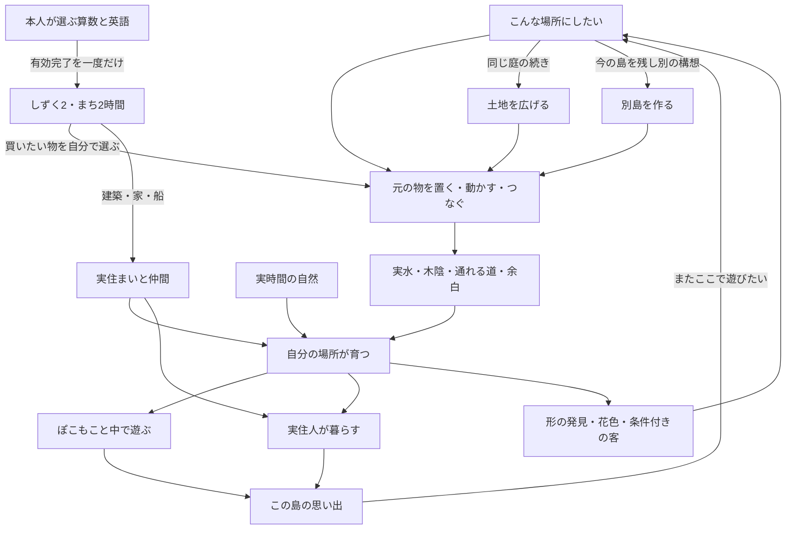

# 島全体の体験と育成の詳細設計

2026-10-20、共同案v0.8。**同じ少数の素材から、自分で育てた場所の中でぽこもこと遊び、実住人と暮らし、昔の場所の続きへ世界を広げる。** その体験を全アイテム・空間・操作・行動・進行・土地・別島・回復・受入へ具体化した。

SG1〜3・住人選択・共同演奏記憶・3島比較は[採用ADR](../../../adr/2026-10-20-island-place-experiences.md)に基づき実装した。[実装と検証範囲](implementation.md)を参照する。それ以外の新造形/未決事項は詳細設計候補。現在の遊びの正本は[52](../../52_growing_island_game_spec.md)と[v0.4の詳細規則](../growth-rules.md)、[現行対応](../implementation-map.md)。未制作の大型形、美術の採用、実参加者の理解・再訪を完成扱いにしない。柱はくふう・にぎわい・ふしぎ・愛着をすべて強め、既存の学習・所有・住人・土地・履歴・無罰を保持する。

## 全体を読む地図

| 章 | 具体化した範囲 | ここで答える問い |
|---|---|---|
| [1 置くものの全台帳](01-items.md) | 50項目の物、8つの愛着領域。継続品・旧品・全13形の学習記念 | なぜ置くのか、何と関係するか、不要な機能を増やしていないか |
| [2 成長と空間](02-space.md) | 4系列×各3形、全11組、現在/利用/履歴、式・状態遷移・大型の条件 | 何と何をどこへ置き、何を待つと、何が変わるか |
| [3 遊びと住人](03-play-and-residents.md) | 共通操作、全12種類と4性格、行動選択、予約/中断、共同記憶 | 育った場所で何をし、誰がどのように使うか |
| [4 進行と島](04-progression-and-islands.md) | 初回〜長期、3育成方向、9つの遊び方、時計/経済/土地式/複数島 | どんな理由で戻りたくなり、どれくらい広がるか |
| [5 全体験と画面と発見](05-experiences.md) | E01〜25、全動線、画面競合、11花色/全交配/客/W | 入口・返事・次の選択・回復が一続きか |
| [6 同素材の3全島](06-three-islands.md) | 同じ38個・96セル・4住人の座標図/JSONと実計算 | 同じ材料で本当に別の島になるか |
| [7 制作と受入](07-delivery.md) | 制作単位、独立7評価、42反例、8つの行き詰まり、残判断 | 何を作ればよく、何ができたら合格と言えるか |

先に作品全体を理解するならこの入口→6→3→4。条件を実装するなら1→2→3→5→7。現在のコードへ移す際は未採用候補を正本へ採用し、該当章/保存境界を更新してから実装する。

## ゲームの一周

矢印は自動学習や強制の解放順ではない。学習しない短い訪問も、今ある場所で遊び・無料再配置・観察ができる。好きな庭を残すことも成功。成長の数、人口、購入数、写真数、島数を一つのランキングへ集約しない。

## 三つの育成構想

| 方向 | 最初の工夫 | 育った場所での選択 | 長い育成で変わること |
|---|---|---|---|
| 森 | 苗を列/塊/余白を囲む配置へ | 木陰を通る、内庭へ入る、実対応した内部へ | 昔の森が泉や家をつなぐ道にもなる |
| 暮らし | 家・畑・玄関前の庭を選ぶ | 仲間のいる庭、食事/休憩/遊具、演奏へ参加 | 一つの集落から違う居場所を持つ地区へ |
| 水と花 | 実通水と配色を選ぶ | 岸を巡る、花庭で過ごす、流れや色を試す | 泉/花/森/暮らしがつながる島を作る |

方向は混ぜられ、最初のコース選択ではない。建築と自然は別の時計。家の外観styleと現在の環境、花の成熟と交配、実供給と運搬の描画、現在の場所と過去の記録も分ける。

## 今回明確にした設計上の判断

1. 元の品を正本にし、派生する場所は現在の姿とする。分離/再接続でIDや年齢、色、家の所属、歴史は失わない。
2. 小さな単体から遊びがある。通常場所のための席/特定家style/終了商品を追加の必須購入へ戻さない。
3. 同じ操作が、実際の接続・床・空席・その場の仲間によって異なる結果を返す。かわいい動作だけで奥深さ完成としない。
4. NPCの個性は実際の行動差へ出す。自律した世界にぽこもこが参加し、全員集合や架空群衆で繁栄を装わない。
5. 自動の思い出は意味のある初回に絞る。全NPCペア、全revision、全着座を記録課題にしない。
6. 土地拡張は「今の作品の続き」、別島は「元の作品を残す別構想」。新島の無料品や往復から共通資産を増殖させない。
7. 作品比較の単位は同素材の3全島。局所の水/席だけを全体完成へ読み替えない。

## 現在の具体的な差と未達

3案すべてで、38所有物への論理到達、96セル、全6水路の通水、4住居枠、食料7/8/8を確認した。初回に見つかった席の系列間再割当による森/花庭の降格は修正済みで、3案とも4系列が成熟成立する。[初回の失敗](layout-verification-before.json)と[修正後の論理診断](layout-verification.json)を分ける。現在のSG1〜3・住人行動・共同記憶と比較操作は[実装記録](implementation.md)を参照する。論理診断は実取得や美術・子どもの理解の合格ではない。

本人の材料からできる場所の接触遊び、住人の行動差、共同演奏の初回記憶を本体へ実装した。既存の有限対応形を越える中空幹/回廊/花天蓋/共同屋根の制作と、実機/子どもの理解・自発再訪は別に残る。

文書の網羅性、技術的一致、美術、体験の面白さ、公開はそれぞれ違う状態。採用済み部分の実装と未採用の大型形を分け、「最高になった」という実証にはしない。

## 根拠と協議

根拠は[憲法](../../../../CONSTITUTION.md)、[親仕様01](../../01_app_spec.md)、[現行育成マップ](../implementation-map.md)、[成長詳細](../growth-rules.md)、[全島制作方針](../../island-construction-strategy.md)、[画面44](../../44_display_layout_spec.md)、各章のコード参照。現行と異なる提案値は候補初期値として区別する。

チャッピーとの[体験育成戦略整理](https://chatgpt.com/g/g-p-6ad58d0857b881918e46e346350848e7/c/6ad58fdd-7f00-83e8-b262-b3cb942b0702)で、配置と空間→遊びと暮らし→実計算を返した統合批判→上限と記憶粒度の訂正→能動的な遊びの具体案を協議した。履歴は[協議記録](../../../design/2026-10-19-island-system-spec/README.md)へ残す。SimCity/どうぶつの森は既存の比較の設計軸であり、今回の最新機能調査や原作と同等の体験の主張ではない。

検証記録は[verification.json](verification.json)、座標診断は[layout-verification.json](layout-verification.json)。資料の追加で通常の保存・配信を切り替えない。
