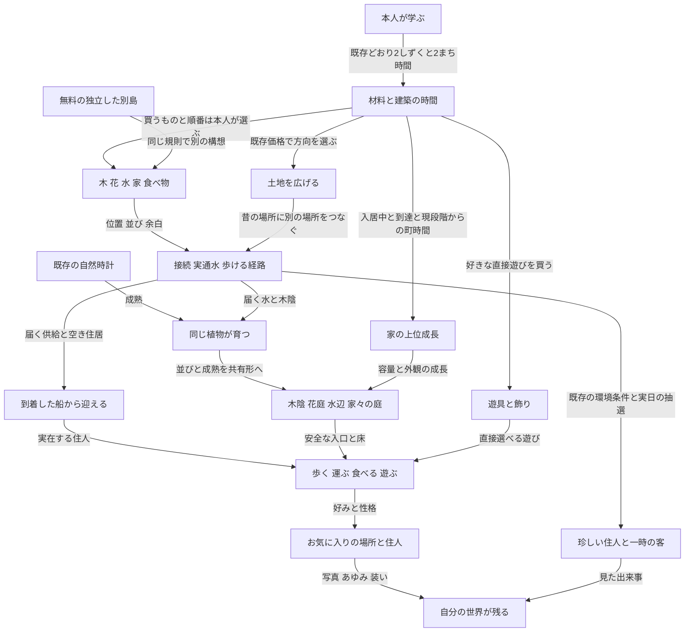

# 少ない素材から場所と暮らしを育てる仕様案

2026-10-19、v0.4。**利用者の実装依頼により採用。** [ADR](../../adr/2026-10-19-island-growth-v04.md)、[実装/検証](../../tasks/active/2026-10-19-island-growth-v04.md)。[完全マップ](current-map.md)は実装前の比較用snapshot。実装採用は公開や利用者観察の合格を意味しない。

## 目的と変える範囲

子どもは何をどこに置くかを決める。木・花・水は見える規則でつながり、既存の時計で育ち、ぽこもこと住人が使う。少量でも遊べ、同じ材料を並べ直すほど違う場所になる。

「くふう」は配置の因果、「にぎわい」は実人口と実利用、「ふしぎ」は既存の条件付きの出会い、「愛着」は所有・外観・個体の履歴を通じて保つ。**弱める可能性があるもの**は、Lvごとに商品が増える期待、好みを整えて家を成長させる攻略、特定の材料を揃える発見。代わりに自由な購入順、同じ素材の空間差、使い方と長期の成長を強める。柱への影響を採用時に判断し、必要なADRを先に残す。

本案は通常の場所形成・家成長・購入品の統合・旧品の保護・W記念の復旧を具体化する。[成長と移行の詳細規則](growth-rules.md)と[30日仮計算](../../design/2026-10-19-island-system-spec/pace-analysis.md)を合わせて読む。自由な部位の着せ替え、島間物流、通常保存への新地区導入、新祭りイベント、任意形状の巨大構造の自動設計は含めない。

## 次期の全体像

げんきの数値を隠すだけの変更にはしない。家成長と新規購入資格をげんきから切り離す。一方、入居の「住居＋食の余裕＋到着船」は現行で既に成立しているので、新しい発明として扱わない。

## 判断の一覧

| ID | この仕様案で選ぶ規則 | 現行から変えること | 採用前の確認 |
|---|---|---|---|
| D01 | 木/花/水/家/食の5概念。遊具と飾りは直接選ぶ | たねと家具という生成元を子どもの基本理解にしない | 分類表示だけでなくD02/D03/D04を伴う |
| D02 | 単体→接続→成熟まで少量から場所になる | 通常の木陰/花床/水辺にPの固定個数や席を必須にしない | 同材料3配置と実利用 |
| D03 | 家は入居中＋到達＋現段階からの時間で育つ | 平均すみごこちとげんきの家成長ゲートを外す | 経済の試算と既得段階保持 |
| D04 | 初期Aと初回入居後Bの2段階で新規購入資格を統一 | 人数1/2/3とLv1〜10の個別購入ゲートを整理 | 選択肢過多と長期の節目を観察 |
| D05 | 新規の食は畑40だけ、供給2/実給水3。旧鉢/パン/市場は保持 | 三つの供給施設の新規購入を終了。店への自動変形なし | 統合前後の選択と占有/供給/物流の整合 |
| D06 | 選んだ外観/所有/土地を保持。周囲だけ現在配置へ適応 | 新規家の環境styleを取得資格にしない | 旧styleと大型構造の両立 |
| D07 | 土地は前段取得＋現行価格。別島は現行契約 | 土地4/5のLv5/6条件を外す | 島内継続と別島の経済比較 |
| D08 | 特別種4枠を実際の節目に対応。装いはBへ | 旧発行を対応し、不明枠は保護者が一度復元 | 原子的な保存と例外復元の再実行防止 |
| D09 | 自然種/遊び場種/祭り種の新規購入を終了 | 木/花から自生、遊具を直接選ぶ。旧種は従来どおり完成 | 自生の速度/占有と旧種の回帰 |

D01だけを実装して整理完了とはしない。D02〜D09は独立に検証できるが、現行と混在する途中版では適用した規則版を明示する。

## 本人が置くものと島が育てるもの

| 系統 | 本人が決める | 自動で育つ部分 | 新しく発行しないもの |
|---|---|---|---|
| 木 | 苗の位置、列/塊/囲む余白 | 元の木の成熟、枝/根/樹冠/木陰の連なり | 木の所有数、配置権、住居容量 |
| 花 | 株の位置、基本の色 | 開花、既存の広がり/交配、花床/花弁のまとまり | 親の消費、確実な珍色 |
| 水 | 水源と水路の配置 | 実通水、湿り、岸の形 | 水源のない供給、8セル超の給水 |
| 家 | 位置、既存の向きの範囲、屋根色、所有外観 | 家の段階、周囲の庭と木陰、実住人の暮らし | 選んだ姿の自動置換、架空の入居 |
| 食 | 畑の位置、食事先との接続。所有済み旧施設も使える | 作物と実際の運搬/食事 | 自動の店、新しい供給施設ID |
| 遊具 | 座る/こぐ/滑る/跳ねる等の遊びを選ぶ | 実在する住人の利用 | 人口の必須あそび点 |
| 飾りと装い | 色、旗、帽子、灯り、小物等 | 時刻による既存の景色 | 新能力値、服屋、専用通貨 |

**水は一つの概念だが水源と水路は別の道具。** 食の新規購入は畑だけにする。鉢/パンや/市場は新規購入を終了し、既存個体は容量1/3/4、姿、元の取得額を保つ。40の畑から店の姿を自動生成せず、同じ見た目で供給能力が異なる新商品を作らない。

新規の購入種は家と畑の2種類。ふしぎ種は購入品ではなく記念の3系統目。木と花は直接置き、草/しだ等は[自生規則](growth-rules.md#自然の広がり)で増える。遊びは直接選ぶ遊具に統合する。

「向かい合う家」を新しい回転操作の実装約束にしない。現在の玄関方向を使い、家の位置と余白から共同空間を作る。

## 共通する規則と組み合わせ

1. 木/花は同系列の辺接続または通れる1セルの直線的な隙間でつながる。斜めのみはつながらない。
2. 水は水源から実接続された水路だけを流れる。既存の8セル・湿り・木陰の式を継承する。
3. 住人は実際に歩ける経路から使える入口へ向かう。席の同時利用は一人。見た目で床を捏造しない。
4. 成熟は既存の個体と時計から導く。別の場所ポイント、合体待ち時間、毎日の管理作業を増やさない。

| 組み合わせ | どう置く | 直後の変化 | 育った結果 | できること |
|---|---|---|---|---|
| 木＋木 | 列に並べ、歩ける横を空ける | 根/枝の寄る方向 | 長い木陰 | 木陰を歩く、近くで休む |
| 木＋木 | 周囲を囲い中央に余白と入口 | 内側が分かる接続 | 木陰の中庭 | 内側へ入る、集まる |
| 木＋木 | まとまりを寄せ、入口を保つ | 密度の差 | 厚い樹冠 | 周囲を回る。安全な大型構造は別判定 |
| 木＋家 | 家の玄関を塞がず木陰へつなぐ | 家と木陰の関係 | 森の庭にある家 | 実住人が家から庭へ歩く。家の屋根色は変えない |
| 花＋花 | 列/まとまり/中央の余白 | 花床の連続 | 花道/花庭/花に囲まれた庭 | 花を見る、庭を使う。座るには本人が選ぶ席が必要 |
| 花＋花 | 既存の異色・距離・空地条件 | 親の配置 | 条件付きの新色 | 図鑑に残す。交配はP達成の必須条件にしない |
| 水源＋水路 | 辺でつなぎ、流れを曲げる | 流水と乾いた部分 | 曲がる岸/水辺 | つなぐ位置を比べる |
| 水＋花 | 花へ実際に水が届く | 湿りの変化 | 水辺の花庭 | 花と岸を眺め、実在の住人が使う |
| 水＋畑 | 既存の水の影響範囲 | 給水の違い | 作物と供給の差 | 食の余力2→3。見た目だけで増産しない |
| 家＋食＋経路 | 玄関/生産/受取先を実接続 | 届く供給と空き枠 | 入居と暮らし | 船から迎える、運ぶ、食べる |
| 家＋家 | 通路と共同の余白を残す | 家の間の庭 | 住人の行き来 | 集まる。共同屋根を新しい住居枠にしない |
| 遊具＋本人/住人 | 空いている実利用先へ | 乗る/座る等の反応 | 同じ場所での暮らし | 何度でも遊ぶ。通貨は発生しない |
| 森/水/花/集落 | 既存C01〜C04の実条件で接続 | 二つの場所の連なり | 複数地区の往来 | 以前の場所の使われ方が広がる |

一般の水/木陰/通行は、専用C形がなくても働く。すべての異素材を専用の合成形へ変えない。何も専用作用を定義していない組み合わせに、新しい能力や抽選倍率を付けない。

## 単体から成熟した場所へ

| 現在の状態 | 判定の入力 | 表現と実利用 | 移動と分離 |
|---|---|---|---|
| 単体 | 所有済み1個、現在の成長量 | 若い木/花/水の小さな景色と返事。苗から成熟木の影を先取りしない | 個体はそのまま |
| 接続 | 共通の接続、流路、空地、入口 | 根/枝/花床/岸が列/塊/中庭に対応する | 現在の接続成分を再計算 |
| 成熟 | 元の木の成熟/開花/家段階、既存時計 | 実際の成長量に応じた樹冠/花弁/共同の庭 | 年齢/家段階は保持。共同形は小さくなり得る |
| 安全な大型構造 | 成熟した所有群と対応する美術部品、実支持床/入口/全身経路/頭上/非干渉 | 中空幹/回廊/花天蓋/共同屋根。条件不成立なら成熟した庭に留まる | 構造消失前に実在の入口へ退出し、元個体を保持 |

通常の木陰/花床/水辺の成立条件から、P01〜P05の固定必要個数・ベンチ・特定家styleを外す。大型は[有限の判定手順と初期値](growth-rules.md#場所と大型の判定)を使う。木の列の初期報酬は地上の木陰の道。空中回廊/中空幹/花天蓋は対応する部品と実床を検証できる場合だけ成立する。**未検証の寸法や部品には大型の能力を付与しない。** 入力・分類・成熟・戻り先は仕様候補として決め、全配置に安全な大型ができるという約束はしない。

成長は有限の美術部品を接続・変形して表す。毎フレーム無限の形状を探索する意味の「連続」ではない。配置予告/確定/足/通路/水/住人が同じ導出結果を読み、無料の移動/分離/再接続で成長を初期化しない。派生した岸や床の見た目を、新しい取得地点や無条件の歩行権にしない。

P01〜P05は場所の名前と任意の目標として残せるが、旧最小個数で通常表現を止めない。P06は森/水/花/集落の異なる3系列、到達、実在するぽこもこと住人の現行revision利用による任意記録。基本の品、土地、別島を使う資格にはしない。

## 家と人口と食料

### 家の時間と成長

| 変化 | 費用と待ち時間 | 次期の条件 | 容量 |
|---|---|---|---|
| たね→テント | 40、配置から6まち時間 | 家から到達。初回1個の無料導入を継承 | 1 |
| テント→こや | 現段階開始から24まち時間 | この家に住人が所属し、家へ到達 | 1 |
| こや→いえ | 現段階開始から48まち時間 | 同上 | 2 |
| いえ→ふたかいだて | 現段階開始から96まち時間 | 同上 | 2 |

家の成長判定は既存の夜明けで、各家は一つの夜明けにつき最大1段階。段階が変わった実際のまち時刻を次の待ち時間の起点にする。一度の帰島同期で複数の夜明けを順に処理する追いつきは維持し、「1回の帰島で1段階まで」という制約を加えない。未入居の空家は上位へ育たず、画面外/夜/おでかけ中でも所属住人がいれば入居中と扱う。経路が塞がれると以後の成長を保留し、戻せば保存済みまち時計と未使用時間から再判定する。到達できなかった期間を理由に時計を減算/初期化しない。

既存の家の段階、style、屋根色、住人、入居枠を保持する。移行直後の追いつきも旧`stagedAt`を使い、24/48/96を建築時からの累積として一度に消費しない。各夜明けではその処理時点の所属と到達を評価し、後から入居した住人を過去の夜明けにも住んでいたものとして扱わない。成長が成立した時刻を過去へ推測して戻さない。

### 入居と供給

入居条件は現行を保つ。到着船があり、到達する空き住宅枠があり、届く食料の容量が現在住人数を超えたら、夜明けに準備し、本人が船を開いて迎える。好み/遊び点/げんきを追加の入居ゲートにしない。運搬アニメが完了するまで入居を待たせない。

| 供給元 | 現行から継承する値 | 境界 |
|---|---|---|
| ぽこもこの家 | 基礎2人分 | 初回導入の循環を防ぐ |
| 畑 | 40、食2/水の影響あり3 | 完成と実到達が必要 |
| 旧鉢 | 取得額30、食1 | 新規購入終了。実到達が必要 |
| 旧市場 | 取得額120、食4 | 新規購入終了。完成と実到達が必要 |
| 旧パンや | 取得額70、食3 | 新規購入終了。実到達が必要 |
| 食卓 | 40、生産能力なし | 家も受取先。食卓購入を入居の必須にしない |

同じ供給元をC関係・重なる派生形・複数の受取先ごとに加算しない。経路を切ると現在の供給余力を再計算するが、既存住人は退去せず、家は退化しない。食べ物の置き場所と実物流が対応する必要は残す。

船の新規航行は48＋2×住人数まち時間。保存済みの到着時刻を延ばさず、旅人は一人で期限なく待つ。学習に戻るよう促す困り顔/不足の脅しを使わない。

## 解放と節目

### 購入資格は二段階

| 段階 | 条件 | 選べるもの |
|---|---|---|
| A | 島の初期 | home、赤黄白花、木、水ばち、ベンチ。無料初回家は既存の任意導入 |
| B | その島で最初の住人を迎えた保存済み事実 | farm、水路/食卓/ブランコ/滑り台/トランポリン/音楽/灯り/さく/灯台/噴水/ポスト、青花。継続する通常品の残り |

価格は全品とも[現行表](current-map.md)を継承する。「選べる」と「無料でもらえる」を区別する。木は初期から購入資格があるが価格20を維持し、初回無学習で買えるという約束や無料配布の追加はしない。継続する商品の旧解放はA/Bの条件に関係なく保持する。購入終了品は旧解放記録を保持するが、旧解放済みでも追加購入を終了する。この購入機会の縮小は明示的な候補変更であり、全権利が無変更とは呼ばない。所有済み個体/種の再配置・使用・完成は保持する。新しい解放を日数・学習問数・珍色・P目標・土地の購入に従属させない。

土地を買わない小さい庭でも、同じ通常品から好きなものを選べる。最初の土地取得を通常品の解放条件にする3段階案は、この自由を弱めるため選ばない。通常品を全て常時並べる必要もない。本の案内は既存の最大3候補に留め、全一覧は本人が開く。買えないものへの学習催促を足さない。

### 現行の解放先の全対応

| 現行 | 次期候補の行先 |
|---|---|
| 初期home/花/水ばち/ベンチ | Aのまま。wildは新規購入終了 |
| 住人1人の畑/木/水路 | 畑/水路はB、木はAへ前倒し |
| 住人2人の鉢/食卓、3人のポスト | 食卓/ポストはBへ。鉢は新規購入終了 |
| Lv2のplay/ブランコ/青花 | ブランコ/青花はB。playは新規購入終了 |
| Lv3の灯り/さく | B |
| Lv4の音楽/パン/市場 | 音楽はB。パン/市場は新規購入終了 |
| Lv5のfestival | 新規購入終了。新祭りイベントは範囲外 |
| Lv6の滑り台/灯台 | B |
| Lv7のトランポリン | B |
| Lv8の噴水 | B |
| 家成長のLv2/4/6 | 家の時間/所属/到達の条件へ置換 |
| 土地4/5のLv5/6 | 前の取得段階＋720/960しずくへ置換 |
| 旗模様/服色/帽子/特別枠のLv7/8/9/10 | Bで既存の選択肢だけを無料で選べる |
| ふしぎ種のLv3/5/7/9 | 下記W1〜W4の一度だけの節目へ置換 |
| 旧5品 | 所有済み権利を保持、新規商品として解放しない |

あそび点とすみごこちは既存の行動/好みを表すために利用できるが、新しい購入資格や家成長の隠れた必須条件にしない。最高げんきと旧Lvは過去の記録として保持し、旧Lv計算と新しい資格を同時に要求しない。新しい通常資格と特別記念の判定を混ぜない。

### ふしぎ種の四つの記念枠

| 枠 | 新規の節目候補 | 旧付与との対応 |
|---|---|---|
| W1 | 初回の入居 | 旧Lv3 |
| W2 | 無料導入以外の通常種を、まち時間で初めて建てた | 旧Lv5 |
| W3 | 島開始後に木か花が未成熟から成熟へ進んだ最初の保存済み事実 | 旧Lv7 |
| W4 | 最初の土地拡張 | 旧Lv9 |

各島各枠一度だけ、順序の強制なし。W2には通常のhome/farmと、旧所有の建築途中play/market/festivalの初回完成を使い、初回無料家/自然種/ふしぎ種は除く。購入終了しても既存の建築途中品は排除しない。W3は有効な成長量の到達事実で、表示の観察を条件にしない。島ID・個体ID・未成熟から成熟への保存された状態遷移を一意のW3枠と照合する。自然時計の追いつき処理で成立した実際の遷移も対象とし、単に現在成熟した株があることから付与しない。無料の初期植物でも開始後に実際に成熟すればよいが、最初から咲いた配置を「育てた」と認定しない。旧島に移すときは確認可能な過去の成長記録だけを使い、なければ今後の新たな成熟で達成できる。特定の3系列や珍しい色を集める必要はない。

旧Lv3/5/7/9の発行済み枠を新枠へ一対一で移す。これは発行済み数量の対応であり、新しいWの達成理由を遡って認定する意味ではない。各枠には旧由来と旧閾値を残す。残る在庫と建築済み現物はそのまま保持する。**在庫0を未受領とみなさない。**

現コードの旧方式は、独立した受領IDではなく最高げんきの閾値通過時に在庫を増やす。元の規則版とこの一貫した保存契約を確認できる記録に限り、旧最高げんきを発行済み枠の根拠に使う。例外/不整合で根拠が不足する場合は新しい付与を推測せず、元状態を保つ移行保留にする。回復は[Wの状態遷移](growth-rules.md#wの旧枠と例外復旧)に従い、保護者が不明枠だけを一度復元できる候補とする。元データ欠損時は旧発行との現物重複を完全には証明できない。例外の権利回復を優先し、換金不可/他島移送不可、枠receiptと付与を同時保存する。これを二重発行ゼロとは呼ばない。新枠の付与と受領記録を同時に保存し、旧Lvによる付与処理を次期規則へ重ねて動かさない。新島にはその島の新W枠を用意し、旧島の受領と現物を再配布しない。

新しい島の無料家/無料素材/ふしぎ種から、プロフィール共通のしずくを生み出す換金・移送ルートを足さない。独力習得の記念品O33/O34とは別の資格であり、その教科/主レベル/共通受領境界を変えない。

## 土地と別島と既得権

土地の初期6×5、最初の5価格120/240/480/720/960、6回目1200以後＋240、東西3列/南3行の反復、回数上限なしを継承。D07で変えるのは土地4/5のLv条件だけ。次期の3D地区は、取得地点/床高/水域/接続口を同じ世界定義で成立させ、通常保存切替を別に検証する。

| 選択 | 変わる対象 | 新しい体験 | 保持 |
|---|---|---|---|
| 同じ物を並べ直す | 一つの場所の形 | 同じ木で道/塊/中庭を比較 | 年齢、ID、屋根、住人、記念 |
| 同じ島を広げる | 場所同士の関係 | 森の先の泉へ行く往来。元の森が道にもなる | 最初の場所と土地の権利 |
| 別島を作る | 独立した構想 | 元の島を壊さず、花中心/森中心等を試す | 島別所有と歴史、共通受領の一意性 |

別島の作成/切替/共通財布/島別まち時間/自然追いつき/写真/旧writer拒否は[現行海図契約](../island-voyages.md)を維持する。新島への旧解放の持込をこの案で勝手に追加せず、各島のA/Bと既存の解放状態を使う。学習完了を受け取った時点の現役島にまち時間、同じ完了IDから二重受領なし。未受領の完了を切替時にどこへ反映したかはtransactionの固定した結果に従う。

## 既存の全要素の移行先

| 現行ID | 次期の役割 | 移行時の保護 | 変わる規則 |
|---|---|---|---|
| O01 家 | 基本の住まい | ID/段階/住人/style/屋根/時間 | D03、styleをP成立の必須にしない |
| O02 畑、O09 鉢 | 新規は畑だけ。旧鉢は所有品として継続 | 容量/元価格/現物 | 畑はB、鉢は新規購入終了 |
| O10 市場、O22 パン | 旧所有の食料施設 | 供給実体と所有、占有 | 新規購入終了。自動出現なし |
| O03 遊び場、O11 祭り広場 | 旧所有の遊び | 現物/動作/既得の表示/途中の建築 | 新規購入終了。新規は直接遊具 |
| O04 自然種 | 旧所有の自然と自生の個体 | 草/しだ等の結果を花へ強制置換しない | 新規購入終了。成熟木/開花花も自生の親にする |
| O05 木、O06〜O08 花 | 基本の自然と育った結果 | 年齢/色/親/ID | D02の小規模表現 |
| O12 ふしぎ種 | 特別な記念 | 在庫/現物/旧4枠 | D08 |
| O13/O14 水 | 水源と流路の道具 | 実給水/8セル/占有/価格 | Bへの資格整理、万能水効果なし |
| O15 噴水 | 水の飾りと好み | 現物/水環境 | B、通水源への無断昇格なし |
| O16 食卓 | 食事と受渡し | 現物/利用 | B、食料生産物扱いをしない |
| O17〜O21 遊具と音楽 | 直接選べる遊び | 全動作と対象個体 | B、個別あそび点を解放資格にしない |
| O23/O24 灯り | 景色とふしぎの環境 | 環境点と既存出来事 | B、別の建築必須点数にしない |
| O25 さく、O26 ポスト | 囲いと飾り | 現物/既存通行 | B、ポストのあそび点を新進行へ使わない |
| O27 ぽこもこの家 | 常設拠点 | 位置/基礎食/室内/学習 | 維持 |
| O28/O29/O30 | 散歩/入居/別島 | 三つの役割と全保存 | 混同せず維持 |
| O31 出会い | 条件付きのふしぎ | 固定済み候補と実日受領 | 現行環境点/抽選を継承 |
| O32とP01〜P05 | 配置から育つ場所 | 元個体/既存の安全な構造/記録 | D02、大型は別ゲート |
| P06、C01〜C04 | 任意記録と場所の関係 | 達成済み記録、作用の一意性 | 通常品を得る条件にはしない |
| O33/O34 記念品 | 独力習得の証 | 主レベル/現物/共通受領 | 13kind不整合は別の正本照合 |
| O35a〜e | 旧所有と遊び | 旧5品すべて | 新規取得へ復活しない |
| H01〜H08 | 表現/暮らし/記録/訪問 | 名前/装い/部屋/写真/手紙/花/本 | H02/H03と特別枠の資格をBへ、他は継承 |

現行E01〜E25の体験は行先を持つ。廃止候補は**条件の重複**であり、演奏/食事/着座/交配/図鑑/記録/服色/帽子を削ることではない。食の別施設/自然種/遊び場種/祭り種は新規購入から統合する。旧kindの読み書き・動作まで廃止しない。既存の遊具と遊び場の動作が完全同一だという主張もせず、新規で選べなくなる旧施設の姿と固有体験は採否のトレードオフとする。

## 初回から別島までの通し例

1. 初回は仮所有者で同じ島へ到着し、ぽこもことベンチで遊ぶ。無料家の特例で最初の住人を迎え、BとW1の権利が生まれる。学習設定は本人が学ぶ時。設定で別の島を作り直さない。
2. 木を列に置くと若い接続が見える。家を40で仕込み、本人が普段の学習を選ぶと、既存の有効完了からしずくとまち時間が届く。6まち時間で家が建つ。未使用時間があれば新しい学習を要求せず使える。
3. 基礎食2と空き家、到着した船が揃えば2人目を迎える。入居済みの家は現段階から24時間でこやへ進める。住人が森を好むかどうかは行動を変え、成長の資格を奪わない。
4. 3人目を迎える前に食の余裕を作る。畑40で2人分、実給水なら3人分増える。現在の家の空き、到着船と併せて入居を準備する。食卓の追加購入と運搬アニメ完了を必須にしない。
5. 同じ木を囲む配置へ変え、中庭を作る。自然が成熟してもID/年齢は同じ。花や水辺とつなぎ、実在する住人の過ごし方を比べる。全商品を買わずに続けられる。
6. 土地を120で広げるとW4の権利。元の木陰の先に水辺を作り、家から木陰を通って泉へ行く暮らしが生まれる。次の拡張も価格と前段取得で選べ、P06達成を要求しない。
7. 海図から無料の別島を作り、花中心の構想を始める。元の島の年齢と住人は残り、共通の完了受領から報酬を再発行しない。初期素材を共通通貨へ変える仕組みはない。

これは条件の通し例で、何日/何問で必ずそこへ到達するという約束ではない。経済基準の1日20問を子どもの日課ノルマにしない。

## 保存の不変条件

- 同じ命令ID、同じ完了ID、同じW枠の新版での付与/復元を二重に反映しない。旧証拠欠損時の例外復元だけは現物重複の可能性を明記する。残高/受領/時間/現物の変化は同じ保存境界で整合させる。
- 継続商品の旧解放と新資格は和集合にする。購入終了品の旧解放記録/個体は保持し、新規購入だけを終了する。完成品を再購入させない。
- 既存の家の成長、木の年齢、屋根/style、名前、写真、住人、土地を保持する。移行で位置を整列させない。
- げんきの旧到達、Wの旧受領、独力学習の記念、任意目標の実表示/利用は別記録。成長事実から「見た/使った」を捏造しない。
- 島切替は退避と復元を原子的に行い、表示元島IDを照合する。旧島の古い財布で共通値を戻さない。
- 次期ルールを旧writerが読書きしない版境界と、対応する復帰版が必要。保存を消してやり直す復旧にしない。
- 規則版と移行が未実装の状態で、文書の変更だけを通常runtimeへ適用した扱いにしない。

## 検証と導入の順

| 段階 | 成果物 | 合格条件 | 次へ持ち越すもの |
|---|---|---|---|
| S0 今回 | 完全マップと共同仕様案、静的な矛盾確認 | 全品/関係/体験/島/旧権利の行先を追える。文書検査 | 実装、美術、面白さ、公開 |
| S1 | 同じ木/花/水/家から3配置を作る小試作 | 配置予告と実形一致、分離/再接続、同年齢で別形、実住人の利用 | 解放/家成長/保存移行の通常切替 |
| S2 | 家成長の規則と経済比較 | 空家/表示外/経路切断/復旧/時間起点を検査、人口ペースを比較 | 全商品解放 |
| S3 | A/B解放とW4枠と旧権利の移行 | 全対応表、二重付与防止、複数島/旧writer/更新/復旧 | 配布と子どもの受入 |
| S4 | 採用正本の改訂と通常候補 | 変更別matrixの技術検証、美術/無説明理解と安全/実機を別判定 | 全体の公開は明示依頼で行う |

### 最小の反例

| ケース | 期待 |
|---|---|
| 木1本/花1株、水源1つ | 何もない表示にならず、小さい姿と返事がある |
| 同じ4本を列/塊/中庭へ動かす | 所有/年齢不変で形と通れる空間が変わる |
| 若い苗を置く | 成熟した大回廊を即時に付与しない |
| 大型部品の支持/頭上/入口が不成立 | 成熟した通常形で遊べる。虚偽の通路なし |
| 気に入った屋根の家を森へ移す | 家の姿/色は保持、周囲の庭が変わる |
| 入居済みで空き容量あり、食料余力不足 | 次の入居だけ待つ。既存住人は退去しない |
| 未入居の家に大量のまち時間 | 勝手に上位段階へ成長しない |
| 長期間無人だった家へ途中の夜明けで入居 | 過去の夜明けへ所属を遡及しない。成長した実時刻を次の起点にする |
| 入居者が夜/画面外/おでかけ中 | 所属と経路が成立すれば家は成長できる |
| テント成長から47時間 | 次のいえへまだ進まない。48時間で夜明け条件を判定 |
| 小さい島のまま入居済み | 土地を買わずにBの遊具を購入できる |
| 旧Lv8、購入/衣装解放済みだが初回導入記録なし | 旧権利を取り上げない |
| 旧ふしぎ種を4つ全て配置して在庫0 | 新W1〜W4で4つ再付与しない |
| W3→W1の順に達成、再読込/別タブで同時保存 | 順番を強制せず、それぞれ一度だけ |
| 初期から咲いた花、または現在の成熟状態だけがある旧記録 | 未成熟からの遷移を捏造してW3を発行しない |
| 休止島の自然追いつきで同じ木が成熟 | その島の保存された成長処理としてW3を一度だけ確定。表示観察は追加条件にしない |
| 島Aで学習後、未反映でBへ切替 | transactionで受領先を固定、一度のしずくと時間だけ |
| 休止島の古い残高を復元 | 現役の共通財布を保ち巻戻さない |
| 新島を何度も作る | 過去の独力記念/学習報酬を再発行せず、共通通貨へ無料物を換金しない |

子どもの観察では、説明なしで原因を予想し、直せて、完成後も並べ直し、翌日自分から戻るかを見る。短い試作で翌日再訪まで確認した扱いにせず、技術検証と観察の対象を別に記録する。

## 残る判断と実装ゲート

| ID | 残ること | 閉じる条件 |
|---|---|---|
| Q11 | A/Bで増える選択肢と、減る解放の期待 | 少数候補からの自由選択と長期再訪を観察。大量一覧を強制しない |
| Q12 | 好みを整える育成戦略の弱まり | 住人の実行動差と配置差が価値を持つか確認 |
| Q13 | 有限部品の寸法と能力確認 | 判定手順は詳細規則で決定。実アセットのbbox/マージン/支持/経路を測り、合格部品だけ有効化 |
| Q14 | 経済のモデル外と体験 | 12ケースの部分仮計算を実施。全商品比較/水/最適行動/旧食施設/実利用者は未検証。現時点で価格や容量を変えない |
| Q15 | W枠移行と旧保存の実装検証 | 状態表と一度の保護者復旧を決定。実fixtureで並行保存/再移行/監査/旧writerを検査 |
| Q16 | 13種の記念品と正本10種の差 | 形とレベル資格を区別した正本照合。既存の学習と受領を保持 |
| Q17 | 新規購入統合後の分布と選択 | 統合先/自生の親/旧機能保持は決定。自生速度/カタログ理解/旧固有体験を選べない影響を観察 |

本規則は実装対象として採用済み。大型の部品能力/安全、保存の実更新/復旧、経済と子どもの体験の受入は[実装タスク](../../tasks/active/2026-10-19-island-growth-v04.md)で別に追跡する。
