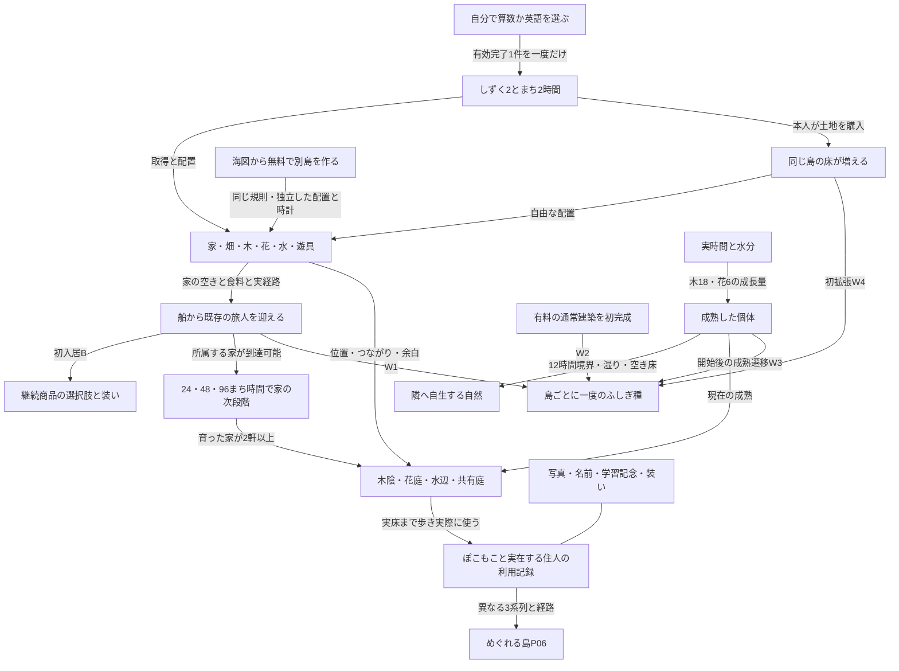

# v0.4の育ち方と実装の対応

2026-10-19。[52の採用規則](../52_growing_island_game_spec.md)、[詳細規則](growth-rules.md)を現在の実装へ引く地図。旧所有物の全IDは[実装前台帳](current-map.md)に保持する。検証結果は[実装記録](../../design/2026-10-19-island-growth-v04/README.md)を参照する。

## 一周の関係

矢印は発行条件・影響・記録を示す。場所を完成しないと学べない、島を増やせない、という順序にはしない。食や道の不足は新しい入居・現在の利用に影響するが、欠席罰や住人の追放にはしない。

## 全品の現在の扱い

| 台帳ID | 新しく選ぶもの・存在理由 | 現在の扱い |
|---|---|---|
| O01 | 家：実住人の住居と集落の構想 | 初期A。初回無料、以降40。入居と実経路を満たす家が育つ |
| O02 | 畑：住人を迎えるための食 | B、40。食2、実給水で3。環境による作物差を保持 |
| O05/O06 | 木・花：実時間で変わる景色と場所の主材 | A。木20、赤黄白花10。青はB。自生の親にもなる |
| O07/O08 | 自生・交配：自然の変化を見つける | 直接購入なし。親/湿り/空地/上限、既存交配の条件で生成 |
| O12 | ふしぎ：島の節目を残す | W1〜W4の一度発行。旧個体と在庫、由来付き復元を保持 |
| O13/O14 | 水源・水路：植物と畑と水辺をつなぐ | 水源A、水路B。実接続した水路だけ通水、最大8セル |
| O17 | ベンチ：好きな場所で座る | A。通常の木陰/花庭/水辺を成立させる必須商品にはしない |
| O15/O16/O18〜O21/O23〜O26 | 噴水・食卓・各遊具・演奏・灯り・柵・ポスト | Bと旧解放の和集合。実物の供給/利用/環境/通行を保持。ポストに未定義の配達機能を追加しない |
| O03/O04/O09〜O11/O22 | 旧遊び場・wild種・鉢・市場・祭り・パン | 追加購入終了。旧所有・元価格・完成・利用・収納を保持 |
| O35a〜O35e | さらに古い5品 | 新規購入なし。所有・表示と従来の実利用を保持 |
| O27〜O31 | 本人の家・橋・入居船・海図・客 | 本人の家は拠点。橋は同島の見晴らし台。入居船と別島の航海は別の機能 |
| O32 | 派生した場所の形 | 購入物・新所有・新住居枠にはしない。対応する有限部品だけ使う |
| O33a〜h/O34a〜e | 算数8系統/英語5系統の学習記念 | 独力の主レベル昇格の既存発行。Wとは別。全13姿と個体の所有を保持 |

価格と供給の詳細は52と詳細規則を参照する。A/Bは入口を簡素にする資格で、元の個体を再購入させる条件ではない。

## 何と何がどう育つか

| 系列・関係 | 成立の起点 | 現在の景色と行動 | 境界 |
|---|---|---|---|
| P01 木陰 | 成熟木1本から、到達する空間 | 通常の木陰。既存の席があれば着座 | 席や家styleを必須にしない |
| P02 大樹の場所 | 大木2本以上と既存有限プロファイルの配置 | 対応する樹冠と実床の回廊、到達する既存actorの歩行 | 任意配置に中空幹や空中床を生成しない |
| P03 水辺 | 実水源と現在の岸/入口 | 水源単体の水辺から、実接続した水路へ。岸での滞在 | 見た目だけの水路を通水扱いしない |
| P04 共有庭 | 実経路で近い家2軒以上、各家が段階2以上 | 既存の空床で住人とぽこもこが滞在し記録する | 家の屋根を消費しない。共同大屋根は未制作 |
| P05 花庭 | 開花した花と到達する空間 | 通常の花床/列/まとまり。対応する有限配置では既存の花部品 | 不適合の配置を大型天蓋へ押し込まない |
| P06 めぐれる島 | 異なる3系列の場所、実経路と実利用 | 今の配置を巡った記録 | 土地/別島/学習の必須ゲートにしない |
| C01〜C04 | 既存の2場所と実経路 | 木/水/花/暮らしの近接関係 | C自体が新しい資源や所有を発行しない |
| 自生 | 成熟木/開花/旧wild、12時間境界 | 湿った空地へ有料品と別のwild個体 | 50%試行、土地数40%上限。再読込で再抽選しない |
| 家成長 | 実入居者、所属する家、到達、段階の町時計 | 24/48/96時間、夜明けに次段階 | 旧すみごこちやLvを新家成長の条件にしない |
| 土地と別島 | 所有しずくで土地/海図の無料作成 | 同島の床拡張/別の構想を持つ独立島 | 大型の見た目で土地権利を増やさない。別島で報酬を二重発行しない |

移動・収納・分離では現在の形と経路を再計算する。元の成長、住人の所属、写真、実利用の履歴を保持し、消えた床や庭で行動を続けない。

## 体験の入口

配置/移動/収納、自然観察、水をつなぐ、色を交配する、家を育てる、入居を迎える、食を届ける、座る/遊具で遊ぶ/演奏する、家へ入る/本を見る、装う、記念を置く、写真/あゆみを見る、橋へ歩く、土地を広げる、場所を巡る、別島で構想を変える、算数/英語へ進む、同じ問題へ戻る、保護者が旧記念を復元する。旧品の固有体験は既存個体を通して継続する。

これらを一つの達成階段へ並べない。「最少の必須条件」「自由な配置による変化」「履歴が残る」の三つを共通の軸にする。実機の触り心地、子どもの原因理解・楽しさ・再訪、大型の新しい造形は、それぞれ実測/制作の別受入として残る。
